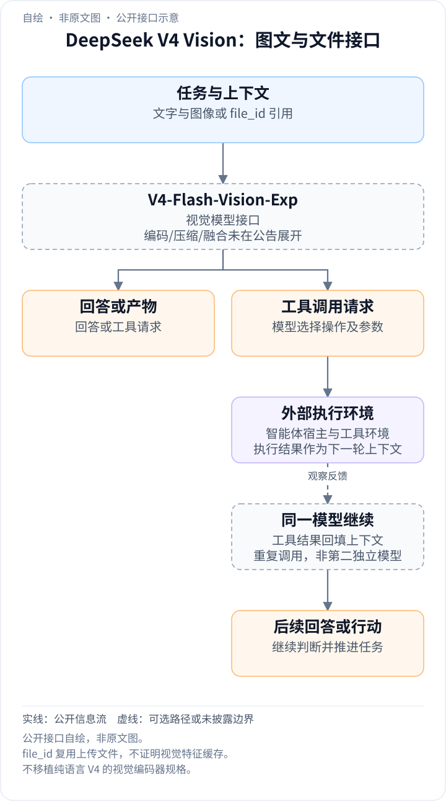
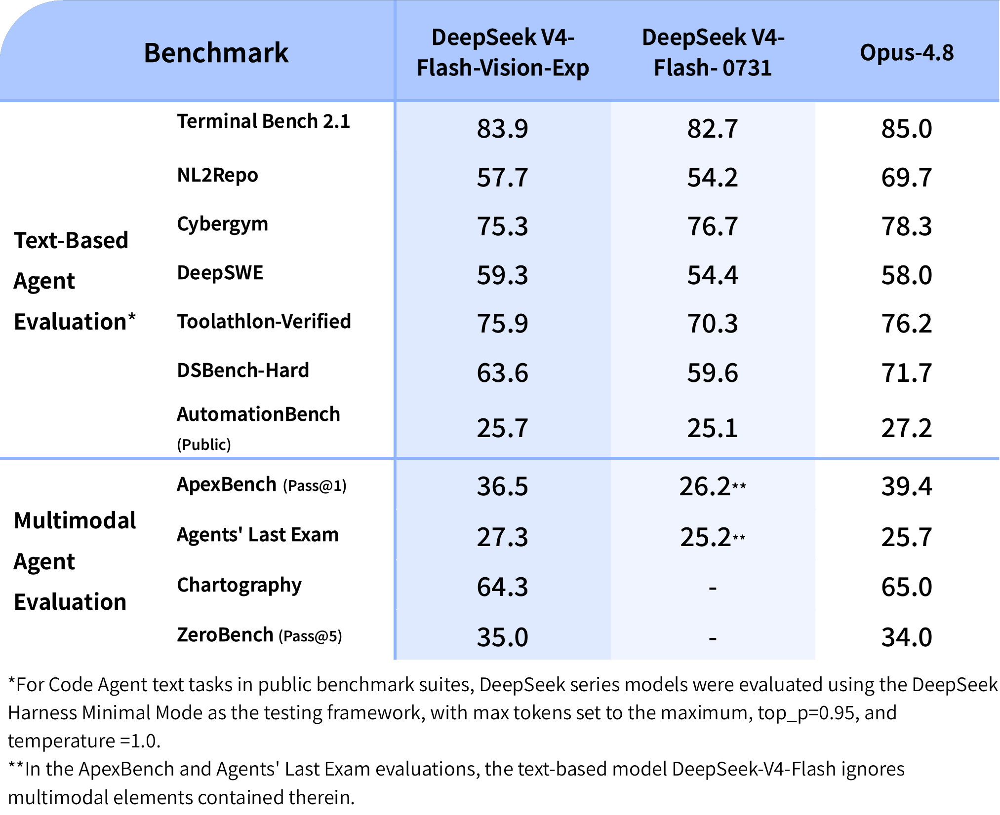

<!-- article-header:start -->
[项目首页](../../../README.md) › [模型系列](../../../reports/model-family-index.md) › [DeepSeek](../README.md)
<!-- article-header:end -->

# DeepSeek-V4-Flash-Vision-Exp：将图像理解接入 V4-Flash 智能体接口

<!-- article-toc:start -->

**本篇目录** · [论文定位](#paper-info) · [快速概览](#overview) · [整体架构](#architecture) · [核心原理](#principles) · [数据构建](#data) · [训练流程](#training) · [实验结果](#experiments)
<!-- article-toc:end -->

## 1. 论文信息与模型定位

| 项目 | 信息 |
|---|---|
| 官方材料 | [DeepSeek-V4-Flash-Vision-Exp Release: Multimodal API Now Live](https://api-docs.deepseek.com/news/news260821/) |
| 发布方与日期 | DeepSeek，2026 年 8 月 21 日 |
| 本文依据版本 | 官方发布页 2026 年 10 月 8 日固定快照及两张原始图片 |
| 材料类型 | 简短发布说明，不是披露完整方法与训练配方的论文 |
| 产品定位 | 保留 V4-Flash 文本与工具使用能力的实验性视觉模型 |
| 输入与接口 | 文字和图像混合输入；Chat Completions、Messages、Responses 接口 |

本条目归入 DeepSeek 家族，与完整 V4 技术报告分开整理。发布页没有提供视觉模型的完整参数规模、视觉编码器、训练语料或训练目标，不能把 V4 文本模型报告中的全部配置直接套在这个实验版本上。

## 2. 快速概览

官方主要主张是：视觉实验模型的文本智能体、推理和知识能力与 V4-Flash 接近，加入视觉后改善多模态智能体任务。调用标识为 `deepseek-v4-flash-vision-exp`；当天发布的 DeepSeek Harness 0.1.1 提供支持。

发布图给出四项多模态智能体测试：ApexBench Pass@1 **36.5**、Agents' Last Exam **27.3**、Chartography **64.3**、ZeroBench Pass@5 **35.0**。它们分别反映不同任务和采样口径，不能直接平均成一个总准确率。官方将整体表现描述为接近 Opus-4.8，但逐项既有领先也有落后。

图像可通过 base64、外部 URL 或 Files API 提供。发布说明给出每张图像最多按 **384 token** 计费，使用当时 V4-Flash 的价格口径。本文只整理固定快照的服务说明，不把它当作当前报价或内部视觉 token 的严格长度。

## 3. 整体架构

<!-- derived-architecture:start -->

*自绘公开接口示意（非原文图）。依据下述公开资料归纳；方框表示功能组件，不代表逐层实现。*

依据：[official-source-snapshot-2026-10-08; Multimodal API support / Files API](https://api-docs.deepseek.com/news/news260821/)。
<!-- derived-architecture:end -->

原文披露的是使用接口和智能体工作流，未给出底层网络结构。可以确定模型接收图文混合输入，并可在智能体框架中结合工具完成工作；尚不能确定它采用何种图像编码、压缩、注意力融合、位置编码、裁剪分辨率或参数冻结方式。

从应用数据流看，用户提供图像和任务文字，智能体框架调用视觉模型，随后结合工具处理任务。Files API 可以先上传一次图像，再用 `file_id` 在后续请求引用。这个机制减少重复上传的网络开销，并不证明不同请求共享了模型中间视觉特征，也不意味着引用的图片不再产生推理或计费成本。

**读图：** 这张长图展示图文、数字、分段路线与视觉设计组成的成品页面，体现发布方希望支持的多模态工作流。图片没有附完整输入提示、工具调用轨迹、执行日志或成功判定，因而不能仅凭它证明模型一次运行就完成所有设计与开发步骤。图中行程和费用是案例内容，不是本仓库提供的旅行建议。

| 模块 | 输入与输出 | 公开机制 |
|---|---|---|
| 图文输入接口 | 文字与base64/URL/file_id图片 → 混合请求 | 支持Chat Completions、Messages、Responses；编码器结构未披露 |
| 视觉语言模型服务 | 混合请求 → 回答或智能体流程所需输出 | 实验视觉版本；具体融合层、分辨率策略和参数量未公开 |
| Files API | 上传图像 → 可重复引用的file_id | 减少重复上传带宽；没有承诺复用模型中间特征 |
| 工具与Harness集成 | 任务、视觉观察和工具结果 → 工作流产物 | 发布页说明Harness0.1.1支持；各框架的执行策略不能视为模型内部结构 |
| 图像计费统计 | 每张图像 → 至多384个计费token | 服务侧公开计费口径，不能等同固定patch数或视觉向量数 |

## 4. 核心创新与数学原理

这份材料的新增内容是视觉能力进入智能体接口，以及一组官方评测和计费说明。它没有公开新的模型公式，不能据接口形态推导其采用了某种特定视觉连接器、视觉压缩损失或强化学习算法。

### 4.1 图文条件进入智能体决策

可用一般条件策略 $`\pi(a\mid x,I,h)`$ 理解应用：行动或输出 $`a`$ 同时依赖任务文字 $`x`$、图片 $`I`$ 和工具历史 $`h`$。这是本文的概念表达，不是原文训练目标。图像信息是否被正确利用，需要具体任务测量，不能由“支持图像输入”自动推定。

新增的实际信息通路是：任务描述之外，模型还能直接利用截图、照片或设计稿中的可见证据，再与工具返回的信息共同决定下一步。页面案例体现的是这种接口能力，但没有给出逐层特征转换，因此不能把同家族文字模型的网络配置直接复制成该视觉版本的确定结构。[发布页：Multimodality unlocks more agent use cases](https://api-docs.deepseek.com/news/news260821/)。

### 4.2 图像计费与输入复用是两个机制

若一次请求包含 $`m`$ 张图像，按发布页所述上限，图像计费 token 的合计可表达为 $`T_{\rm image}\le384m`$。这只是对已披露上限的算术解释，不覆盖文本、输出或其他费用，也不等于内部每幅图恰好有 384 个 patch。原文没有给出图像大小与计费 token 的映射规则。

Files API复用的是已上传文件的引用；计费token表示服务对图像输入计数的方式。前者减少传输字节，后者影响请求用量统计，它们并不等价。若要判断端到端速度，还需要图像读取、预处理、模型预填充和工具执行耗时，而发布页没有提供这样的拆分测量。[发布页：Multimodal API support、Files API](https://api-docs.deepseek.com/news/news260821/)。

### 4.3 评测尝试预算决定成绩的含义

图中 ApexBench 写作 Pass@1，ZeroBench 写作 Pass@5。后者涉及多次尝试的统计口径，不能把 35.0 视为相同协议下的一次成功概率，也不能由该值倒推单次概率；独立同分布假设及具体采样过程未披露。

从接口发布材料能确认支持的输入形式和官方展示任务，但不能恢复评测的完整采样过程、失败重试和工具预算。同一智能体给五次机会与只运行一次的成功统计具有不同含义；比较模型时应先匹配这一协议，再讨论视觉能力是否带来提升。[官方发布与评测图](https://api-docs.deepseek.com/news/news260821/)。

## 5. 数据构建与处理

发布说明没有公开视觉预训练、图文监督、OCR、截图、智能体轨迹或偏好数据的来源、规模和清洗流程。也没有披露图像去重、分辨率分布、数据与基准的交叉污染检查。图片输入支持 base64、URL、文件引用，是部署数据入口，不能把它当作训练数据处理配方。

官方比较表的一条重要注释是：纯文字 V4-Flash 在 ApexBench 和 Agents' Last Exam 中 **忽略多模态元素**。因此它并没有通过额外 OCR 或其他视觉模型取得相同图像信息；视觉实验模型的收益包含获得额外任务信息的因素。两者比较不能孤立证明某个新训练算法本身的贡献。

## 6. 训练流程与目标

原文没有披露阶段顺序、预训练 token 量、SFT 或强化学习目标、学习率、训练步数、批大小、训练硬件和各模块可训练范围。官方称文本能力与 V4-Flash 接近，这一行为结果不说明文本权重必定冻结或模型必须共享完全相同的架构。

DeepSeek Harness 0.1.1 的支持和 Files API 的上线属于部署集成，不是训练阶段。本文没有运行该 API、上传用户图像或复现智能体测试；下列成绩均来自发布方原图。

## 7. 实验设置与主要结果

**读表：** 对照是 **V4-Flash-0731**，不是此后任意更新版本。前七项是文字智能体，后四项是多模态智能体。脚注只明确文字代码智能体任务中 DeepSeek 系列使用 Harness Minimal Mode、最大 token 上限、top_p=0.95、temperature=1.0；不能把该设置无条件扩展给表里所有多模态任务或 Opus。

| 多模态任务 | Vision-Exp | V4-Flash-0731 | Opus-4.8 |
|---|---:|---:|---:|
| ApexBench，Pass@1 | 36.5 | 26.2，忽略图像 | 39.4 |
| Agents' Last Exam | **27.3** | 25.2，忽略图像 | 25.7 |
| Chartography | 64.3 | 未报告 | **65.0** |
| ZeroBench，Pass@5 | **35.0** | 未报告 | 34.0 |

相对 V4-Flash-0731，ApexBench 增加 10.3、Agents' Last Exam 增加 2.1 个分数点。Vision-Exp 在后二者可比的全部四项中，Agents' Last Exam 和 ZeroBench 高于 Opus，ApexBench 和 Chartography 低于 Opus。未报告的 V4-Flash 行用短横表示，不能当成零分。

文字任务中，Vision-Exp / V4-Flash-0731 的 Terminal Bench 2.1 为 **83.9/82.7**，NL2Repo 为 **57.7/54.2**，DeepSWE 为 **59.3/54.4**，Toolathlon-Verified 为 **75.9/70.3**，DSBench-Hard 为 **63.6/59.6**，AutomationBench Public 为 **25.7/25.1**。Cybergym 则为 **75.3/76.7**，说明“文本能力接近”并非每项分数都提高；DeepSWE 的 59.3 也高于表中 Opus 的 58.0，而 NL2Repo 仍低于 Opus 的 69.7。

发布页未给出评测样本数、置信区间、完整工具环境、推理时间预算和多模态任务细节，也没有通用 OCR、文档或图像问答成绩表。这份材料能够支持“官方实验展示视觉输入改善部分智能体任务”，尚不能支持“完整视觉架构已公开”“通用视觉理解全面领先”或“低计费 token 已证明高分辨率图像无损压缩”等更强结论。

<!-- article-footer:start -->
---

[← 上一篇：Qwen3.8-Max](../../qwen/document-ebaf67f69f80/README.md) · [按发表时间浏览](../../../reports/paper-reading-guide.md#year-2026) · [下一篇：GLM-5.3-Flash →](../../glm/document-e213666dcb0d/README.md)

[返回本篇目录](#article-toc) · [返回模型系列](../README.md)
<!-- article-footer:end -->
