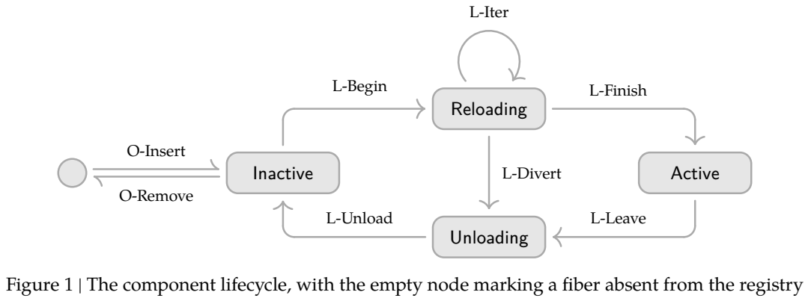
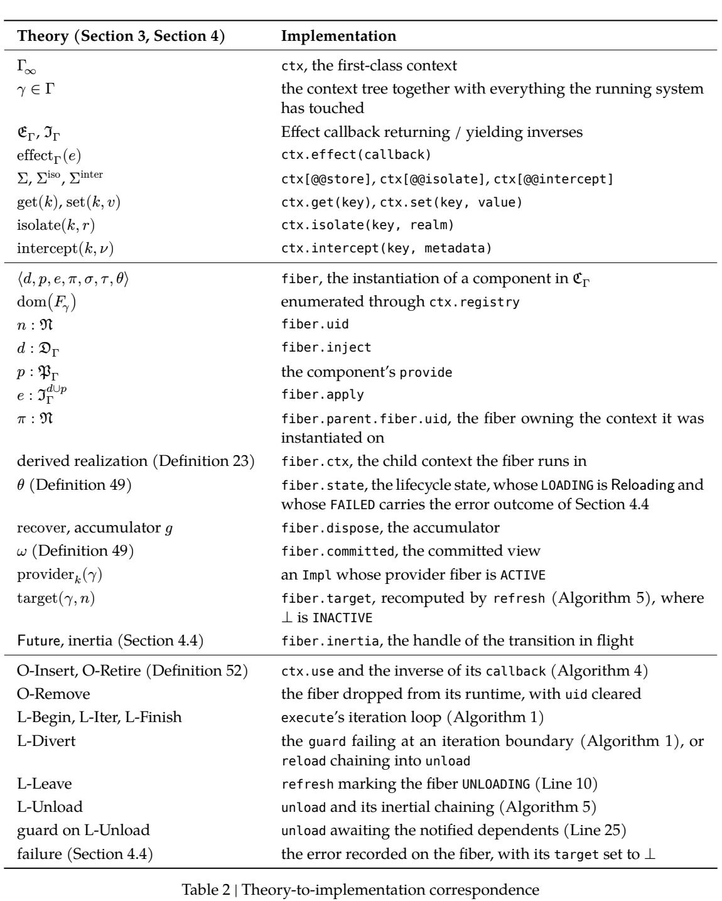

<!-- article-header:start -->
[项目首页](../../../README.md) › [模型系列](../../../reports/model-family-index.md) › [DeepSeek](../README.md)
<!-- article-header:end -->

# DeepSeek Harness 来源核验：Cordis 的时空可组合编程范式

<!-- article-toc:start -->
<a id="article-toc"></a>

**本篇目录** · [论文定位](#paper-info) · [快速概览](#overview) · [整体架构](#architecture) · [核心原理](#principles) · [数据构建](#data) · [训练流程](#training) · [实验结果](#experiments)
<!-- article-toc:end -->

<a id="paper-info"></a>

## 1. 论文信息与模型定位

| 项目 | 核验结果 |
|---|---|
| 原目录条目 | DeepSeek Harness；链接指向 `cordiverse/paper` 的论文 |
| 实际标题 | **A Programming Paradigm for Spatiotemporal Composability** |
| 作者 | Yifan Shi（Peking University、DeepSeek-AI），Wei Zhang（Peking University），Tianyi Cui（DeepSeek-AI） |
| 固定原文 | [arXiv 2608.25512v1](https://arxiv.org/abs/2608.25512v1)，92 页 PDF |
| 实际对象 | **Cordis** 动态组件元框架，属于工具与平台支持材料 |

本文按实际原论文介绍。作者含 DeepSeek-AI 成员，原目录使用 Harness 名称，但正文没有介绍名为 DeepSeek Harness 的多模态模型、模型权重或训练配方。它研究插件及智能体运行环境如何在服务继续运行时添加、撤销和替换组件，为构建 harness 提供软件基础。

<a id="overview"></a>

## 2. 快速概览

时间可组合性要求：卸载组件时撤销它在系统内部留下的修改。空间可组合性要求：组件声明依赖，并随依赖出现、消失和更换而自动调整生命周期。论文将经典 effects 与 coeffects 概念转成运行时机制，再用统一上下文连接它们。

核心贡献是可撤销副作用、响应式依赖、上下文范式及动态组合演算。实现采用 TypeScript，提供核心库、声明式组件加载器和热模块替换；Koishi 是实际生态案例。评证主要为形式化论证和观察性案例，没有模型能力基准、受控吞吐比较或训练实验。

<a id="architecture"></a>

## 3. 整体架构

系统分三层。核心库跟踪副作用、解析依赖并管理实例生命周期；加载器将持久化配置变为组件实例，并在配置或源文件改变时增量协调；应用框架在上层定义数据库、通信适配器、界面等领域功能。核心不预设某一种智能体或模态。

组件声明需要的键集合 $`d`$、可能提供的键集合 $`p`$，以及执行函数 $`e`$。组件实例称为 fiber，记录父实例、提供的绑定、撤销累积器及已经提交的依赖视图。上下文依赖访问通过代理中介，而不是任意读取一个会不断变化的全局对象；卸载中的消费者仍沿其提交视图完成清理。



**读图：Figure 1，PDF 第 34 页。** 四个状态是 Inactive、Reloading、Active、Unloading。加载过程可以逐步执行，也可以在依赖改变时转入卸载。外部编排器只请求插入或退休，生命周期规则决定实际激活与清理；图省略了在所有状态上设置退休标志的 O-Retire 自环。退休不等于立即删掉对象，否则会丢失清理记录。

| 模块 | 输入与输出 | 公开机制 |
|---|---|---|
| 核心上下文 | 组件声明与环境绑定 → 依赖视图 | 以键到值的上下文表达依赖，并中介组件访问 |
| 副作用跟踪 | 上下文变换及disposer → 累积撤销器 | 按执行相反顺序组合清理；组件须提供满足条件的逆 |
| 依赖解析与fiber生命周期 | 需求集合与绑定变化 → 激活/卸载状态 | 区分Inactive、Reloading、Active、Unloading，并保存已提交依赖视图 |
| 声明式加载器 | 配置/源文件变化 → 实例增量协调 | 在核心机制上实现配置协调和热模块替换 |
| 领域应用框架 | 受管理的组件 → 数据库、适配器与界面服务 | 在同一运行时组织可组合应用；本身不是一个神经网络模型 |

<a id="principles"></a>

## 4. 核心创新与数学原理

### 4.1 可撤销副作用：把修改与清理一起组合

原文 Section 3.1 将副作用表示为“状态变换及其逆”的对。这里逆主要指**左逆**，并非要求每个操作可双向无损互换。对变换的组合采用 Equation 4：

```math
(f_1,g_1)\circ(f_2,g_2)=(f_1\circ f_2,g_2\circ g_1).
```

正向按通常函数复合执行，撤销次序相反。其跟踪状态是 $`\partial\Gamma=\Gamma\times(\Gamma\to\Gamma)`$；Equation 6 把当前状态与既有撤销器 $`(\gamma,\varphi)`$ 更新为

```math
\mathrm{track}(f,g)(\gamma,\varphi)=(f(\gamma),\varphi\circ g).
```

这使多步修改能被累计为统一清理操作。实际实现由回调返回或迭代器逐步产生 disposer，运行时负责收集与调用；**它不验证用户提供的逆是否正确**，这是组件作者须满足的义务（PDF 第 59 页）。

以“注册监听器，再建立连接”为理解例子，清理时应先关闭连接、再移除监听器。这个例子说明LIFO组合为何重要，不是论文实测任务。迭代器版本允许组件在多步加载之间暴露暂停边界；运行时只撤销已发生的步骤，无须假定整个初始化函数瞬间完成。[§3.1、Eq18–19，PDF第9、16页](https://arxiv.org/pdf/2608.25512v1#page=16)。

### 4.2 响应式依赖：由满足关系驱动组件生命周期

依赖上下文 $`\sigma`$ 是键到类型相符值的有限部分函数。Equation 22 的满足关系为 $`\sigma\models d\iff\forall k\in d,\ k\in\mathrm{dom}(\sigma)`$。每次变化按满足关系从假到真、真到假或不变，分类为激活、停用或中性。隔离 realm 允许同一个逻辑键在不同上下文解析到不同提供者；interception 在访问时合并元数据，从而约束依赖使用。

依赖声明把“缺少资源时是否可以运行”变成可检查条件。一个新绑定可能使等待组件启动，一个绑定退出可能使消费者进入清理；不相关键变化则不必重启所有组件。配置协调因此可以在细粒度实例上进行，而非依赖重启整个进程来恢复一致状态。[§1.3、§3.2，PDF第6、16页](https://arxiv.org/pdf/2608.25512v1#page=6)。

### 4.3 上下文中介：用观察等价限定组合保证

统一上下文的“恢复”按**观察等价**理解（Section 3.3）：释放内存无须把分配器物理布局恢复为过去的字节状态，而是恢复上下文操作可观察的行为。组件之间无干扰还依赖中介访问、独立操作等前提；不能从这些定理推出任意 JavaScript 代码、外部网络写入或恶意插件自动可逆。

统一接口的作用是使副作用与依赖使用遵循同一套可观察规则。如果组件绕开接口直接改写外部状态，运行时既可能无法记录，也可能无法安全撤回。报告的形式化条件因此决定了保证的适用域；将这种软件组合理论类比为模型的思维链或强化学习回滚，会混淆系统语义与神经网络训练。[§3引言，PDF第9页](https://arxiv.org/pdf/2608.25512v1#page=9)。

<a id="data"></a>

## 5. 数据构建与处理

本论文没有多模态训练语料。它处理的是配置树、依赖表、实例注册表及源模块的导入图。配置条目包含稳定 `id`、模块 `url`、隔离和拦截配置、领域 `config`、`disabled` 标志（PDF 第 65 页）。稳定 id 用于比较前后配置，组组件按子条目 id 增量创建、撤销或更新实例，避免每次变化整树重建。

热更新先沿导入图确定哪些模块接受传播，哪些是边界；再找出引用受影响模块的配置条目。缓存备份作为回滚输入。此处“数据处理”是运行时元数据协调，原文没有将对话、图像或视频收集为训练样本，也未报告其标注、去重或 token 规模。

<a id="training"></a>

## 6. 训练流程与目标

这里没有梯度训练、损失函数或 GPU 配方。对应的工程流程为：声明组件依赖和提供项；用上下文 API 生成可追踪副作用；依赖满足时加载实例；依赖变化或退休时先使消费者停止并完成清理，再撤销提供者；配置变更后使系统回到与目标配置相符的静止状态。



**读图：Table 2，PDF 第 58 页。** `ctx.effect` 对应副作用跟踪，`ctx.set/get` 对应依赖提供与解析，`ctx.use` 对应实例化，`fiber.dispose` 对应撤销累积器。表中的依赖已提交视图和卸载等待，说明实现除了“调用清理回调”，还必须协调提供者和消费者的撤销顺序。

加载器按字段选择不同变更路径：模块身份改变需重建；拦截元数据可在访问时生效；隔离变化重新解析；领域配置交给组件判断是否重载。热更新依次做传播判定、过期条目识别和事务式重载；导入失败时恢复旧缓存并用旧模块重建受影响实例（Algorithms 8–10）。这是上下文范围内的回滚，不能撤回已经发出的外部消息。

<a id="experiments"></a>

## 7. 实验设置与主要结果


**Algorithm 10 与 Section 5.3，PDF 第 69 页。** Algorithm 10 说明出现异常时如何恢复模块缓存并重新实例化旧代码，Section 5.3 则介绍 Koishi 案例。它们描述一种实现与使用证据，没有模型评分表，不能把“回滚算法存在”当作已完成所有故障场景测试。 [原文](<https://arxiv.org/pdf/2608.25512v1#page=69>)。

形式化部分给出保持性、时间与空间可组合性、进展及合流方面的论证（Section 4.3）。其约束包括：修改必须经上下文中介，逆函数满足恢复义务，组件声明符合实际访问；核心演算将提供键视为单来源，隔离与服务 broker 是进一步扩展。这些是有前提的理论保证，本文未独立机械验证全部证明。

案例报告 Koishi 四年积累超过 **4000 个社区插件**，在服务器与网页控制台两个环境中使用相同组合原语。作者观察到插件卸载、源文件保存后重载和依赖提供者替换能够只影响有关组件。重要的版本限定是：**现有 Koishi 使用 Cordis v3，论文展示 v4**；共同的是核心组合模型，不能把四年生态都称为 v4 实测。

Section 5.3 明确承认证据来自单一生态、单一宿主语言，是存在与采用的案例，而非对照实验。运行开销、开发效率的定量比较仍是未来工作。Section 6 又限定：系统无法独占并恢复的外部状态不在恢复边界内；语言层访问控制不能替代恶意插件沙箱；依赖键的接口漂移和版本兼容还未完全解决。因此该文适合作为动态插件与智能体基础设施的技术材料，不能用于证明多模态模型准确率、安全性或自我进化的实际提升。

<!-- article-footer:start -->
---

[← 上一篇：Qwen-MM-Plugins](../../qwen/document-0aebb3826b29/README.md) · [按发表时间浏览](../../../reports/paper-reading-guide.md#year-2026) · [下一篇：Qwen3.8-Max →](../../qwen/document-ebaf67f69f80/README.md)

[返回本篇目录](#article-toc) · [返回模型系列](../README.md)
<!-- article-footer:end -->
