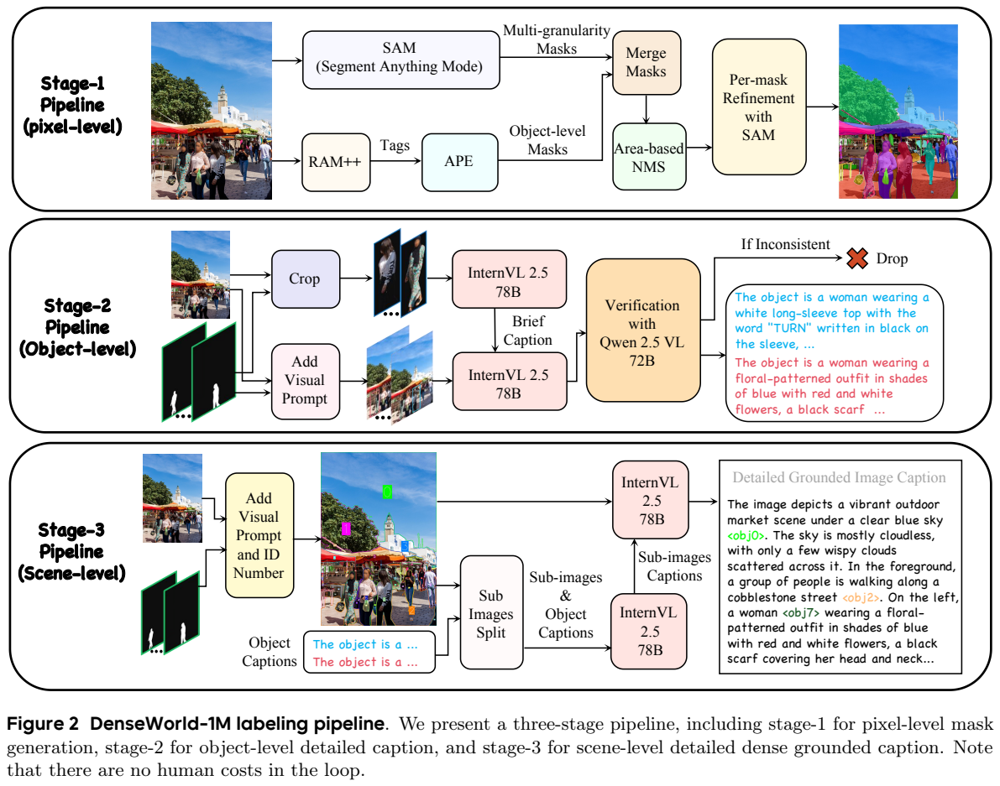
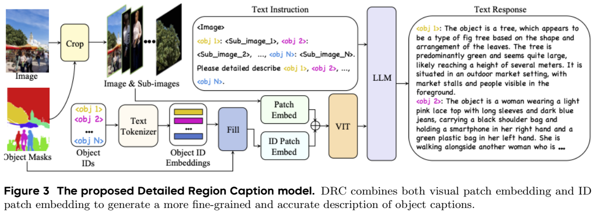
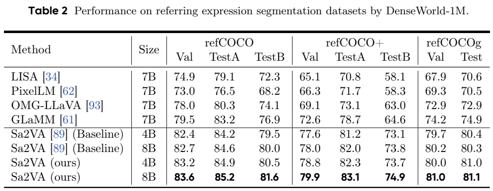
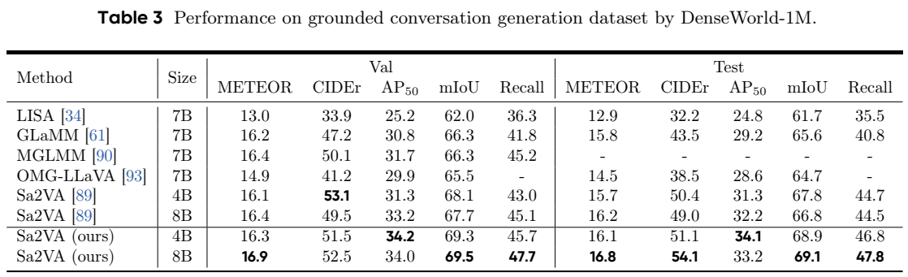
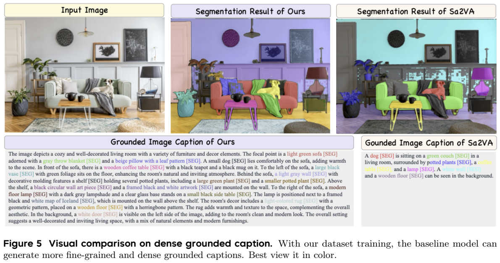
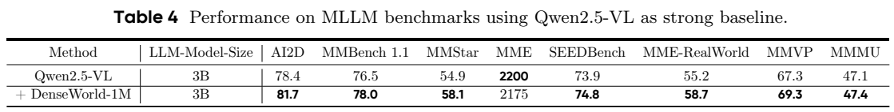

<!-- article-header:start -->
[项目首页](../../../README.md) › [模型系列](../../../reports/model-family-index.md) › [DenseWorld-1M](../README.md)
<!-- article-header:end -->

# DenseWorld-1M：从像素掩码到对象细节与场景关系的密集描述

<!-- article-toc:start -->

**本篇目录** · [论文定位](#paper-info) · [快速概览](#overview) · [整体架构](#architecture) · [核心原理](#principles) · [数据构建](#data) · [训练流程](#training) · [实验结果](#experiments)
<!-- article-toc:end -->

## 1. 论文信息与模型定位

**论文**：*DenseWorld-1M: Towards Detailed Dense Grounded Caption in the Real World*，Xiangtai Li、Tao Zhang、Yanwei Li 等，ByteDance Seed、武汉大学与北京大学。本文依据 [arXiv:2506.24102v1](https://arxiv.org/abs/2506.24102v1)，2025 年 6 月；[官方仓库](https://github.com/lxtGH/DenseWorld-1M)。

本文以数据集为中心：一百万张真实图像附带像素掩码、对象描述和带对象绑定的场景描述。它还训练两个标注模型，DRC（Detailed Region Caption）负责对象细节，SCM（Spatial Caption Merging）负责融合为场景描述。报告部分段落把后者写成 SPM，本文统一沿用 SCM，不将其视为另一模型。

目标是让图像描述覆盖大量对象，并把文本内容关联到实际区域。普通长描述可能仍漏掉小物体、混淆同类实例，甚至无法指出文字对应哪个掩码；DenseWorld 尝试在数据制作阶段解决这些问题。（PDF 第 1–4 页）

## 2. 快速概览

| 内容 | 论文设计 |
|---|---|
| 资源规模 | 1M 场景描述、23.1M 对象描述、23.6M 掩码 |
| 图像来源 | SAM-1B、Objects365、V3Det |
| 三层管线 | 像素级掩码 → 对象级细节 → 场景级融合 |
| 原标注模型 | RAM++、APE、SAM；InternVL2.5-78B 与 Qwen2.5-VL-72B |
| 加速模型 | 基于 Qwen2.5-VL 的 3B DRC；基于 InternVL3-8B 的 SCM |
| 数据迭代 | 前 600K 图像训练标注模型，继续标注 400K |
| 验证对象 | Sa2VA、Qwen2.5-VL、改造的 LLaVA 系统 |

对象描述平均 111.4 词，场景描述平均 458.4 词。词、字符和 token 是不同单位，不能把 Table 1 的“超过 150 token 的详细描述”定义误当成所有对象都平均超过 150 词。（PDF 第 3、11 页）

## 3. 整体架构

*从上往下分别是掩码、对象描述和场景描述。第二层同时使用裁剪图与原图中的视觉提示，右侧验证器丢弃不一致描述；第三层通过对象 ID 把文字重新绑定到区域。裁图保留了原图说明与掩码处理条件。*

像素层先由 RAM++ 产生类别标签，引导 APE 做开放词汇分割；SAM 的多粒度掩码补足遗漏。合并与面积优先的 NMS 抑制重复对象，再用当前掩码生成点提示，调用 SAM 精修。

对象层先裁剪目标，利用 InternVL2.5-78B 得到类别与主要外观；再把简短描述、原图及目标视觉提示一起输入模型，生成包含上下文关系的详细描述。Qwen2.5-VL-72B 作为检查器过滤不一致结果。这样既有局部细节，也能保留裁剪图之外的关系。（PDF 第 5–6 页）

场景层输入各对象的描述和带 ID 的图像，生成连贯文本。复杂场景对象多于约 15 个时，先拆成子图描述再合并，减少只保留主角的问题。它是一套标注流水线，不是把所有这些大模型同时安装成一个最终聊天模型。（PDF 第 6 页）

## 4. 核心创新与数学原理

*DRC 上路是原图与对象裁剪图，下路把对象 ID 的文本嵌入填入掩码，经 ID Patch Embed 后，与视觉 patch 嵌入相加再进入 ViT。这里的绑定在特征编码早期发生，并非只在原图上写数字让模型自行辨认。*

DRC 用两种信息指向同一实例：裁剪图提供该实例的外观特征，ID 嵌入提供其在原图的空间范围。每个对象随机分配特殊 token，获取它的文字嵌入，填入对应掩码；不重叠 patch 的二维卷积将其转换为 ID patch 特征，与视觉 patch 相加。

为解释这种操作，可记 $U(x,y)=\sum_i m_i(x,y)e_i$，$\tilde P=P_{\mathrm{vision}}+\operatorname{Conv}_{\mathrm{ID}}(U)$。其中 $m_i$ 为对象掩码，$e_i$ 为对象 ID 嵌入。这是本文对实现的解释写法，原论文没有给出这一数学式，也未提出额外 ID 对比损失。随机 ID 帮助模型关注“标签与区域的对应”，而不是让某个固定数字永久代表某类对象。（PDF 第 7 页）

像素层的过滤条件同样具体：若一个掩码完整包含于另一个、且二者 IoU > 0.5，则保留较大掩码；随后按面积而非置信度优先去重。该规则对抑制“人物与其上半身”的重复有用，也可能丢弃细粒度部件，因此不能写成对任意层级对象都保留完整语义的保证。（PDF 第 5 页）

SCM 则直接微调 InternVL3-8B，不改变其架构，学习把图像、掩码视觉提示、ID 与对象描述融合为一段带绑定的文本。论文强调数据分解和较小标注模型的效用，而非新建复杂区域特征提取网络。（PDF 第 7 页）

## 5. 数据构建与处理

三种图像来源互补：SAM-1B 提供高分辨率场景，Objects365 提供常见对象，V3Det 提供较大类别词汇。模型自动生成标注，作者称标注循环没有人工成本；这指自动标注流程，不是声称项目完全没有人工设计和评测。

前 600K 图像通过大型模型管线产生训练标注，再训练 DRC/SCM，用其继续制作 400K，即约 40% 数据由加速模型参与。最终统计中掩码数比对象描述数略多，应分别保留 23.6M 与 23.1M，而不能假定每个掩码都有唯一成功描述。Table 7 的场景描述平均 2,813.1 字符、458.4 词、20.5 句；对象描述平均 673.4 字符、111.4 词、4.5 句。（PDF 第 3、6、11 页）

过滤依赖模型间一致性，能够减少明显不匹配，但检查器与生成器仍可能共享错误。可视化案例说明细节丰富度，不能据此推成整套数据逐条人工准确率。报告没有给出全数据对象级错误率、验证器阈值或完整来源采样比例。

训练下游分割模型时，对象描述可改写为“请分割该描述对应对象”；场景描述用于带掩码的对话生成。图像级模型则使用场景长描述，不需要它们直接预测全部像素掩码。（PDF 第 11–13 页）

## 6. 训练流程与目标

DRC/SCM 从已有多模态模型初始化，以大型模型管线输出作监督。该流程属于学习生成标注文本，没有披露强化学习或过程奖励。DRC 架构实验另用 Osprey-724K 微调进行公平比较，不能把这组结果写成使用 DenseWorld 全量数据的效果。（PDF 第 6–7、9–10 页）

下游验证有不同配方：Sa2VA 先用 DenseWorld 的对象与场景数据训练，再按原 Sa2VA 配方使用任务训练集微调；其测试不是零样本迁移。LLaVA 实验换用 Qwen2.5 语言骨干并加入 InternVL 式图像切块。预训练首先只更新 MLP，再使用 DenseWorld 通过 LoRA 更新视觉编码器与 LLM；SFT 阶段同样以 LoRA 更新二者并训练全部 MLP。（PDF 第 12–13 页）

Qwen2.5-VL 后训练将 DenseWorld 与 MAmmoTH-VL-Instruct-12M 的抽样数据按 1:2 混合，总计 3M，沿用官方仓库默认参数；用 VLMEvalKit 评测，不额外调用 API 帮助答案处理。由于基线是原始 Qwen2.5-VL，这组比较同时包含新增训练与另一数据源，不能把全部增益严格归因于 DenseWorld 单独加入。（PDF 第 13 页）

报告引用既有默认训练设置，但未完整列本次学习率、batch、步数、LoRA rank、GPU 数量或训练耗时。本文不将原基座的常见参数补为实测配方。生成目标可理解为给定图像、区域/ID 与指令后，拟合标注回答的 token；这是机制解读，原文没有展示新损失公式。

## 7. 实验设置与主要结果

*上表测试指代表达分割，下表把文字质量、定位与掩码质量分列。关注同一规模 Sa2VA 的前后变化，避免用 4B 与 8B 的差异混淆数据效果。*

Sa2VA-8B 的 RefCOCO/+/g 验证集从 82.7/78.0/80.2 到 83.6/79.9/81.0。GCG 测试中 METEOR/CIDEr/AP50/mIoU/Recall 从 16.2/49.0/32.2/66.8/44.5 到 16.8/54.1/33.2/69.1/47.8。4B 验证集 CIDEr 却从 53.1 降至 51.5，说明较长描述未必同时改善每个基于文字重叠的指标。（PDF 第 8、12 页）

*Figure 5 将原图、训练后的掩码与原 Sa2VA 结果并列，下方文本用颜色关联对象。Table 4 才是跨样本量化结果；长篇描述案例不能替代这些指标。*

Qwen2.5-VL-3B 后训练的 AI2D 从 78.4 到 81.7、MMStar 54.9 到 58.1、MME-RealWorld 55.2 到 58.7；MME 从 2,200 降至 2,175，因此正文“八项一致改善”与原表不完全相符。改造后的 LLaVA-3B MMMU 从 36.9 到 44.8；7B 的多数指标提高，但 MME 1,943 降至 1,909。（PDF 第 9–10、12 页）

DRC 在 RefCOCOg 区域描述得到 CIDEr 116.6、METEOR 16.9；对比 Osprey 为 108.3、16.6。标注速度在 1,000 张 SAM 图像、LMDeploy 与单张 A100-80G 条件下比较：对象层约 3.2 分钟/图降至 1.1 分钟，场景层 2.6 分钟降至 31 秒。它是该推理设置的流水线速度，不是训练加速倍数。SCM 另做 100 例、20 多位评审的偏好研究，正文称质量接近大模型管线，却未给出完整数值表，本文不补造胜率。（PDF 第 9–10 页）

这组证据支持密集区域绑定数据的价值，也显示自动标注与长描述评测仍有边界。本文核验原文与原图，未生成新数据、训练标注器或重跑下游测试。

<!-- article-footer:start -->
---

[← 上一篇：Qwen VLo](../../qwen/document-244376c2123a/README.md) · [按发表时间浏览](../../../reports/paper-reading-guide.md#year-2025) · [下一篇：GLM-4.1V-Thinking →](../../glm/arxiv-2507.01006/README.md)

[返回本篇目录](#article-toc) · [返回模型系列](../README.md)
<!-- article-footer:end -->
