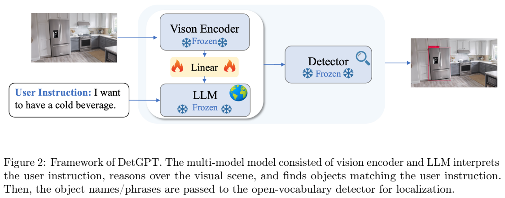
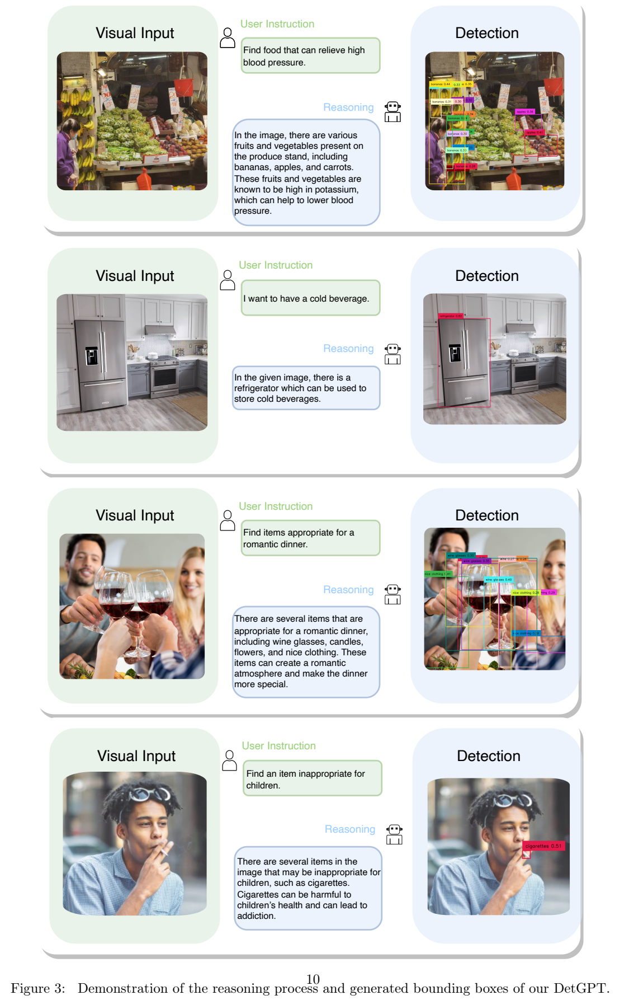
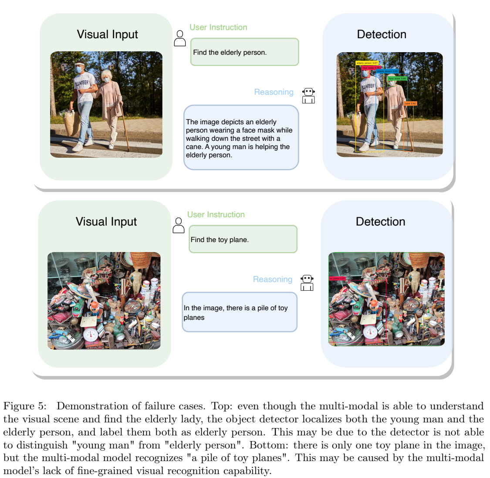

<!-- article-header:start -->
[项目首页](../../../README.md) › [模型系列](../../../reports/model-family-index.md) › [DetGPT](../README.md)
<!-- article-header:end -->

# DetGPT：从用户目标推理待检测对象，再交给开放词表检测器

<!-- article-toc:start -->

**本篇目录** · [论文定位](#paper-info) · [快速概览](#overview) · [整体架构](#architecture) · [核心原理](#principles) · [数据构建](#data) · [训练流程](#training) · [实验结果](#experiments)
<!-- article-toc:end -->

## 1. 论文信息与模型定位

原论文 **DetGPT: Detect What You Need via Reasoning** 由 Renjie Pi、Jiahui Gao、Shizhe Diao 等作者提出，机构为香港科技大学、香港大学、上海交通大学。本文依据 [arXiv 2305.14167v1](https://arxiv.org/pdf/2305.14167v1)，提交日期为 2023 年 5 月 23 日；PDF 首页标注 5 月 24 日。[项目页面](https://detgpt.github.io)是论文给出的公开入口。

DetGPT 探索“基于推理的目标检测”：用户可以表达“我想喝冷饮”，而不必直接说“检测冰箱”。系统理解图片与需求，列出能满足目标的可见对象，再输出其位置。其语言底座为 Vicuna 13B，视觉部分来自 BLIP-2，定位由 GroundingDINO 执行。因此它是一条组合系统管线，并非一个直接预测全部框的端到端新基础模型，也没有展示完整机器人执行或自动驾驶闭环。

## 2. 快速概览

两阶段推理分别处理“应该找什么”和“对象在哪里”。首先多模态模型给出场景描述、理由及目标名称；其次解析目标名称，将原图和名称发送到开放词表检测器。即使用户未提对象名，语言模型也可借助常识选择图中工具或容器，例如冷饮没有直接可见时建议寻找冰箱。

作者用 COCO 的 5,000 张图构造约 30,000 条目标导向问答。ChatGPT 不直接读取图片，而是读取原图片标题和对象类别，生成推理回答，再用于指令训练。两个训练阶段都只更新视觉—语言间的线性映射，视觉模型、Vicuna 和检测器保持冻结。

本版本的结果主要是案例展示，没有提供标准 mAP、问答准确率、人工成功率、推理速度或组件消融。因而可肯定其任务定义和组合实现，但无法从论文获得“比某检测器提高多少”“在实际机器人上成功率多少”的量化结论。

## 3. 整体架构

*Figure 2，PDF 第 5 页。雪花标记表示冻结模块，火焰只位于线性映射层。*

视觉编码器从图片产生表示，线性层将表示映射到 Vicuna 能处理的文本嵌入空间；图片表示与用户指令共同作为多模态模型输入。模型生成几个句子的解释，并以规定字符串结束：`Therefore the answer is: [object_names]`。系统从该末尾列表提取名字或短语，再调用 GroundingDINO。

图中冰箱例子体现两个不同判断：前端依据需求选择“冰箱”，后端依据词语在图片中预测冰箱框。框由后端检测器输出，前端语言模型本身没有预测坐标。两者也没有通过框特征反复往返交流；模型生成错误名称时，检测器通常只能继续寻找这个错误目标，不能自动纠正前端推理。

该系统复用 MiniGPT-4 式视觉语言连接，报告称视觉编码器采用 BLIP-2，语言底座为 13B Vicuna，映射为线性层。报告未逐项写出视觉 token 数、Q-Former 配置或精确系统总参数，因此本文不根据所引用模型的常见实现补写这些数值。

## 4. 核心创新与数学原理

创新首先在任务接口：把检测词表从用户直接输入的类别，变为根据用户目标与图像推导出的类别集合。可以用解释性形式 $`S=G(I,q)`$、$`B=D(I,S)`$ 表示，$`G`$ 负责生成目标列表，$`D`$ 负责定位。这是对方法的简写，并非原论文独立提出的概率模型。

论文 Equation 1 使用回答 token 的语言建模负对数似然训练映射。按易读记号整理为

$$\mathcal L=-\sum_{t=1}^{L}\log p_\theta(y_t\mid I,q,y_{<t}),$$

其中 $`I`$ 是图片，$`q`$ 是输入指令，$`y_t`$ 是相应回答第 $`t`$ 个 token，$`L`$ 为回答长度；训练更新的 $`\theta`$ 对应线性连接参数。原公式把多模态计算写作 $`F`$，本文将用户指令条件显式写入，以对应其训练输入描述。预测内容包括推理文字和目标名，没有新增针对目标框的监督损失。

提示设计同样是重要组成部分。推理阶段的系统提示要求依次描述图片、解释相关对象为什么符合需求、以固定列表收尾；用户侧也追加格式约束。这样的格式提高名称提取稳定性，但“输出了合理解释”不自动代表推理忠实，也不能保证对象确实出现。正则式或字符串解析只解决结构接口问题。

“可能有冷饮的冰箱”还体现常识推断与直接可见证据的区别：检测到冰箱不证明其内部确有冷饮。系统所做的是定位一个与目标有关的可见对象，论文没有报告检查隐藏内容的能力。这种关系应在理解应用边界时保留。

## 5. 数据构建与处理

对齐数据使用 SBU、LAION 与 Conceptual Caption 的组合，沿用 MiniGPT-4 的训练思路。随后构造的任务数据基于 COCO 的图像标题和对象标注，共 5,000 张图、约 30,000 条问答；COCO 的常见对象类别为 80 类，不能把它写成 30,000 张独立图片。

数据生成给纯文本 ChatGPT 两种信息：同一图片的多句描述与图中对象类别。模型先扩写场景，再生成多种目标导向查询与回答。附录提供两个人工设计的上下文示例，帮助输出围绕现有对象的问答。论文 Table 4 要求相关对象来自已有描述或类别，对颜色、形状等属性仅在源文字明确时生成问题。

例如桌面场景可产生“我要打电话”“有哪些电子设备”“什么可以打字”等不同需求，最终对应电话、显示器、键盘等名称。这比只给每类对象写一条检测指令更贴近用户目标，但覆盖仍受标题和标注限制。ChatGPT 未直接看图，无法自行核实描述遗漏、属性错误或细粒度空间关系；论文没有完整披露人工复核比例、去重规则及生成标注错误率。

任务训练学到的主要是将需求映射到可见类别并按规定格式回答。对训练类别之外对象的演示仍依赖预训练语言/视觉知识和开放词表检测器，不能据 COCO 数据有限就称所有新类都能可靠零样本检测。

## 6. 训练流程与目标

第一阶段图文对齐只训练线性连接，冻结其他模块。BLIP-2 的既有表示提供视觉语言基础，映射使它能进入新的 Vicuna 嵌入空间。第二阶段用合成任务问答继续只训练该连接层，以 Equation 1 监督目标选择、解释与输出格式。GroundingDINO 没有在这批任务数据上联合微调。

训练输入包含图片占位、用户指令和格式提示，回答为监督目标。固定格式提示在训练和推理都使用。第三步“推理”属于运行流程，不是第三个参数训练阶段；此时解析列表并调用检测器。

原报告没有给出完整学习率、批量、训练步数、epoch、显卡与耗时，也没有检测置信度阈值、随机种子和完整推理解码配置。需要复现时必须另检查官方实现与配置；本文只依据报告固定版本介绍，不能将后续仓库设置写成论文已经披露的超参数。

## 7. 实验设置与主要结果

*Figure 3，PDF 第 10 页，每行依次为输入图、用户需求/解释、检测框。*

冷饮案例中，语言模型选择冰箱，右侧检测器给出冰箱区域；儿童不适宜物品案例选择香烟；浪漫晚餐案例尝试寻找酒杯等物品。这些图展示需求到名称到位置的流程。Figure 3 还含食品与健康相关的生成解释，它只是论文模型输出示例，未经过该论文的医学准确性验证，不应将这段生成文字当作研究确认的健康结论。

Figure 4 进一步展示游戏截图、潜在危险等案例，作者将其视为超出 COCO 类别的泛化表现。不过没有独立统计样本数、总体错误率或与基线对照；这些图最多支持“在部分展示案例中能运行”，不能据此推断通用开放世界成功率。

*Figure 5，PDF 第 12 页。上部定位错误来自检测阶段，下部描述错误来自多模态阶段。*

老人案例的前端文字识别出老人和帮助她的年轻人，但检测器将两人都匹配为老人，说明同类人的细粒度属性判断可能失败。玩具飞机案例的前端把一架玩具飞机说成一堆，反映复杂杂乱场景的细节识别不足。两种错误沿组合管线传递，证明“名称选择正确”和“框正确”需要分别核验。

论文没有提供可抄录的量化主结果表，也没有单独验证固定提示、合成数据与各模块的贡献。它的价值在于提出目标导向检测任务和可复用的两阶段实现；其可靠性仍受前端视觉理解、常识推断、格式解析和后端开放词表定位共同限制。后续若用于应用，应按这几类失败分别测量，而不是仅检查解释是否通顺。

<!-- article-footer:start -->
---

[← 上一篇：Pengi](../../pengi/arxiv-2305.11834/README.md) · [按发表时间浏览](../../../reports/paper-reading-guide.md#year-2023) · [下一篇：LaVIN →](../../lavin/arxiv-2305.15023/README.md)

[返回本篇目录](#article-toc) · [返回模型系列](../README.md)
<!-- article-footer:end -->
