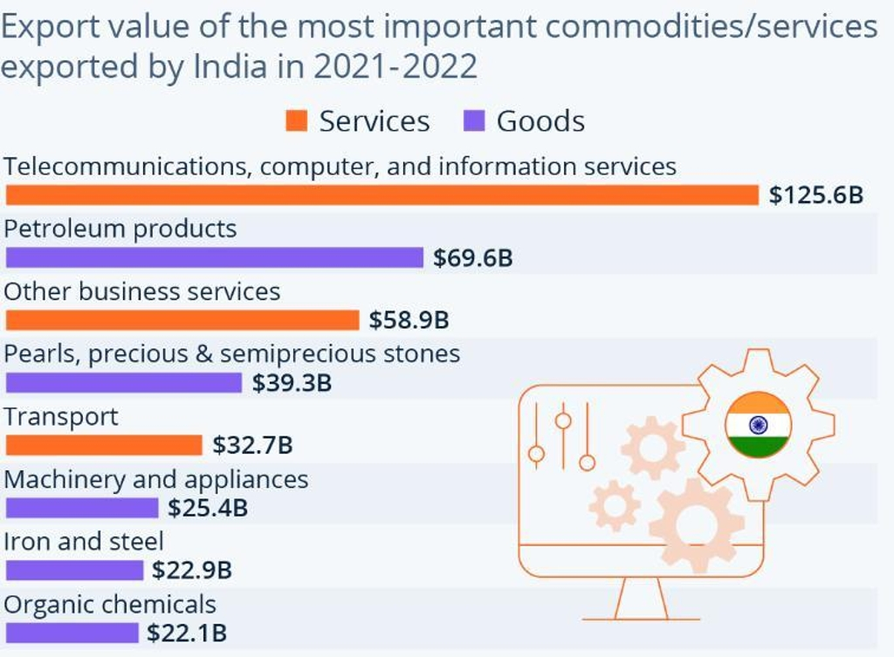
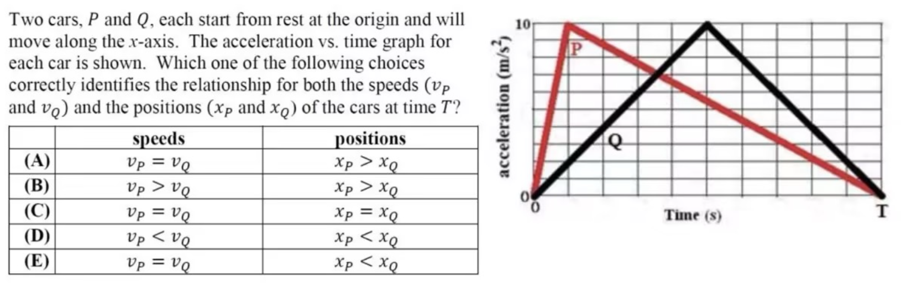

# dots.vlm1：从原生分辨率视觉预训练到 DeepSeek-V3 多模态适配

## 1. 论文信息与模型定位

**dots.vlm1** 是小红书 HiLab / rednote-hilab 的 dots 系列首个视觉语言模型，目录记录的发布日为 **2025 年 8 月 6 日**。本介绍依据官方仓库 README 和其链接的技术博客在 **2026 年 10 月 8 日**可获取的内容。[官方仓库](https://github.com/studio-dots-ai/dots.vlm1)；[官方技术博客](https://github.com/studio-dots-ai/dots.vlm1/blob/main/assets/blog.md)；[公开指令模型](https://huggingface.co/rednote-hilab/dots.vlm1.inst)。原仓库 rednote-hilab 路径已转到 studio-dots-ai，本文保留实际来源路径。

它把 **1.2B NaViT 视觉编码器**、轻量 MLP 适配器与 **DeepSeek-V3 MoE 语言模型**组合起来，主要研究图像感知、文档/图表理解、多图理解和视觉推理。公开材料是发布博客，披露程度介于简短模型卡与完整论文之间；没有正式提供所有预训练 token、优化超参数和系统级复现配置。

dots.vlm1 采用 DeepSeek-V3 作为语言底座，但它的视觉编码器、数据和适配训练由 dots 团队开发，不能归为 DeepSeek 官方视觉模型，也不能直接沿用 DeepSeek-VL 的视觉结构。

## 2. 快速概览

这份材料最有辨识度的设计，是**从随机初始化训练视觉编码器**，并同时使用文字监督与纯视觉监督。NaViT 首先从 224×224 图像学习，随后逐步扩展到 **1M 像素、10M 像素输入**。这里的 M 是像素规模，不是训练样本数或 token 总量。

多模态预训练数据分成两大类：把图片内容转成文本的 **跨模态翻译数据**，以及需要综合交错图文上下文的 **跨模态融合数据**。网页由内部 VLM 重写清理，PDF 则使用 dots.ocr 解析，并设计文本块遮挡恢复任务。后训练只有 **SFT**，强化学习是原文未来工作，不能把模型的推理能力归因于已完成的 RL。

官方重评表中，dots.vlm1 的 MMMU 为 **80.11**、MathVista **85.0**、DocVQA **96.52**、ChartQA **87.68**、Mantis **86.18**。这些成绩体现较强的多模态推理和结构化文档能力，但 OCRBenchV1 **82.3** 比表中 Qwen2.5-VL-72B 的 **87.1** 低，说明其优势并非所有文字感知任务都成立。

## 3. 整体架构

官方 Methods 描述三个组件：NaViT 提供视觉特征，MLP 适配器建立视觉与语言隐空间之间的映射，DeepSeek-V3 处理视觉条件与文本上下文并生成回答。视觉编码器有 **42 个 Transformer 层**，使用 **RMSNorm、SwiGLU、二维 RoPE**。博客称整体结构和训练方式与 AIMv2 有相似性，但明确是从头训练自己的视觉编码器，不能写成直接使用 AIMv2 现成权重。

原生分辨率支持的意义，是让图像保留更多自身长宽与细节，而不是始终压到单一固定方形画布。二维 RoPE 为视觉位置建模提供空间位置信息；RMSNorm、SwiGLU 属于网络层设计。博客没有公布 patch 大小、视觉 token 数、图像打包策略、MLP 精确层数和连接维度，因此不从 NaViT 名称推断一套完整实现。

原图来自博客 **2.2 Demo Highlights / Complex Doc/Chart Reasoning**，没有 Figure 编号。橙色表示服务、紫色表示货物。原问题要求对名称第二个字母为 e 的“货物”求平均，因此首先要按图例排除服务，再读取 Petroleum 的 **69.6B** 和 Pearls 的 **39.3B**，最后计算 **54.45B**。它展示视觉提取、语义过滤与算术组合，而不只是读取条形长度。示例本身不揭示内部注意力图，也不能用于证明某个模块独立贡献。

## 4. 核心创新与数学原理

视觉编码器预训练使用两种监督。**Next Token Prediction（NTP）** 从图文配对中学习预测文本，使视觉信息能支持语言描述；**Next Patch Generation（NPG）** 利用纯视觉数据，通过扩散模型预测图像 patch，补充不依赖文本说明的视觉学习信号。

NTP 可用通用条件似然解释：

\[
\mathcal L_{\mathrm{NTP}}=-\sum_t\log p_\theta(y_t\mid y_{<t},I).
\]

这是任务的数学解释，并非博客给出的完整训练公式。NPG 只披露“通过扩散模型预测 patch”，没有公布噪声日程、预测参数化、条件掩码、重建目标、损失权重或它与 NTP 的混合比例。因此本文不写一个看似完整但未经披露的扩散损失，也不把它改成离散图像 token 分类。

两种监督的互补关系在于：图文目标偏向人类会写出的语义，纯视觉目标可让编码器学习图像中的空间、纹理和结构信息。作者将其与加入 OCR 丰富图像、grounding 标注、视频帧一起用于提高感知能力，但未提供足够的逐项消融，不能把最终的某项分数归给 NPG 单独作用。

第二项创新是从数据对齐角度处理交错图文。网页常有图片与邻近文字不对应的情况，仅用 CLIP 相似度过滤可能保留语义松散内容。作者改用内部 VLM 重写并清理弱关联文本、低质量图像。这里“重写”是在构建训练目标和上下文，不是推理时联网补知识。

PDF 的遮挡恢复则让模型利用版面与其他上下文重建被遮文本。从任务角度可写成 \(p(\text{被遮文本}\mid\text{页面图像及剩余上下文})\)。博客没有说明所有遮挡是否同时修改像素与文本序列，本文不自行补充掩码细节。其目标是让格式化文档理解进入训练，而非只把 PDF OCR 成一段失去空间关系的纯文本。

## 5. 数据构建与处理

**跨模态翻译数据**覆盖普通图片的 alt-text 和密集描述，真实或合成的图表、表格、公式、图形及其结构化标注，多语 OCR、场景文字定位、纯文字提取、文档解析、视频帧时间描述，以及边界框和关键点监督。统一思路是：把图像中可由人解释的内容转成离散序列，支持不同细粒度的感知任务。

**跨模态融合数据**包含交错图文网页和 PDF。网页通过内部模型清理/改写，PDF 通过专门解析模型 **dots.ocr** 转成图文交错表示，另外使用整页渲染和选择性文本块遮挡来构建恢复任务。dots.ocr 在这里是数据处理工具，不等于 dots.vlm1 的视觉编码器名称。

原图来自同一组文档案例。表格包含全票、半票、免费条件、团队条件与额外服务。原题给出六名 1.3 米儿童、两名成人、四名本科在读学生，按图中的个体票条件计算 **6×50+2×100+4×50=700**。关键是把人群属性与表格适用范围正确匹配，而不是仅找出一个“50”或“100”。团队票栏没有给出可直接计算的统一价格，示例也没有把讲解费自动加进去。这里讨论的是历史原图的模型测试案例，不是当前景区价格信息。

原文没有公开图文 token 总量、各类数据数量、合成占比、去重阈值、网页重写通过率或 SFT 完整构成。它也没有给出视频理解标准评测；训练数据含视频帧，不足以据此宣称已验证长视频、实时音视频能力。

## 6. 训练流程与目标

整体训练分为三阶段。**第一阶段**从头训练 NaViT，内部再分为 224×224 的初始预训练和逐步提高到 1M/10M 像素的分辨率扩展。初始阶段包含 NTP 与 NPG，扩展阶段进一步加入 OCR、grounding、视频帧等视觉来源。

**第二阶段**对视觉编码器与 DeepSeek-V3 进行联合多模态预训练，使用上述翻译与融合数据。它让新的视觉表征进入已有语言模型的上下文，使模型学习从图像条件生成文本，并处理图文交错序列。博客没有列出每个子阶段各模块是否冻结或解冻的完整表格，不能补造连接器暖启动时长和学习率。

**第三阶段**使用不同任务的 SFT 增强泛化和指令跟随。作者明确注明后训练仅含监督微调，RL 计划在未来探索。因此公开结果是在这套预训练与 SFT 下得到，而不是展示 GRPO、PPO 或其他强化学习的消融收益。

发布材料没有披露 GPU 型号与训练卡数、学习率、优化器、batch、step、总 epoch 和实际训练 token。评测使用 **64K 序列长度**，服务示例也设置 65536 的上下文；这属于评测/部署配置，不能据此反推每个训练阶段都采用 64K。API 示例的生成上限同样不是训练超参数。

## 7. 实验设置与主要结果

官方技术博客比 README 更详细地说明评测：由于无法稳定复现已有报告分数，作者在自己的流程中**重新评估对比模型**。选择题采用 VLMEvalKit 的默认推理/评估协议，同时用模型映射回答到选项，减少规则抽取错误；MMVP 使用 pair accuracy。OCRReasoning、DocVQA、ChartQA、MUIR、Mantis 使用 **xVerify-9B-C** 评分，ChartQA 使用 **human_test** 子集，Vibe-Eval 用 **GPT-4o** 作裁判。dots.vlm1 所有评测使用 64K 序列长度。

| 指标 | Qwen2.5-VL-72B | Gemini 2.5 Pro | Seed-VL1.5 thinking | dots.vlm1 |
|---|---:|---:|---:|---:|
| MMMU | 69.3 | 84.22 | 79.89 | 80.11 |
| MathVista | 74.6 | 83.5 | 86.1 | 85.0 |
| RealWorldQA | 75.9 | 78.43 | 78.69 | 79.08 |
| DocVQA | 96.23 | 95.42 | 93.65 | 96.52 |
| ChartQA human_test | 86.1 | 86.16 | 86.88 | 87.68 |
| OCRBenchV1（原表尺度） | 87.1 | 86.6 | 86.7 | 82.3 |
| Mantis | 79.26 | 84.33 | 82.3 | 86.18 |

表格体现结构化文档、多图和推理的强项，也显示不同任务有明显差异。MMMU 仍低于 Gemini 2.5 Pro，MathVista 低于 Seed，OCRBenchV1 低于三个对照模型。因此博客的“接近领先水平”不能改写成所有基准领先。这里的数字来自 dots 团队重评，不应与其他厂商不同裁判、数据子集的分数直接拼接成统一排名。

纯文本评测中 LiveCodeBench 为 **72.94**、AIME 2025 **85.83**、GPQA **72.78**；原表 DeepSeek-R1-0528 为 73.3、87.5、81。数学和代码接近，但 GPQA 有 **8.22** 分差，不能以“继承语言底座”概括成保持所有文字推理性能。

这幅原图来自 **Demo Highlights / STEM Problem**。横轴是时间、纵轴是加速度，P 的加速度集中在前段，Q 的峰值较晚。图下选项要求同时判断末速度与位移。原文答案为 A：\(v_P=v_Q\)、\(x_P>x_Q\)。解释它需区分 \(v(T)=\int_0^T a(t)dt\) 与 \(x(T)=\int_0^T(T-t)a(t)dt\)：相同面积给相同末速度，较早加速使加权位移更大。**这些是案例中的物理关系，不是模型训练损失或架构公式。**

dots.vlm1 的公开方法重点在视觉编码器从头学习、双重视觉监督以及交错图文数据构造。原文尚缺完整训练规模和机制消融，评测也依赖特定模型裁判；这些限制应与成绩一起阅读。本介绍核对官方正文与三幅原图，没有运行模型。
