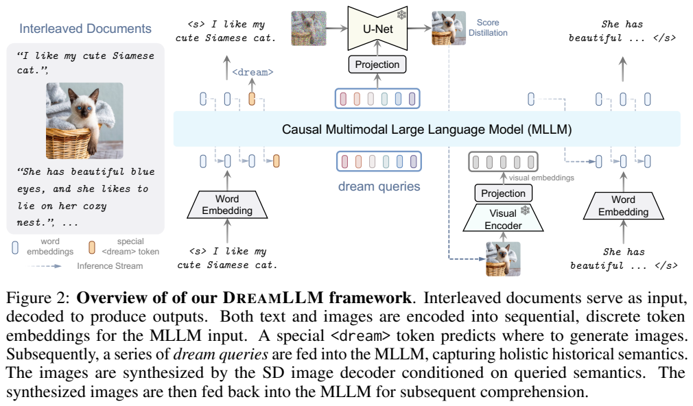
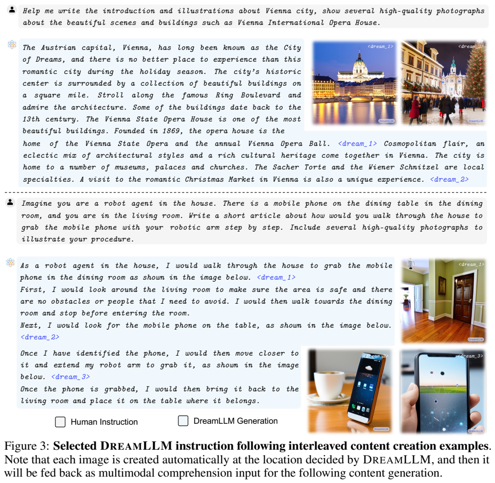
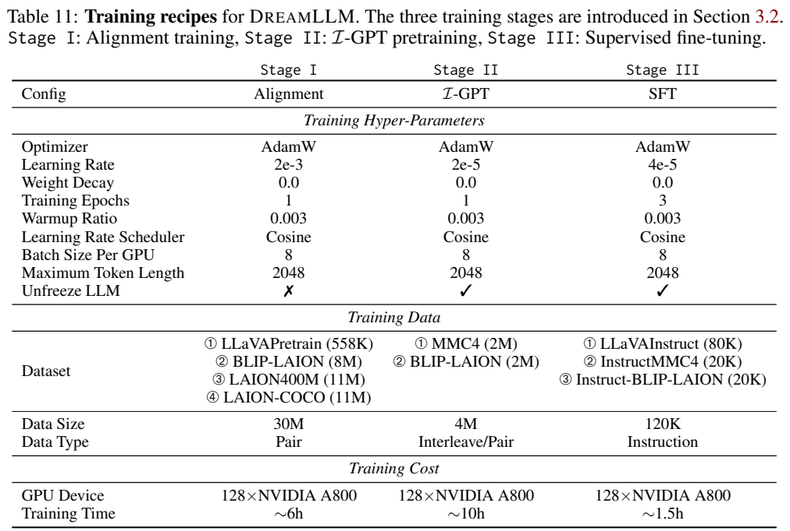
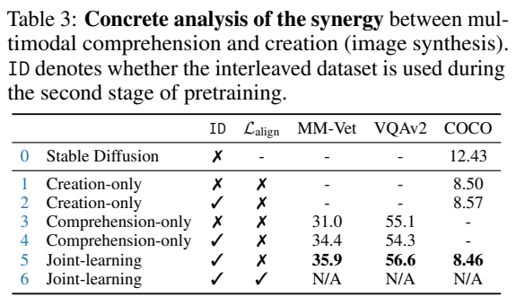
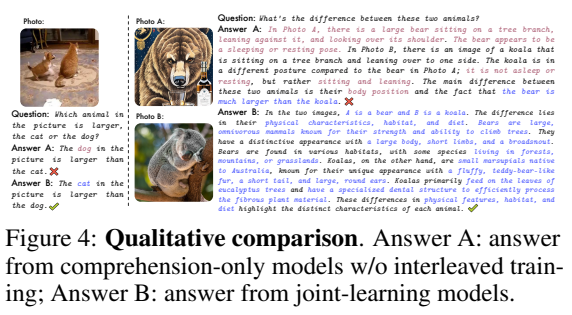
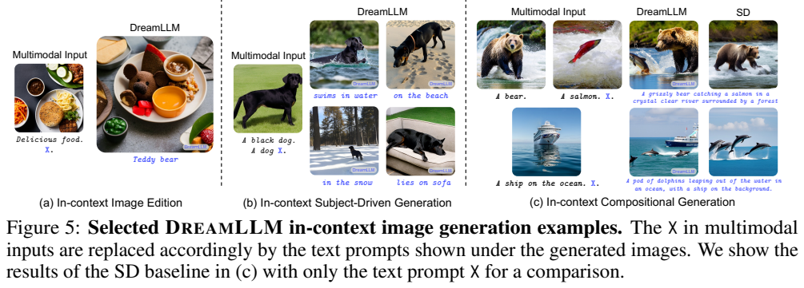

<!-- article-header:start -->
[项目首页](../../../README.md) › [模型系列](../../../reports/model-family-index.md) › [DreamLLM](../README.md)
<!-- article-header:end -->

# DreamLLM：联合学习图像理解、图像生成与交错图文创作

<!-- article-toc:start -->
<a id="article-toc"></a>

**本篇目录** · [论文定位](#paper-info) · [快速概览](#overview) · [整体架构](#architecture) · [核心原理](#principles) · [数据构建](#data) · [训练流程](#training) · [实验结果](#experiments)
<!-- article-toc:end -->

<a id="paper-info"></a>

## 1. 论文信息与模型定位

| 项目 | 信息 |
|---|---|
| 原题 | DreamLLM: Synergistic Multimodal Comprehension and Creation |
| 作者与机构 | Runpei Dong、Chunrui Han、Yuang Peng 等；西安交通大学、旷视、清华大学、华中科技大学 |
| 固定来源 | [arXiv:2309.11499v1](https://arxiv.org/abs/2309.11499v1)，2023-09-20，34 页 |
| 项目 | [dreamllm.github.io](https://dreamllm.github.io/) |
| 模型定位 | Vicuna-7B 驱动的多模态理解与创作框架，可输入和输出交错图文文档 |

DreamLLM 研究理解任务与生成任务能否相互帮助。它让语言模型决定何时写字、何时插入图像，再用从语言上下文提取的条件控制 Stable Diffusion。模型实际仍使用 CLIP 编码输入图像；“不依赖 CLIP 对齐”特指生成侧不以 CLIP 中间表征作为拟合目标，不能理解为整个系统没有 CLIP。

<a id="overview"></a>

## 2. 快速概览

模型在词表中加入 `<dream>`，当它生成该标记时，插入 64 个可学习 dream queries，读取此前的图文语义，经投影作为扩散模型条件。生成图片再由视觉编码器编码，返回上下文，语言模型继续写后续文本。整体文档按内容顺序因果生成，每幅图内部通过扩散去噪合成。

原文报告 COCO 文生图 FID 8.46、MM-Vet 35.9、VQAv2 56.6，并展示自动安排插图位置的文档。对“协同”更关键的证据来自控制实验：在相同交错数据下，纯理解模型 MM-Vet 34.4，联合模型 35.9；纯生成与联合生成的 COCO FID 则非常接近。它支持该配置下联合学习的益处，但尚不是所有模型与任务都必然获益的定律。

<a id="architecture"></a>

## 3. 整体架构



*原文 Figure 2，PDF 第 4 页原文图表裁图。蓝色语言模型接收文字、dream queries 和视觉嵌入；上方冻结的 U-Net 将条件转成图像，图像随后通过下方视觉编码器反馈。图中虚线表示生成图像重新编码后进入后续上下文。*

语言骨干采用基于 LLaMA-1 的 Vicuna-7B v1.1。图像输入由冻结的 CLIP-L/14 编码，224×224 对应 256 个视觉 patch token，前后加 ``、`` 标记，经线性视觉 projector 映射到语言空间。文字仍使用语言模型的词嵌入。

生成侧使用冻结的 Stable Diffusion v2.1，输出分辨率 512×512。64 个 dream queries 是可学习向量，它们经过语言模型获得带历史条件的隐藏表示，再由另一个线性 condition projector 映射给扩散 U-Net。`<dream/>` 标记结束 query 序列。查询不是 64 个自然语言单词，也不是把图像离散化为 64 个像素代码；它们承担扩散条件接口。

生成 `<dream>` 时，语言模型决定文档里的图片位置。图像合成与文字续写之间存在真实反馈通路，使下一段文字可依据已经生成的图像。该结构不等于语言模型逐像素自回归采样：文字与图片位置由因果模型控制，单幅图像仍由潜空间扩散与图像解码器产生。

<a id="principles"></a>

## 4. 核心创新与数学原理

原文式 (3) 可概括为 $`C=F_\theta(d,\text{history})`$：learnable queries $`d`$ 读取之前的多模态上下文，经条件 projector 转成生成条件。相比先预测某个冻结 CLIP 表征再拟合它，DreamLLM 直接通过目标图像的扩散去噪误差监督这条条件通路。

其核心式 (4) 为：

```math
\mathcal L_{DM}=\mathbb E_{t,\epsilon}
\left\Vert \epsilon_\xi(z_t;C,t)-\epsilon\right\Vert _2^2,
\qquad z_t=\sqrt{\alpha_t}z+\sqrt{1-\alpha_t}\epsilon.
```

$`z`$ 是目标图像的扩散潜变量，$`\epsilon`$ 为加入的噪声，$`\epsilon_\xi`$ 是冻结 U-Net。由于 $`C`$ 依赖语言模型、查询和投影，梯度可以经条件输入回传，虽然 $`\xi`$ 不更新。本文将其解释为利用冻结生成模型指导条件学习，不把它误写成优化当前生成图像像素的独立 DreamFusion 流程。

理解端使用下一文字 token 的语言建模目标，原文式 (1) 条件包含此前文字与视觉序列。报告式 (6) 从概念上写出统一因果目标：

```math
\mathcal L_{joint}=-\mathbb E_t\log p_\Theta(x_t\mid x_{\lt t}).
```

$`x_t`$ 可代表文字或图像内容；实际训练文字采用交叉熵、图像采用上述扩散噪声预测，不是把所有图像当作离散词表 token 直接做同一个 softmax。原文对扩散目标与最大似然的关系依赖“预训练 SD 是最优 score function”等假设，这属于建模解释，不能当作有限模型已经精确学习全部真实联合分布的证明。

附录在推理使用 classifier-free guidance，并将噪声组合写为 $`(1+s)\epsilon_{cond}-s\epsilon_{empty}`$，默认 $`s=7.5`$、COCO $`s=2.0`$。这与一些实现采用 $`\epsilon_{empty}+g(\epsilon_{cond}-\epsilon_{empty})`$ 的记号不同；若按此原式转换，$`g=1+s`$，不能在未核验实现时把同一数值直接代入另一约定。

<a id="data"></a>

## 5. 数据构建与处理

第一阶段约 30M 图文对，Table 11 列出 LLaVAPretrain 558K、BLIP-LAION 8M、LAION400M 11M、LAION-COCO 11M。数量是约数和训练抽样配方，不表示重新采集的互不重叠图像。

第二阶段加入 2M MMC4-Core 交错文档，通过 CLIP 分数阈值 0.25 选择；另加入 2M 经 BLIP 描述的 LAION 图文对，改善噪声文本或低质量图像对生成的影响。第三阶段使用 80K LLaVA 视觉指令、20K InstructMMC4 文档生成指令和 20K Instruct-BLIP-LAION 图像生成指令。后两者通过 GPT-4 根据文档文字摘要或图片 caption 生成任务描述，并非在教师直接看图后产生全面图像真值。



*原文 Figure 3，PDF 第 7 页原文图表裁图。蓝色 `<dream_1>` 等表示模型选择插图位置，右侧展示真实生成的图片；维也纳介绍和机器人取手机的文章是图文创作示例，不能当作真实机器人任务执行记录。*

交错监督同时提供文字顺序、图片位置和图片内容。训练图像按用途分别缩放到 CLIP 的 224 和 SD 的 512，避免将输入感知分辨率与输出生成分辨率混淆。报告指出 MMC4 含广告和低质量图片，因此网页文档训练也可能把商业语言或风格带入输出。

<a id="training"></a>

## 6. 训练流程与目标



*原文 Table 11，PDF 第 26 页，保留优化、数据、硬件与时间表。正文 §3.2 与附录 C.2 明确指出 CLIP 与 SD 在全部阶段冻结，而语言模型从阶段 II 开始解冻。*

| 阶段 | 更新范围 | 学习率 / epoch / 数据 |
|---|---|---|
| I：对齐 | 视觉 projector、条件 projector、dream queries；LLM、CLIP、SD 冻结 | $`2\times10^{-3}`$ / 1 / 约 30M 图文对 |
| II：I-GPT | 继续训练连接模块和查询，解冻 LLM；CLIP、SD 保持冻结 | $`2\times10^{-5}`$ / 1 / 4M 文档与图文对 |
| III：SFT | LLM 和连接模块、查询继续训练；CLIP、SD 仍冻结 | $`4\times10^{-5}`$ / 3 / 120K 指令样本 |

各阶段使用 AdamW、weight decay 0、warmup ratio 0.003、余弦调度、最大长度 2048、每 GPU batch 8。采用 FlashAttention 与 PyTorch FSDP；报告使用 128 张 A800，阶段时间分别约 6、10、1.5 小时。这是作者记录的该配置成本，不是模型在个人硬件上的训练估计。CLIP 和 SD 已经预训练，其历史成本不包含在本轮适配时间内。

训练同时让模型预测文本与 `<dream>` 位置，并通过冻结 SD 的去噪误差学习图像条件。报告没有完整给出所有 loss 的实际缩放比例或逐 token 掩码实现，本文不补写未公开权重，也不声称整个 U-Net 在更新。query 数量消融中 32、64、128 的 COCO FID 分别为 9.56、8.46、14.24，说明更长条件序列在当前数据与解码器下并不必然更好。

<a id="experiments"></a>

## 7. 实验设置与主要结果

Table 1 的 DreamLLM 结果为 COCO caption CIDEr 115.4、Image2Paragraph 17.4、VQAv2 56.6、OKVQA 44.3、VizWiz 38.1、TextVQA 34.9、MMBench 49.9、MM-Vet 35.9。正文概述曾写 MMBench 49.1，主表与附录 Table 5 均为 49.9，本文采用表中一致值。所谓零样本是未针对各评估数据集继续微调的评估，并不意味着模型没有视觉指令训练。

文生图主结果 COCO FID 8.46 采用每提示生成 8 张后按 CLIP 分数选图；LN-COCO FID 20.53 则每提示 1 张，不使用 CLIP 排序，因为描述太长。两者协议不同。COCO 的 SD 基线 12.43、对齐阶段后 8.76，说明语言条件学习已有明显收益；但专用 Parti FID 7.23 等仍更低，不能称其优于所有专用生成模型。







*PDF 第 8 页保留协同学习控制表，以及关系理解、上下文图像生成的定性案例。Table 3 的 ID 表示阶段 II 是否采用交错文档，需同时读训练目标与 ID 两列。*

| 控制实验 | MM-Vet | VQAv2 | COCO FID↓ |
|---|---:|---:|---:|
| 纯理解，无交错数据 | 31.0 | 55.1 | — |
| 纯理解，有交错数据 | 34.4 | 54.3 | — |
| 纯生成，有交错数据 | — | — | 8.57 |
| 联合理解与生成，有交错数据 | 35.9 | 56.6 | 8.46 |

联合训练相对有交错数据的纯理解模型提升 MM-Vet 1.5、VQAv2 2.3；生成改善只有 0.11 FID，没有误差区间，结论应限于所测设置。加入额外 CLIP 对齐损失的联合实验未收敛，证明该配置的训练冲突，不足以证明所有表征对齐方法都不适用。

文档图片质量评估使用 15K held-out 文档及真值文字条件，FID 为 36.62，对照 SD 为 74.77；它不是完全自由创作全部文档后测量的端到端文本事实分数。150 个创作样本由 5 位志愿者评审，模型 supportive rate 60.68%，原始 MMC4 为 77.24%。论文将其与“图灵测试”阈值比较，但本文只将其作为该人工评估中的支持比例，不能推断一般人类无法识别。

语言能力并非全部保持：MMLU 5-shot 从 Vicuna 的 45.0 下降到 41.8。POPE adversarial F1 76.47 也低于 InstructBLIP 的 77.32。附录报告多主体生成可能把两个对象融合成单个混合体，且对提示敏感；A800 上 50 步扩散生成延迟 3.65 秒、SD 3.46 秒只对应指定单图配置。本文核验原文与图片，未运行模型。

<!-- article-footer:start -->
---

[← 上一篇：Multimodal Foundation Models](../../multimodal-foundation-survey/arxiv-2309.10020/README.md) · [按发表时间浏览](../../../reports/paper-reading-guide.md#year-2023) · [下一篇：GPT-4V 系统卡 →](../../gpt/document-5cd14e1ea9af/README.md)

[返回本篇目录](#article-toc) · [返回模型系列](../README.md)
<!-- article-footer:end -->
