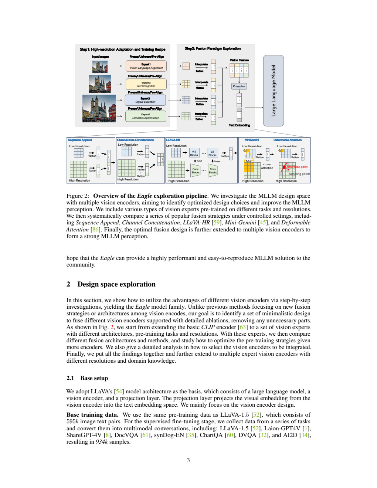
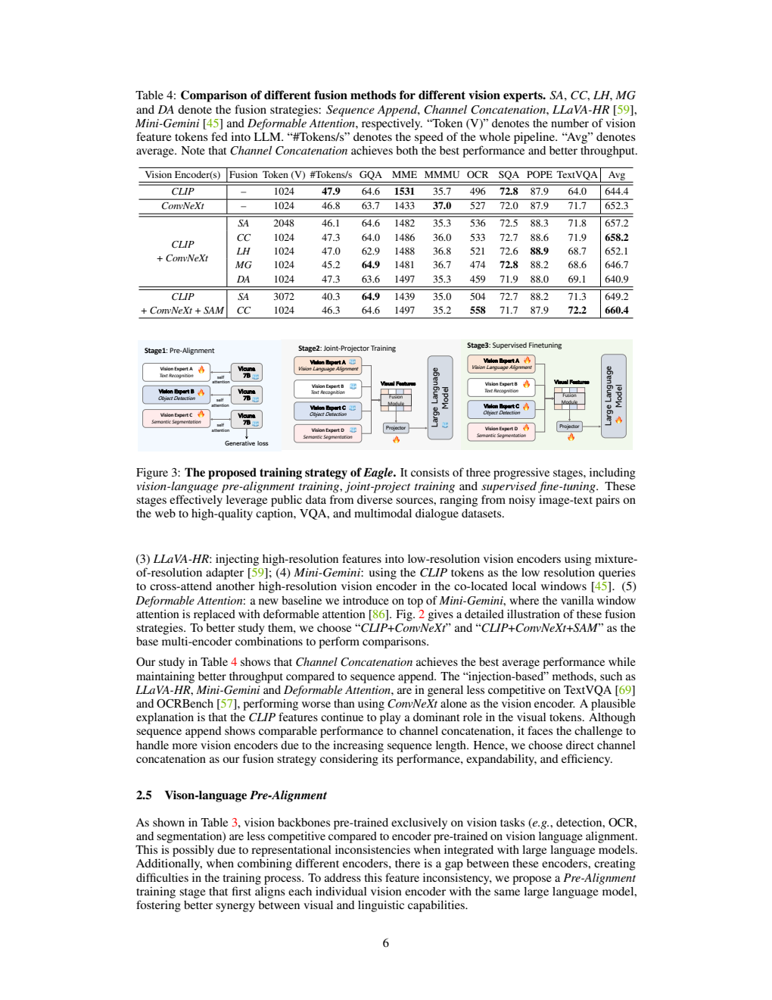
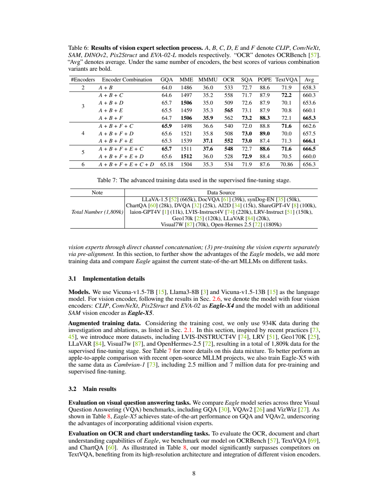
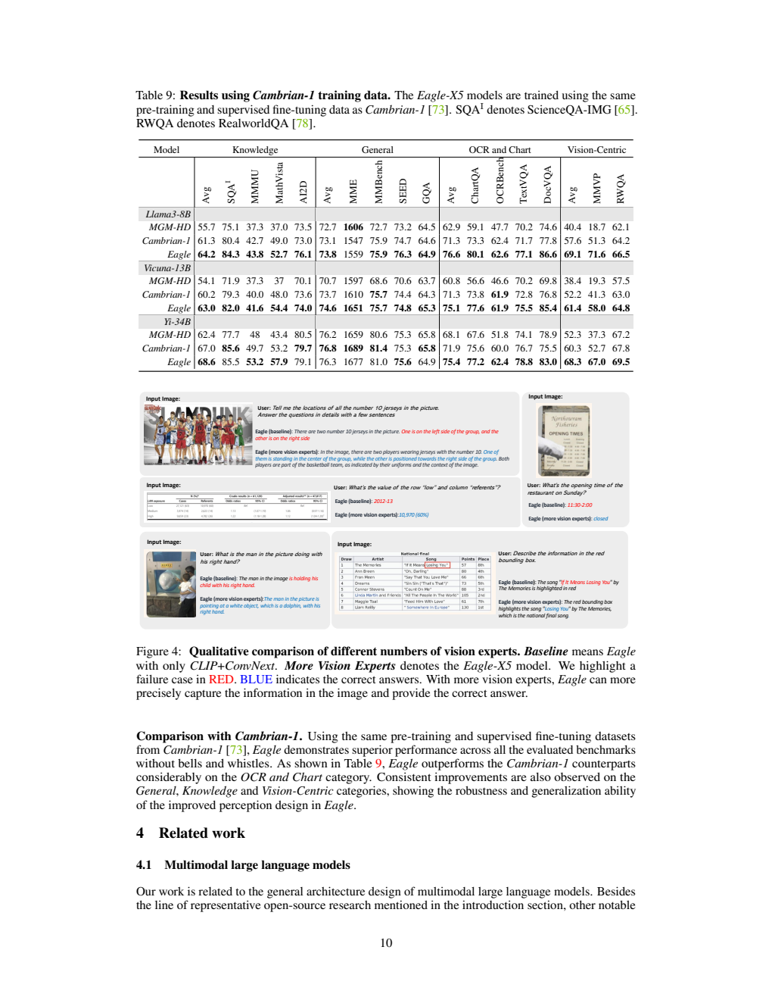

# EAGLE：多视觉编码器如何组合，才能真正改善多模态理解

## 1. 论文信息与模型定位

论文为 **EAGLE: Exploring The Design Space for Multimodal LLMs with Mixture of Encoders**，由 NVIDIA、Georgia Tech、马里兰大学等机构的 Min Shi、Fuxiao Liu 等作者提出。本介绍依据 **arXiv 2408.15998v1**，公开于 2024 年 8 月，原文共 16 页。[固定版本 PDF](https://arxiv.org/pdf/2408.15998v1)；[官方代码](https://github.com/NVlabs/Eagle)。

EAGLE 是图像输入、文本输出的多模态语言模型系列，也是一次关于视觉前端的系统研究。它沿用视觉编码器、投影器、语言模型的总体框架，重点追问：高分辨率、多个视觉专家和不同融合模块各自带来什么收益，是否有更简单的组合方式？原文考察 Vicuna-7B/13B、Llama-3-8B，并在与 Cambrian 的对照中报告 Yi-34B 结果。

题名中的“Mixture of Encoders”指多个视觉编码器的组合，不表示语言模型内部采用稀疏 MoE。最终配置同时提取所选编码器的特征，没有每个 token 只激活一个视觉专家的路由机制。

## 2. 快速概览

论文的主要结论有三层。第一，直接把 CLIP 的输入分辨率增大，只有在视觉编码器也参与训练时，才能稳定释放 OCR 收益；固定编码器、仅改变位置编码并不够。第二，把不同编码器的空间特征对齐后沿通道拼接，已经可以取得很强的结果；复杂的跨注意力和注入模块未在作者的控制实验中体现稳定优势。第三，先让每个视觉编码器独立适配语言模型，再联合训练，有助于减少原始预训练目标差异造成的融合困难。

最终 EAGLE-X4 使用 CLIP、ConvNeXt、Pix2Struct、EVA-02，X5 再加入 SAM。DINOv2 也是候选，但并未进入最终五编码器组合。不同编码器数量不是单调的性能旋钮：增加第六个编码器反而降低作者汇总分，部分 13B 实验中 X4 也优于 X5。

## 3. 整体架构

**Figure 2，PDF 第 3 页** 上部展示图像经多个视觉编码器、空间调整、融合和投影后送入语言模型的流程，下部对比序列拼接、通道拼接、跨注意力及特征注入等方案。读图时应关注融合发生的位置：EAGLE 的最终通道拼接在视觉前端完成，语言模型仍接收一条视觉 token 序列。

候选编码器覆盖不同预训练经验：CLIP ViT-L 和 ConvNeXt-XXL 提供视觉语言对齐特征；Pix2Struct 偏向屏幕、文档等结构化视觉内容；EVA-02 来自检测相关视觉建模；SAM 提供分割表征；DINOv2 提供自监督视觉特征。具体实验使用 CLIP/DINOv2 的 448 分辨率以及若干 1024 分辨率编码器，不应把它们理解为同一种骨干的不同尺寸。

每个特征图被调整为 **32×32，即 1024 个位置**。论文使用双线性调整或 pixel-unshuffle 等操作统一空间维度，再沿特征通道拼接，用可训练投影器映射到语言模型隐空间。因此，加入视觉专家后，语言模型侧的视觉序列仍为 1024 token；增加的计算首先来自多个视觉编码器，而非语言模型上下文按编码器数等比例增长。它控制了后端序列长度，却不能据此认定多编码器没有额外成本。

## 4. 核心创新与数学原理

可以把通道融合写成下面的解释式。设第 \(e\) 个编码器调整后的输出为 \(F^{(e)}\in\mathbb R^{1024\times d_e}\)，则

\[
F=\operatorname{Concat}_{\mathrm{channel}}(F^{(1)},\ldots,F^{(E)}),\qquad
Z=P_\theta(F).
\]

这里拼接后的维度为 \(1024\times\sum_e d_e\)，投影器再输出语言模型需要的维度。**这是对原文结构的数学化解读，不是论文另行提出的损失函数。** 序列拼接则把编码器输出沿 token 方向相接，两个编码器会得到 2048 token、三个会得到 3072 token，注意力计算和推理吞吐因此受到影响。

**Table 4，PDF 第 6 页** 给出融合控制实验。CLIP+ConvNeXt 的序列拼接和通道拼接分别使用 2048、1024 token，报告吞吐为 46.1、47.3 token/s，OCRBench 为 536、533；通道拼接在这一项并非更高。加入 SAM 后，序列拼接为 3072 token、40.3 token/s、OCR 504，通道拼接为 1024 token、46.3 token/s、OCR 558。这说明固定空间序列并保留每个位置的多源特征，能够兼顾效果与后端效率；吞吐是作者实现和实验环境的结果，不能外推到任意 GPU。

编码器选择采用逐步搜索：以 CLIP 为起点，按消融结果加入 ConvNeXt、EVA-02、Pix2Struct、SAM。它是可操作的贪心设计过程，不是所有编码器组合的全局最优证明。多个骨干带来不同信息，也带来冗余；是否保留某个专家，应看联合模型而非单编码器排行榜。

另一关键是 **Pre-Alignment**。原图 Figure 3 从左到右展示独立对齐、联合投影器训练、联合微调。独立阶段让每个编码器分别学习如何向冻结的语言模型提供有用信息，避免直接拼接未经语言任务适配的表征。其收益同样有边界：CLIP+EVA 的 MME 从 1537 到 1586、OCR 从 474 到 495；CLIP+ConvNeXt 的汇总分基本相同，TextVQA 还从 71.9 到 71.6。不能把“预对齐有效”扩展成每项指标都提升。

## 5. 数据构建与处理

基础设计实验使用作者所述的 **595K 图像描述样本**和 **934K 指令数据**。后者结合 LLaVA-1.5、LAION-GPT4V、ShareGPT4V，并加入 DocVQA、SynthDoG-EN、ChartQA、DVQA、AI2D 等数据，使文字读取、文档、图表和科学图示参与视觉前端选择。这里的 595K 按本论文披露记录，不用其他 LLaVA 版本的常见数字替换。

**Table 6，PDF 第 8 页** 展示逐步增加编码器的结果，最后加入 DINOv2 的六编码器组合并不优于五编码器组合。**Table 7，同页** 给出增强数据来源：LVIS 220K、LRV 150K、Geo170 120K、LLaVAR 20K、Visual7W 70K，以及文本指令数据 OpenHermes 等。正文称最终增强指令集合为 **1.809M**。

表格有一处应保留的不确定性：OpenHermes 2.5 一行也写成 1809K，与整体 1.809M 完全相同，无法同时与其他正数来源相加成立。因此本文仅确认正文的总体规模及明确的来源行，**不猜测 OpenHermes 的真实子集大小，也不据此计算数据比例**。此外，Table 9 的 Cambrian 对照采用 **2.5M 预训练、7M 指令数据**，属于另一套控制配方，不能和 1.809M 增强实验混为一谈。

图像在视觉编码器侧按各自分辨率处理，输出才调整到统一空间网格。提高分辨率的消融同时涉及视觉骨干是否解冻：冻结的 448 配置 OCRBench 285，冻结 336 配置为 369；解冻 448 后达到 496，解冻 672 为 492。问题不只是保留更多像素，还在于编码器能否适应新的输入尺度与任务。

## 6. 训练流程与目标

基础两阶段实验先只训练投影器，视觉编码器和语言模型冻结；随后进行指令微调。原文披露前者 **1 epoch、batch 256、学习率 \(10^{-3}\)**，后者 **1 epoch、batch 128、学习率 \(2\times10^{-5}\)**。这是设计实验的基础配方，不能自动视为所有最终模型和额外预对齐阶段的完整配置。

Pre-Alignment 的三阶段冻结关系则明确为：第一阶段，各编码器配自己的投影器，使用指令数据适配冻结的 Vicuna-7B，视觉编码器可训练；第二阶段，把它们组合起来，冻结编码器和语言模型，在图像描述数据上训练联合投影器；第三阶段，进行整个模型的联合指令微调。Figure 3 的锁图标正是理解这套流程的关键。

任务目标仍是给定图像与指令后预测文本回答，可用条件自回归损失解释：

\[
\mathcal L_{\mathrm{text}}=-\sum_t\log p_\theta(y_t\mid y_{<t},x_{\mathrm{image}},x_{\mathrm{instruction}}).
\]

该式概括生成式监督，不表示作者增加了独立的专家竞争、路由均衡或视觉重建损失。固定版本没有充分披露额外预对齐阶段的学习率、batch、训练轮数，也没有可据以复现全部最终配置的 GPU、上下文长度、优化器等清单；本文不补造这些设置。

## 7. 实验设置与主要结果

实验覆盖 MME 感知部分、MMBench 英文开发集、SEED 图像子集、MathVista testmini、MMMU validation、POPE、ScienceQA、GQA、VizWiz、VQAv2，以及 OCRBench、TextVQA、ChartQA。不同任务的分数尺度并不相同，尤其 MME 和 OCRBench 的原始分数不能当成百分比。

在 1.809M 增强数据配方下，**EAGLE-X5+Pre-Alignment / Vicuna-7B** 的 Table 8 结果包括 MME **1579**、MMBench **68.8**、SEED **73.5**、MathVista **39.0**、MMMU **36.4**、OCRBench **554**、TextVQA **71.9**、ChartQA **67.0**。相较未预对齐的 X5，MME 1528、MathVista 37.0、OCR 529 有所改善，但 SEED 73.9→73.5、GQA 64.9→64.0、ChartQA 67.7→67.0 下降。这里应理解为跨任务折中，而非全面压倒。

**Table 9，PDF 第 10 页** 使用与 Cambrian 对应的 2.5M/7M 配方。Llama-3-8B 下 EAGLE / Cambrian 的 MathVista 为 **52.7 / 49.0**、MMMU 为 **43.8 / 42.7**、ChartQA 为 **80.1 / 73.3**、TextVQA 为 **77.1 / 71.7**、DocVQA 为 **86.6 / 77.8**；MMBench 则同为 **75.9**。EAGLE 在文档和图表上的提升比较突出，但 34B 对照也存在 MME、MMBench、GQA 等未领先的任务。Table 9 的 OCRBench 已采用另一尺度，不能与 Table 8 的 554 直接比较。

同页 **Figure 4** 展示不同专家组合在视觉问答中的答案。它适合说明某个局部信息怎样被更多视觉特征补充，属于定性实例，不能代替完整测试集证据。作者表中的 Avg 有时称归一化平均，但固定版本没有足够说明其全部计算细节；本文优先列出可直接核验的单项指标，不自行重算综合排名。

EAGLE 的价值在于把多编码器模型拆成可检验的设计变量：空间序列长度、融合位置、专家互补性与独立对齐。它提供的是一套经实验支持的工程选择，仍需承担多个视觉骨干的计算与部署成本。本介绍已核对原文与上述原图，没有运行模型或复现实验。
