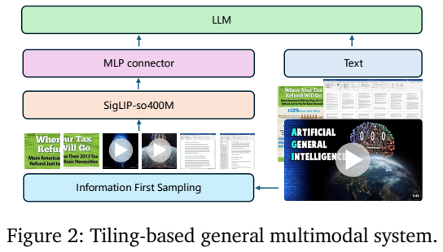
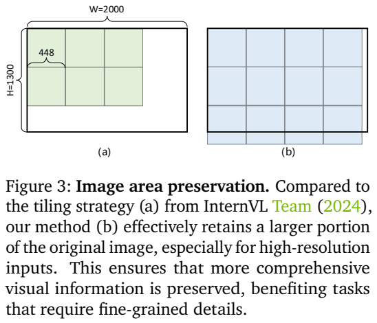
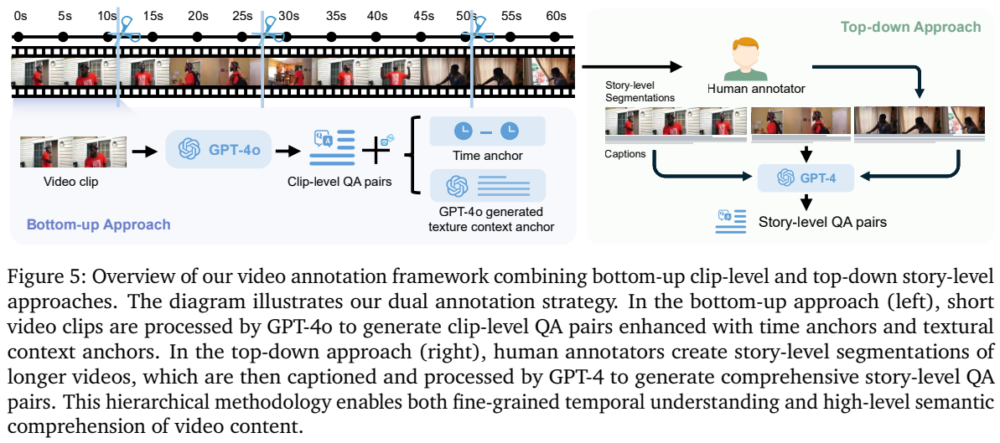
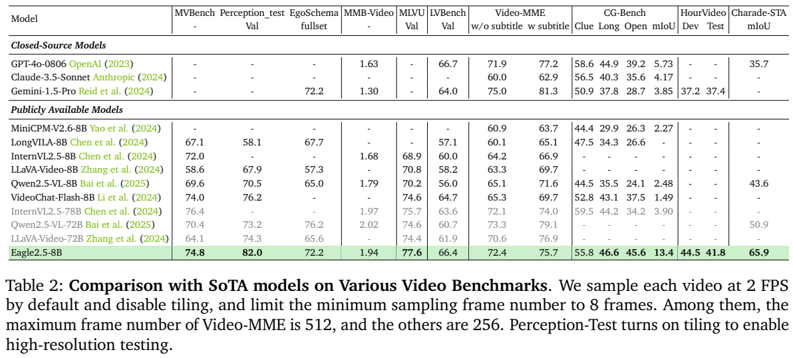
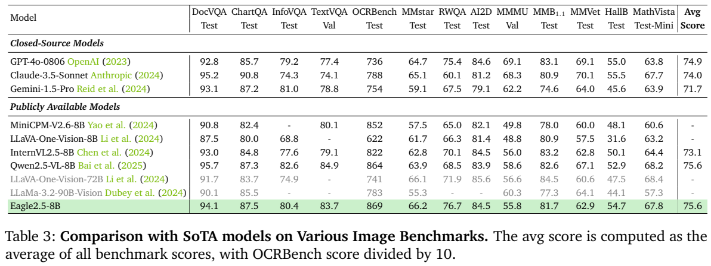
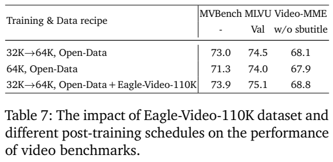
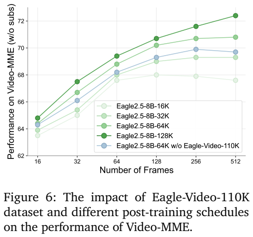

<!-- article-header:start -->
[项目首页](../../../README.md) › [模型系列](../../../reports/model-family-index.md) › [Eagle](../README.md)
<!-- article-header:end -->

# Eagle 2.5：以信息保留和渐进训练增强长上下文视觉理解

<!-- article-toc:start -->
<a id="article-toc"></a>

**本篇目录** · [论文定位](#paper-info) · [快速概览](#overview) · [整体架构](#architecture) · [核心原理](#principles) · [数据构建](#data) · [训练流程](#training) · [实验结果](#experiments)
<!-- article-toc:end -->

<a id="paper-info"></a>

## 1. 论文信息与模型定位

原论文为 **Eagle 2.5: Boosting Long-Context Post-Training for Frontier Vision-Language Models**，作者包括 Guo Chen、Zhiqi Li、Shihao Wang、Jindong Jiang、Guilin Liu、Zhiding Yu 等，来自 NVIDIA 与南京大学、香港理工大学、Rutgers University。本文依据 [arXiv 2504.15271v1](https://arxiv.org/pdf/2504.15271v1)，提交于 2025 年 4 月 21 日；PDF 首页日期为 4 月 22 日。

论文主要实验模型为 Eagle 2.5-8B，以 Qwen2.5-7B 语言底座、SigLIP 视觉编码与连接器形成约 8B 多模态系统。它面向长视频、高分辨率图片、多页文档和一般图像问答。核心工作在长上下文后训练、输入采样与数据构建，不依赖额外的任务专用视频压缩网络。这里“长上下文”涉及输入容量和训练分布，并不能单凭最大长度推断每项任务都有效利用全部上下文。

<a id="overview"></a>

## 2. 快速概览

Eagle 2.5 的方法由三项相互配合的设计构成。Image Area Preservation（IAP）在切图时兼顾面积与宽高比，减少细节过度缩小；Automatic Degradation Sampling（ADS）优先保留完整训练文字，再在剩余预算内选择帧数和切图数量；渐进混合训练依次扩展到 32K、64K、128K 上下文，并混合短长样本。

Eagle-Video-110K 通过长视频章节级描述/问答和短片段细节问答补充训练。章节来自人工标注的语义分段，细节问答加入时间与文字上下文锚点，以便移到完整视频时仍能找到对应事件。

主结果包括无字幕 Video-MME **72.4**、有字幕 **75.7**、Perception-Test 82.0、MLVU 77.6；图像侧 OCRBench 869、DocVQA 94.1、MathVista 67.8。Video-MME 使用至多 512 帧，不能与默认 32/64 帧设置等同。它在多项长视频任务较强，但无字幕 Video-MME 仍低于原表 Qwen2.5-VL-72B 的 73.3、Gemini-1.5-Pro 的 75.0。

<a id="architecture"></a>

## 3. 整体架构





*Figure 2 是模型通路，Figure 3 是切图方式比较，页底 Equation 1 给出切图选择目标。*

视觉输入先经过信息优先采样，再进入 SigLIP-so400M，MLP 将表示投影到 Qwen2.5 嵌入空间，与文字序列共同交给语言模型。输入可为单图、多图、视频帧或文档页；它们通过同一视觉语言主干处理，差异主要在视觉预算和组织方式。

图片局部 tile 分辨率为 448，每块对应 256 个视觉 token，另有全图缩略视图；Table 8 写作 $`(ij+1)\times256`$。最多 12 个局部 tile 是配置上限，实际数由图片形状及文本预算决定。视频或时间内容默认不切图，每帧/页 256 token，因此单张高分辨率图像策略与视频帧策略不可混写。

Figure 3 对一个 2,000×1,300 的图像比较两类网格。IAP 并非单纯让宽高比最接近原图，而是在避免过度缩小和形状偏差之间折中。扩大 tile 数会消耗更多编码与语言上下文，所以采样层同时承担资源分配作用。

| 模块 | 输入与输出 | 公开机制 |
|---|---|---|
| Information-first sampling | 图像、视频、文档和文本长度 → 预算内视觉输入 | IAP 选图像切块网格，ADS 分配剩余序列预算；文字长度先计入 |
| SigLIP-so400M | 448 局部图块/缩略图或帧页 → 视觉特征 | 图像每块 256 token；时间内容不切块，每帧/页 256 token |
| MLP connector | 视觉特征 → Qwen2.5 嵌入空间 | 公开的 LLaVA 式投影；不加专门长视频压缩网络 |
| Qwen2.5 主干 | 多视觉序列与文本 → 回答 | 使用统一视觉语言主干读取不同输入形态；长上下文通过后训练策略扩展 |
| 长度混合与渐进后训练 | ADS 样本 → 32K/64K/128K 阶段 | length-balanced packing 与逐阶段增大最大长度，保持不同长度任务分布 |


<a id="principles"></a>

## 4. 核心创新与数学原理

### 4.1 空间预算评分同时约束缩小与形变

面积与长宽比项相乘，意味着某一项很好不能完全补偿另一项很差。面积项达到阈值后不再增长，此后更密网格只有改善几何匹配时才有评分优势；阈值以下则为保留更多像素提供动力。它调整进入编码器的可见信息，而不是从编码后特征中学习压缩，因此与视觉 token pooling 属于不同环节。[原文 §3.2.1、式 (1)，PDF 第 4 页](https://arxiv.org/pdf/2504.15271v1#page=4)

原文 Equation 1 在 $`r_wr_h\le N`$ 的候选网格中最大化

```math
\min\left(\frac{A_{\rm new}}{A_{\rm orig}},0.6\right)\min\left(\frac{r_t}{r_{\rm orig}},\frac{r_{\rm orig}}{r_t}\right),
```

其中 $`A_{\rm orig}=WH`$，$`A_{\rm new}=r_wr_hs^2`$，$`r_t=r_w/r_h`$，$`r_{\rm orig}=W/H`$。面积项在达到原图面积 60% 后饱和，避免无限奖励更大网格；宽高比项在两者一致时为 1，偏离时下降。**60% 是评分偏好，不是候选集合不足时仍必然满足的硬约束**；这里的面积表示缩放后像素预算，也不等于识别内容准确率达到某比例。

### 4.2 把采样退化写成上下文分配问题

固定帧率容易让长视频挤掉监督文本，ADS 反过来先保留文字，再在剩余预算中调低视觉量。图像调整空间切块，视频/文档调整时间或页覆盖；两个变量控制不同信息损失。实际按先时间、再切块的离散流程执行，不能把式 (2) 的目标当成已求得所有混合输入的连续全局最优解。[原文 §3.2.1、式 (2)，PDF 第 5–6 页](https://arxiv.org/pdf/2504.15271v1#page=5)

ADS 首先计算文字长度 $`L_{\rm text}`$，从最大长度中扣除，得到 $`L_{\rm vis}=L_{\max}-L_{\rm text}`$。正文 Equation 2 以 $`\sum_iL(t,I_i)+256n`$ 为预算使用目标，并要求不超过视觉预算；$`t`$ 控制图片最大切块数，$`n`$ 控制视频帧或文档页采样数。视频上限按 2 FPS、文档上限按总页数设置。目标是尽量用满预算，不是逐帧估计语义重要性的可学习评分器。

实现先在 $`t=1`$ 下减少时间采样，尽量接近 2 FPS 或覆盖所有文档页；若连最低采样数量都无法满足，丢弃样本。再从 12、8、6、4、2、1 中选择能容纳的最高切图配置。文字监督因此得到优先保护，但原文未具体给出所有极端长文字情形的处理，不能把“所有样本绝不截断”当作无条件保证。

### 4.3 渐进长度与混合长度解决不同训练压力

混合训练用长度均衡 packing 让模型接触从短到长的样本；渐进方案再把最大上限按 32K、64K、128K 推进，避免直接在最大长度下同时平衡全部分布。两者可组合：阶段上限增长，不意味着该阶段只使用最长样本。其贡献在训练分布与资源组织，公开模型路径仍保持通用视觉连接器。[原文 §3.2.2，PDF 第 6 页](https://arxiv.org/pdf/2504.15271v1#page=6)

渐进训练则改变模型接触的长度分布。从较短预算开始，再扩到 64K、128K，让长序列能力建立在已有图像与短视频能力上。论文没有提出新的奖励优化或长序列专用数学损失；训练仍是视觉条件下的文本生成监督。ADS、IAP 的可检验意义是数据进入模型前的预算与空间信息处理。

<a id="data"></a>

## 5. 数据构建与处理

Open-Data 包含视频分类、时序动作定位、视频片段定位、密集描述、时序分割、一般视频 QA、多页文档与长文本。来源包括 COIN、ActivityNet、Ego4D、LLaVA-Video、FineVideo、SlideVQA、DUDE、MP-DocVQA、LongAlign 等。附录 Table 11 还包含图像与纯文本训练数据，并明确以颜色标注部分内部数据，因此不能把整个训练配方称作仅由公开数据构成。

新视频选择强调内容差异：从多个候选视频集合抽取 1 FPS 的 CLIP 特征，将视频分为 10 秒片段并池化。对候选片段 $`a_j`$，取与现有训练片段最大余弦相似度 $`S_{\max}(a_j)=\max_iS(b_i,a_j)`$，保留小于 **0.5** 的片段及其原视频。这是语义新颖性筛选，不等同于按精确图像哈希完成训练/测试去重。



*Figure 5，PDF 第 8 页。左侧从短片段生成局部问题，右侧从人工章节组织全视频问题。*

章节路线保留至少两章的视频，按章节以至多 2 FPS、最多 50 帧采样，结合章节标题交给 GPT-4o 生成密集描述；汇总时间段、标题和描述后，由 GPT-4 生成长视频问答。短片段路线随机选五类问题，利用 GPT-4o 生成细节问答，再用时间区间或文字上下文锚点消除完整视频中的歧义。

附录提示更具体地要求，局部问题不能只用简短锚点描述就完整回答；这样减少把答案泄漏在定位提示中的风险。章节结构由人工信息提供，不是新标注者对每个生成答案逐条确认。110K 是数据集名与规模标识，报告没有在主文提供完整的唯一视频数、每种问答精确占比及全量生成标注人工错误率，本文不将其解释为所有样本均人工标注。

<a id="training"></a>

## 6. 训练流程与目标

Table 8 把初始化与后续训练划为五步。Stage 1 用 1.2M ALLaVA 对齐，仅训练 40M 的 MLP 连接器，批量 1,024、学习率 $`2\times10^{-4}`$、最大长度 4,096；Stage 1.5 用 21.6M 丰富数据训练完整模型，批量 1,024、学习率 $`2\times10^{-5}`$、长度 8,192。本工作实际复用 Eagle-2 的 Stage-1.5 权重，再开展长上下文扩展，不能将所有初始化训练成本归于重新从零训练 Eagle 2.5。

Stage 2/3/4 分别设长度 32,768/65,536/128K，均训练完整约 8B 模型，学习率 $`2\times10^{-5}`$；批量为 256/128/128。表中每阶段数据写为 4.6M 短样本加 4.6M 长样本，这是配方数量，报告未给出全部 epoch 或精确 optimizer steps，不能直接推导总遍历次数。

使用长度平衡打包保持不同输入长度的学习；Triton 融合 MLP、RMSNorm、RoPE、线性层与交叉熵以减少中间存储，并将部分隐藏状态卸载至 CPU。分布式上下文并行结合 Ulysses、Ring 相关技术，采用 zigzag Llama3 风格及 all-gather KV；还优化稀疏帧解码，并以 vLLM 进行服务与评测。报告没有统一端到端吞吐/显存节省对照，以及完整硬件、耗时和优化器细节，不能将优化方向写成已验证的固定倍数加速。

<a id="experiments"></a>

## 7. 实验设置与主要结果





*Table 2 为视频任务，Table 3 为图像任务。保留原表以核对字幕条件、数据分割与模型名称。*

视频默认 2 FPS，至少 8 帧；Video-MME 最多 512 帧，其他主表任务最多 256 帧。一般关闭视频切图，但 **Perception-Test 开启切图**，其 82.0 包含高分辨率处理。主表不是所有模型在相同帧数下重新训练、重新测试的严格受控比较。

| 视频指标 | Eagle 2.5-8B | 原表比较配置 | 对应结果 |
|---|---:|---|---:|
| MVBench | 74.8 | InternVL2.5-8B | 72.0 |
| MLVU val | 77.6 | InternVL2.5-78B | 75.7 |
| LVBench val | 66.4 | GPT-4o-0806 | 66.7 |
| Video-MME 无字幕 | 72.4 | GPT-4o-0806 / Qwen2.5-VL-72B | 71.9 / 73.3 |
| Video-MME 有字幕 | 75.7 | GPT-4o-0806 / Qwen2.5-VL-72B | 77.2 / 79.1 |
| Charade-STA mIoU | 65.9 | Qwen2.5-VL-72B | 50.9 |

CG-Bench 的 Clue/Long/Open/mIoU 为 55.8/46.6/45.6/13.4，Clue 仍低于 Claude-3.5-Sonnet 的 56.5，不能按正文笼统称其四列全部超过。HourVideo dev/test 为 44.5/41.8，高于表中 Gemini 的 37.2/37.4。图像主表报告 DocVQA test 94.1、ChartQA test 87.5、InfoVQA test 80.4、TextVQA val 83.7、OCRBench val 869、MMMU val 55.8、MathVista testmini 67.8、MMBench1.1 test 81.7；平均 75.6 对 OCRBench 除以 10 后计算，不是全部任务的统一准确率。

原表将小型 Qwen2.5-VL 行标作“8B”，其 MMMU 58.6、MathVista 68.2、DocVQA 95.7 都高于 Eagle；本文保留原表名称口径，不用这行宣称 Eagle 全面领先。同样，Table 4 消融采用 DocVQA/InfoVQA val 与 MMBench EN-val，不能把它们与 Table 3 的 test 数字混写。





*Table 7 对训练调度及新数据作比较；Figure 6 展示不同上下文检查点随帧数改变的趋势。*

Table 6 的 32K 基线无字幕 Video-MME 为 65.4，去除 IAP 后 64.9、去除 ADS 后 65.0；Perception-Test 分别为 76.3/73.3/75.5，支持细节和监督预算的作用。Table 7 中，仅 Open-Data 的直接 64K 训练为 67.9，32K→64K 为 68.1，加入 Eagle-Video-110K 后为 68.8。这些是具体消融设置，并非最终 512 帧 72.4 的同一配置。

Figure 6 中 128K 检查点随着更多帧持续提高，而较短上下文配置可能饱和甚至下降，说明容量、训练长度与测试采样应配合，不能只增加输入帧。附录还有 SlideVQA test ANLS 72.7 和 MMLongBench-Doc F1 29.4，表明多页文档仍有明显改进空间。总体证据支持长视频训练与细节保留的有效性，其效果仍依赖帧预算、字幕、空间切图与数据配方。

<!-- article-footer:start -->
---

[← 上一篇：InternVL3](../../internvl/arxiv-2504.10479/README.md) · [按发表时间浏览](../../../reports/paper-reading-guide.md#year-2025) · [下一篇：Skywork R1V2 →](../../skywork/arxiv-2504.16656/README.md)

[返回本篇目录](#article-toc) · [返回模型系列](../README.md)
<!-- article-footer:end -->
