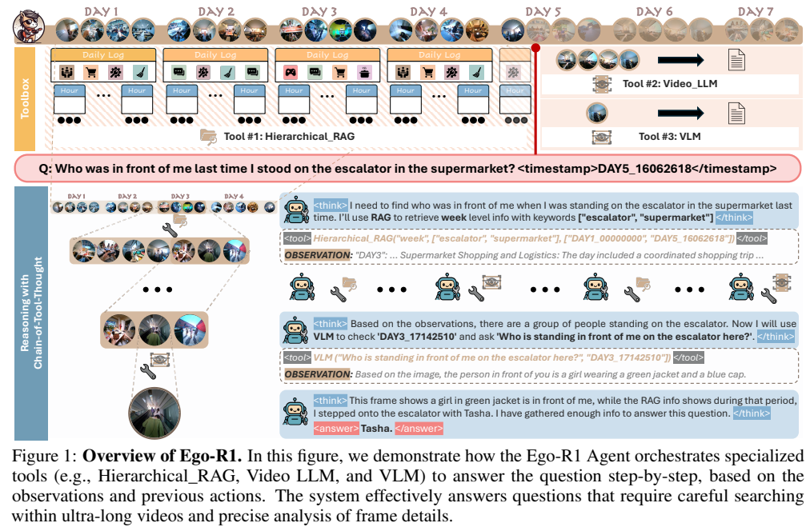
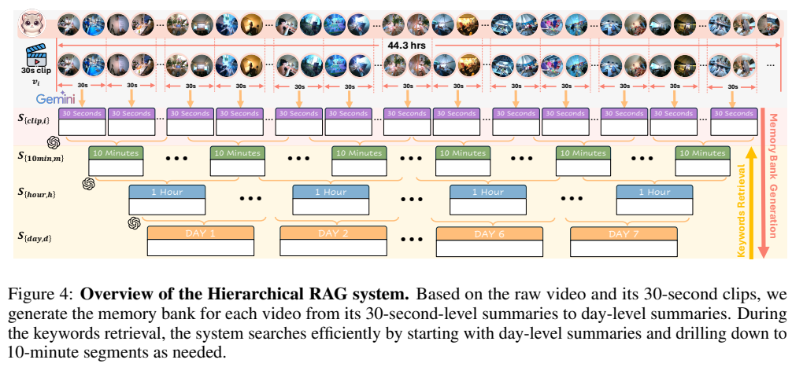
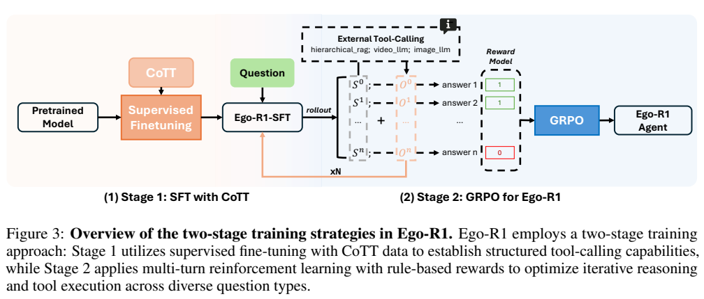
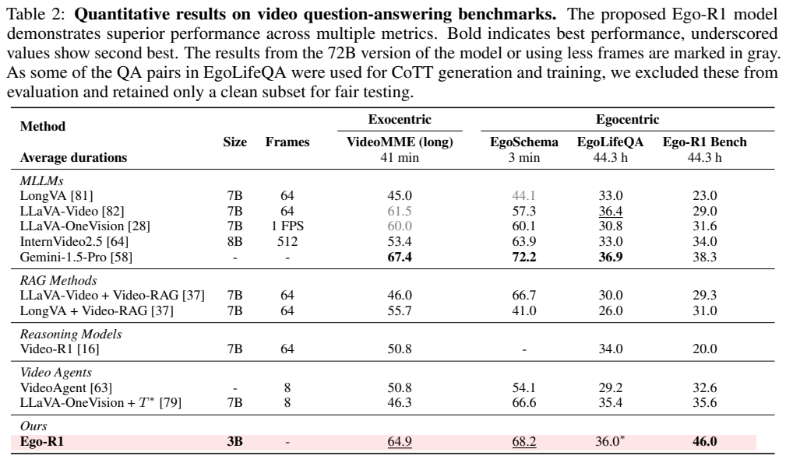

<!-- article-header:start -->
[项目首页](../../../README.md) › [模型系列](../../../reports/model-family-index.md) › [Ego-R1](../README.md)
<!-- article-header:end -->

# Ego-R1：通过工具链推理检索跨日第一视角视频

<!-- article-toc:start -->
<a id="article-toc"></a>

**本篇目录** · [论文定位](#paper-info) · [快速概览](#overview) · [整体架构](#architecture) · [核心原理](#principles) · [数据构建](#data) · [训练流程](#training) · [实验结果](#experiments)
<!-- article-toc:end -->

<a id="paper-info"></a>

## 1. 论文信息与模型定位

| 项目 | 信息 |
|---|---|
| 原题 | Ego-R1: Chain-of-Tool-Thought for Ultra-Long Egocentric Video Reasoning |
| 作者与机构 | Shulin Tian、Ruiqi Wang、Hongming Guo 等；南洋理工 S-Lab、A*STAR、Simon Fraser University、上海 AI 实验室 |
| 来源 | [arXiv:2506.13654v1](https://arxiv.org/abs/2506.13654v1)，2025-06-16，22 页 |
| 项目 | [Ego-R1 官方页面](https://egolife-ai.github.io/Ego-R1/) |
| 定位 | Qwen2.5-3B-Instruct 作为工具调度代理，结合跨日文字记忆、局部视频模型与单帧视觉模型回答问题 |

Ego-R1 是多模型工具系统。3B 指负责调度的语言模型，不包含 Gemini、GPT-4o、检索和汇总等外部组件。它不把整周原始视频塞入一个 3B 模型的上下文，而是预先构建时间索引，再按问题选择证据。任务覆盖一周日历跨度，主实验的每视角录像/问题时间范围平均约 44.3 小时，不能将“一周”理解为所有输入都是连续 168 小时视频。

<a id="overview"></a>

## 2. 快速概览

方法称为 Chain-of-Tool-Thought（CoTT）：代理根据问题和已有观察生成下一步工具调用，工具执行后返回新证据，再决定继续检索、检查视频或给答案。工具每次只处理合适的时间尺度，细节不足时可从文字摘要回到图像。

训练先以 25K 工具链数据做 SFT，再以 4.4K QA 做多轮强化学习。新建 Ego-R1 Bench 的 300 个问题上，SFT 模型准确率 34.3%，加入 RL 后 46.0%；只用检索工具为 39.7%。这些结果支持动态证据查询，但仍超过一半问题未答对，也没有证明所有生成的推理解释都真实反映决策过程。

<a id="architecture"></a>

## 3. 整体架构



*原文 Figure 1，PDF 第 1 页原文图表裁图。上半部分把长视频组织成日志，右边是局部视觉工具；下半部分展示从跨日检索到单帧核对的调用链。截图中的对话为原文案例，不是本仓库新执行的工具记录。*

工具分三类。H-RAG 接收时间层级、关键词、起止时间，返回相关文字日志；Video-LLM 根据子问题检查数秒到最多十分钟的视频窗口，以 1 FPS 采样；VLM 检查给定时间戳的单帧，用于小字、衣着和物体属性。默认 Video-LLM 为 Gemini-1.5-Pro，单帧 VLM 为 GPT-4o，CoTT 生成与关键词检索使用 GPT-4.1。附录早先概括写 GPT-4，具体环境段写 GPT-4.1，本文以具体配置为准。

代理输出由 `<think>`、`<tool>`、`<answer>` 标记组织，外部服务器解析工具名和参数，验证时间范围与语法后执行，将观察反馈。系统还引入长上下文 summary model 汇总较长工具链，但报告没有明确其全部型号与成本。`terminate` 是数据生成时的辅助工具，不能当作三个感知工具以外的主要视觉模块。



*原文 Figure 4，PDF 第 18 页原文图表裁图。记忆建库由 30 秒日志向上合并至日摘要；查询则从较粗层级往细层级搜索。两种方向和预处理/推理成本应区分。*

记忆先按 30 秒切片并保留原始录制边界，结合视频描述和 ASR 转录，再逐级生成 10 分钟、小时、日摘要。检索层级名 `week` 用于找某一天，`day` 找某小时，`hour` 找某十分钟段。它主要是带时间约束、由语言模型进行关键词匹配的层级检索，正文没有完整定义独立向量相似度或 ANN 算法，不宜默认写成常规向量数据库 RAG。

| 模块 | 输入与输出 | 公开机制 |
|---|---|---|
| 层级记忆 | 视频与ASR → 多时间尺度日志 | 30秒片段向上汇总；查询按关键词、层级及时间约束自上而下定位。 |
| Video-LLM | 时间窗口及子问题 → 动态观察 | 检查短视频段，补足日志缺失的事件与时序信息。 |
| 单帧VLM | 时间戳及问题 → 细节证据 | 读取文字、服饰和物体属性等单帧细部。 |
| 语言代理 | 问题和历史观察 → 工具调用/回答 | CoTT分别表示思考、调用和答案；语言策略不直接生成工具观察。 |
| 外部环境 | 结构化调用 → 验证和执行结果 | 解析工具名及时间参数，执行后把观察加入下一轮上下文。 |

[模块依据：v1 §3.2–4.1，第4–5页；§5.1–5.2，第7页](https://arxiv.org/pdf/2506.13654v1)。

<a id="principles"></a>

## 4. 核心创新与数学原理

### 4.1 由证据缺口驱动的多粒度工具选择

原文式 (1) 将工具链表示为 $`C=(S_0,\ldots,S_n)`$，$`S_i=(T_i^{th},T_i^{to},o_i)`$，分别为推理文本、工具调用和返回观察。按任务语义，可作如下政策解释：

```math
a_i\sim\pi_\theta(\cdot\mid q,o_{\lt i},a_{\lt i}),\qquad
o_i=\mathrm{Tool}(a_i).
```

这是本文对原文流程的形式化解释；工具返回的证据由环境生成，代理只生成选择与参数。一次调用改变后续可用信息，因而“推理更长”只是过程表象，关键在于是否检索到正确时间和视觉证据。

层级记忆先缩小时间范围，Video-LLM检查一段动态过程，单帧VLM再核对可读文字或对象属性，形成从粗到细的可用路径。代理也可以依据当前观察改变下一次调用，并不要求每题固定顺序访问全部工具。任务只允许使用查询时间之前的视频，因此参数中的时间约束同时定义证据的可用边界。 [§3.1–3.2，第4–5页](https://arxiv.org/pdf/2506.13654v1)

### 4.2 先学调用格式，再学习整条轨迹的成效

RL 公式展示组内采样、概率比裁剪与 KL 约束。用更清晰的记号解释其组内优势：

```math
\hat A_i=\frac{R_i-\overline R}{\mathrm{std}(R_1,\ldots,R_G)},
\qquad
r_{i,t}=\frac{\pi_\theta(s_{i,t}\mid h_{i,t})}{\pi_{old}(s_{i,t}\mid h_{i,t})}.
```

原文说明优势来自同一问题的多条 rollout 最终答案奖励，裁剪项取 $`\min(r\hat A,\mathrm{clip}(r,1-\epsilon,1+\epsilon)\hat A)`$，并用参考策略的 KL 约束限制漂移。报告把 GRPO 展开为“Gradient-Regularized Policy Optimization”，但展示的内容是组内奖励标准化和裁剪政策优化；本文依据实际公式解释，不额外添加一个正文没有定义的“梯度方差正则损失”。原式在多轮、轨迹、token 索引的文字描述上也不够一致，因此不据此编造逐步奖励分配算法。

SFT把工具调用与环境返回组织成多轮会话，先建立可执行的行为格式；RL阶段则真实执行调用，观察反过来影响后续生成。训练轨迹在得到最终答案或达到步数上限时结束，所以一次rollout的长度可以随策略而变化。模拟模板中的正确调用格式与真实环境中能否找到答案，是两个需要衔接的学习目标。 [§5.1–5.2，第7页](https://arxiv.org/pdf/2506.13654v1)

### 4.3 最终答案奖励的信用分配边界

最终奖励通过整条链的答案正确性评估，图中示意正确为 1、错误为 0。这会偏好有助于正确答案的调用，但不自动保证最少调用或最低 API 成本。报告未公开完整成本惩罚权重、格式奖励配方、标准差为零时的处理等细节；不能将提示中“考虑成本”写成已训练出严格最优成本策略。

同一问题的多条轨迹用相对奖励形成优势，鼓励比组内其他轨迹更有效的行为；但终点正确并不能唯一确定中间哪一步贡献最大。论文没有给每次检索标注独立真值奖励，因而不能把组内优势解释成逐工具的精确贡献估计。工具错误、日志遗漏和策略选择仍可能在同一终点奖励里交织。 [§5.2，第7页](https://arxiv.org/pdf/2506.13654v1)

<a id="data"></a>

## 5. 数据构建与处理

Ego-R1 Data 来源于六个第一视角、总计超过 500 小时的录像。4.4K QA 同时含人工与合成来源：已有高质量人工问题约 2.9K，其他问题由模型根据视频 caption、ASR 和跨时间日志生成，再经人工筛选与交叉验证。环境配置中，Gemini-1.5-Pro 用于视频转文字，Gemini-2.5-Pro 生成候选多选题，Claude-3.5-Sonnet 后处理。作者使用 Fleiss’ kappa 检查标注一致性，但本文原文未给完整一致性数值。

从选出的约 2.9K QA 生成 Ego-CoTT-25K，平均每任务 7.42 次工具调用；25K 是工具链轨迹数量，不是 25K 个独立真实问题。GPT-4.1 与 AutoGen 负责构造多轮示范，工具参数在执行前验证，并记录真实工具观察。语法验证改善可调用性，不代表语义与最终推理必然正确。

数据生成提示偏向多工具和较长轨迹，甚至要求充分使用所有工具并以检索到视频再到单帧的层次探索；这会影响 SFT 起点的调用偏好。训练后的代理允许按观察动态决定下一步，不能把示范中的倾向描述为完全没有任何人工流程先验。

新基准 Ego-R1 Bench 共 300 QA，六视角各 50，混合人工标注与人工核验的合成问题。EgoLifeQA 中用于训练与 CoTT 生成的问题被排除，主表 36.0 只对应清理后的评估子集。多视角来自同一生活场景，报告没有证明对新的人物、地点、不同生活习惯全面泛化。

<a id="training"></a>

## 6. 训练流程与目标



*原文 Figure 3，PDF 第 7 页。左侧是工具链 SFT，右侧每条 rollout 都实际执行外部工具，再以最终答案奖励训练代理；不是只在静态推理文本上打分。*

SFT 以 Qwen2.5-3B-Instruct 为起点，在包含推理、结构化调用和观察的多轮数据上学习格式及工具使用。消融正文举出 3 epochs 的 SFT，但没有提供完整主训练超参数表。标准监督目标可表达为 $`-\sum_t\log\pi_\theta(s_t\mid\text{history})`$，这里仅说明语言预测形式，不据此推定工具观察文本是否参与 loss、精确 masking 或各段权重。

RL 从 SFT checkpoint 出发，每个问题采样多条链，调用外部工具取得后续观察，到生成合法最终答案或达到步数上限时结束。组内标准化的答案奖励更新代理，并保留参考政策约束。工具视觉模型没有在此报告中被作为联合 RL 参数更新；方法重点是代理的调用政策。

训练 SFT 与 RL 使用 4 张 A100-80GB，基线实验使用 1 张 A100-80GB。外部闭源模型调用和预建记忆的成本不在本地 4 卡数字中。报告未给明确学习率、batch size、rollout group size、KL 系数、裁剪阈值或实际最大步骤 N，不能套用其他 R1 项目的默认超参。

<a id="experiments"></a>

## 7. 实验设置与主要结果



*原文 Table 2，PDF 第 8 页原文表格裁图。Size 是代理或基础模型口径；Frames 各方法不同，Ego-R1 并没有一个统一固定帧数，因此不能从“3B”一列推断整个系统资源更少。*

| 基准 | Ego-R1 | Gemini-1.5-Pro | LLaVA-Video |
|---|---:|---:|---:|
| VideoMME long，平均 41 分钟 | 64.9 | 67.4 | 61.5 |
| EgoSchema，平均 3 分钟 | 68.2 | 72.2 | 57.3 |
| 清理后的 EgoLifeQA，平均 44.3 小时 | 36.0 | 36.9 | 36.4 |
| Ego-R1 Bench，平均 44.3 小时 | 46.0 | 38.3 | 29.0 |

Ego-R1 在新基准超过 Gemini 7.7 个百分点，但其工具本身使用 Gemini-1.5-Pro、GPT-4o 等能力。对比说明“组织检索与调用”有价值，不能写成单一 3B 模型全面超过闭源视觉模型。新基准上其他代理最高为 T* 的 35.6；论文正文称 LLaVA-Video 是最强开放基线，与表中其他系统得分不完全对应，本文保留实际表值。

所有方法受查询时间限制，不应读取未来视频。基线采样预算按架构调整：普通模型约 64 帧，较高容量模型 512 帧，部分代理用 1024 帧构成 1 FPS 视频，因此并非逐方法完全相同成本。Table 2 和正文对部分方法帧数记法也不同，报告没有给总 API token、建库费用与端到端延迟。VideoMME 标注 w/o subtitle，但建库会使用转录的对话；这一协议不能据此理解为所有系统都只看无声画面。

训练消融是最明确的证据：未训练 1.4% 答题/4.3% 格式正确，只有 RL 为 0%/13.3%，只有 SFT 为 34.3%/100%，SFT+RL 为 46%/100%。这说明先学会可用工具链对该设置十分重要。工具消融以 LLaVA-Video 替代 Gemini 局部视频模块后为 43.7%，仅检索为 39.7%，完整工具为 46.0%。失败案例中，代理找到相关早期时间后未继续搜索该窗口，最终错答；层级摘要遗漏与工具幻觉也会影响结果。本文核验原文及原图，未训练代理、调用生产工具或复现分数。

<!-- article-footer:start -->
---

[← 上一篇：MiMo-VL](../../mimo/arxiv-2506.03569/README.md) · [按发表时间浏览](../../../reports/paper-reading-guide.md#year-2025) · [下一篇：Gemini 2.5 →](../../gemini/document-8c1dda86c921/README.md)

[返回本篇目录](#article-toc) · [返回模型系列](../README.md)
<!-- article-footer:end -->
