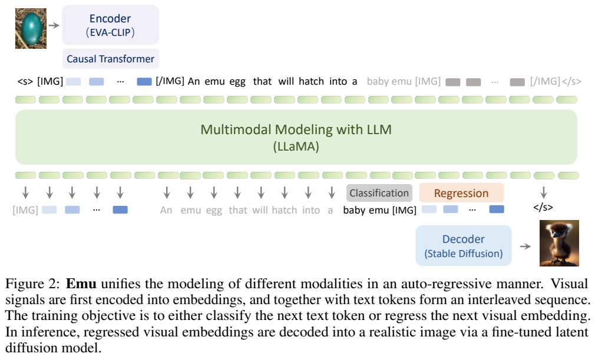
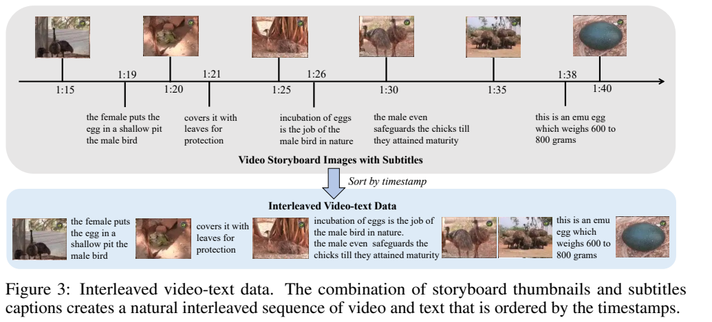
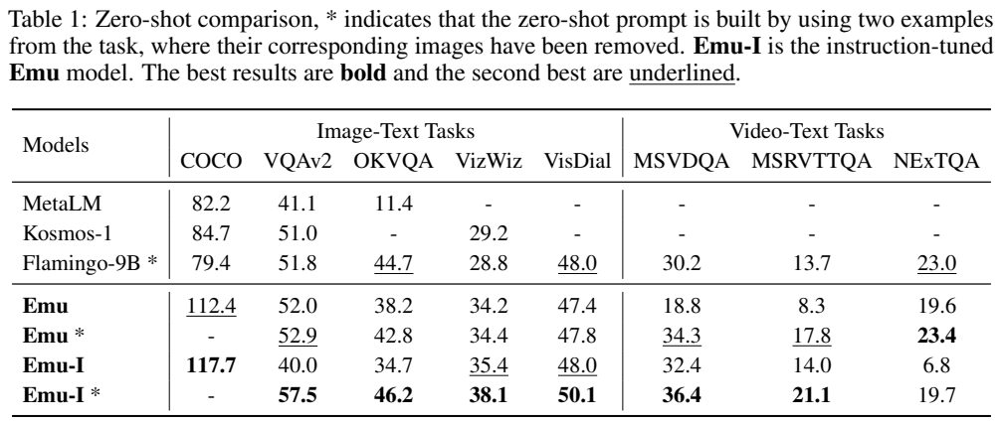
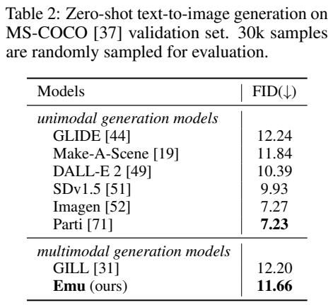

<!-- article-header:start -->
[项目首页](../../../README.md) › [模型系列](../../../reports/model-family-index.md) › [Emu](../README.md)
<!-- article-header:end -->

# Emu：交错多模态序列的生成预训练

<!-- article-toc:start -->
<a id="article-toc"></a>

**本篇目录** · [论文定位](#paper-info) · [快速概览](#overview) · [整体架构](#architecture) · [核心原理](#principles) · [数据构建](#data) · [训练流程](#training) · [实验结果](#experiments)
<!-- article-toc:end -->

<a id="paper-info"></a>

## 1. 论文信息与模型定位

**Generative Pretraining in Multimodality** 由 Quan Sun、Qiying Yu、Yufeng Cui 等研究者提出，来自北京智源人工智能研究院、清华大学和北京大学。本文固定使用 2023-07-11 的 [arXiv:2307.05222v1](https://arxiv.org/pdf/2307.05222v1)。模型名为 **Emu**，代码与演示见 [官方仓库](https://github.com/baaivision/Emu)。介绍对象是本篇首代 Emu，不能把后续 Emu2/Emu3 的架构和规模混入。

Emu 是以 LLaMA-13B 为语言主干、EVA-CLIP 为视觉编码器的约 14B 多模态模型，既可理解图像与视频，也可生成文字和图像。它尝试把图文对、图文交错网页和含字幕视频统一成“预测下一个元素”的序列学习任务。生成图像时，模型先回归连续视觉表征，再交由另外微调的扩散解码器生成像素，因此不是语言模型直接逐像素输出图像。[PDF 第 1、3–6 页](https://arxiv.org/pdf/2307.05222v1#page=1)

<a id="overview"></a>

## 2. 快速概览

论文的核心选择是对**所有模态元素**施加监督：文字位置做词表分类，视觉位置做连续向量回归。视觉信号经过因果 Transformer 转为适合一维自回归建模的潜在序列，随后与文字交错。相较只要求模型看图后生成文字，这一目标允许在相同序列里补全文字或视觉内容，并探索上下文示例引导的图像生成。

| 部分 | 原文配置/职责 |
|---|---|
| 视觉编码器 | EVA-02-CLIP 1B，40 层 ViT |
| 视觉因果转换 | 随机初始化，12 个 Transformer block |
| 多模态主干 | LLaMA-13B 初始化 |
| 图像解码 | Stable Diffusion v1.5 初始化，另行训练 U-Net |
| 预训练规模 | 约 8200 万样本、150B token、10000 步 |
| 指令版本 | Emu-I，固定原模型，仅训练语言 self-attention LoRA |

这些数字描述本篇实验，不构成“数据越多一定越好”或每个下游任务最佳的证明。图像生成 FID 优于同期多模态 GILL，但仍低于专门的 SD v1.5；指令微调也有下降项。[PDF 第 6–8 页](https://arxiv.org/pdf/2307.05222v1#page=6)

<a id="architecture"></a>

## 3. 整体架构



Figure 2 在 PDF 第 4 页。上方图像经过 EVA-CLIP 和 Causal Transformer，蓝色块为连续视觉 embedding，文字和特殊标记夹在它们之间；下方 LLaMA 的两个输出头分别做文字分类和视觉回归。右下角扩散解码器把生成的视觉向量转成图像。沿图阅读可以发现，“统一”发生在多模态自回归主干与目标组织上，不意味着编码器、输出头和像素解码器完全相同。

每幅图像由 EVA-CLIP 提取密集表征，再由一组可学习查询转成 $`N`$ 个因果潜在向量。一个 $`T`$ 帧视频转成 $`T\times N`$ 个视觉向量，各帧前后用 `[IMG]`、`[/IMG]` 包围，完整序列用 `<s>`、`</s>` 标记。论文保留 $`N`$ 为参数，没有在本文已披露配置中明确其固定数值，不能补成其他模型常用的 32 或 256。

Causal Transformer 每层包含因果 self-attention、cross-attention 和前馈层。cross-attention 的 key/value 来自 EVA 视觉表征，query 来自因果自注意力的输出；相比双向 Q-Former，它让第 $`i`$ 个潜在查询仅依赖之前的潜在查询。图像本身没有文字式的左到右语义顺序，作者因此不在原像素栅格上直接施加语言式自回归，而在学习的潜在空间构造顺序。

视觉解码器采用潜在扩散，将 Emu 的 $`N`$ 个视觉 embedding 作为条件，并替换 Stable Diffusion cross-attention 的线性投影以匹配维度。解码阶段与主干预训练分开，不能把扩散训练成本漏掉后再比较整套模型开销。[PDF 第 3–4、6 页](https://arxiv.org/pdf/2307.05222v1#page=3)

<a id="principles"></a>

## 4. 核心创新与数学原理

原文式 (1) 将图像 $`I`$ 的 EVA 编码 $`g(I)`$ 与随机初始化查询 $`e_{1:N}`$ 映射为


```math
z_{1:N}=\mathrm{CausalTransformer}(g(I),e_{1:N}).
```


这些 $`z_i`$ 是连续向量，不是 VQ 词表中的离散视觉 ID。它们捕获的是学习到的潜在依赖，不能解释成现实世界因果关系的识别。将图像、视频帧和文字组织为 $`u_{1:m}`$ 后，原文式 (2) 的思想是最大化 $`\sum_i\log P_\theta(u_i\mid u_{\lt i})`$，近似建模原始多模态语料。

实际优化分成两类，可用以下解释式表达：


```math
\mathcal L= -\sum_{i\in\mathcal T}\log p_\theta(u_i\mid u_{<i})
 +\lambda\sum_{i\in\mathcal V}\Vert \hat z_i-z_i\Vert _2^2.
```


$`\mathcal T`$ 和 $`\mathcal V`$ 分别是文字、视觉位置；第一项分类，第二项回归。这里的合并表达用于解释论文两种损失，**原文没有给出 $`\lambda`$、损失归一化或每种模态位置的完整权重**。若把平方误差理解为固定方差高斯负对数似然，也需要额外假设；论文并未以这种假设推导其概率近似。

推理时，文字任务使用语言 head 输出词，图像任务在提示末尾添加 `[IMG]` 后自回归生成 $`N`$ 个视觉向量，再扩散解码。上下文中可放示例图文对，模型通过后续补全表现出 in-context 能力，这不涉及当次更新参数。

附录 Table 5 明确扩散目标为 $`\epsilon`$-prediction，可用 $`\mathbb E\Vert \epsilon-\epsilon_\phi(x_t,t,z)\Vert ^2`$ 理解预测加到 latent 上的噪声；这是标准形式的解释，来源没有完整展开噪声 schedule。训练随机丢弃 10% 图像条件以支持 classifier-free guidance，测试 Emu 用 guidance 5.0、SD v1.5 用 3.0，都是各自选择的配置，不能将 FID 差异归因于某一个单独因素。[PDF 第 4–5、8、16 页](https://arxiv.org/pdf/2307.05222v1#page=4)

<a id="data"></a>

## 5. 数据构建与处理

图文对来自 LAION-2B 与 LAION-COCO，后者约 600M 图像由模型生成更流畅的描述。作者保留两者，因为重写描述可能损失原 alt-text 的多样性和世界知识。它们是候选数据来源的规模，不等于训练时全部样本都使用一遍。

MMC4 提供约 7500 万交错文档、4 亿图像和 380 亿文本 token。若图像对文档所有文本的 CLIP 相似度均低于 0.32，则丢弃。其采样一类取长度 1024 的子序列与最多前 5 张图，一类取 5 张图及对应句子组成长度 512 的序列。WebVid-10M 的描述含分辨率、摄像参数等无关元信息，作者先以词表和规则识别约百万条需清理内容，再由 Vicuna-13B 改写以提高流畅性。



Figure 3 位于 PDF 第 6 页。上方展示帧时间与字幕区间，下方是排序后的图像—句子交错序列。YT-Storyboard-1B 使用 YT-Temporal-1B 的 video ID，收集约 **1800 万视频对应的 18 亿 storyboard 缩略图及字幕**，不是完整视频的 18 亿连续原帧。缩略图采样间隔已知，字幕含起止时间，据此排序并合并相邻字幕。作者称可避免视频解码并降低约 20 倍存储成本，但这种缩略图表示也限制细节与运动信息保真度。

解码训练采用 LAION-COCO 与 LAION-Aesthetics，比例 7:2，过滤长度超过 150 的文本提示以控制显存；约排除后者 8%、前者 0.01%。指令数据含 ShareGPT 约 70K、Alpaca 52K、LLaVA 原 158K；因详细描述可能导致答非所问，删除该子集并过滤包含特定错误短语的样本，剩约 130K。视频指令来自 VideoChat-11K 与 Video-ChatGPT 约 30K 的一分钟内子集。附录另写实际使用 60K 视频指令样本，不能简单把源集合大小相加当成训练采样总数。[PDF 第 5–6、15–17 页](https://arxiv.org/pdf/2307.05222v1#page=15)

<a id="training"></a>

## 6. 训练流程与目标

**主干预训练。** EVA、LLaMA 与随机初始化 Causal Transformer 端到端训练；图像/帧 224×224，每视频随机 8 帧，图文中图像随机置于对应句子之前或之后。附录按 LAION-2B、LAION-COCO、MMC4、WebVid、YT-Storyboard 分别列 batch 128、128、64、16、16。AdamW 的 beta 为 0.9/0.98、epsilon 为 1e-6、weight decay 为 0.05，cosine 学习率，warmup 2000 步。LLaMA 峰值 3e-5、Causal Transformer 1e-4；视觉编码器**正文 5e-5，附录 Table 4 为 4e-5**，存在差异，本文不选择其一伪装成唯一配置。训练使用 128 张 A100-80G、10000 步，约 8200 万样本/150B token，报告约两天。

**视觉解码。** 固定 Emu 的视觉编码器、语言主干和 diffusion VAE，仅更新 U-Net；来源没有单列 Causal Transformer 的冻结细节，不能擅自增加配置。32 张 A100-40G，per-GPU batch 50，总 batch 1600，15000 步，512×512。AdamW beta 0.9/0.999、epsilon 1e-8、weight decay 1e-2；前 5000 步升到 1e-4，10000/14000 步降到 5e-5/1e-5。目标是条件图像噪声预测，条件为 Emu 生成的视觉潜在向量。

**指令微调。** 固定全部预训练 Emu 权重，只在语言 self-attention 的所有线性投影加 LoRA，rank=16、alpha=16，不适配视觉编码器。batch 128、10000 步，500 步 warmup 到 1e-5，再 cosine 降到零；16 张 A100-80G，约 16 小时。ShareGPT、Alpaca、LLaVA 各使用 3 epochs。模板由 system、user instruction、assistant answer 组成，只有 answer 参与损失。视觉与视频使用不同 system message，以解释图像或按时间组织的帧，文字任务没有该视觉 system message。[PDF 第 6–7、16–17 页](https://arxiv.org/pdf/2307.05222v1#page=6)

<a id="experiments"></a>

## 7. 实验设置与主要结果



PDF 第 7 页 Table 1 的星号 `*` 很关键：包含两个任务的**纯文字示例，图片被移除**，所以是论文定义的视觉零样本设置，并非完全没有任务示例。基础 Emu 另采用先生成描述、再结合问题回答的测试时 multimodal CoT。指标不相同：COCO 用 CIDEr，VQA 用匹配分数，VisDial 用 NDCG，NExTQA 用 WUPS，不能把整行都写成 accuracy。

| 配置 | COCO CIDEr | VQAv2 | VizWiz | MSVDQA | NExTQA |
|---|---:|---:|---:|---:|---:|
| Emu | 112.4 | 52.0 | 34.2 | 18.8 | 19.6 |
| Emu* | — | 52.9 | 34.4 | 34.3 | 23.4 |
| Emu-I | 117.7 | 40.0 | 35.4 | 32.4 | 6.8 |
| Emu-I* | — | 57.5 | 38.1 | 36.4 | 19.7 |

指令版加格式示例后的 VQAv2 与 MSVDQA 较好，但不带星号的 VQAv2 明显下降，NExTQA 两种指令配置也低于对应基础配置。结果说明评测模板与输出格式会显著影响成绩，不能仅摘最高值声称指令微调全面提升。VizWiz 还先限制回答 yes/no 判断是否可答，再输出答案；常见冗余词会做后处理，OKVQA 使用 Porter stemming。[PDF 第 7–8、18–19 页](https://arxiv.org/pdf/2307.05222v1#page=18)

少样本使用 RICES，从各任务随机 5000 训练样本中以 EVA 特征余弦相似度检索示例；视频比较平均帧特征，测试视频 8 帧、支持视频 2 帧以控制上下文。Emu 2/4/8-shot VQAv2 为 56.4/58.4/59.0，VizWiz 为 37.8/41.3/43.9。MSVDQA 8-shot 为 39.8，低于 Flamingo-9B 的 40.8，因此正文“几乎所有情形”仍有例外。这里只增添上下文，没有更新模型权重。



PDF 第 8 页 Table 2 从 COCO 验证集随机取 30K 提示计算 FID，数值越低越好。Emu 为 **11.66**，优于 GILL 12.20，却不及 SD v1.5 的 9.93、Imagen 7.27 和 Parti 7.23。Emu 与 SD 使用 PNDM 50 步及不同最佳 guidance。作者推测条件空间从文本变为视觉 embedding、解码微调仅 15K 步可能造成差距，这属于解释假设，报告未提供足够消融证明。附录的融合图像、知识识别和多轮对话是定性展示，并无全面幻觉率或公平盲测。本文未执行模型，分数与资源均来自固定首版报告。

<!-- article-footer:start -->
---

[← 上一篇：SVIT](../../svit/arxiv-2307.04087/README.md) · [按发表时间浏览](../../../reports/paper-reading-guide.md#year-2023) · [下一篇：BuboGPT →](../../bubogpt/arxiv-2307.08581/README.md)

[返回本篇目录](#article-toc) · [返回模型系列](../README.md)
<!-- article-footer:end -->
