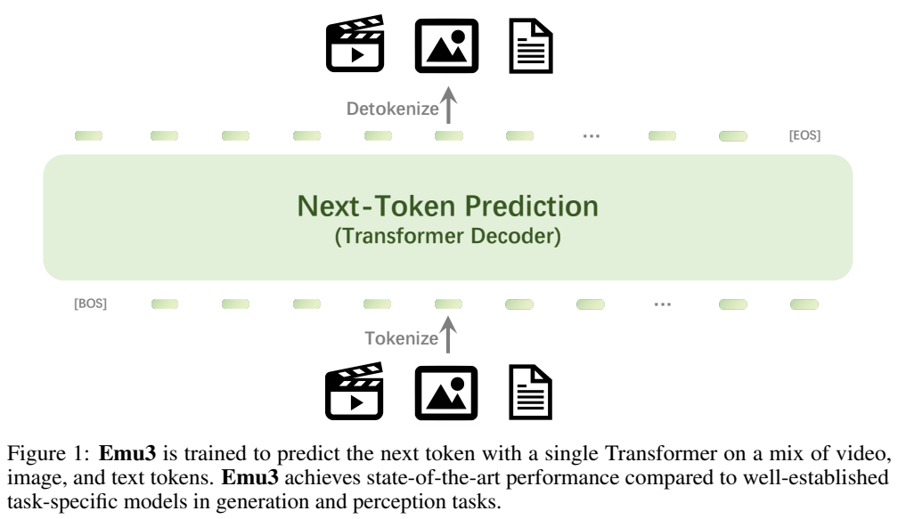
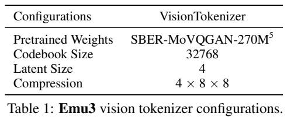
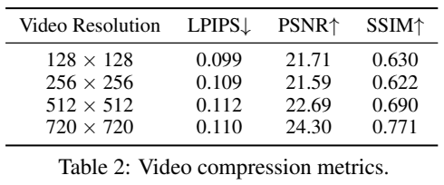
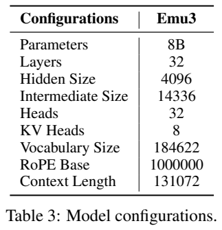
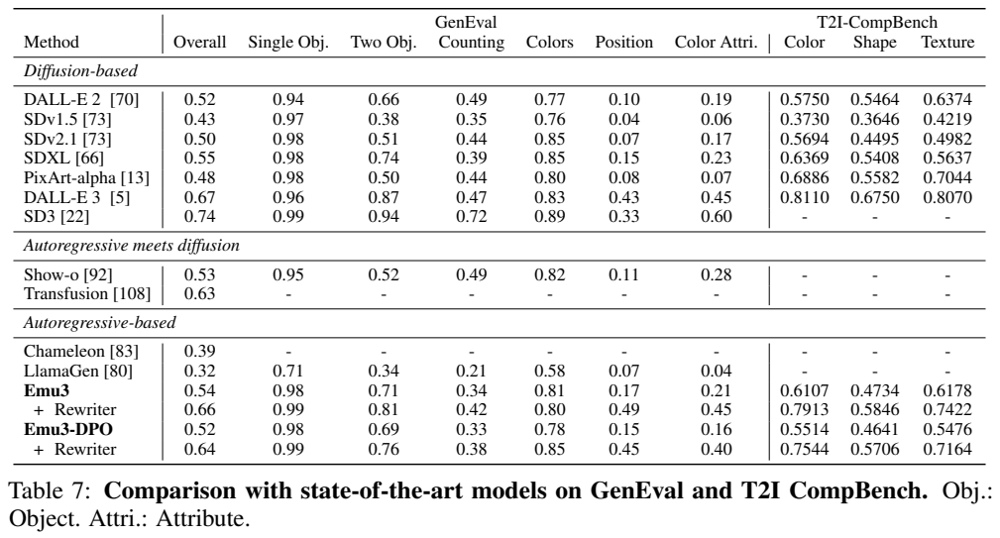
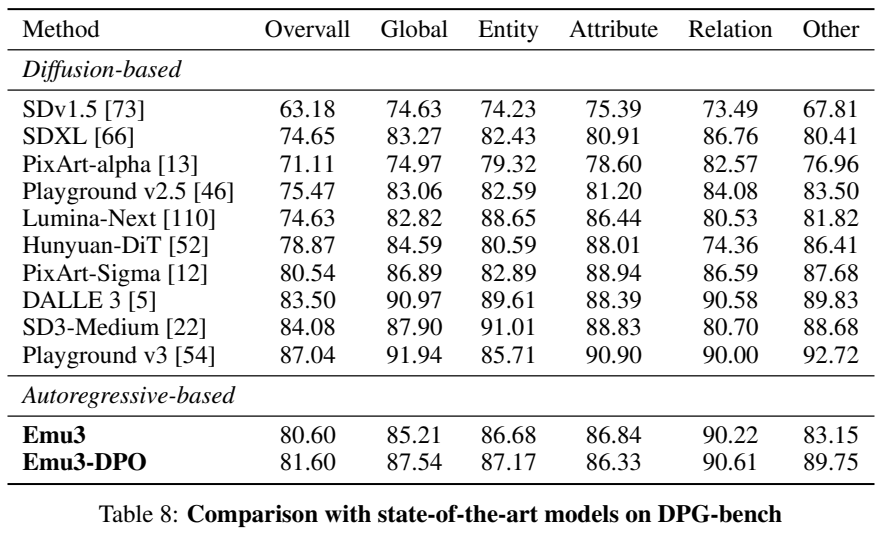
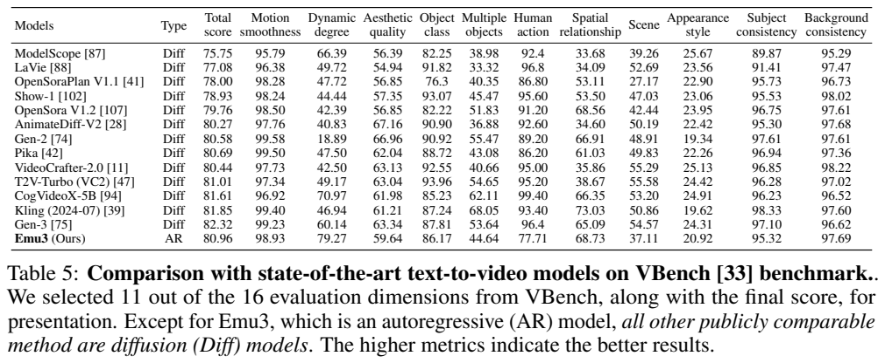
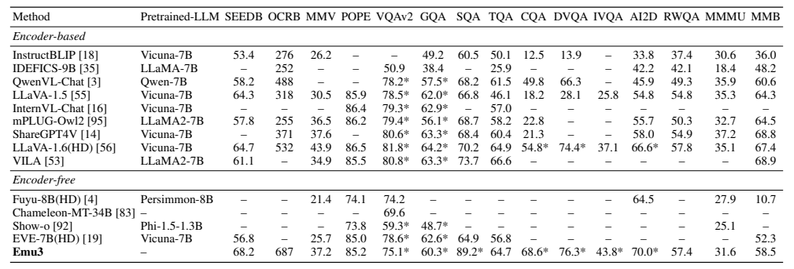

<!-- article-header:start -->
[项目首页](../../../README.md) › [模型系列](../../../reports/model-family-index.md) › [Emu](../README.md)
<!-- article-header:end -->

# Emu3：以离散 token 的自回归预测统一文字、图像与视频

<!-- article-toc:start -->

**本篇目录** · [论文定位](#paper-info) · [快速概览](#overview) · [整体架构](#architecture) · [核心原理](#principles) · [数据构建](#data) · [训练流程](#training) · [实验结果](#experiments)
<!-- article-toc:end -->

## 1. 论文信息与模型定位

原论文 **Emu3: Next-Token Prediction is All You Need** 由北京智源人工智能研究院（BAAI）的 Emu3 Team 发布，项目负责人为 Xinlong Wang，核心贡献者包括 Xiaosong Zhang、Zhengxiong Luo、Quan Sun、Yufeng Cui、Jinsheng Wang、Fan Zhang、Yueze Wang、Zhen Li 等。本文依据 [arXiv 2409.18869v1](https://arxiv.org/pdf/2409.18869v1)，提交于 2024 年 9 月 27 日；[项目页面](https://emu.baai.ac.cn)列于原文首页。

Emu3 的统一主干从零训练，处理文字、图像、视频的离散序列，以相同的下一 token 预测方式学习理解与生成。论文报告一个 8B Transformer，并进行不同任务后训练；生成配置、DPO 配置与理解配置应分别识别，不能假定所有主表结果来自完全同一个未经适配的检查点。其“无需 CLIP/扩散”主要描述自回归主干和生成机制；系统仍包含视觉 tokenizer，视频评测还加入专门的后处理模型。

## 2. 快速概览

先将图像和视频压缩成视觉码本索引，再把这些索引加入文字词表空间。描述放在视觉序列之前可以训练文生图/视频；部分数据把描述移到视觉之后，训练图像到文字。统一目标是 token 交叉熵，不需要在主干中同时维护像素扩散与文字自回归两种预测目标。

视觉 tokenizer 的码本为 32,768，空间压缩 8×8，视频时间压缩 4 倍。一个 512×512 图像或 4×512×512 视频片段可形成 4,096 个视觉 token，说明离散化后序列仍较长。视频阶段将上下文扩至 131,072，以容纳更长时空序列。

Emu3 的带提示重写 GenEval 为 0.66，原提示为 0.54；DPO 后带重写为 0.64。VBench 总分 80.96，高于 OpenSora 1.2 的 79.76，但低于 CogVideoX-5B 的 81.61。理解侧 OCRBench 687、SEED 68.2，而 MMMU 31.6、MMBench 58.5 仍落后于多种专用理解模型。因此成果在于证明统一离散路线可获得有竞争力的结果，不是所有任务全面最佳。

## 3. 整体架构

*Figure 1，PDF 第 1 页。下方将多模态输入转为 token，中间 Transformer 预测序列，上方解码回文字或视觉输出。*

8B 主干采用类似 Llama 的 decoder-only 结构，但没有直接继承一个预训练语言模型。Table 3 给出 32 层、隐藏维度 4,096、FFN 中间维度 14,336、32 个注意力头、8 个 KV 头、词表 184,622、RoPE 基数 1,000,000、上下文 131,072。使用 RMSNorm、GQA、SwiGLU、无偏置的 QKV/投影层，dropout 为 0.1。文字切分使用 QwenTokenizer，不等于语言权重来自 Qwen。

*PDF 第 5 页：Table 1 给出视觉 tokenizer 配置，Table 2 给出视频重建指标，Table 3 给出 Transformer 配置。视觉分词器与主干属于不同模块。*

视觉 tokenizer 基于 SBER-MoVQGAN-270M，在编码器和解码器各增加两层带 3D 卷积核的时间残差层。编码得到连续潜在表示，量化成码本索引；解码器从预测索引重建图像或视频。论文把主干称为 encoder-free，含义是没有拼接 CLIP 式语义视觉编码器，不能误读为整个系统完全没有视觉编码网络。

序列形式包含 `[BOS]`、描述、`[SOV]`、元信息、`[SOT]`、视觉 token、`[EOV]`、`[EOS]`；视觉内部另用 `[EOL]` 与 `[EOF]` 标出行末和帧末。分辨率、视频帧率和时长以纯文字元信息提供，帮助模型学习不同形状与时间布局。

## 4. 核心创新与数学原理

离散化把不同模态的预测变为有限词表分类。用说明性形式写，量化可理解为 $`k=\arg\min_j\Vert z-e_j\Vert ^2`$，其中 $`e_j`$ 为码本向量；主干只预测索引 $`k`$，无需直接回归像素。这是帮助理解码本的通用表达，论文未在正文重新推导完整向量量化公式。

主干的统一目标可整理为 $`\mathcal L=-\sum_t w_t\log p_\theta(s_t\mid s_{\lt t})`$，视觉 token 权重为 **0.5**，防止数量庞大的视觉序列主导训练；这一权重来自 §2.4，公式为本介绍对文字说明的重写。相同的条件概率既可预测文字答案，也可预测后续视觉索引，统一的是训练范式与主干接口。

tokenizer 本身并非只用交叉熵训练：它结合 L2、LPIPS 感知、GAN 和 commitment 损失优化重建。视觉码本质量决定细节损失上限，主干再强也不能完整恢复编码已丢失的信息。Table 2 在 3,172 个 Pexels 视频上评估重建，512 分辨率下 LPIPS/PSNR/SSIM 为 0.112/22.69/0.690；这是重建指标，不是新视频生成质量。

DPO 将同一提示下高分和低分图像对应的 token 序列组成偏好对，再联合 DPO 损失与下一 token 交叉熵优化。标准 DPO 通过当前模型相对参考模型对偏好/拒绝输出的对数概率差，增加偏好输出的相对可能性。本文不补写报告未提供的温度、损失权重或归一化超参数。直接保留生成时 token，避免把图片再次量化形成不同索引而干扰偏好训练。

未来视频延续则把已有帧 token 当作条件，继续自回归生成。论文示例用 2 秒、24 FPS 上下文预测随后 2 秒，并观察到延长 8 秒的可行案例；“可迭代延长”是运行方式，不是任意长度始终物理一致或无限记忆的证明。

## 5. 数据构建与处理

文字语料与 Aquila 使用的中英文高质量语料相同。图文来源含公开网页、AI 合成和内部高质量数据；过滤低于 512×512 的图像、使用美学阈值 5.5，并对未过美学门槛的样本辅以文字检测及颜色条件，以保留更多开放世界图像。另沿 DenseFusion 管线取得数百万图表、表格、文字丰富等理解样本。报告未披露完整图片总量、总 token 数及源比例。

图片 captioner 基于 Emu2-17B：先由 GPT-4V 标注约 1M 条密集图像描述，再微调 Emu2 并大规模重写，使用 vLLM 加速。生成数据因此大量采用详细合成描述，也解释了短提示与训练分布的差异。

视频先用 PySceneDetect 切场景，再以 PaddleOCR 过滤过多覆盖文字，使用光流排除运动太少或过强的片段，最后抽三帧，最低美学分小于 5 的片段被剔除。用于过滤的 2 FPS 和短边 256 只是处理预算，不能当成最终生成帧率或分辨率。

视频描述器由图片描述器继续训练，GPT-4V 初始标注每段 8 帧，部分文本人工修改。规模化标注时，小于 20 秒的片段均匀取 12 帧，更长视频切成 10–20 秒子段。视觉 tokenizer 另在 LAION-High-Resolution 和 InternVid 上训练。不同模块与阶段的数据口径需分开，不能把 tokenizer 数据规模等同主干训练规模。

## 6. 训练流程与目标

主干第一阶段从零训练文字与图像，长度 5,120，不使用视频；第二阶段加入视频，长度 131,072。两阶段学习率均为 $`5\times10^{-5}`$，余弦退火至零，结合 TP、CP、DP，并打包图文数据，保证完整图像不在打包过程中被分割。报告没有完整训练步数、批量、硬件数量或各阶段耗时。

生成后训练先做 Quality Fine-Tuning，选择由 HPSv2.1、MPS、LAION 美学分平均筛选的高质量图像，分辨率从 512 提至 720，仅监督视觉 token；视频另有较严格分辨率与运动筛选，末期线性衰减学习率。DPO 数据对每个用户提示生成 8–10 个候选，由三名评价者评视觉吸引力与提示一致性，选最高/最低形成偏好对。

理解后训练分图像到文字和指令微调两步，均忽略视觉 token 的预测损失，重点监督文字输出。前者图片面积约 512×512且保留比例，后者根据原尺寸保留或限制在报告所述 512–1024 分辨率范围。这里分别优化生成与理解检查点，没有报告两种后训练所有任务指标同时维持不变的联合验证。

视频生成评测还有附录 B.2 的稳像与 4 倍超分：稳像网络基于 Stable Video Diffusion 的时间 VAE，训练损失含 L1、LPIPS、GAN、KL；超分使用时空 U-Net，损失含 L2、LPIPS、GAN。它们不改变主干的离散自回归机制，但最终视频结果属于包含这些模块的管线，不能写成无任何额外后处理。

## 7. 实验设置与主要结果

*Table 7 对比 GenEval、T2I-CompBench 结果及提示重写设置，Table 8 比较 DPG-Bench。视频后处理与评测另见原文附录 B.2。*

| 图像生成指标 | Emu3 | Emu3-DPO | 需保留的条件 |
|---|---:|---:|---|
| GenEval 原提示 | 0.54 | 0.52 | 未使用重写器 |
| GenEval 重写后 | 0.66 | 0.64 | 使用 GPT-4V 扩写短提示 |
| DPG-Bench | 80.60 | 81.60 | 密集长提示评测 |
| MSCOCO-30K FID↓ | 12.8 | 19.3 | 分别 512×512 / 720×720 |
| MSCOCO CLIP-T | 0.313 | 0.312 | 文字—图像一致性 |

主表重写后的 GenEval 与 DALL-E 3 的 0.67 接近，但低于 SD3 的 0.74；未重写 0.54 也略低于 SDXL 的 0.55。DPO 提高 DPG 与人工偏好，但 GenEval、T2I-CompBench 多项和 FID 变差，不能称所有自动指标提高。不同输出分辨率还使基础版与 DPO 的 FID 比较带有配置差异。

附录图像采样采用 Top-k 16,384、Top-p 1.0，并根据基准使用 CFG：MSCOCO 为 5.0，GenEval 为 5.5，每提示 4 图；T2I-CompBench 每提示 10 图，DPG 每提示 4 图，后二者 CFG 为 5.0。外部模型许多数据来自原报告，而非本研究在完全相同协议下重跑。人工评估仅 100 条用户提示，每条三名投票者；其偏好结论应保留有限样本范围。

*Table 5 比较 VBench 视频生成结果，Table 6 比较多模态理解结果。星号表示相关训练集图像在训练中被观察过。*

Emu3 原生生成 5 秒、24 FPS 视频。经前述后处理的 VBench 总分为 80.96，动态程度 79.27、运动平滑 98.93，但人物动作 77.71、场景 37.11；CogVideoX-5B 总分 81.61，Gen-3 为 82.32。因此较高运动幅度不能替代总体一致性和语义能力判断。

理解配置 SEEDBench-Img 为 68.2、OCRBench 687、MMVet 37.2、POPE 85.2、TextVQA 64.7、RealWorldQA 57.4、MMMU 31.6、MMBench 58.5。ChartQA 68.6、DocVQA 76.3、InfoVQA 43.8、ScienceQA-Img 89.2 及其他带星号项具有训练图像已见的条件，不能泛称全部严格零样本。相对 LLaVA-1.6，Emu3 在 OCR/图表等列较高，但 MMVet 低于 43.9，MMBench 低于 67.4，MMMU 低于 35.1。

这些结果展示离散 token 主干兼顾生成与理解的可行性，同时暴露了提示分布、偏好/自动指标差异、视觉量化与长序列成本等约束。论文没有单独测量每项数据过滤、tokenizer 时间层或主干配置的完整因果消融；“下一 token 预测具有潜力”是由特定训练与评测支持的研究判断，不能据这些表格直接推导通用智能或可靠世界模拟已经实现。

<!-- article-footer:start -->
---

[← 上一篇：Molmo 与 PixMo](../../molmo/arxiv-2409.17146/README.md) · [按发表时间浏览](../../../reports/paper-reading-guide.md#year-2024) · [下一篇：AuroraCap →](../../auroracap/arxiv-2410.03051/README.md)

[返回本篇目录](#article-toc) · [返回模型系列](../README.md)
<!-- article-footer:end -->
