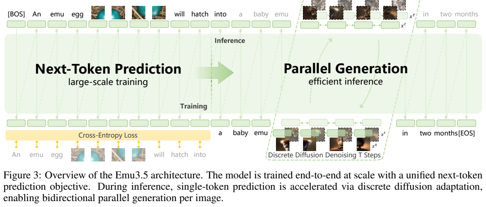
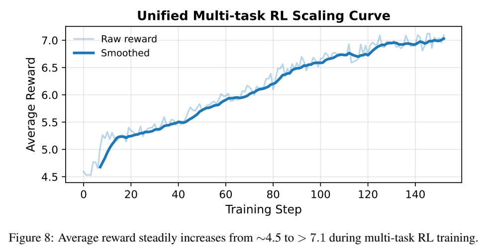
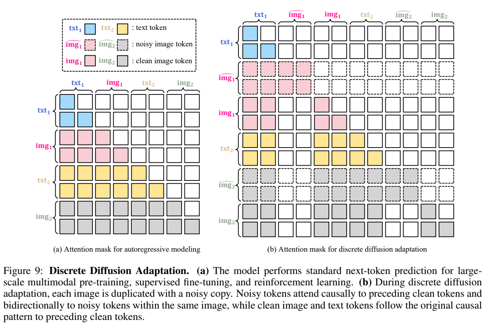
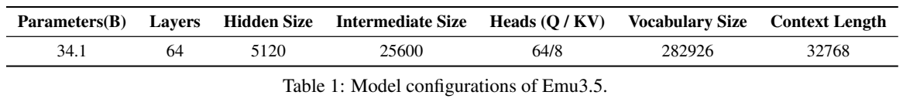
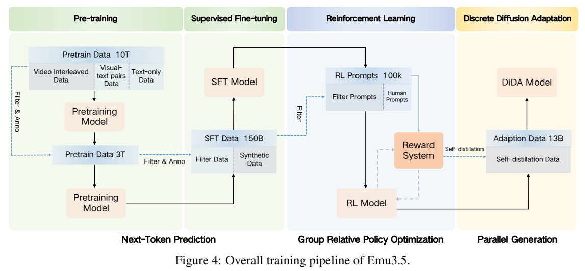
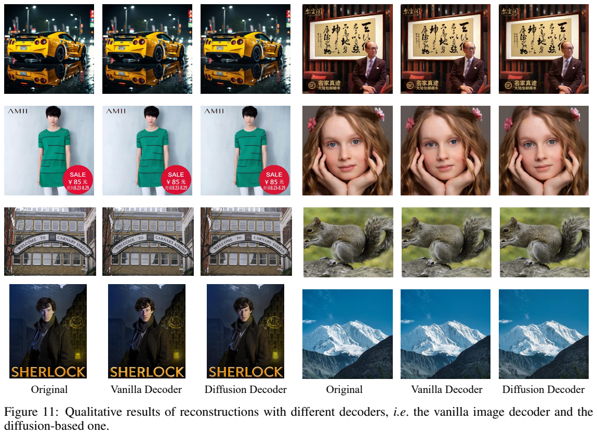
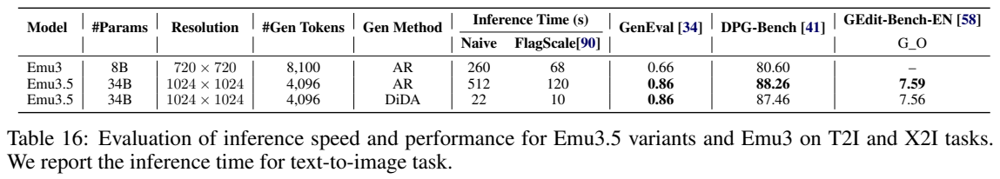

# Emu3.5：用统一离散序列学习图文世界，并适配并行图像生成

## 1. 论文信息与模型定位

| 项目 | 信息 |
|---|---|
| 原文 | *Emu3.5: Native Multimodal Models are World Learners* |
| 作者与机构 | Emu3.5 Team，北京智源人工智能研究院 BAAI；项目负责人 Xinlong Wang |
| 本文依据 | [arXiv:2510.26583v1](https://arxiv.org/pdf/2510.26583v1)，2025-10-30，完整报告 45 页 |
| 项目 | [Emu3.5 官方仓库](https://github.com/baaivision/Emu3.5)、[项目主页](https://emu.world) |
| 定位 | 原生图文理解与生成模型，重点是图像编辑、文字渲染和连续图文状态预测 |

Emu3.5 把图像编码为离散 token，与语言放进同一个 Transformer，既读图文，也写图文。报告中的“世界模型”具体表现为根据指令生成后续观察图、子任务说明与关键帧，不等于已经完成物理机器人闭环控制验证。引言称它为 32B 模型，但第 2.2 节的精确口径是 Transformer 31.2B、embedding 2.9B，合计 **34.1B**；另有视觉 tokenizer 和可选扩散解码器。

## 2. 快速概览

主要变化有三项：把长视频关键帧和时间对齐的 ASR 转写作为预训练主体；把图像编辑、故事、教程、导航和操作规划放进统一 SFT/RL；最后用 DiDA 将图像内部的逐 token 解码改为多步并行去噪，文本仍顺序生成。

| 要点 | 报告中的实现 |
|---|---|
| 统一序列 | 151,854 个文本 token、131,072 个视觉码，词表共 282,926 |
| 主干 | 64 层、宽度 5,120，GQA 为 64 个 Q 头／8 个 KV 头，最大上下文 32,768 |
| 图像表示 | IBQ tokenizer，空间下采样 16 倍，512² 图像需 1,024 个视觉 token |
| 预训练 | 概述约 13T；Table 2 的实际 seen tokens 为 10.3T + 3.5T |
| 推理加速 | Table 16 中 1024² 图像：FlagScale AR 120 秒，DiDA 10 秒 |
| 结果重点 | 长文字渲染和图像编辑；新式交错生成任务采用自动偏好评判 |

所谓“约 20 倍”不是所有配置都恰好 20 倍：同表 naive 实现是 512→22 秒，约 23.3 倍；FlagScale 是 120→10 秒，12 倍。指标也有小幅变化，不能把“基本保持质量”写成每个分数严格不变。

## 3. 整体架构

输入图像先由 455M 的 IBQ tokenizer 转成网格码，码向量维度 256。文本沿用 QwenTokenizer。序列含图像边界、尺寸等格式信息，主干用 RMSNorm、QK-Norm、SwiGLU 和 RoPE 处理交错 token，在同一词表预测下一项。模型从 Qwen3 初始化，报告没有把视觉输入与图像输出分成两套独立大型语义骨干。

*原文 Figure 3，PDF 第 5 页，图表区域裁切。左侧是所有模态的下一 token 训练；右侧一张图的视觉码一起初始化并多步更新。图中的并行是图像内部并行，不代表整段故事一次生成。*

视觉码可以由原始图像 decoder 重建，也可交给以 SD3.5-medium 初始化的扩散图像 decoder，输出每个方向两倍的像素分辨率，最高支持 2K。后者通过 LoRA 蒸馏把 50 步缩至 4 步。它和 DiDA 是两件事：DiDA 加速**视觉离散码预测**，扩散 decoder 改善**码到像素的还原**。

连续视频还可用 Wan2.2-5B 初始化的 DiT decoder，在生成关键帧码的条件下补中间帧。量化 embedding 给低层细节，可选帧间文字给语义条件，4 通道 mask 指示哪些帧已有条件。主干预测关键状态、视频 decoder 补连续变化，因此不应把所有视频像素都说成由统一主干逐 token 生成。

## 4. 核心创新与数学原理

**统一 NTP 的价值在于共同预测空间。** 以下是第 3.2 节损失描述的记号化解释，原文没有给这条编号公式：

$$\mathcal L_{\mathrm{NTP}}=-\sum_i w_i\log p_\theta(s_i\mid s_{<i}),\qquad w_i=\begin{cases}0.5,&s_i\text{ 为视觉码}\;\\1,&s_i\text{ 为文本}\end{cases}.$$

视觉序列通常远长于说明文字，减小视觉损失权重能够调节两种模态的梯度贡献。它不会减少视觉 token 数，也不是“把一张图变成半个样本”。不同 SFT 阶段权重另有变化。

空间下采样的关系可直接推导为 $N_v=(H/16)(W/16)$，这里假定尺寸与网格对齐。1024² 图像产生 4,096 个码。AR 至少需要相应数量的顺序输出步骤，而离散扩散可在每个去噪步骤同时更新一批视觉位置；这减少串行深度，但没有消除图内注意力的计算开销。

*原文 Figure 8、Figure 9，PDF 第 16 页。重点看下方右图：虚线表示带噪图像副本；它能看到同一张图的其他带噪位置，以及此前的干净上下文，不能偷看当前图的干净答案。上图奖励上升只说明所用奖励系统的优化情况。*

DiDA 的训练为每张图复制带噪版本。带噪位置对同图带噪码使用双向注意力，对之前干净图文使用因果注意力；原始干净图文只按原来的因果关系访问此前干净内容。这样可以在交错序列里学会整图去噪，同时保存文本的顺序关系。报告没有完整展开噪声转移概率、时间采样与损失权重，不能据此补出一套未经披露的精确扩散方程或固定推理步数。

多任务 RL 使用 GRPO：对同一提示采样多条输出，利用组内奖励的相对好坏学习。标准机制可解释为 $A_j=(R_j-\bar R)/(\operatorname{std}(R)+\epsilon)$，这只是 GRPO 的通常解释，并非报告原文公式或已公布的 epsilon。奖励包括 CLIP/VLM 对齐、审美、OCR 与布局、身份保持和跨帧一致性，各项先归一至 [1,10] 再组合。多奖励有助于减少偏科，但奖励曲线本身不能证明绝不存在 reward hacking。

## 5. 数据构建与处理

视频交错数据约 **6,300 万段**，平均 6.5 分钟，合计约 790 年视频。PySceneDetect 分场景：短场景取中帧，长场景按间隔取帧，保留时间戳，平均每秒 0.27 个关键帧。Whisper-large-v2 经 Faster-Whisper 转写，spaCy 根据停顿和语法划句，然后按时间排序构成图文链。音频在这里成为 ASR 文本，不能据此宣称模型原生生成声音。

第一阶段基本清洗筛除过短、低分辨率及 talking-head 视频，并平衡语言与静音样本。第二阶段再用 DeQA 评估帧质量、DINO/FG-CLIP 去冗余、LLM 评估转写文本；Qwen2.5-VL-7B 加 scene caption，LLM 做语义分段与图文汇总。最初阶段不额外加这些 caption，所以两阶段监督密度不同。

另外还有约 5 亿图文对、3,000 万视频文本对、2,735 万 X2I 样本及约 3T 纯文本 token。视频文本对采用 1 FPS 并按原视频时间顺序打包；X2I 包含 SEED-Data-Edit、PromptFix、OmniGen 系列等公开数据和自建真实／合成材料。它们的样本数不应与重复训练后的 seen tokens 混加。

SFT 的六类数据在 Table 3 中总计约 **150.1B token**。第 2.1 节写“150 billion samples”，但图和数据表的单位明确是 token，本文采用后者。故事 430K 样本，教程 960K，导航 200K，操作 973K；操作来源分别为 OXE 920K、Agi-world Alpha 40K、Songling Aloha 13K。视频经分段、去冗余、caption/ASR 合并后构造全局及图级 CoT；教程仅保留 2–10 步。操作数据将轨迹切为语义子任务，也从中间状态起步训练。教师模型生成的标注提供监督，不等于每条思维过程都经过人工事实核验。

## 6. 训练流程与目标

*原文 Figure 4 和 Table 1，PDF 第 6 页。从左到右分别为预训练、SFT、RL、DiDA；图中 RL 模型产生自蒸馏数据再用于适配，不能把并行推理能力描述成仅靠修改部署 mask 即可获得。*

| 阶段 | 真实配置与目标 |
|---|---|
| 预训练 S1 | 700K steps，LR 5e-4，最大图像 1,024 码；数据采样文本/图文/视频文/X2I/交错视频为 .20/.20/.05/0/.55 |
| 预训练 S2 | 240K steps，LR 1e-5，图像 1,024–4,096 码；比例 .18/.16/.08/.03/.55 |
| 两阶段预训练共同配置 | batch 448、seq 32,768、TP8/CP2、cosine、warmup700、WD.1、梯度裁剪5；AdamW beta .9/.95、epsilon1e-8 |
| SFT S1 | X2I768px、故事/教程/操作512px、导航720px；视觉权重1，seq16,384，TP8/CP1 |
| SFT S2 | X2I1024px，其余交错任务720px；视觉权重.5，seq32,768，TP8/CP2 |
| SFT 共同配置 | 每阶段3,000 iterations，batch1,024，LR6e-6，AdamW、cosine |
| RL | GRPO，global batch640，LR1e-6，每提示 rollout8；vLLM采样、VeRL；混合任务走一遍提示后再做X2I/T2I专门RL |
| DiDA | SFT数据和自蒸馏图文链；Figure4标适配数据13B，概述写“few billions”，完整适配配方未列全 |

RL 为每种下游任务筛约 10K 提示，并纳入约 1K 人类反馈样本，另有 58K X2I、50K T2I 提示。默认定量结果是 RL 模型；DiDA 结果在专门对比表说明。

Tokenizer 单独训练 500K iterations，batch256，Adam beta .5/.9，LR1e-4、warmup15K；联合重建、量化、LPIPS、PatchGAN、熵与 SigLIP 语义蒸馏目标。报告将这些目标列为组成项，没有给所有精确权重。可选图像 decoder 用 flow matching，先512px训练200K步，再多分辨率50K步，最后6K步LoRA蒸馏。视频 decoder 先1秒片段80K步，再2–5秒80K步，最后1080px微调；最终阶段完整超参未披露。

## 7. 实验设置与主要结果

| 指标与原表 | Emu3.5 | 对照及解释 |
|---|---:|---|
| OneIG-EN overall，Table5 | .564 | Gemini2.5FlashImage .550；各维度并非全赢，diversity仅.151 |
| OneIG-ZH overall，Table6 | .529 | Qwen-Image .548 更高 |
| LongText English/Chinese/avg，Table8 | .976/.928/.952 | Qwen-Image .943/.946/.944；中文单项仍落后 |
| ImgEdit，Table10 | 4.41 | Qwen-Image-Edit-2509 4.35、Gemini4.28；GPT4.1裁判 |
| GEdit overall，Table11 | 7.59 | Qwen2509 7.54、GPT-Image-1 7.53；GPT4o裁判，overall不是另外两列的简单均值 |
| OmniContext，Table12 | 8.82 | GPT4o8.80、Gemini7.84；GPT4.1按基准权重评分 |
| ICE-Bench overall，Table13 | .637 | Gemini.631；人脸参考、风格参考、换脸等子项仍较弱 |

图像编辑评测约1024²，ImgEdit737样本、GEdit606、OmniContext400、ICE-Bench6,538。表中自动判分差距很小的结果应按其评估协议理解，报告没有为所有差异给置信区间。

*原文 Figure 11、Table 16，PDF 第 26 页。上方按“原图、普通 decoder、扩散 decoder”排列，可以观察小字和脸部；下方列出了两种基础设施下的时间，不能只取最快数值与另一个实现的最慢数值拼成统一加速比。*

DiDA 的 GenEval 与 AR 都是 .86，DPG 88.26→87.46，GEdit7.59→7.56。扩散 decoder 在 Table15 的文字重建均值 T-ACC 为51.11，普通decoder41.52；但一般图像rFID反而.42→.49、LPIPS.08→.10。这说明它偏重局部可读性，不能描述成所有重建指标都改善。

交错任务用 ChatGPT 与 Nano Banana 做偏好比较：故事胜49.2%/平10.3%/负40.5%，教程51.5/9.5/39.0，导航65.5/0/34.5，操作67.1/2.4/30.5。操作评测331样本含10张实拍、109个抽样和192个合成，判的是生成计划与图像的一致性、物理合理性等，**没有给真实机器人任务执行成功率**。故事胜率也不能改写为超过50%。预训练验证损失持续下降支持训练可扩展性，但它是teacher-forced损失，并非相同幅度的任务成功率提升。报告将更系统的长期生成评估与物理具身代理列为后续工作；本文所有数值来自原报告，未运行模型复现。
