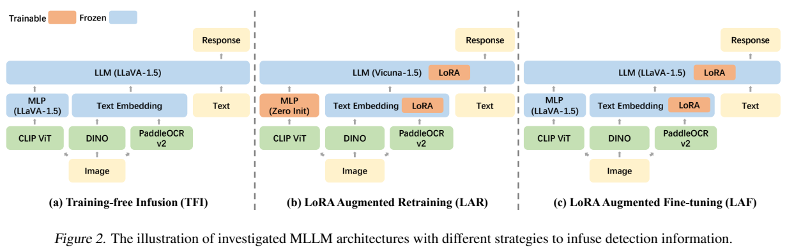
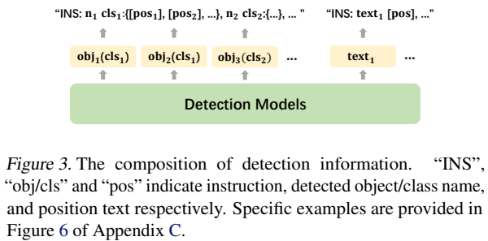
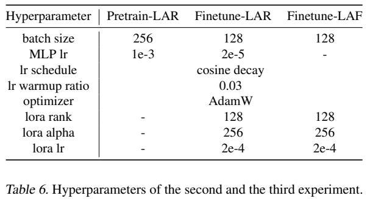
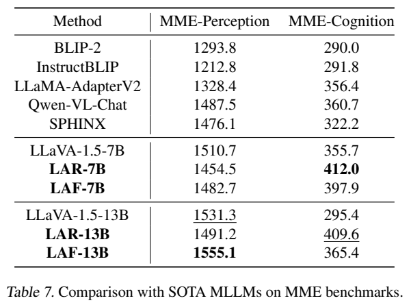
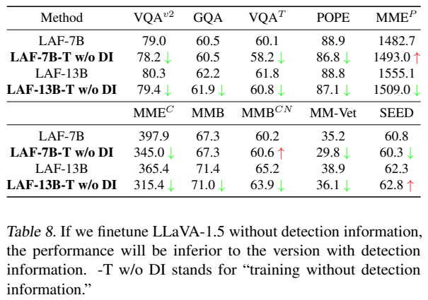
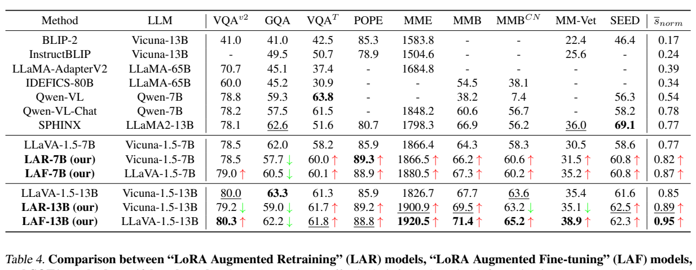
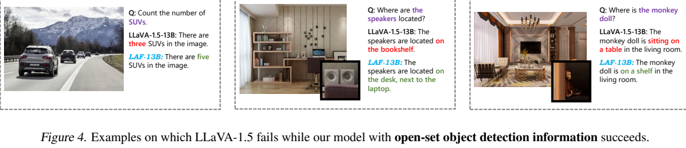
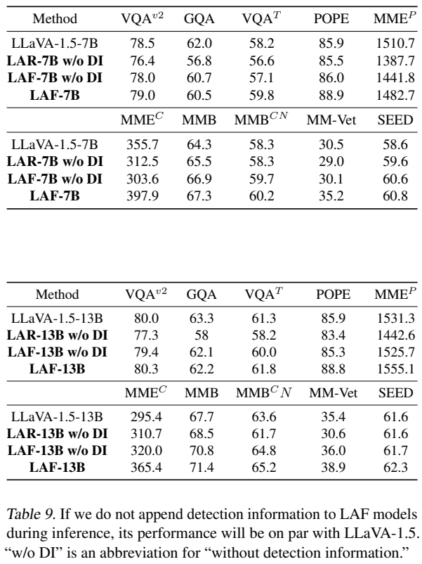
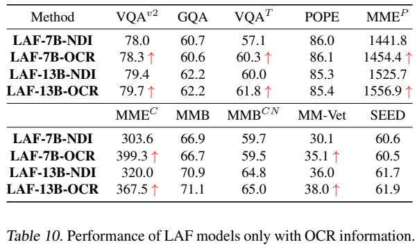
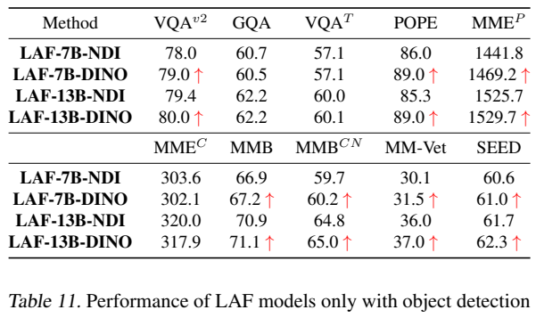

# 检测与 OCR 增强多模态模型：三种融合策略的实证比较

## 1. 论文信息与模型定位

**论文：** *Enhancing Multimodal Large Language Models with Vision Detection Models: An Empirical Study*。作者 Qirui Jiao、Daoyuan Chen、Yilun Huang、Yaliang Li、Ying Shen，来自中山大学与阿里巴巴。本篇固定介绍 [arXiv 2401.17981v1](https://arxiv.org/abs/2401.17981v1)，2024 年 1 月 31 日提交，共 16 页。

这是一份以 LLaVA-1.5 为基础的融合策略研究。它调用现成目标检测器和 OCR，在训练与推理时把对象类别、数量、中心位置和识别文字转为文本输入，比较何种训练方式能使用这些信息，同时保留原有视觉问答能力。论文最终推荐 **LoRA Augmented Fine-tuning（LAF）**，不是重新预训练一个独立视觉基础模型。

它与“用 OCR 构建训练标签”的方案不同：检测器也在推理时提供信息。评测因此针对由多组件组成的系统，不能把全部收益归为单个 LLM 的裸图像识别能力。[原文 §1、§3，PDF 第 1–4 页](https://arxiv.org/pdf/2401.17981v1#page=1)

## 2. 快速概览

| 研究问题 | 原文发现 |
|---|---|
| 直接把检测结果加入现成模型是否够用？ | TFI 不训练，7B 部分改善，13B 多项下降 |
| 从视觉语言接口重训是否更好？ | LAR 在部分任务改善，但有依赖检测信息、原图问答退化现象 |
| 如何保留原模型能力？ | LAF 固定已有投影与语言模型基础参数，仅训练新增 LoRA |
| 信息表示 | 对象类别、计数、归一化中心坐标；OCR 字符串与中心坐标 |
| 工具 | DINO、PaddleOCRv2；另展示将 DINO 换成 GroundingDINO |
| 主要限制 | 检测错误、类别粒度、额外推理成本、坐标信息利用不充分 |

最有价值的结论是“需要学会权衡额外信息”，而不是“工具输出总比原图可靠”。例如闭集检测把 SUV 归为 car，模型采纳较粗标签可能在 GQA 的严格答案比较中失分。

## 3. 整体架构

**原图：Figure 2、Figure 3，PDF 第 4 页。** 上半页左、中、右是 TFI/LAR/LAF，橙色可训练、蓝色固定；LAR 的 MLP 重新初始化，LAF 保留既有 MLP。下半页显示将对象按类别合并，再把类别、数量与位置转成自然语言字符串。图中的 LoRA 标记说明训练路径，不是新增完整语言骨干。

视觉主干沿用 LLaVA-1.5 的 CLIP ViT-L/14-336 与两层 MLP，产生图像级特征。并行运行 DINO 和 PaddleOCRv2，获得局部识别信息。DINO 输出按类别合并，记录每类数量及各实例的中心坐标；OCR 输出记录文字与中心位置。字符串用 LLM 原有词嵌入层编码，与图像特征拼接，再输入语言模型。

检测分支不把区域特征直接插入视觉编码器，也没有新增区域 cross-attention 或像素级分割头。它利用语言模型对文字的理解，把外部检测结构化结果表达成文本。保留中心而省略宽高缩短输入，但也丢掉边界范围和重叠等细节，不能将中心列表当成完整空间布局。

开放集替换时，从用户问题提取目标名称，作为 GroundingDINO 的文本条件，例如“blue guitars”“SUVs”。返回结果转为同一字符串接口，后续模型不变。原文没有披露完整目标名提取算法或给出全面替换后的基准分数，主要是定性验证。[原文 §3.2、§4.4，PDF 第 3–4、7–8 页](https://arxiv.org/pdf/2401.17981v1#page=3)

## 4. 核心创新与数学原理

**以文字接口注入局部证据。** 可以把模型输入概括为 \([P(V(I));E(S_{\rm obj});E(S_{\rm ocr});E(q)]\)，其中 \(V\) 为视觉编码器、\(P\) 为投影、\(S\) 为检测信息字符串、\(E\) 为文字嵌入。这个表达是本文对原文架构的整理，不是原文提出的编号公式。它解释为何数值中心坐标也是普通文本 token，而不是另设的坐标向量编码。

该接口使模型不必从压缩视觉特征中重新推断所有对象及字符，但工具信息可能含漏检、重复计数和误识别。因此融合并不是强制把检测结果当答案，而是学习在图像、问题与工具证据之间选择。

**训练初始化影响信息依赖。** LAR 从现成 Vicuna 与 CLIP 出发，重建多模态接口；“retraining”不是把语言模型从随机参数开始训练。额外检测文字贯穿对齐阶段，有机会让系统过早依赖较易读的文字证据。LAF 先继承已经学会利用图像特征的 LLaVA-1.5，再学习附加工具，实验显示总体保留能力更好。但移除工具后仍有退化，不能称为严格无遗忘。

LoRA 的通常表达为 \(W=W_0+BA\)，保持基础权重 \(W_0\) 不变，训练低秩增量。这是对训练模块的数学解释；本论文核心是实证策略比较，没有新提出专门的检测监督损失。训练目标仍是条件回答生成。

**综合分数需要区分量纲。** 原文先对每个基准归一化：

\[
s_{\rm norm}=\frac{s-s_{\min}}{s_{\max}-s_{\min}},
\qquad \bar s_{\rm norm}=\operatorname{Mean}(s_{\rm norm}).
\]

其中最小/最大值取自纳入比较的方法。这样可将 MME 分数与准确率等放到统一区间，但结果会随所选比较模型变化，并非通用的绝对能力量表。报告所称 12.99%/11.76% 是归一化综合成绩的改善，不是每项准确率增加这些百分点。[原文 §3.4，PDF 第 5 页](https://arxiv.org/pdf/2401.17981v1#page=5)

## 5. 数据构建与处理

作者沿用 LLaVA-1.5 的训练数据，主要增加同一图片的检测文本，没有额外构建一个新图像大数据集。LAR 对齐阶段使用 **LCS-558K** 图文配对；指令数据沿用 LLaVA-1.5 的混合来源，包括 GPT-4 对话、ShareGPT、VQAv2、GQA、OKVQA、A-OKVQA、OCRVQA、TextCaps、RefCOCO 与 Visual Genome。论文没有在此逐项提供去重后的精确配比。

对象字符串先给说明句，再写 `数量 类别: {中心1, 中心2, ...}`。同类别合并既缩短文字，又显式提供计数。OCR 则写识别字符串及相应中心。它们源自自动模型，不是人工真值，也不是额外目标答案；图中示例含水印文字或其他不相关内容，训练需处理这类噪声。

附录 A 的统计：对象信息平均 **118.5 tokens**，OCR 平均 **29.4**；剔除空结果后分别为 **125.1、97.5**。对象最长 1247、OCR 最长 3995，超过 512 的比例约 0.6% 与 0.2%。为控制输入，作者排除长度超过 **1024** 的对象检测或 OCR 信息，不应误写成把整个训练上下文固定为 1024。

这些压缩方式让多数辅助文本较短，但“长度可接受”是原文判断，未附全面推理延迟、显存或工具调用吞吐量评测。检测器的训练数据、阈值、输出排序等关键复现信息也没有在本报告完整列出。[原文 §3.2、附录 A/D，PDF 第 3–4、12、15 页](https://arxiv.org/pdf/2401.17981v1#page=12)

## 6. 训练流程与目标

**原表：Table 6、7、8，PDF 第 15 页。** 左下是训练参数，LAF 的 MLP 学习率为破折号，因为它固定；右上 MME 拆成感知与认知，揭示总分掩盖的下降；右下比较“训练时不用工具”的额外微调基线，与“推理时拿掉工具”是不同实验。

| 策略 | 初始化与更新 | 明确披露参数 |
|---|---|---|
| TFI | 直接使用已有 LLaVA-1.5，加检测文字；无新增训练 | 不适用训练学习率 |
| LAR 对齐 | 重初始化 MLP，固定现成视觉与语言基础模块，检测信息参与 | batch 256；MLP LR \(10^{-3}\) |
| LAR 指令 | 训练 MLP 和语言侧 LoRA | batch 128；MLP LR \(2\times10^{-5}\)；LoRA LR \(2\times10^{-4}\) |
| LAF | 基于已训练 LLaVA-1.5，固定 MLP 与 LLM 基础权重，只训练 LoRA | batch 128；LoRA LR \(2\times10^{-4}\)；1 epoch |

LAR/LAF 指令阶段 LoRA rank 为 **128**、alpha **256**，optimizer AdamW，cosine 学习率，warm-up ratio 0.03。视觉编码器和外部检测器不被作为共同训练的模块。原文没有公开本实验的 GPU 数、精度、总训练时间、确切步数、完整最大上下文或全部优化器参数，本文不从 LLaVA 后续实现补填。

如果将训练目标记为 \(-\sum_t\log p_\theta(y_t\mid I,q,S_{\rm obj},S_{\rm ocr},y_{<t})\)，它只监督回答 token；这个数学写法是本文归纳，不是新增的检测损失。论文没有同时回归 DINO 框，也没有让 LLM 对 OCR 输出提供置信度校准。[原文 §3.3、Table 6，PDF 第 4–5、15 页](https://arxiv.org/pdf/2401.17981v1#page=15)

## 7. 实验设置与主要结果

**原表/图：Table 4、Figure 4，PDF 第 7 页。** 上表将 MME 感知与认知相加展示，下方是 GroundingDINO 替换后的成功例，不能把这些例子等同于开放集替换全面优于 DINO 的统计证据。表右端是归一化平均值，并不是新的独立测试集。

| 指标 | LLaVA-1.5 7B → LAF-7B | LLaVA-1.5 13B → LAF-13B |
|---|---:|---:|
| VQAv2 | 78.5 → 79.0 | 80.0 → 80.3 |
| GQA | 62.0 → 60.5 | 63.3 → 62.2 |
| TextVQA | 58.2 → 60.1 | 61.3 → 61.8 |
| POPE | 85.9 → 88.9 | 85.9 → 88.8 |
| MME 总分 | 1866.4 → 1880.5 | 1826.7 → 1920.5 |
| MMBench | 64.3 → 67.3 | 67.7 → 71.4 |
| MMBench-CN | 58.3 → 60.2 | 63.6 → 65.2 |
| MM-Vet | 30.5 → 35.2 | 35.4 → 38.9 |
| SEED | 58.6 → 60.8 | 61.6 → 62.3 |

结果表明 LAF 对对象幻觉判定、文字和综合问答多数指标有利，但 GQA 两个规模都下降。MME 拆开后，7B 感知从 **1510.7 降到 1482.7**，认知从 355.7 到 397.9；总分改善掩盖前者。因而原文概括的“9/10”不能解读成每一拆分指标都提升，也不能称为超过所有列出的模型：Qwen-VL 的 TextVQA 63.8、SPHINX 的 SEED 69.1 高于 LAF13B。[原文 Table 4/7，PDF 第 7、15 页](https://arxiv.org/pdf/2401.17981v1#page=7)

无需训练的 TFI13B 在 VQAv2 从 80.0 降到 76.6、GQA 从 63.3 降到 60.2；即使 POPE 提升，也不足以证明直接拼工具总有益。LAR13B 的 GQA 为 59.0，推理拿掉检测信息后更低到 58.0。LAF13B 在同一移除条件下为 62.1，更接近原 63.3，支持 LAF 较好保留视觉能力，但并非所有成绩完全恢复。[原文 Table 1–3/9，PDF 第 5–6、16 页](https://arxiv.org/pdf/2401.17981v1#page=5)

**原表：Table 9、10、11，PDF 第 16 页。** 左表是在已训练模型推理时移除工具；右表分别只加 OCR 或 DINO。要先识别这个差别，才能正确解释“额外微调本身”与“外部信息”的贡献。不同表存在个别重列值不一致，例如 LAF7B TextVQA 主表 60.1、Table 9 为 59.8，本文主结果采用 Table 4，不人为合并。

13B 无工具基线的 TextVQA 为 60.0，只加 OCR 达 **61.8**；POPE 从 85.3 到 85.4，变化很小。只加 DINO 时 POPE 达 **89.0**，TextVQA 为 60.1。这种任务对应性支持 OCR 与对象信息各有用途，而不是额外 token 数一增加就获得相同改善。

额外微调不加检测信息的对照也有例外：7B 的 MME 感知 1493.0 高于 LAF 的 1482.7，中文 MMBench 60.6 高于 60.2；13B 的 SEED 62.8 高于 62.3。原文 prose 的“所有基准都更差”与表格不完全一致，应按表项判断。报告未给系统性错误检测注入、工具延迟或真实部署成本实验，GroundingDINO 仅展示定性替换。因此更稳妥的结论是：适当初始化与 LoRA 学习可以有效使用工具证据，收益取决于任务、工具准确性和类别粒度。
