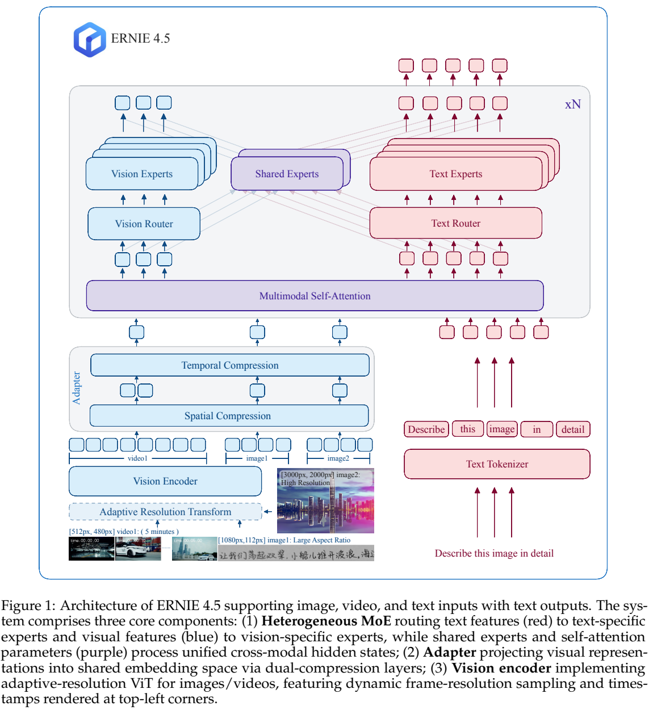
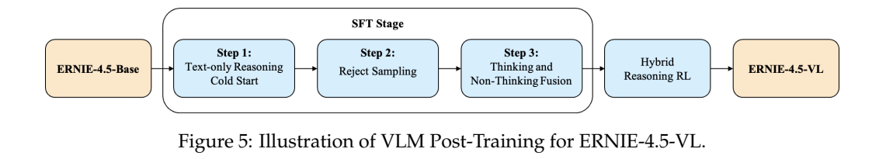
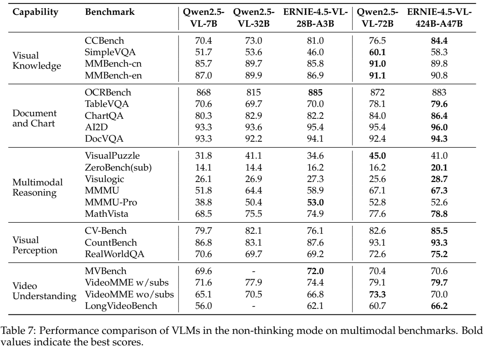

<!-- article-header:start -->
[项目首页](../../../README.md) › [模型系列](../../../reports/model-family-index.md) › [ERNIE](../README.md)
<!-- article-header:end -->

# ERNIE 4.5：模态隔离专家与统一图像视频理解

<!-- article-toc:start -->
<a id="article-toc"></a>

**本篇目录** · [论文定位](#paper-info) · [快速概览](#overview) · [整体架构](#architecture) · [核心原理](#principles) · [数据构建](#data) · [训练流程](#training) · [实验结果](#experiments)
<!-- article-toc:end -->

<a id="paper-info"></a>

## 1. 论文信息与模型定位

| 项目 | 信息 |
|---|---|
| 原文 | **ERNIE 4.5 Technical Report** |
| 团队 | ERNIE Team，百度 |
| 发布日期 | **2025-06-29**，官方PDF署期 |
| 固定来源 | [百度官方技术报告](https://ernie.baidu.com/blog/publication/ERNIE_Technical_Report.pdf)，本仓库保存原始字节与SHA256 |
| 代码与模型 | [官方仓库](https://github.com/PaddlePaddle/ERNIE) · [官方模型集合](https://huggingface.co/collections/baidu/ernie-45) |
| 本文重点 | 视觉语言模型 **ERNIE-4.5-VL-424B-A47B / 28B-A3B**，包括思考与非思考模式 |

报告介绍的十款模型包含纯文本和多模态变体，不能全部视为视觉模型。本文围绕VL模型展开：输入图像、视频和文字，输出文字；语料处理中使用ASR并不意味着这两款VL模型具有原生音频输入接口。A47B/A3B是激活参数规模标识，不能把稀疏激活规模等同总参数规模。[§1–2，PDF第4–8页](https://ernie.baidu.com/blog/publication/ERNIE_Technical_Report.pdf#page=4)

<a id="overview"></a>

## 2. 快速概览

| 关键设计 | 解决的问题 | 机制边界 |
|---|---|---|
| 异构MoE | 视觉/文字梯度竞争、视觉token计算开销 | 两类token进入各自专家组，共享注意力交互 |
| 自适应分辨率ViT | 长宽比、帧数和视觉预算难兼顾 | 受预算约束地调分辨率与抽帧，不是无限分辨率 |
| 双重压缩Adapter | 视频序列过长 | 空间2×2及时间2×分组后映射到语言空间 |
| 路由正交化 | 专家路由坍缩 | 约束router权向量，非约束专家输出彼此正交 |
| 三阶段SFT与混合RL | 同时保持直接回答和复杂推理 | 视觉感知、思考/非思考融合、可验证与偏好奖励 |

最大VL模型非思考模式在MMMU为67.3、MathVista为78.8；思考模式分别为70.0、78.9。不同任务收益不同，开启思考不是所有基准的单调改进。[Tables7–8，第40页](https://ernie.baidu.com/blog/publication/ERNIE_Technical_Report.pdf#page=40)

<a id="architecture"></a>

## 3. 整体架构



*原文Figure1，PDF第6页；保留架构与图注。图中的共享专家是总体设计，具体规模配置需结合Table2。*

| 模块 | 输入与输出 | 公开机制 |
|---|---|---|
| 自适应预处理 | 图像/视频 → 可变分辨率帧 | 保持比例并把边长取到patch倍数；视频按帧率、帧数上下界和token预算共同采样 |
| 视觉ViT | 帧patch → 视觉特征 | 2D RoPE、packing；绝对时间戳直接绘制到帧左上角像素 |
| 压缩Adapter | 视觉网格 → 语言宽度嵌入 | 空间2×2重排、时间2×重排，再用MLP映射；静态图复制成两帧走统一路径 |
| 共享自注意力 | 视觉/文字序列 → 跨模态隐状态 | 两种token在共享注意力中交互，位置编码分配时间/高/宽维度 |
| 模态专属router与FFN | 隐状态 → 专属专家输出 | 文字只路由文字专家、视觉只路由视觉专家；视觉专家中间宽度为文字的1/3 |
| 输出头 | 最终隐状态 → 文字token | 条件自回归生成；最终层不配置不贡献文字CE的视觉专家 |

一次视频问答先分配帧/分辨率预算，在帧中写入时间戳，经ViT和Adapter压缩，与问题文字组合后进入异构MoE。注意力提供跨模态信息交换，FFN路由承担模态专门化，两者职责不同。视觉专家宽度缩小使**单个视觉token的FFN成本约下降66%**，不是整个模型计算量下降66%。[§2.1–2.3，第5–8页](https://ernie.baidu.com/blog/publication/ERNIE_Technical_Report.pdf#page=5)

Table2给VL大/小模型分别列54/28层、Q/KV头64/8与20/4，均列131,072上下文。大模型文字/视觉专家均64选8；小模型均64选6。共享专家列对大模型为“—”、小模型为2，因此不能把图示共享专家数量套给两者，也不据“—”推演未说明的实现细节。[Table2，第11页](https://ernie.baidu.com/blog/publication/ERNIE_Technical_Report.pdf#page=11)

<a id="principles"></a>

## 4. 核心创新与数学原理

### 4.1 隔离路由与可共享的跨模态信息

混合所有token竞争同一专家集合可能造成视觉信号挤占文字路由。ERNIE按模态限制可选专家，把专业化落实到FFN；共享注意力仍允许视觉内容影响文字输出。架构也允许非路由共享专家处理两种模态，但规模配置不同。视觉专家从文字专家结构剪枝初始化，较窄中间层降低高数量视觉token的成本，代价是视觉支路容量较小。这是“注意力交互、专家隔离”的分工，不等于视觉与文字独立编码到底。[§2.1 / Figure2，第5–7页](https://ernie.baidu.com/blog/publication/ERNIE_Technical_Report.pdf#page=5)

### 4.2 空间与时间压缩，以及位置可辨识性

Adapter将相邻2×2空间特征重排成一组，视觉序列长度先变为原来的1/4，再将两帧同位置特征结合实现时间2×压缩。分组特征仍通过MLP转到语言空间，不能把它理解成平均池化直接丢弃四个patch。静态图复制为两帧，以复用视频接口。下游3D RoPE把低频分配给时间，其余频率交错给高/宽；文字仍用1D RoPE。帧内像素时间戳进一步提供绝对时间线索，不额外增加一个文字时间戳token。[§2.2–2.3，第7–8页](https://ernie.baidu.com/blog/publication/ERNIE_Technical_Report.pdf#page=7)

### 4.3 Router权向量正交化

原文Eq.(1)对归一化router权向量施加相关性约束：

```math
\mathcal L_{\mathrm{orth}}=\sum_{i,j}(\hat w_i^{\mathsf T}\hat w_j-\delta_{ij})^2,\qquad \hat w_i=\frac{w_i}{\Vert w_i\Vert_2}.
```

$`w_i`$ 是专家 $`i`$ 的路由权向量，$`\delta_{ij}`$ 是单位矩阵元素。约束鼓励不同专家的router方向分散，减轻路由坍缩；它没有要求专家激活或输出相互正交。实现采用类似AdamW的解耦更新，正交化系数为 $`10^{-3}`$，且该项不随学习率缩放，不能直接写成所有参数统一最小化“CE加固定权重正交项”。[§3.4.1，第12页](https://ernie.baidu.com/blog/publication/ERNIE_Technical_Report.pdf#page=12)

### 4.4 Token平衡损失保留文字监督、改变归一化

图文样本的监督文字比例不同，只按有效文字数归一化会放大文字很短的样本梯度。设 $`U_i`$ 为样本的未遮罩监督文字位置，$`M_i`$ 为图像和prompt等遮罩位置，Eq.(2–3)将归一化分母改为整段长度：

```math
\mathcal L_i^{\mathrm{usual}}=\frac{\sum_{j\in U_i}\ell_{ij}}{\lvert U_i\rvert},\qquad \mathcal L_i^{\mathrm{balanced}}=\frac{\sum_{j\in U_i}\ell_{ij}}{\lvert U_i\rvert+\lvert M_i\rvert}.
```

$`\ell_{ij}`$ 是监督token的交叉熵。分子始终只对 $`U_i`$ 求和，图像/prompt没有因此获得新的预测损失。变化在于不同文字比例样本的相对权重，而不是把所有遮罩token改成生成目标。[§3.4.2，第12–13页](https://ernie.baidu.com/blog/publication/ERNIE_Technical_Report.pdf#page=12)

### 4.5 思考/非思考融合与可验证视觉推理

视觉感知数据先用程序生成几何、函数和谜题，再为自然STEM图合成精细描述，借文字推理模型反复求解筛选；能单靠图中OCR解答的样本被过滤，迫使问题依赖视觉内容。三阶段SFT依次完成文字推理冷启动、视觉拒绝采样、思考/非思考融合；直接回答样本前插空思考标签但遮罩其梯度。专家合并把非思考模型的多模态专家迁入推理模型。

后续视觉RL混合可验证任务和偏好奖励，使用GRPO及受DAPO启发的动态采样/超长过滤。视觉谜题同时检查推理一致性和终答，不只匹配一个选项；UI2Code按HTML渲染结果比较。报告纯文本章节的UPO不应移植成VL训练算法。[§4.2，第17–19页](https://ernie.baidu.com/blog/publication/ERNIE_Technical_Report.pdf#page=17)

<a id="data"></a>

## 5. 数据构建与处理

| 类别 | 处理方式 | 作用与边界 |
|---|---|---|
| 图文交错网页/文档 | 去页面内重复、低清图、广告与无关段落，检查顺序 | 保留图文关联，完整来源配比未公开 |
| 图像文本对 | CLIP相关性筛选、去重、类型标记、部分重新描述 | 提升对齐；拼图与合并caption扩展组合场景 |
| 视频 | 关键帧、ASR与重写，按预算动态采样 | ASR提供训练文字信息，不推出原生音频接口 |
| 领域与合成数据 | 知识点驱动数学/代码/事实合成；金融、医疗等领域筛选 | 具体全部样本量和阈值没有列全 |
| 推理与偏好 | 程序谜题、自然STEM、拒绝采样与RL轨迹回流 | 自动验证降低噪声，不能保证每条合成描述无幻觉 |

数据组织建立语言、知识、领域、场景与质量维度，结合规则、模型和人工反馈。REEAO将固定长度记录及确定性token序列与消费跟踪结合，作者声称可避免分布式恢复时重复/遗漏；本仓库没有复现该工程保证。[§3.1–3.2，第8–10页](https://ernie.baidu.com/blog/publication/ERNIE_Technical_Report.pdf#page=8)

<a id="training"></a>

## 6. 训练流程与目标



*Figure5，第17页；三阶段SFT后接混合推理RL。*

| 阶段 | 更新范围与安排 | 上下文与作用 |
|---|---|---|
| I 文字预训练 | 先训练语言骨干，再扩长上下文 | 长度逐渐到32K/128K；初始值正文写8K而Table3写4,096，原文存在差异 |
| II 视觉适配 | 先用较小LLM训练ViT；预对齐仅Adapter/视觉专家/router；融合时再解冻ViT | 后两步LLM保持冻结，Table3列8,192 |
| III 联合训练 | 文字/图像/视频全参数联合 | 先8,192，再扩至131,072 |
| VL后训练 | 三阶段SFT、GRPO与混合奖励 | 冷启动、拒绝采样、模式融合，再提升可验证视觉推理 |

长上下文扩展将RoPE基数从10,000增到160,000再到500,000，并提高超过16K文档的采样比例。Table2的最终128K窗口不代表所有阶段都使用128K。报告47% MFU与2,016张H800对应其最大**纯文本**模型，不能据此填作VL完整训练效率。未公开的全量数据规模、每一VL阶段耗时不作推算。[§3.3 / Tables2–3，第10–12页；§5](https://ernie.baidu.com/blog/publication/ERNIE_Technical_Report.pdf#page=10)

<a id="experiments"></a>

## 7. 实验设置与主要结果



*Table7，第40页；保留完整表头、模式与图注。*

| 模式/任务 | VL-28B-A3B | VL-424B-A47B |
|---|---:|---:|
| 非思考 MMBench英文 | 86.9 | 90.8 |
| 非思考 OCRBench | 885 | 883 |
| 非思考 MMMU / MathVista | 58.9 / 74.9 | 67.3 / 78.8 |
| 非思考 DocVQA | 94.1 | 94.3 |
| 非思考 VideoMME有/无字幕 | 74.4 / 66.8 | 79.7 / 70.0 |
| 思考 MMMU / MathVista | 61.8 / 72.6 | 70.0 / 78.9 |
| 思考 VisualPuzzle | 36.9 | 46.3 |

图像任务按零样本协议评估，Qwen开放权重与o1官方API在作者环境重测；部分任务按官方指标，其他使用GPT-4.1或蒸馏裁判。视频对比的Qwen结果来自论文/模型卡，ERNIE使用32,768上下文、2fps、16–480帧并按预算调分辨率，不能当作完全统一重跑。[§8.2，第39–41页](https://ernie.baidu.com/blog/publication/ERNIE_Technical_Report.pdf#page=39)

Table8中最大模型MMMU为70.0，o1为77.7；VisualPuzzle为46.3，o1为48.5；MathVista为78.9，o1为71.4。因此正文泛化的“缩小差距或超越”应按任务理解，不能声称它在MMMU已超过o1。思考模式也会降低部分OCR或小模型MathVista分数。本仓库整理报告值，未运行模型或复现评测。

<!-- article-footer:start -->
---

[← 上一篇：Qwen VLo](../../qwen/document-244376c2123a/README.md) · [按发表时间浏览](../../../reports/paper-reading-guide.md#year-2025) · [下一篇：DenseWorld-1M →](../../denseworld-1m/arxiv-2506.24102/README.md)

[返回本篇目录](#article-toc) · [返回模型系列](../README.md)
<!-- article-footer:end -->
