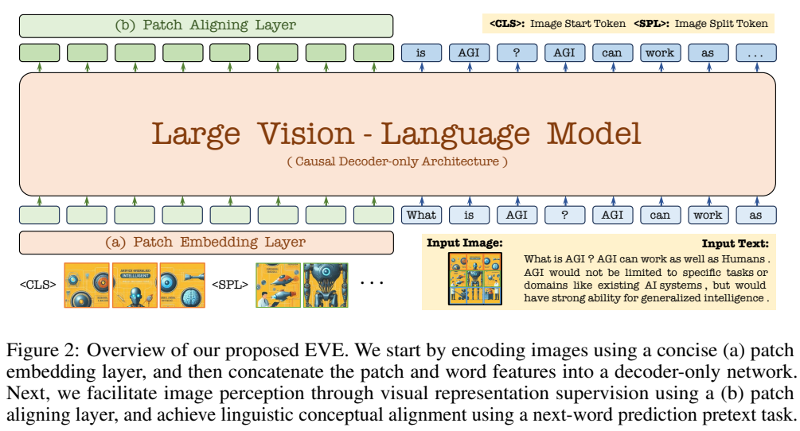
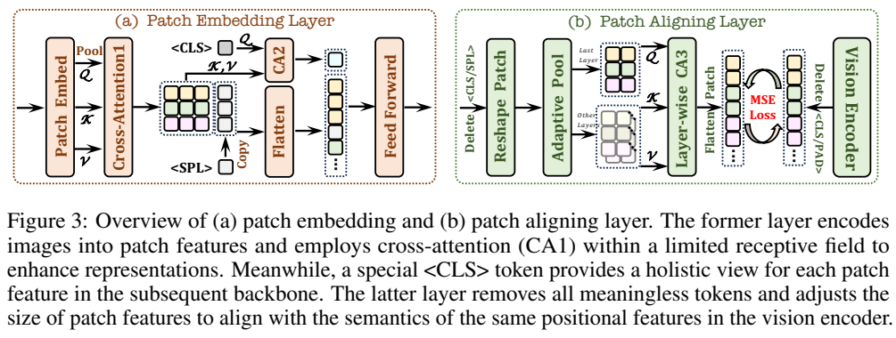
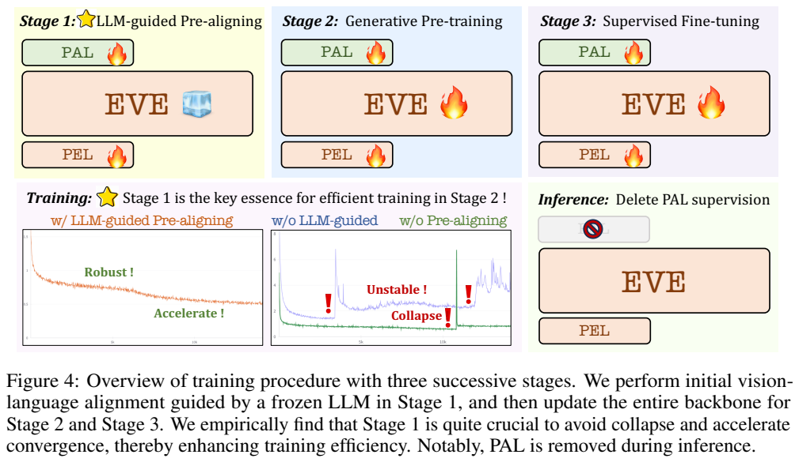
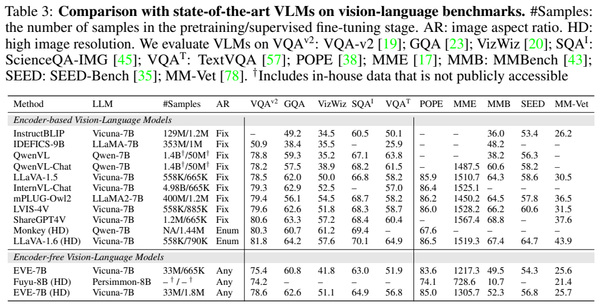
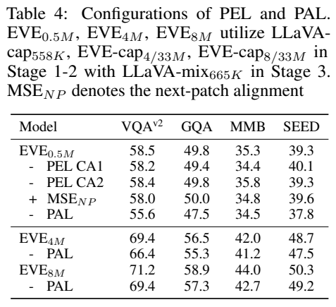
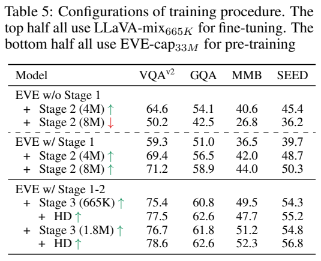
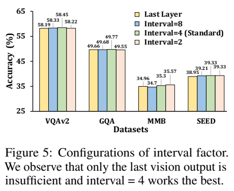
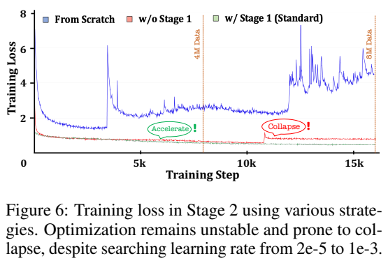

# EVE：用语言底座预对齐和视觉特征监督构建无深层视觉编码器模型

## 1. 论文信息与模型定位

论文 **Unveiling Encoder-Free Vision-Language Models** 由 Haiwen Diao、Yufeng Cui、Xiaotong Li、Yueze Wang、Huchuan Lu、Xinlong Wang 提出，机构为大连理工大学、北京智源人工智能研究院和北京大学。本文采用 [arXiv 2406.11832v1](https://arxiv.org/pdf/2406.11832v1)，提交日期为 2024 年 6 月 17 日；[代码与模型](https://github.com/baaivision/EVE)为首页指定仓库。

EVE 从 Vicuna-7B 演化出视觉语言理解模型，不在推理通路中串接一个深层 CLIP/EVA 视觉编码器，而用轻量 patch embedding 把图片送入统一因果解码器。它提供标准 EVE-7B 和高分辨率 EVE-7B（HD），任务为文字条件的视觉理解与文字回答；没有报告图像/视频生成或音频训练。“Encoder-free”不表示没有任何图像映射层，也不表示训练完全不用视觉编码器，教师视觉特征正是重要监督来源。

## 2. 快速概览

直接把像素 patch 接入语言模型可能收敛慢、优化不稳定。EVE 先冻结语言底座，只训练 patch embedding 和辅助对齐层，让视觉输入进入已有语言表示空间，再解冻主干。训练还用 CLIP-ViT-L/14 的对应 patch 特征作细粒度监督，弥补描述文本对视觉信息覆盖有限的问题。

模型读取保留宽高比的图像，标准版最长边 672，HD 为 1,344，不依赖预设宽高比网格或多张切图来适应固定视觉编码器。训练时的辅助 Patch Aligning Layer（PAL）在推理中删除；输入侧的 Patch Embedding Layer（PEL）保留。

预训练数据池 33M，来自 SA-1B、OpenImages、LAION 的重新描述；标准版 SFT 为 665K，HD 主文标为约 1.8M。HD 的 VQAv2/GQA 为 78.6/62.6，接近部分同规模编码器模型；但 MMBench 52.3、MMVet 25.7 仍有明显差距。移除深层视觉编码器主要节省视觉前处理成本，不能将局部编码阶段约十倍加速写成整个问答过程十倍。

## 3. 整体架构

*Figure 2 为整体模型，Figure 3 左侧是 PEL，右侧是只用于训练监督的 PAL。*

PEL 先用卷积将图片转成二维 patch 特征，卷积步长为 14，再以步长 2 的平均池化控制 token 量。CA1 局部交叉注意力用池化结果查询对应的原 patch 小区域，保留局部信息；CA2 让特殊 `<CLS>` token 查询所有 patch，形成全局概览。每行末插入可学习的 `<SPL>`，指明二维换行，最后通过两层前馈映射并拼接文字嵌入。

由于语言解码器是因果的，放在图片开头的全局 token 提供整体图片线索，帮助后面的 patch 不仅依靠已出现的左侧/上方 token。论文宣称接近无损传入视觉信息，但仍包含卷积、池化与有限表示维度，本文不将其当作数学上可逆或保证零信息损失的编码。

PAL 从主干多个中间层取出视觉 token，移除 `<CLS>/<SPL>`，还原二维形状，通过自适应池化对齐教师 CLIP 的 patch 网格。CA3 用最后层特征作 Query、同位置其他层特征作 Key/Value，融合层次表示，再与教师同位置特征比较。教师侧去除 `<CLS>/<PAD>` 等非 patch 项；三类交叉注意力均为 8 个头。

*Figure 4，PDF 第 5 页。冻结/训练标记需按阶段区分，右下推理图删除 PAL。*

因此部署模型不需要教师 CLIP 或 PAL 的前向计算，但其视觉能力是在训练中借助这些模块获得的。把训练教师与实际推理模块分开，才能正确理解该架构的简化程度。

## 4. 核心创新与数学原理

EVE 的第一项设计是 LLM 引导的预对齐：随机初始化的视觉入口先在冻结语言模型条件下获得可理解表示，再允许整个网络改变。它保护初始语言知识免于过早受到视觉入口噪声干扰。论文提供了有/无预对齐的训练曲线与结果，属于特定数据、底座和学习率下的实证结论，不能推导为所有无编码器模型都必然需要完全相同阶段。

第二项是位置对齐的特征监督。按论文文字操作，可用说明性形式

$$\mathcal L_{\rm patch}=\frac1P\sum_{p=1}^P\|\widehat a_p-\widehat v_p\|_2^2$$

解释：$a_p$ 为 PAL 聚合输出，$v_p$ 为教师对应位置输出，帽号表示 $\ell_2$ 归一化。归一化后平方距离等于 $2-2\cos(a_p,v_p)$，因此该项主要对齐方向；这是基于标准恒等式的解释，原论文未把它单独列为推导。图片和教师采用不同分辨率，空间匹配通过自适应池化实现，而非要求原始 token 数一模一样。

文字端使用下一词交叉熵，与 patch MSE 共同训练。论文没有在正文给出两项损失完整权重，本文不补一个任意系数。它也比较对应 patch 对齐与“下一 patch”特征预测：后者并非本模型最终训练目标，不能误写成同时生成未来图像 token。

多层聚合选择的 interval 标准值为 4，指从完整网络按层间隔取特征，而不是仅取最后 4 层。Figure 5 中这种配置在部分任务较好，但 MMBench 的 interval=2 为 35.57，高于 interval=4 的 35.33，不能称标准 interval 所有指标最高。

## 5. 数据构建与处理

预训练共 33M 对：SA-1B 11M，由 LLaVA-1.5-13B 描述；OpenImages 7M、LAION 15M，由 Emu2-17B 描述。保留高于 448×448 的源图，去掉重复文字和不完整句子。LAION 先用 EVA-CLIP 提取特征，再做 50,000 类 K-means，各类取距中心最近的 300 张，合计 15M，目标是选取代表性图片，不能视为严格的全部重复图去除或长尾分布保证。

Stage 1 使用上述 33M 中的 16M 子集，Stage 2 使用完整 33M。这里 16M 与 33M 是不同阶段取用的数据，不能相加当成 49M 唯一图片。合成标题来自已有视觉语言模型，公开图片来源不意味着监督文本不受教师错误和风格影响。

标准 SFT 使用 LLaVA-mix-665K，包含视觉问答、对话与纯 NLP 交互。HD 增加 AI2D、SynthDoG、DVQA、ChartQA、DocVQA、Vision-Flan、Bunny 等。正文称额外约 1.2M、主表称总计 1.8M；附录 Table 7 又将所列混合总量写为 1.35M，并列出采样比例。版本内部口径不一致，本文保留各自出处，不把这些数字拼成一个确定且可复现的唯一总量。

教师特征监督用 CLIP-ViT-L/14，把图像填充并缩到 336×336。EVE 本体可接收保比例的大图，教师则仍有固定网格限制；PAL 正是在两个空间之间提供对齐桥梁。

## 6. 训练流程与目标

第一阶段冻结 Vicuna，只训练 PEL/PAL，使用文字交叉熵和 patch MSE；第二阶段解冻 PEL/PAL 及整个语言主干，以 33M 对继续联合训练；第三阶段全部模型继续用同类目标进行 SFT，HD 只在此阶段扩展最大图片分辨率，不是从第一阶段始终以 1,344 训练。

正文与附录 Table 8 报告：三阶段批量 512/512/128，最大学习率 $4\times10^{-4}$/$4\times10^{-5}$/$2\times10^{-5}$，AdamW、余弦衰减、权重衰减 0、各 1 epoch，warmup 比例 0.03/0.01/0.01，DeepSpeed stage 3。标准版训练样本为 16M/33M/665K，在两个各 8 张 A100 40GB 的节点上约 9 天完成。该耗时主要对应标准 EVE-7B，报告没有把所有数据生成成本或完整 HD 成本明确计入。

作者观察到大量图文预训练提升视觉能力但削弱语言与指令能力，于是第二阶段使用较低学习率；增加语言数据或 MoE 被提出为后续方向，不能把它们写成已实施的标准预训练方案。SFT 本身含纯文字对话，但并不表示 Stage 2 已全面混入大规模纯文本。此处的“generative pre-training”指文本自回归训练，不等同于像素图像生成。

## 7. 实验设置与主要结果

*Table 3，PDF 第 7 页。标准与 HD 分辨率及 SFT 量不同，应按配置比较。*

| 模型 | VQAv2 | GQA | TextVQA | POPE | MME | MMBench | SEED | MMVet |
|---|---:|---:|---:|---:|---:|---:|---:|---:|
| EVE-7B | 75.4 | 60.8 | 51.9 | 83.6 | 1217.3 | 49.5 | 54.3 | 25.6 |
| EVE-7B HD | 78.6 | 62.6 | 56.8 | 85.0 | 1305.7 | 52.3 | 56.8 | 25.7 |
| Fuyu-8B HD | 74.2 | — | — | 74.1 | 728.6 | 10.7 | — | 21.4 |
| LLaVA-1.5 7B | 78.5 | 62.0 | 58.2 | 85.9 | 1510.7 | 64.3 | 58.6 | 30.5 |
| LLaVA-1.6 HD 7B | 81.8 | 64.2 | 64.9 | 86.5 | 1519.3 | 67.4 | 64.7 | 43.9 |

HD 比标准版在多列提升，相对 Fuyu 在所列可比较项也较强；但相对 LLaVA-1.5，只有部分任务接近或略高，指令格式相关和综合任务仍有差距。论文明确提到选择字母、二元回答等指令问题。主文 ScienceQA-Img 63.0/64.9 等结果也不足以证明原语言底座能力完全保留。

*左上为模块消融，右上为训练流程消融，下方展示层次聚合与优化稳定性。*

Table 4 在 4M 配置中，保留 PAL 的 VQAv2/GQA 为 69.4/56.5，去掉后 66.4/55.3；8M 配置为 71.2/58.9，去掉后 69.4/57.3，支持特征监督。小规模去除 CA1/CA2 影响有限且并非每列变差，不能把任一交叉注意力都称作所有指标不可替代。

Table 5 中，无 Stage 1 的 4M/8M VQAv2 为 64.6/50.2；有 Stage 1 对应 69.4/71.2，Figure 6 显示无预对齐配置后期损失上升。HD 单独在 665K SFT 下把 VQAv2 从 75.4 提至 77.5，却把 MMBench 从 49.5 降至 47.7；再增加指令数据后最终为 78.6/52.3。因此分辨率和数据量的作用应通过消融分别理解。

Table 6 的视觉侧耗时从 LLaVA-1.5 的 0.033 秒降至 EVE 的 0.003 秒，LLM 侧两者同为 0.48 秒；按分量相加仅约 0.513→0.483 秒，不能宣称端到端十倍。HD 视觉/LLM 为 0.013/1.52 秒，LLaVA-1.6 为 0.13/2.07 秒，配置的 token 与计算量也不同。原文未完整列明这些延迟的硬件、批量、输出长度协议，应作为报告设置下的结果。

EVE 的贡献在于展示可部署的统一解码器路线及预对齐、特征监督的必要实证，而不是证明视觉教师已不再有用。公开数据、较轻视觉入口与高分辨率灵活性具有研究价值，但语言遗忘、指令遵循、数据规模需求及与强编码器模型的性能差距仍需处理。
