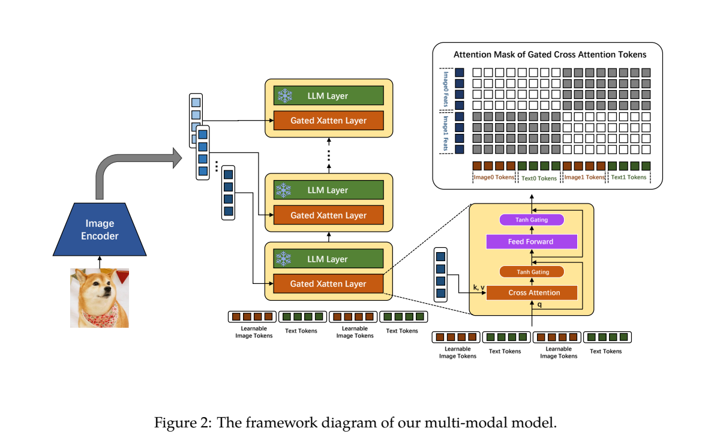
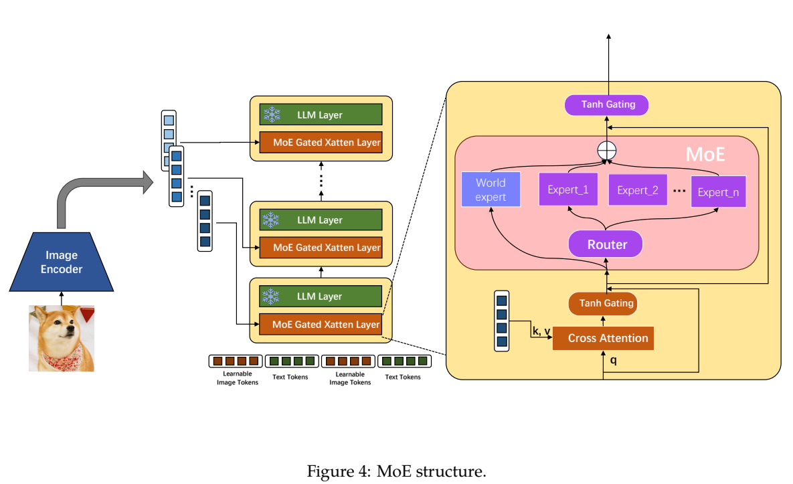
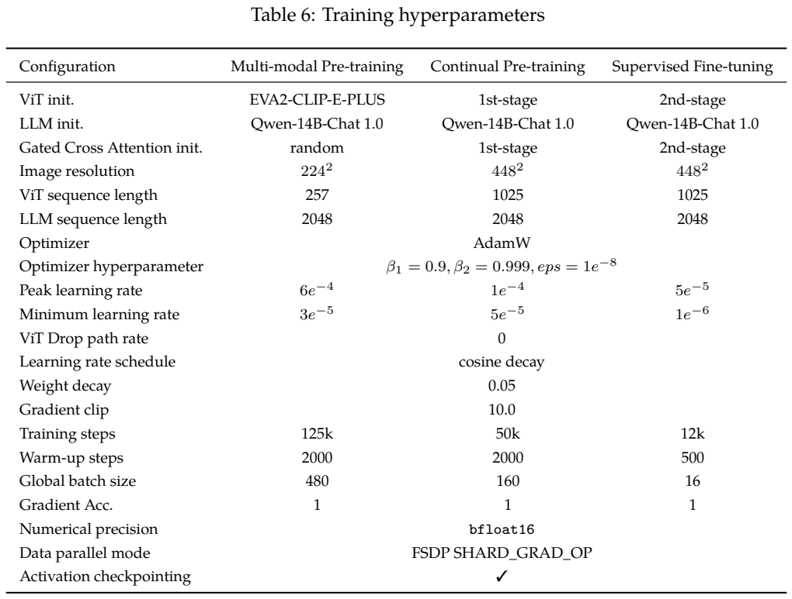
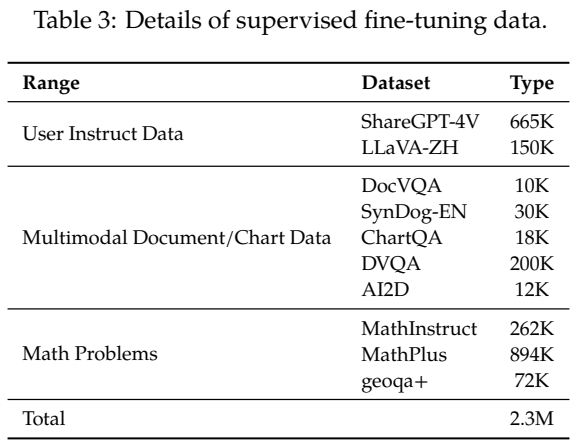
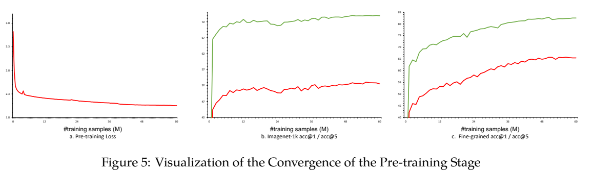
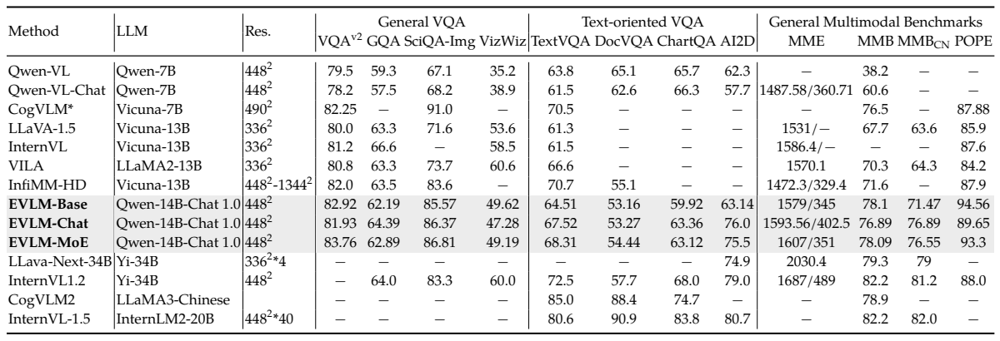

<!-- article-header:start -->
[项目首页](../../../README.md) › [模型系列](../../../reports/model-family-index.md) › [EVLM](../README.md)
<!-- article-header:end -->

# EVLM：用分层视觉特征和门控交叉注意力降低视觉理解成本

<!-- article-toc:start -->
<a id="article-toc"></a>

**本篇目录** · [论文定位](#paper-info) · [快速概览](#overview) · [整体架构](#architecture) · [核心原理](#principles) · [数据构建](#data) · [训练流程](#training) · [实验结果](#experiments)
<!-- article-toc:end -->

<a id="paper-info"></a>

## 1. 论文信息与模型定位

| 项目 | 信息 |
|---|---|
| 原文 | *EVLM: An Efficient Vision-Language Model for Visual Understanding* |
| 作者与机构 | Kaibing Chen、Dong Shen、Hanwen Zhong 等，快手科技 |
| 本文依据 | [arXiv:2407.14177v1](https://arxiv.org/pdf/2407.14177v1)，2024-07-19，21 页，含数据与训练附录 |
| 模型基础 | EVA2-CLIP-E-Plus 4.4B + Qwen-14B-Chat 1.0 |
| 模型档位 | EVLM-Base、EVLM-Chat、EVLM-MoE；不是三个不同尺寸的语言主干 |

EVLM 面向图像与视频理解，输出文本，重点是中英文细粒度识别、问答以及详细描述。论文试图解决“高分辨率视觉特征直接拼入 LLM 后计算很贵”的问题：保留较多视觉信息，让语言 token 在较窄的交叉注意力模块中访问它们。它不是图像生成模型，也不是仅含 14B 参数的完整系统。

<a id="overview"></a>

## 2. 快速概览

| 设计 | 作用与边界 |
|---|---|
| 分层 ViT 特征 | 从视觉编码器最后 40 层均匀取 8 个特征序列，送入不同语言层的交叉注意力 |
| 每图 16 个可学习 media token | 进入 LLM 的图像标记序列较短；原始视觉特征仍保留在外部 KV 中 |
| 每个 LLM 层前加门控 cross-attention | 语言与图像多次交互；固定 LLM，训练新增融合层及部分 ViT |
| 融合模块中的 MoE | 16 个细粒度路由专家选 4 个，另有总参与的 world expert |
| 三阶段训练 | 大规模图文预训练→问答/OCR等持续预训练→指令微调 |
| 数据重点 | 2.5B 图文对、50M 网页图文；约 60% 中文，包含地标、菜品、明星等概念 |

论文计算得到单层语言模块 FLOPs 约为直接拼接路线的 .24 或 .077，取决于视觉长度。这个估算支持融合模块的效率设计，但没有实测整套系统达到 4.2 倍或 13 倍吞吐：4.4B 视觉编码器、多层特征和 MoE 等开销不能忽略。

<a id="architecture"></a>

## 3. 整体架构

EVA2-CLIP-E-Plus 去掉最后 Transformer 后面的 norm 和 head，从最后 40 层取 8 级特征。这里“分层”是不同网络深度的语义表示，不是额外构造八种像素分辨率。Qwen-14B-Chat 1.0 的每个 Transformer 层之前都插一个 Gated Cross Attention Layer；不同深度语言层按顺序接收不同深度的视觉特征。



*原文 Figure 2，PDF 第 3 页，图表区域裁切。橙色融合层在绿色 LLM 层之前；右侧框给出交叉注意力、FFN 和 tanh 门控。右上 mask 约束每组 media token 仅访问所属图像。*

一张图对应 16 个可学习 token 替代 Flamingo 的单个 `<image>` 标记。它们可在多层交互中携带视觉信息，但不是先用 Q-Former 压成 16 个向量后彻底丢弃原始图像特征。交叉注意力的 Q 来自语言/media 隐状态，K、V 来自视觉特征。额外全零视觉向量用于处理并不对应图像的文本位置。普通图文序列中，每组可学习 token 访问自己的图，文本段访问前一张图。

视频描述改变 mask：各帧 media token 仍只看各自帧，但 caption 的文本 token 能访问视频全部帧特征，避免只读到最近一帧。Figure 7 展示到 frame15 的示意，不能据此认定所有训练视频都固定抽 16 帧，论文未完整给出视频采样与专门微调配方。

<a id="principles"></a>

## 4. 核心创新与数学原理

**让视觉序列不经过宽 LLM 的全部自注意力与 FFN。** 若视觉长度 $`s_v`$、文本长度 $`s_t`$、语言宽度 $`h`$、batch $`B`$，原文 Eq.(1) 为：

```math
F_{\rm full}=24B(s_v+s_t)h^2+4B(s_v+s_t)^2h.
```

前项包含投影和 FFN，后项是注意力矩阵乘法的二次项。原文 Eq.(2) 的交叉注意力估算为：

```math
F_{\rm cross}=4(6+r_{xc}+r_{xf})B(16+s_t)h^2+4B(16+s_t)^2h+4r_{xc}Bs_vd_vh+4r_{xc}B(16+s_t)s_vh.
```

其中 $`d_v`$ 为视觉宽度，$`r_{xc}`$、$`r_{xf}`$ 为新增注意力/FFN 相对语言宽度的设置。语言模块主要处理 $`16+s_t`$ 个位置，视觉长度出现在视觉 KV 投影与交叉乘积中。固定文本长度时，这部分对视觉长度呈线性增长；视觉 ViT 自身依然有注意力开销，多图时还要计入每图的 media token，不能把这个单图单层估算推广成整个模型严格线性。

报告采用以下示例配置：

```math
h=5120,d_v=1792,r_{xc}=.2,r_{xf}=.5,s_t=64
```

当 $`s_v=256`$ 时 $`F_{cross}/F_{full}\approx.24`$，$`s_v=1024`$ 时约 .077。附录 ViT sequence length 是 257/1025，包含额外 token，而 FLOPs 示例采用 256/1024；本文保留两者原口径。

门控可以用标准残差示意 $`u'=u+\tanh(a)\mathrm{CrossAttn}(u,V)`$ 来理解：标量或参数化门值限制新视觉更新，之后还有门控 FFN。这是 Figure 2 的解释式，并非论文新增编号公式；原文没明确所有门参数初始化，不能自动补成“全部初始化为零”。



*原文 Figure 4，PDF 第 7 页。路由发生在新增融合层的 FFN 内，绿色 LLM 层仍冻结；蓝色 world expert 不依赖路由挑选。不要把图解读为整个 Qwen 主干变成 MoE。*

MoE 从 EVLM-Base 的 FFN 复制 $`N=4`$ 份，每份切为 $`M=4`$ 个细粒度专家，共 16 个，路由选 $`k=4`$ 个，再叠加每 token 都参与的 world expert。原文没有详列门控归一化、负载均衡系数或完整总/激活参数量；因此只可说增加可训练容量、保持稀疏选择，不能算成整个系统仅激活四分之一参数。由于共享专家还参与，选4/16也不是完整融合模块的计算占比。

<a id="data"></a>

## 5. 数据构建与处理

第一阶段 Table 1：英文 BLIP-cap100M、LAION-COCO40M、LAION-en200M、Coyo160M、DataComp500M；中文 LAION-zh100M、自建1.4B；网页 MMC4 40M、WanJuan10M。图文caption合计2.5B，网页50M。caption和网页分别打包，每序列最多64张图、语言长度2048，得到60M训练序列，不能把打包序列数当成只用了60M原始图文对。

附录A的清洗删除坏图、纯色图、异常长宽比、低分辨率图，以及过短、重复、符号/长数字串、URL等文本，繁体转简体，CLIP低相关样本剔除。网页筛掉图片过多和文本超过2048**字符**的网页，再做MMC4式相关过滤；这与训练2048 **token**不是同一个限制单位。

持续预训练92M样本：上一阶段按聚类抽取30M、VQA9M、检测17M、OCR26M、内部NLP10M。VQA含GQA、DocVQA、ChartQA等；检测含GRIT、VisualGenome与RefCOCO家族。OCR真实材料来自快手视频、Wukong、CommonCrawl、街景、电子书，专家模型抽文字/框/置信度，过小或低置信文字通过inpainting移除，再去重复；合成材料用SynthDoG、中英字体、手写/艺术字及LaTeX密集文档。自动OCR和合成标注不是全部人工真值。

SFT汇总称2.3M：ShareGPT4V665K、LLaVA-ZH150K，文档图表270K，以及MathInstruct262K、MathPlus894K、geoqa+72K。Table3列项相加约2.413M，与汇总2.3M不完全一致，本文不强行对齐。另有dense caption流程：多VLM产描述，Llama2-70B拆句去重，GPT4o核对与合并，GPT4润色，随后用于描述专门微调；其规模与完整训练设置未给全。教师核对降低幻觉风险，不能保证每句准确无误。

<a id="training"></a>

## 6. 训练流程与目标

训练目标是文本 token 的自回归交叉熵。用说明式写为 $`\mathcal L=-\sum_{t\in\mathrm{text}}\log p_\theta(y_t\mid y_{\lt t},V)`$；图像可学习标记用于输入，不是要生成像素的监督目标。此式根据第3节文字整理，不是报告原编号公式。



*原文 Table 6，PDF 第 20 页。查看各列的分辨率、步数、batch 和学习率，可发现持续预训练与 SFT 并非相同数据、相同训练时长。*

| 设置 | 图文预训练 | 持续预训练 | SFT |
|---|---:|---:|---:|
| 分辨率 / ViT长度 | 224² /257 | 448² /1025 | 448² /1025 |
| training steps |125K|50K|12K|
| global batch |480|160|16|
| 峰值→最低LR，Table6 |6e-4→3e-5|1e-4→5e-5|5e-5→1e-6|
| warmup |2000|2000|500|
| 更新范围 |前25%仅融合层；后75%再开ViT后半|融合层+ViT后半|融合层+ViT最后四分之一|

三个阶段 LLM 始终冻结，ViT和融合层继承前阶段参数。共同使用AdamW（beta .9/.999、eps1e-8）、cosine、WD.05、梯度裁剪10、bfloat16、FSDP SHARD_GRAD_OP与activation checkpointing。正文第一阶段LR写6.4e-4，但附录表及说明均6e-4，表中采用附录口径并保留这一差异。MoE沿用SFT数据和配置，由EVLM-Base的融合FFN扩容。

125K×480=60M与第一阶段打包序列数吻合；后两阶段步数×batch并不等于数据池总量，说明不能自行写成“92M与2.3M样本各完整训练一遍”。报告未明确所有重采样/打包细节，也未给公开GPU时长。

<a id="experiments"></a>

## 7. 实验设置与主要结果







*原文 Figure 5及Tables3–4，PDF第8页。中部曲线区分预训练损失、ImageNet和细粒度识别；下方灰色三行是Base/Chat/MoE，应横向比较每种能力，而非只看一个最高分。*

| Table4 指标 | Base | Chat | MoE |
|---|---:|---:|---:|
| VQAv2 |82.92|81.93|83.76|
| GQA |62.19|64.39|62.89|
| ScienceQA-Img |85.57|86.37|86.81|
| TextVQA |64.51|67.52|68.31|
| DocVQA |53.16|53.27|54.44|
| ChartQA |59.92|63.36|63.12|
| AI2D |63.14|76.0|75.5|
| MMBench EN / CN |78.1/71.47|76.89/76.89|78.09/76.55|
| POPE |94.56|89.65|93.3|

MoE有VQAv2/TextVQA收益，却不是所有指标都优于dense Chat，后者GQA、ChartQA、AI2D、中文MMBench更高；Base的英文MMBench和POPE也并未被SFT全面超越。和外部系统相比，EVLM-MoE TextVQA68.31低于表中InternVL1.5的80.6，DocVQA54.44低于90.9，ChartQA63.12低于83.8；两者分辨率策略、规模、训练数据不同。不能把正文“多数任务优越”泛化为OCR全面领先。CogVLM标星结果是任务专门微调模型，应区别于通用模型。

ImageNet监控从每类抽10张，共10K图：对1000个候选类别计算文本损失，取最低者；这不是自由生成分类。细粒度七类随数据增加继续提高，但明星类别仍弱。没有直接消融单独证明“八层特征”或“16token”的净效果，数据与结构贡献不能完全分离。

视频dense caption评测3,596视频、39类，用GPT4o裁判。Table5的详细程度/描述准确性：EVLM5.73/7.22，Video-llava2 5.69/7.18，Video-llama2 5.32/7.10。差距较小，报告未给置信区间或完整裁判偏差校准。正文说“五个来源”但只列YouTube1B、ActivityNet、Ego4D三名，来源清单披露不完整；也没有给传统字幕指标。因此这些成绩支持所构建评测下的描述能力，不能推出自动裁判比所有人工或既有指标更可靠。所有数据为原报告结果，本文未运行模型。

<!-- article-footer:start -->
---

[← 上一篇：InternLM-XComposer-2.5](../../internlm-xcomposer/arxiv-2407.03320/README.md) · [按发表时间浏览](../../../reports/paper-reading-guide.md#year-2024) · [下一篇：SlowFast-LLaVA →](../../slowfast-llava/arxiv-2407.15841/README.md)

[返回本篇目录](#article-toc) · [返回模型系列](../README.md)
<!-- article-footer:end -->
