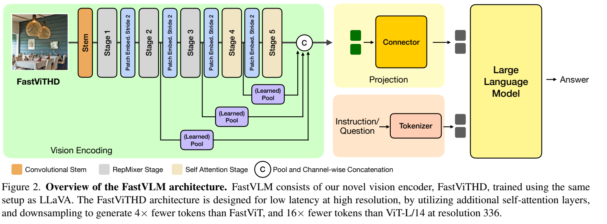
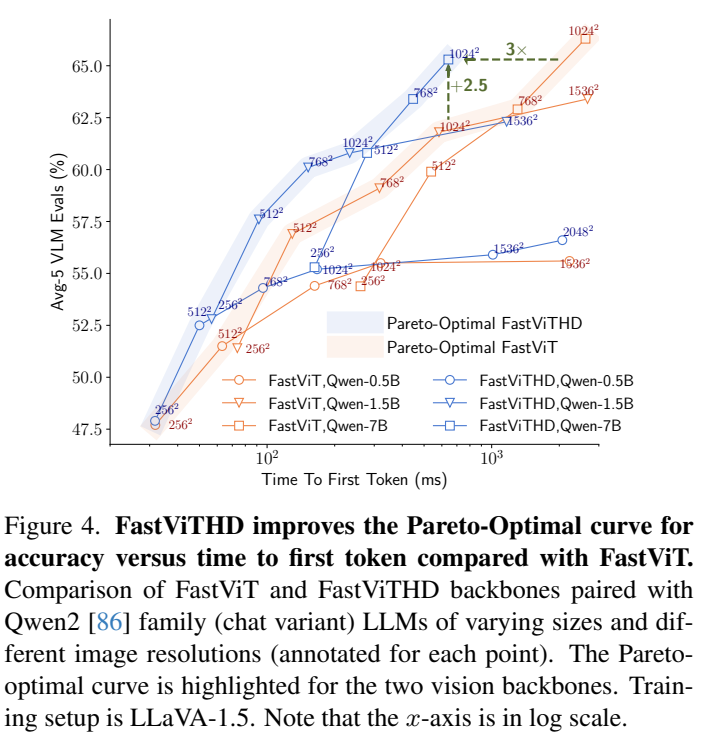
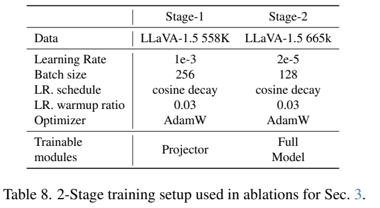

<!-- article-header:start -->
[项目首页](../../../README.md) › [模型系列](../../../reports/model-family-index.md) › [FastVLM](../README.md)
<!-- article-header:end -->

# FastVLM：高分辨率混合视觉编码与首 token 延迟优化

> 解读 Apple 的 **FastVLM: Efficient Vision Encoding for Vision Language Models**，采用 arXiv **2412.13303v2**（2025-05-15），首次提交为 2024-12-17。本文将不同训练行、语言主干与分辨率分别列出，不把全篇最佳值拼成一个型号。

<!-- article-toc:start -->
<a id="article-toc"></a>

**本篇目录** · [论文定位](#paper-info) · [快速概览](#overview) · [整体架构](#architecture) · [核心原理](#principles) · [数据构建](#data) · [训练流程](#training) · [实验结果](#experiments)
<!-- article-toc:end -->

<a id="paper-info"></a>

## 1. 论文信息与模型定位

| 项目 | 内容 |
|---|---|
| 团队与材料 | Apple；CVPR 2025 论文及公开代码/模型 |
| 家族 | FastVLM，核心视觉编码器为 FastViT-HD |
| 模态 | 图像和文字输入、文字输出 |
| 规模 | 视觉编码器约 125.1M，论文组合 Qwen2-0.5B/1.5B/7B 与 Vicuna-7B |
| 核心定位 | 同时减少视觉编码耗时与语言 prefill 的 token 负担，优化真实硬件上的准确率/延迟折中 |
| 官方资源 | [固定论文](https://arxiv.org/pdf/2412.13303v2) · [官方代码](https://github.com/apple-aiml-research/ml-fastvlm) · [官方技术博客](https://machinelearning.apple.com/research/fast-vision-language-models) |

与只剪掉语言输入 token 的方法相比，本工作把视觉编码器本身的耗时纳入优化。小语言主干配上很慢的高分辨率编码器，仍会出现很长的首 token 等待；因此编码速度和输出 token 数需要共同设计。[§1、§3，PDF 第 1–5 页](https://arxiv.org/pdf/2412.13303v2#page=3)

<a id="overview"></a>

## 2. 快速概览

FastViT-HD 用卷积/RepMixer 处理早期高分辨率特征，在后期低分辨率特征上使用自注意力。它增加第五个阶段，使最终空间下采样达到 64 倍，并融合早期多尺度特征。1024×1024 的静态输入最终只给语言模型 256 个视觉 token。

研究先在相同 LLaVA-1.5 配方下比较视觉主干，接着扩大预训练与指令数据，给出多个语言尺寸和分辨率的 Pareto 曲线。作者不主张单纯把分辨率升到最高：小语言模型未必有效利用大量视觉细节，视觉编码也可能成为主要瓶颈。

报告的 TTFT 是视觉编码实测与语言 prefill 测量之和，使用 M1 Max MacBook Pro；训练使用 H100。读数必须保留两种硬件的不同用途，不能把训练服务器当成延迟评测设备。

<a id="architecture"></a>

## 3. 整体架构



*原文 Figure 2，PDF 第 4 页。先看 stem 与五个阶段，再看早期特征经池化汇入连接器；图中的 Answer 对应语言主干生成的文字。*

| 模块 | 输入与输出 | 公开机制 |
|---|---|---|
| 卷积 stem | 图像 → 初始网格 | 在每边下采样 4 倍，降低高分辨率早期成本 |
| Stage 1–3 | 网格 → 分层局部特征 | RepMixer；深度 2/12/24，宽度 96/192/384 |
| Stage 4–5 | 较小网格 → 语义视觉特征 | 自注意力；深度 4/2，宽度 768/1,536；自注意力在低分辨率执行 |
| 阶段间 patch embedding | 特征网格 → 更小网格/更宽通道 | 7×7 depthwise stride2 + 1×1 pointwise；不使用 squeeze-excite 以控制延迟 |
| 多尺度融合 | 各阶段特征 → 对齐后的特征序列 | 池化早期尺度后按通道拼接；比较平均池化与学习的 depthwise pooling |
| 投影连接器 | 视觉特征 → 语言可用嵌入 | 沿 LLaVA 形式对齐视觉/语言空间；原文未完整列出全部中间维度 |
| 语言模型 | 视觉嵌入+提示 → 文字答案 | Qwen2 或 Vicuna 自回归主干，尺寸作为实验变量 |

一次推理先处理图像并融合空间/尺度特征，连接器把视觉序列交给语言主干，与问题共同 prefill，再生成答案。这里的 token 减少主要来自层级结构的空间下采样，不是编码完所有 ViT token 后再用一个重要性排序器删除它们。[§3.1–3.2，PDF 第 3–5 页；附录 B，PDF 第 15 页](https://arxiv.org/pdf/2412.13303v2#page=15)

<a id="principles"></a>

## 4. 核心创新与数学原理

### 4.1 以 TTFT 分解确定瓶颈，而非只数视觉 token

论文将首 token 等待定义为：

```math
T_{\mathrm{TTFT}}=T_{\mathrm{vision}}+T_{\mathrm{prefill}}.
```

第一项是运行视觉编码器，第二项是语言模型处理输入上下文。降低 token 数直接帮助第二项，但如果视觉编码器本身耗时很长，总延迟依然可能很高。输入分辨率、视觉主干结构、语言尺寸都会改变两项的相对大小。

§3.2.1 同时改变 Qwen2 尺寸与分辨率，选择给定延迟预算下的最佳配置，构成 Pareto 曲线。小语言模型加极高分辨率并非总是有效，因为它既要等待更慢的视觉编码，又未必能充分使用新增细节。



*原文 Figure 4，PDF 第 5 页，横轴为对数尺度。每个点对应语言尺寸与输入分辨率的组合，不能把整条曲线称为同一 checkpoint 的动态表现。*

论文分别测量 Core ML 视觉编码与 MLX 语言 prefill 再相加，反映组件运行成本；这不包含完整应用里的文件读取、网络传输、全部后续文字生成和 UI 更新。[§3.2.1、§4 Benchmarking，PDF 第 5、8 页](https://arxiv.org/pdf/2412.13303v2#page=8)

### 4.2 第五阶段与早期卷积：把自注意力留给较小网格

直接增加原有 FastViT 的宽度/注意力层数会让高分辨率延迟增长。FastViT-HD 新增阶段与下采样，在前面三个阶段使用 RepMixer，后面两个阶段使用自注意力。附录明确 stem 下采样 4 倍、四个阶段转换各下采样 2 倍，因此最终为 $`4\times2^4=64`$ 倍；正文所说在 32 倍下采样张量上使用注意力是阶段内描述，不等于最终输出步幅只有 32。

对于边长能按该网格整除的静态输入，可用 $`N_{\mathrm{visual}}=(R/64)^2`$ 理解 token 数：256/512/768/1024 输入分别得到 16/64/144/256。此式是架构尺寸关系，不是任意预处理和 AnyRes 下的通用公式。

较早的卷积适合密集局部计算，较晚的注意力在较小网格上形成全局语义。整体设计同时降低编码耗时与语言端输入长度，代价是空间信息更早聚合，细字和精确对齐仍可能失误。[§3.2、Table 4，PDF 第 4–5 页；附录 B，第 15 页](https://arxiv.org/pdf/2412.13303v2#page=15)

### 4.3 多尺度特征：压缩序列时保留不同层级的信息

层级编码器不同阶段保留不同粒度。作者将早期特征池化至共同空间尺度，再按通道合并，以补充最终语义特征。池化比较中，depthwise convolution 略优于平均池化；Table 2 的平均五项分数为 62.9 对 62.7，原始 FastViT 为 62.6。

这一消融是 FastViT 的机制探索，并不能把 0.3 分差直接当作最终 FastViT-HD 全部性能增益。图 2 将多尺度路径纳入最终结构，说明空间压缩与尺度融合共同设计；“较少 token”不等于只保留最后一层的少数位置。[§3.1.1、Table 2、Figure 2，PDF 第 3–4 页](https://arxiv.org/pdf/2412.13303v2#page=4)

### 4.4 静态高分辨率与切图：分块更多未必更快更准确

FastViT-HD 本身可以适配高分辨率，论文比较整图升分辨率与 AnyRes 切图。大部分被测预算下，直接提高分辨率的准确率/延迟折中更好；在极高分辨率及硬件带宽条件下，较少裁块才可能有利。它是具体编码器和硬件下的结果，不是所有 VLM 都应禁用切图。

后续高分辨率模型使用 2×2 网格、每块 1,024，以处理 2,048 输入；Table 10/11 记其视觉 token 为 1,280，而非简单只算四块的 1,024。因此部署预算应采用实际处理器和表中完整视图组织，不能仅按原图分成几块估计总 token。[§3.2.2、附录 C.1，PDF 第 6、16–17 页](https://arxiv.org/pdf/2412.13303v2#page=16)

<a id="data"></a>

## 5. 数据构建与处理

| 阶段/规模 | 数据组织 | 注意事项 |
|---|---|---|
| 视觉主干预训练 | DataCompDR-1B，沿 CLIP/MobileCLIP 设置 | 与后续 VLM 的 15M 数据不是同一预算 |
| Stage 1 | LLaVA-558K 图文对齐 | 输入使用编码器预训练分辨率 |
| Stage 1.5 | Recap-CC3M/CC12M，约 15M 密集描述 | 300 个通用问题随机配描述；图像标记前/后放置概率各半 |
| Stage 2 | 665K、1.1M、6.5M、11.9M、12.5M 等配方 | 逐步加入公开任务、Cambrian、OneVision、DocMatix；必须按实验行区分 |
| Stage 3 | MammothVL 单图子集约 10.6M | 提高推理/指令质量的额外微调，部分成绩仍存在权衡 |

12.5M 由前面的 11.9M 再加入约 0.6M DocMatix 得到；Stage 3 继续加入 10.6M，表中对应 IT 累计量为 23.1M。不能将这些阶段全部称为“原始自然图像预训练数据”，也不能混淆样本条数与 token 数。[附录 D，PDF 第 16–18 页](https://arxiv.org/pdf/2412.13303v2#page=18)

<a id="training"></a>

## 6. 训练流程与目标



*原文 Table 8，PDF 第 15 页。这是两阶段消融配置，扩展数据模型使用相邻 Table 9 的更多阶段。*

| 环节 | 更新状态 | 公开优化设置 |
|---|---|---|
| Stage 1 对齐 | 只训练 projector，冻结视觉与语言 | 一轮，学习率 $`10^{-3}`$、batch 256 |
| Stage 1.5 分辨率适配 | 全模型 | 扩展配方使用 15M，目标分辨率 |
| Stage 2 指令微调 | 全模型 | 学习率 $`2\times10^{-5}`$、batch 128，一轮 |
| Stage 3 额外指令训练 | 全模型 | MammothVL 单图数据，同量级学习率 |

附录配置使用 AdamW、余弦衰减与 0.03 预热比例。主文各行训练数据与语言主干不同；所有 FastVLM 实验训练在 8×H100-80GB 单节点。报告给 1,024 分辨率、15M Stage 1.5 约 77 小时、1.1M Stage 2 约 8 小时，不能将这组时间当作 12.5M/23.1M 所有发布型号的总成本。[§4、附录 A，PDF 第 6、8、15 页](https://arxiv.org/pdf/2412.13303v2#page=15)

<a id="experiments"></a>

## 7. 实验设置与主要结果

以下统一取 Table 6 的 R4/R12/R41：均采用 15M 预训练扩展与 12.5M 指令数据、静态 1,024 输入、256 个视觉 token。语言尺寸是变量，视觉编码器都约 125M。

| 指标 | Qwen2-0.5B（R4） | 1.5B（R12） | 7B（R41） |
|---|---:|---:|---:|
| TTFT，ms↓ | 166 | 233 | 641 |
| TextVQA | 62.9 | 69.0 | 73.4 |
| DocVQA | 70.4 | 75.6 | 82.7 |
| MMMU | 32.9 | 39.1 | 47.3 |
| SeedBench | 69.2 | 73.1 | 74.1 |

速度在 M1 Max/32GB MacBook Pro 上测量：视觉编码器使用 Core ML/Neural Engine，语言模型使用 MLX/FP16。论文的 85 倍优势比较 LLaVA-OneVision-0.5B 在最高支持分辨率 1,152、7,290 token、14,124ms 与 FastVLM-0.5B 的 1,024、256 token、166ms；它同时改变视觉结构、分辨率与 token 组织，不是单个算子的纯加速。[§4 Benchmarking、Table 6/10，PDF 第 7–8、16 页](https://arxiv.org/pdf/2412.13303v2#page=8)

Avg-5 仅平均 GQA、TextVQA、POPE、DocVQA、SeedBench，用于低方差消融；不能当作所有任务的综合百分比。额外 Stage 3 对 DocVQA/SQA 等有帮助，但 Table 6 的 7B MMMU 从 R41 的 47.3 降到 R42 的 44.0，说明更多指令数据也有能力权衡。论文的价值在于可验证的精度/延迟折中，而非任何设置都速度更快且全部指标更高。

<!-- article-footer:start -->
---

[← 上一篇：DeepSeek-VL2](../../deepseek/arxiv-2412.10302/README.md) · [按发表时间浏览](../../../reports/paper-reading-guide.md#year-2024) · [下一篇：QVQ-72B-Preview →](../../qwen/document-b615730dc322/README.md)

[返回本篇目录](#article-toc) · [返回模型系列](../README.md)
<!-- article-footer:end -->
