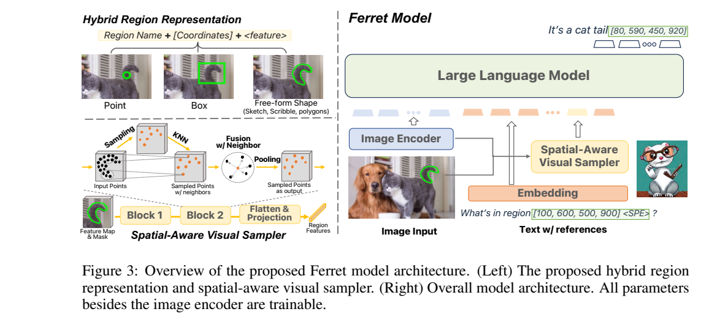
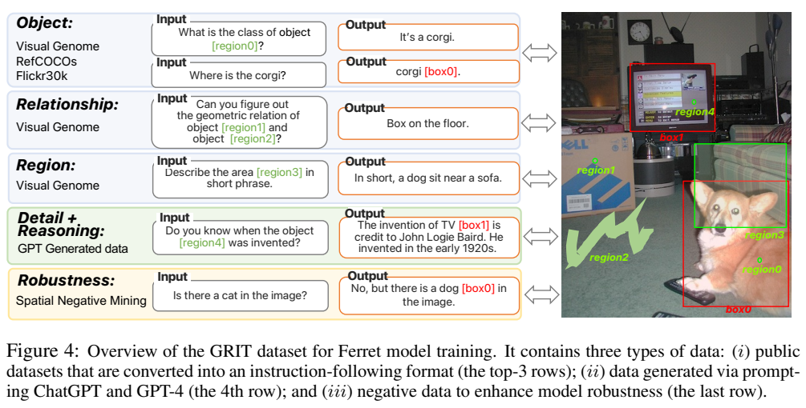
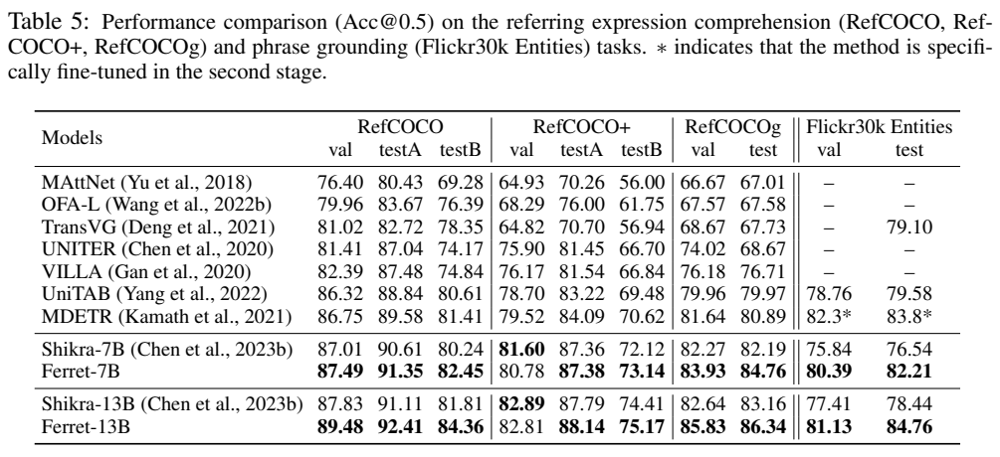
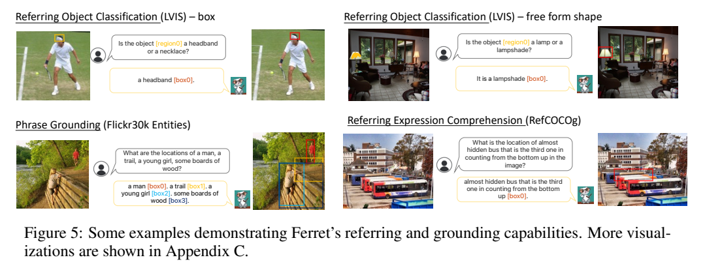
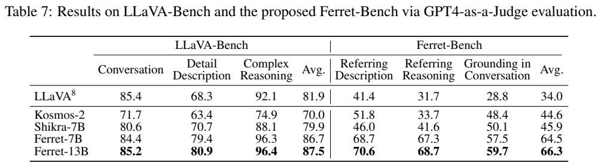
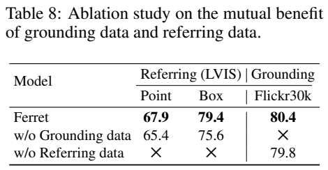
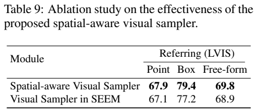

<!-- article-header:start -->
[项目首页](../../../README.md) › [模型系列](../../../reports/model-family-index.md) › [Ferret](../README.md)
<!-- article-header:end -->

# Ferret：任意形状区域的指代理解与文本定位

<!-- article-toc:start -->
<a id="article-toc"></a>

**本篇目录** · [论文定位](#paper-info) · [快速概览](#overview) · [整体架构](#architecture) · [核心原理](#principles) · [数据构建](#data) · [训练流程](#training) · [实验结果](#experiments)
<!-- article-toc:end -->

<a id="paper-info"></a>

## 1. 论文信息与模型定位

**Ferret: Refer and Ground Anything Anywhere at Any Granularity** 由 Haoxuan You、Haotian Zhang、Zhe Gan 等作者提出，来自 Columbia University 与 Apple AI/ML。本文固定使用 2023-10-11 的 [arXiv:2310.07704v1](https://arxiv.org/pdf/2310.07704v1)，对应 [官方项目](https://github.com/apple/ml-ferret)。报告实验包含 Ferret-7B、Ferret-13B，语言主干为 Vicuna，视觉通路为 CLIP。

论文区分两种任务：**referring** 是用户指一个区域，模型理解它是什么及其关系；**grounding** 是给文字，模型找出相应位置。Ferret 将二者纳入同一对话模型，输入区域可为点、框或自由形状，输出将名词与边界框对应。标题中的“任何粒度”是目标与能力描述，首版仍只输出框，输出分割掩码在结论中列为未来工作。[PDF 第 1–4、14 页](https://arxiv.org/pdf/2310.07704v1#page=1)

<a id="overview"></a>

## 2. 快速概览

核心问题是仅用一个包围框可能分不清重叠对象，复杂轮廓若逐顶点转成文字又很长。Ferret 给区域同时提供**位置坐标与连续视觉特征**：坐标说明区域在哪里，特征保留真正选中的内容。空间感知采样器借鉴点云网络，从不规则 mask 内采点并聚合相对几何信息。

模型配套约 **1.1M** 的 GRIT（Ground-and-Refer Instruction-Tuning）数据，含公共标注转换、教师生成对话及稳健性数据。这里的 GRIT 是本篇数据名称，应与其他同名视觉数据或模型区分。另提出 Ferret-Bench，评价区域描述、区域推理和对话内定位。

| 组件/设置 | 原文披露 |
|---|---|
| 视觉编码器 | CLIP-ViT-L/14@336p，固定参数 |
| 语言模型 | Vicuna 7B/13B |
| 区域坐标 | 1000 bins，用普通数字文字表示 |
| 区域采样 | 512 点，两级下采样，每级比例 4、24 邻居，最终 32 点 |
| 训练 | GRIT 3 epochs，batch 128，学习率 2e-5 |

数字坐标不增加专门的“第 123 个位置”词表，但输入中有承载连续区域特征的 `<SPE>` 占位符。不要将“没有额外位置词表”扩展成完全没有特殊标记。[PDF 第 4–8 页](https://arxiv.org/pdf/2310.07704v1#page=4)

<a id="architecture"></a>

## 3. 整体架构



Figure 3 位于 PDF 第 5 页。左上并列点、框、自由形状，左下展示采点、KNN、特征融合与池化；右侧把全图 token、文本和区域 embedding 一起送入语言模型。绿色框的输出是模型生成坐标的可视化。区域特征不只是将矩形裁下来再独立编码，而从全图 CLIP feature map 和指定 mask 中采样，因此可兼顾周围上下文与选中形状。

CLIP 输出 $`Z\in\mathbb R^{H\times W\times C}`$，文本分词成 $`T\in\mathbb R^{L\times D}`$。全图 feature 经线性映射匹配语言维度。区域文本使用“区域名称 + 坐标 + `<SPE>`”，不知道对象名称时可写 region/area；连续区域特征替换占位符。在输出中，语言模型直接在被定位的名词后生成框坐标，不依靠另外的对象检测 head 完成最终输出。

每个区域先构造与图像同尺寸的二值 mask，内部为 1。点输入被扩展成以该点为中心、默认半径 5 的圆；框与自由形状输入使用相应区域及其最小/最大坐标。坐标量化到 1000 bins，以减小输入图像尺寸变化造成的数值差异。对自由形状而言，外接框只能说明总体位置，mask 提取的特征才有助于区分包围框几乎相同的对象。[PDF 第 4–6 页](https://arxiv.org/pdf/2310.07704v1#page=4)

| 模块 | 输入与输出 | 公开机制 |
|---|---|---|
| CLIP ViT-L/14 | 全图 → 带空间网格的视觉特征 | 同一全图特征同时供全局投影与区域采样，训练中冻结编码器 |
| 区域 mask/坐标接口 | 点、框、任意形状 → 二值 mask 与量化坐标 | 点扩为半径 5 圆；坐标映射到 1000 bins，mask 保留外接框无法描述的形状 |
| 空间采样器 | mask 内 512 点及插值特征 → 32 点特征 | 两级 FPS、24 邻居融合与 max pooling；每级点数减为四分之一 |
| 区域/全图投影 | 区域点特征或全图特征 → LM 嵌入 | 区域特征展平投影替换 SPE 占位，全图另用线性层对齐 |
| Vicuna | 图像、区域引用和文字 → 描述与框数字 | 因果语言生成；输出名词后写坐标，无独立检测 head 作为最终输出 |


<a id="principles"></a>

## 4. 核心创新与数学原理

### 4.1 离散位置与连续形状为什么需要同时保留

只有坐标时，外接框近似相同的自由形状难以区分；只有区域特征时，明确几何参照又难以表达。Ferret 把二者放进同一句话，用坐标说明位置、用 mask 条件采样说明形状内容。采样仍从全图 CLIP 特征插值，既利用上下文，也意味着其细节精度受原特征网格限制，不能理解为直接读取所有原始像素。[原文 §3.1–3.2，PDF 第 4–5 页](https://arxiv.org/pdf/2310.07704v1#page=4)

**不规则区域的空间采样。** 在 mask 内随机取 512 个正点，用双线性插值得到各点 CLIP 特征。每级先用最远点采样取原点数的四分之一，再找每个中心的 24 个邻居。最远点采样倾向于覆盖区域，而不是让随机密集处占据全部表示。两级后为 $`512/4/4=32`$ 点。

### 4.2 局部差分、中心参照与逐通道池化

邻居与中心的特征差和坐标差提供局部变化，中心本身再加入提供参照，避免只保留相对量。逐通道 max pooling 为不同通道选择响应最强的邻居，所以最终向量未必对应某一个真实采样点；两级汇聚后还要展平投影成一个语言向量。其目标是紧凑区域描述，不能从 32 点中直接读出 32 个对象预测。[原文 §3.2、式 (1)–(2)，PDF 第 5–6 页](https://arxiv.org/pdf/2310.07704v1#page=5)

原文式 (1) 将邻居 $`x_{ik}`$ 和中心 $`x_i`$ 的相对内容与相对坐标融合：


```math
h_{ik}=\sigma([\theta([Z(x_{ik})-Z(x_i);C(x_{ik})-C(x_i)]);Z(x_i);C(x_i)]).
```


$`C(x)`$ 为二维坐标，分号代表通道拼接，$`\theta`$、$`\sigma`$ 在正文中均实现为线性层；这里的 $`\sigma`$ 不应因符号惯例被误解成 sigmoid。相对差分描述局部关系，中心自身特征保留全局参照。原文式 (2) 对邻居逐通道 max pooling：$`h_i=\max_k h_{ik}`$。最终把 32 点特征展平并投影为一个语言维度向量，而不是让 LLM 为每个采样点独立生成描述。

### 4.3 统一对话中输入引用与输出定位的非对称

输入允许自由形状，通过连续特征提供丰富视觉指代；输出则在名词之后生成矩形坐标，主要提供对象位置。两种方向共享图文语义，但输出不逆转采样器来恢复输入 mask。把它们组织成同一对话格式便于双向训练，也必须按不同方向选择正确评测：文本描述质量和框 IoU 衡量的并非同一件事。[原文 §3.2 Input/Output，PDF 第 5–6 页](https://arxiv.org/pdf/2310.07704v1#page=6)

**联合指代与定位。** 同一视觉对象既可出现在“给位置求名称”的输入，也可出现在“给名称求位置”的输出。它们共享区域—语义对应关系，因此训练数据双向组织有望互补。这个观点由消融验证，不是数学上保证双向学习必然提高所有任务。

**坐标生成的限制。** 定位结果是普通文字中的数字，语法有效不等于空间准确。评测使用 $`\mathrm{IoU}(B,\hat B)=\vert B\cap\hat B\vert /\vert B\cup\hat B\vert`$，超过 0.5 才算正确。IoU 是评测指标；本篇没有披露直接以 IoU 回归优化的专门 loss，不能将其写成模型训练目标。区域输入包含自由形状，也不意味着输出恢复其轮廓。[PDF 第 5、10、12 页](https://arxiv.org/pdf/2310.07704v1#page=5)

<a id="data"></a>

## 5. 数据构建与处理



PDF 第 6 页 Figure 4 的前几行来自公共标注，推理行来自教师生成，最后一行教模型识别不存在的物体。对象位置可位于输入或输出，颜色框将各示例关联到同一图像。它说明数据粒度和方向多样，而不是每条样本同时具备全部能力。

公共对象数据来自 Visual Genome、Objects365、RefCOCO 系列和 Flickr30k Entities，合计约 **678K**；对象关系与区域描述来自 Visual Genome，约 **177K**。对于部分 Visual Genome 对象和关系，使用 SAM 从已有对象得到分割 mask，作为采样器训练输入。它们是外部模型产出的区域监督，不应称为人工精确轮廓。模板提供对象识别、关系、区域描述、REC、phrase grounding、检测与带定位描述等任务。

教师生成部分提供对象、关系、区域描述、全图描述及坐标的**文字场景信息**，由 ChatGPT 首轮生成、GPT-4 精炼，得到 **34K** 对话。教师并不是直接观看图片；提示还要求像视觉助手一样回答，因而潜在标注错误不能由自然措辞消除。第二轮上下文约为第一轮的 10%，用于缓解长上下文下规则遵循不足。LLaVA-158K 另由 GLIPv2 定位名词，追加框，形成伪定位指令数据。

稳健性部分约 **95K**，在两种挖掘方式内平衡正负样本：一类从 Objects365 中选图里不存在的类别，另一类在 Flickr30k 实体上由教师构造易混淆的类别、属性或数量，例如男人/女人、蓝/黄、二/三。95K 包含正负平衡的数据，不能全数算成纯负例。附录对数量替换和避免包含关系作出约束，但没有提供全面噪声审计。各数据规模是近似口径；训练还去除与下游评测重叠的样本。[PDF 第 6–9、19–25 页](https://arxiv.org/pdf/2310.07704v1#page=7)

<a id="training"></a>

## 6. 训练流程与目标

CLIP-ViT-L/14@336p 与 Vicuna 提供初始化，投影层使用 LLaVA 第一阶段权重，区域采样器随机初始化。Figure 3 图注明确 **除图像编码器外均可训练**，因此不能写成只更新 projector 或采用 LoRA。GRIT 训练三轮，使用 AdamW（正文引用 Decoupled Weight Decay Regularization）、学习率 2e-5、batch 128；8 张 A100 上，13B/7B 分别约 5/2.5 天。来源没有明确 A100 显存版本、优化器 beta/epsilon、warmup、最大序列长度、精度、梯度累积及详细 task sampling ratio。

训练区域随机使用中心点、框，或在有 mask 时使用分割区域，使同一对象以不同指代形式出现。数据要求模型生成自然文字与数字坐标，适合用条件自回归负对数似然理解：$`-\sum_t\log p_\theta(y_t\mid y_{\lt t},I,R,q)`$。这是生成式指令学习的解释性表达，**论文未单列完整损失公式、输入/回答掩码及坐标 token 权重**，不能宣称坐标有专门权重或联合 mask loss。

本篇没有为 Ferret 增加一个从头大规模预训练阶段；模型使用已有 CLIP、Vicuna 和 LLaVA 投影初始化，再训练空间指令能力。SAM、GLIPv2、ChatGPT/GPT-4 主要用于构建数据，也不应混写为推理时必需逐个调用的组件。[PDF 第 5、8–9 页](https://arxiv.org/pdf/2310.07704v1#page=8)

<a id="experiments"></a>

## 7. 实验设置与主要结果

LVIS 指代分类从验证集采样 **2667** 个对象，将真类别与同图附近另一个类别组成二选一问题，点靠近对象边界，自由形状由内部随机笔画模拟。Ferret-13B 点/框/自由形状分数为 **68.35/80.46/70.98**，7B 为 67.94/79.42/69.77。随机猜测为 50，这不是从上千 LVIS 类别直接开放生成的 Top-1 accuracy，也不能证明任意用户涂画都准确。





PDF 第 10 页 Table 5 使用 Acc@0.5，按 RefCOCO 的 val/testA/testB、RefCOCO+ 和 RefCOCOg 等拆分。Ferret-13B RefCOCO 为 **89.48/92.41/84.36**，RefCOCOg val/test 为 **85.83/86.34**，Flickr30k test 为 **84.76**。但 RefCOCO+ val 的 82.81 略低于 Shikra-13B 的 82.89，不能将“所有指标优秀”解释成每项都排名第一。Figure 5 展示词语、对象与框的对应，应结合表的 IoU 门槛理解定位，而不只看可视化是否好看。

Flickr30k 带定位描述分别评文字和定位。13B CIDEr 为 **76.1**，$`F1_{all}`$ 为 **15.12**、$`F1_{loc}`$ 为 **38.03**；后者只在正确预测对象词上计算，因而更高，不等于所有名词均正确定位。不同分母决定两个 F1 不能互换。[PDF 第 9–10 页](https://arxiv.org/pdf/2310.07704v1#page=9)







PDF 第 12 页 Table 7 的 Ferret-Bench 三类各采 40 张 COCO 验证图，区域统一用框以便对照。问题与伪答案由 GPT-4 生成，GPT-4 再以文字场景真值对模型回答和自身答案打 1–10 分，报告的是两者评分比值。13B 平均 **66.3**、Shikra-7B 为 45.9，差 **20.4 个百分点**；它不是人工确认的任务成功率，更不应说“定位精度提高 20.4%”。裁判与生成者相同、样本较少、API 会演进，均限制结果稳定性。

Table 8 中完整 7B 的点/框指代为 67.9/79.4，去除 grounding 数据后为 65.4/75.6；Flickr30k 定位 80.4，去除 referring 后 79.8。Table 9 的空间采样器点/框/自由形状为 67.9/79.4/69.8，平均特征采样器为 67.1/77.2/68.9，支持局部几何聚合的有限收益。报告未单独充分隔离所有数据组成对幻觉的贡献。

POPE random accuracy **90.24**、F1 **89.76**；adversarial accuracy **82.36**，低于 Shikra 83.10，F1 82.00 也低于 82.49。负数据与细粒度训练改善部分对象存在性回答，但不代表消除幻觉。GPT-4V 比较仅为少量展示案例，正文也承认其一般知识更强，不能据此给出全任务优劣排序。本文只核验固定首版中的数据、公式与原图，未运行模型或独立复现实验。[PDF 第 11–14 页](https://arxiv.org/pdf/2310.07704v1#page=11)

<!-- article-footer:start -->
---

[← 上一篇：CogVLM](../../cogvlm/arxiv-2311.03079/README.md) · [按发表时间浏览](../../../reports/paper-reading-guide.md#year-2023) · [下一篇：PaLI-3 →](../../pali/arxiv-2310.09199/README.md)

[返回本篇目录](#article-toc) · [返回模型系列](../README.md)
<!-- article-footer:end -->
