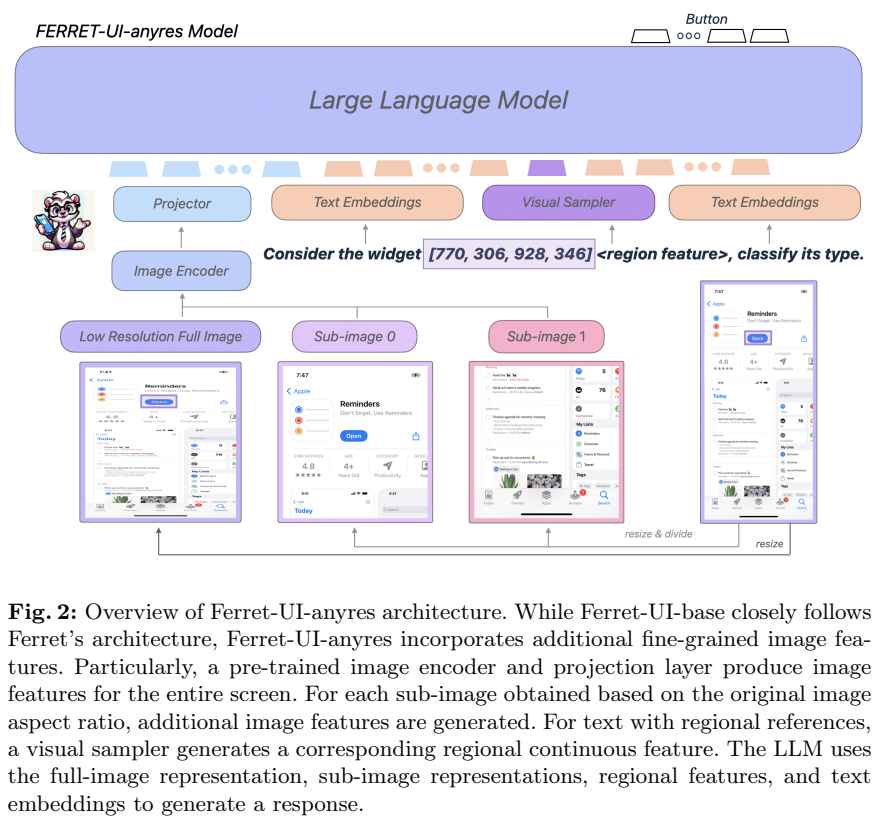
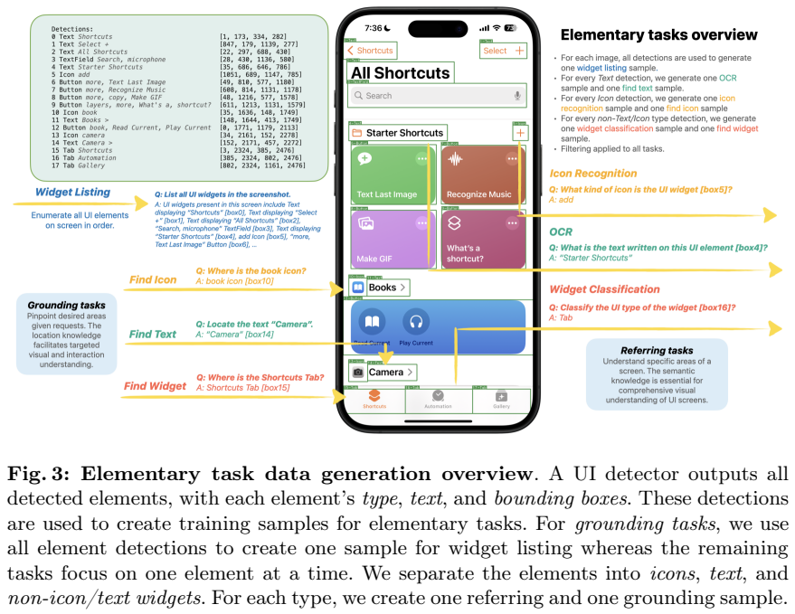
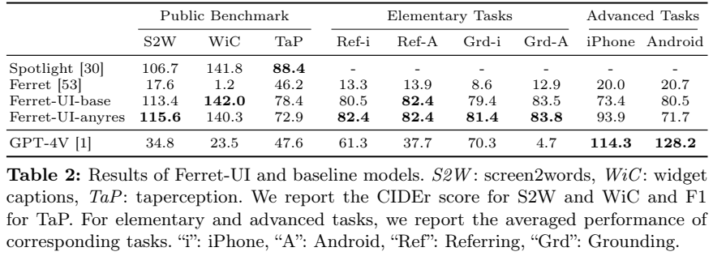
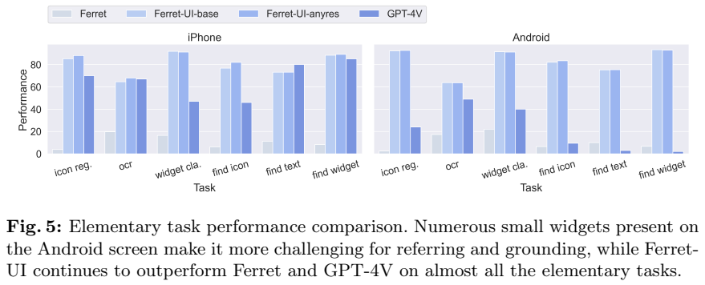
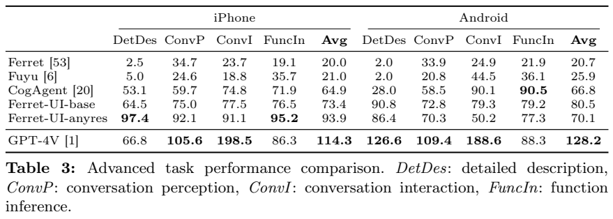

<!-- article-header:start -->
[项目首页](../../../README.md) › [模型系列](../../../reports/model-family-index.md) › [Ferret](../README.md)
<!-- article-header:end -->

# Ferret-UI：面向移动界面的区域理解与定位

<!-- article-toc:start -->
<a id="article-toc"></a>

**本篇目录** · [论文定位](#paper-info) · [快速概览](#overview) · [整体架构](#architecture) · [核心原理](#principles) · [数据构建](#data) · [训练流程](#training) · [实验结果](#experiments)
<!-- article-toc:end -->

<a id="paper-info"></a>

## 1. 论文信息与模型定位

- **原文**：[Ferret-UI: Grounded Mobile UI Understanding with Multimodal LLMs](https://arxiv.org/abs/2404.05719)，本文固定为 arXiv v1（2024-04-08）。
- **作者与机构**：Keen You、Haotian Zhang、Eldon Schoop 等，Apple。
- **定位**：把 Ferret 的区域指代和定位能力迁移到手机截图，使模型能回答某个按钮是什么、根据指令寻找控件、描述界面和推断功能。论文同时报告普通 Ferret-UI 和加入 anyres 的版本。

这是界面视觉理解模型。论文中的交互任务输出建议和区域坐标，实验没有报告完整环境中的连续操作成功率，因此不能据此认定它已经是经过闭环验证的手机操作代理。信息范围以原文及附录为准。

<a id="overview"></a>

## 2. 快速概览

手机截图与自然图像的困难不同：画面常为细长矩形，文字和图标密集，一些图标面积不到截图的 0.1%。把整张截图直接缩到视觉编码器的输入大小会抹去关键内容。Ferret-UI 的回答分为两类：**referring** 根据已指定区域辨认内容；**grounding** 根据语言描述返回区域。

模型的主要改变是界面专用指令数据和简单的分辨率扩展。基础任务覆盖 OCR、图标与控件分类、控件枚举以及文字、图标、控件定位；高级任务包含详细描述、感知对话、交互对话和功能推断。anyres 在全局图之外再保留两个局部视图，提高细小目标可见性。

收益具有条件性：anyres 提高了 iPhone 的高级任务汇总分数，却降低了 Android 的部分高级任务和 Tappability 结果。论文给出了界面领域迁移的有效证据，也暴露了分辨率、数据分布和任务类型之间的取舍。

<a id="architecture"></a>

## 3. 整体架构



**读图**：Figure 2 左侧保留 Ferret 的混合区域表示，右侧显示把竖屏或横屏拆成两个子图的 anyres。图中保留了全局视图、两个局部视图与区域采样器之间的连接。

基础网络沿用 Ferret：CLIP ViT-L/14 提取视觉特征，视觉投影连接 Vicuna 语言解码器。用户可以用点、框等区域提示引用界面元素；区域表示同时包含离散坐标和从图像特征采样得到的连续视觉表示。模型因而既能理解“这个位置的是什么”，也能生成目标位置。本文不把 Ferret 其他版本的参数规模当成本报告明确披露的 Ferret-UI 规模。

anyres 选择与截图长宽比更接近的 **1×2 或 2×1 网格**。竖屏沿上下拆分，横屏沿左右拆分；模型分别编码完整截图和两个子视图，再供语言模型使用。这里固定增加两个子视图，不是可以无限增加切片的任意分辨率机制。全局图提供布局关系，局部图补充文本和图标细节。

推理时输入截图及语言/区域提示，无须外部 UI 检测器或界面 XML。但训练数据的区域标注来自检测器和 OCR 系统，所以“推理不依赖检测器”不意味着数据构建没有这些工具。

<a id="principles"></a>

## 4. 核心创新与数学原理

第一项创新是把统一的区域理解接口映射到 UI 语义。相同的控件框可以服务于 OCR、类型判断与根据描述寻找控件，区域语义和几何位置在一套对话格式中学习。其价值在于，模型不只生成“点击设置”的文字，还能给出对应的目标框。

第二项是按截图几何形状保留局部细节。若完整画面缩放后一个图标只占很少的像素，其类别信息很难恢复；拆成两块后，同一控件在编码器输入中的相对面积增大。不过更多局部视图也改变了模型接收的视觉上下文，并不保证每类问题都改善。

论文没有提出新的 UI 专用损失公式。训练可用条件自回归目标解释：

```math
\mathcal L_{\mathrm{AR}}=-\sum_t\log p_\theta(y_t\mid y_{<t},I,q,r),
```

其中 $`I`$ 为截图，$`q`$ 为指令，$`r`$ 为可选区域提示，$`y`$ 是回答或定位序列。这是对论文指令微调方式的解释，不是原文新增的数学贡献。定位评测使用交并比，$`\mathrm{IoU}(B,\hat B)=\vert B\cap\hat B\vert /\vert B\cup\hat B\vert`$，严格 **大于 0.5** 才算正确。

高级任务的 GPT-4 评分是预测回答相对于参考回答的评分比值再乘 100，可以超过 100。该数值不是准确率，也不是任务操作成功率；回答长度、详细程度和评审模型偏好都会影响它。

<a id="data"></a>

## 5. 数据构建与处理



**读图**：Figure 3 按区域理解和目标定位展示同一类截图怎样转成不同问题。图中目标框和文字是原始数据示例，读者应区分模型输入中的区域提示与训练回答中的目标坐标。

Android 截图来自 RICO/Spotlight，去重后的训练/测试截图为 **26,527/3,080**；iPhone 截图来自 AMP，为 **84,685/9,410**。预训练 UI 检测器生成元素类别与边界框，Apple Vision 提取文本，再用规则合并多行文本、图片及其说明。数据因此含有自动标注误差，而非全部人工真值。

基础数据按七项任务分别构建，原文 Table 1 列出每个平台每项任务约 40K 的数据池。OCR 保留少于 10 个 token、至少两个字符的文本；定位问题剔除重复出现、无法唯一指认的候选；部分控件类别归并，例如复选框和开关不再区分选中状态。控件枚举同时输出显示文字和类型。这些处理降低指代歧义，也意味着评测不全面考察控件状态识别。

此外，模型使用 Spotlight 的 Screen2Words、Widget Captioning、Tappability 数据，约 **78K、109K、14K**，以 GPT-3.5 扩写指令而保留原始答案。

高级数据选择含超过 2 个、少于 15 个元素的 iPhone 截图，把检测结果、归一化框和示例对话交给**只接收文本的 GPT-4**生成回答。四项高级任务各 10K，共约 40K。Table 1 的高级数据列法容易误读；正文明确说明高级训练数据来自 iPhone，Android 高级测试用来考察跨平台泛化，不能写成两平台都做了同等高级训练。

基础测试每项取至少 5,000 个有效样本或全部可用样本；高级测试明显较小，每项先选 iPhone 25 张、Android 5 张，去重后分别只有 56 和 13 张截图。各任务问答数为 iPhone 20/40/38/20、Android 5/10/10/10。因此高级评测存在样本规模和自动参考答案的限制。

<a id="training"></a>

## 6. 训练流程与目标

模型在混合后的 **250K 指令样本**上训练。这里是实际训练混合规模，不能把各个数据池简单相加当作训练总量。训练更新语言解码器和视觉投影，冻结视觉编码器；原文没有给出足以独立复现的完整学习率、批大小、轮数和区域采样器参数更新说明，本文不补填。

基础版使用 8 张 A100，训练约一天；anyres 版约三天。该差异说明更细致的视觉输入有计算代价，但原文没有完整端到端吞吐和统一输入预算的对比，不能从训练天数推导精确推理速度。

任务消融把高级任务单独训练，再加入 iPhone 基础、Android 基础或两者。在普通 Ferret-UI 配置下，高级汇总分数从 **64.6/64.3**（iPhone/Android）提高到两类基础数据都加入时的 **73.4/80.5**。这是基础区域任务帮助高级理解的证据；并非 anyres 的单独因果验证。另一项消融中，Widget Captioning 由只用 Spotlight 的 138.7 提升为完整混合的 142.0，说明更广的界面任务有一定互补作用。

<a id="experiments"></a>

## 7. 实验设置与主要结果



**读表**：前三列分别是 Screen2Words/Widget Captioning 的 CIDEr 和 Tappability 的 F1，后续才是区域任务和高级任务。不同列不能用同一“准确率”概括。

| 模型 | Screen2Words | Widget Captioning | Tappability | iPhone 区域理解均值 | Android 区域理解均值 | iPhone 定位均值 | Android 定位均值 |
|---|---:|---:|---:|---:|---:|---:|---:|
| Ferret | 17.6 | 1.2 | 46.2 | 13.3 | 13.9 | 8.6 | 12.9 |
| Ferret-UI | 113.4 | 142.0 | 78.4 | 80.5 | 82.4 | 79.4 | 83.5 |
| Ferret-UI anyres | 115.6 | 140.3 | 72.9 | 82.4 | 82.4 | 81.4 | 83.8 |
| GPT-4V | 34.8 | 23.5 | 47.6 | 61.3 | 37.7 | 70.3 | 4.7 |

领域适配相对于原 Ferret 的提升很大；anyres 的进一步增益主要出现在部分区域任务。Widget Captioning 和 Tappability 却低于普通版本。Figure 5 还显示 iPhone 的 Find Text 并未全面领先所有对照，因此不采用“所有基础任务都最优”的概括。

GPT-4V 因费用限制，各任务随机评估约 100 条，而 Ferret-UI 使用完整测试集。GPT-4V 的定位采用 Set-of-Mark，把标号候选框画到截图上后让模型选编号；区域理解还提供标记和类别说明。这些输入及样本差异需要与数值一同阅读。





**读图与表**：上方 Figure 5 展示各基础任务；下方 Table 3 的高级指标是 GPT-4 相对评分，出现 198.5 并非超过 100% 的成功率。

| iPhone 高级任务 | Ferret-UI | anyres | GPT-4V |
|---|---:|---:|---:|
| 详细描述 | 64.5 | 97.4 | 66.8 |
| 感知对话 | 75.0 | 92.1 | 105.6 |
| 交互对话 | 77.5 | 91.1 | 198.5 |
| 功能推断 | 76.5 | 95.2 | 86.3 |
| 表中均值 | 73.4 | 93.9 | 114.3 |

GPT-4V 的均值更高，优势集中在对话，尤其是交互对话；anyres 在详细描述和功能推断反而高于 GPT-4V。Android 上 anyres 的四项值为 **86.4、70.3、50.2、77.3**，低于普通版本的高级任务总体表现。

**原表一致性说明**：Android anyres 高级均值在 Table 2 为 **71.7**，Table 3 为 **70.1**；按 Table 3 四项计算为 **71.05**。本文保留这些原文差异，不把任何一个当作已消除矛盾的总分。人工定位检查的 91.7 与 GPT-4V 的 93.4 也采用不同输出协议，不能解释为完全相同条件下的定位能力排序。

失败案例包括 OCR 误识、复合控件只框住子元素、重复控件无法唯一指代，以及漏读状态栏。高级交互主要围绕点击；滚动、长按和输入的覆盖仍有限。结果支持“界面专用数据和局部视图能提升截图理解与区域定位”，尚不足以推出真实移动设备上的长程自主操作能力。

<!-- article-footer:start -->
---

[← 上一篇：VITRON](../../vitron/document-f588b0cc5a2b/README.md) · [按发表时间浏览](../../../reports/paper-reading-guide.md#year-2024) · [下一篇：MA-LMM →](../../ma-lmm/arxiv-2404.05726/README.md)

[返回本篇目录](#article-toc) · [返回模型系列](../README.md)
<!-- article-footer:end -->
