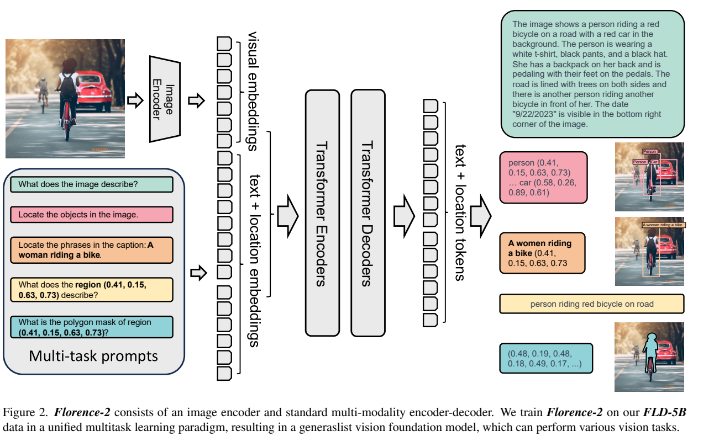
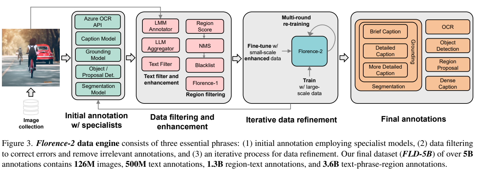
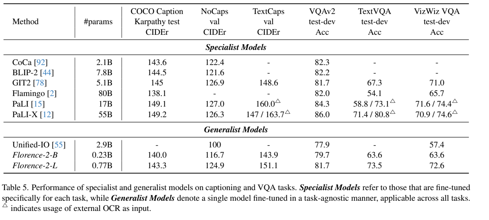

<!-- article-header:start -->
[项目首页](../../../README.md) › [模型系列](../../../reports/model-family-index.md) › [Florence](../README.md)
<!-- article-header:end -->

# Florence-2：把视觉任务统一为文本与位置序列

> 解读 Microsoft 的 **Florence-2: Advancing a Unified Representation for a Variety of Vision Tasks**，固定采用 arXiv **2311.06242v1**。它以紧凑的视觉编码器与编码器—解码器处理描述、检测、定位和分割，是多模态基础模型的重要路线；本文不将它描述成依赖大型语言模型的通用聊天系统。

<!-- article-toc:start -->
<a id="article-toc"></a>

**本篇目录** · [论文定位](#paper-info) · [快速概览](#overview) · [整体架构](#architecture) · [核心原理](#principles) · [数据构建](#data) · [训练流程](#training) · [实验结果](#experiments)
<!-- article-toc:end -->

<a id="paper-info"></a>

## 1. 论文信息与模型定位

| 项目 | 内容 |
|---|---|
| 题名 | Florence-2: Advancing a Unified Representation for a Variety of Vision Tasks |
| 团队与日期 | Microsoft；arXiv 首次提交 2023-11-10 |
| 公开模型 | Florence-2-B：232M；Florence-2-L：771M 总参数 |
| 基本接口 | 图像与任务提示输入，文字和量化位置 token 输出 |
| 研究问题 | 用统一架构、统一目标和多粒度标注获得可迁移视觉表示 |
| 官方资源 | [固定报告](https://arxiv.org/pdf/2311.06242v1) · [Microsoft 模型卡](https://huggingface.co/microsoft/Florence-2-large) |

论文把图像级语义、区域/像素级识别、细粒度图文对齐放在同一训练框架中。它同时评估完整生成模型与迁移后的视觉骨干，两类实验使用的网络与监督不同，不能合并为一个 checkpoint 的统一聊天成绩。[§2、§6，PDF 第 2–3、9–12 页](https://arxiv.org/pdf/2311.06242v1#page=3)

<a id="overview"></a>

## 2. 快速概览

Florence-2 的关键选择是把视觉任务翻译成序列生成。描述输出自然语言，检测输出类别和框坐标，OCR 输出文字与四边形，分割输出多边形顶点。任务提示决定当前要生成什么，而不必为这些任务分别增加预测头。

DaViT 提供视觉特征，投影后与提示嵌入拼接，送入标准多模态 Transformer 编码器—解码器。训练依赖 FLD-5B：126M 张图像被标上超过 5B 条、多层次的标注，而非收集了 5B 张图像。

性能来自架构与数据协同。数据引擎通过专用模型初标、过滤、Florence-2 重标与再训练，扩展描述、框和短语—区域对应；消融显示只学图像描述不足以形成可靠区域能力。其输出能力仍由任务格式、标注覆盖与训练协议约束。

<a id="architecture"></a>

## 3. 整体架构



*原文 Figure 2，PDF 第 3 页。左侧多种提示表示不同任务调用；中间共享图像编码和编码器—解码器，右侧展示对应的文本/坐标输出，不代表一次推理必须生成全部任务。*

| 模块 | 输入与输出 | 公开机制 |
|---|---|---|
| DaViT 视觉编码器 | 图像 → 展平视觉 token | 使用 DaViT；B/L 四阶段宽度分别为 128/256/512/1024 与 256/512/1024/2048 |
| 视觉维度对齐 | 视觉特征 → 与文字同维的表示 | 线性投影与 LayerNorm；报告没有使用固定查询 token 压缩器 |
| 扩展 tokenizer | 任务文字/区域 → 提示嵌入 | 普通文字词表加入位置 token，坐标离散为 1,000 个 bin |
| 多模态编码器 | 视觉与提示拼接序列 → 联合表示 | 标准 Transformer 编码器；B 为 6 层/768 维，L 为 12 层/1024 维 |
| 自回归解码器 | 联合表示 + 先前答案 → 下一 token | B/L 分别为 6/12 层；生成文字、框、四边形或多边形序列 |
| 任务输出解析 | token 序列 → 描述/检测框/区域掩码 | 按任务约定还原坐标与文本，统一词表不等于所有输出具有相同语义 |

一次推理中，图像先经过 DaViT，提示独立嵌入；二者经维度对齐后拼成编码器输入，解码器再逐 token 生成答案。可以把原文 §3 的维度关系写为：

```math
V\in\mathbb{R}^{N_v\times D_v},\qquad
V'=\mathrm{LayerNorm}(\mathrm{Linear}(V)),\qquad
X=[V';T_{\mathrm{prompt}}]\in\mathbb{R}^{(N_v+N_t)\times D}.
```

其中 $`N_v`$ 与 $`N_t`$ 分别为视觉和提示 token 数。正文以符号描述视觉序列，不应把 1,000 个坐标 bin 当成 1,000 个视觉 token。视觉编码器以 UniCL 初始化，编码器—解码器以 BART 初始化；不应替换解释成“把图像送进一个数十亿参数聊天 LLM”。[§3、§6.1、附录 C Table 15，PDF 第 4、9、20 页](https://arxiv.org/pdf/2311.06242v1#page=4)

<a id="principles"></a>

## 4. 核心创新与数学原理

### 4.1 位置词表：让空间结果进入同一个生成接口

框由左上和右下角的四个坐标表示；OCR 的四边形按左上角起顺时针输出八个坐标；指代分割按顺时针输出可变长多边形顶点。坐标被映射为 1,000 档位置 token，模型于是能像预测词一样预测位置。

作用是把原本需要不同输出头的目标放进序列学习，文字与区域也能交替出现。权衡在于位置经过量化，分割轮廓成为顶点序列；统一输出格式本身并不保证边界具有连续回归或像素级预测的全部精度。[§3 Task formulation，PDF 第 4 页](https://arxiv.org/pdf/2311.06242v1#page=4)

### 4.2 统一目标：同一种损失学习不同粒度监督

原文 Eq. (1) 对所有任务采用目标序列的交叉熵：

```math
\mathcal{L}=-\sum_{i=1}^{\vert y\vert}\log P_\theta(y_i\mid y_{\lt i},x).
```

$`x`$ 是图像和任务提示，$`y_i`$ 是当前目标 token，$`y_{\lt i}`$ 是已经生成的目标，$`\theta`$ 为网络参数。这里统一的是计算目标：描述词、位置 token 和区域相关文字都可被预测；它们的任务含义通过提示和标注格式确定，不能把损失下降直接解释为某一种下游 mAP 上升。

论文的创新重心是将图像级、区域级和像素相关任务及其数据组织到同一接口，而非发明新的交叉熵形式。[§2.1、§3 Eq. (1)，PDF 第 3–4 页](https://arxiv.org/pdf/2311.06242v1#page=4)

### 4.3 数据引擎：从专用教师走向可扩展的统一标注



*原文 Figure 3，PDF 第 5 页；按初始标注、过滤增强、迭代重标、最终标注阅读。这是离线数据生产流程，推理时无需同时调用图中的所有教师。*

第一步让专用模型或云 API 生成标签，并与原有人类标注合并。第二步以文本依存分析筛除噪声或概念过少的描述，以分数阈值及 NMS 过滤框。第三步在初始数据上训练 Florence-2，再对训练图像重标、合并和重训；详细描述等稀缺任务先获得小规模高质量增强标签，再训练专用标注器扩展到全量。

因此该过程包含教师知识与模型生成噪声，不能称为无需外部模型的自监督学习；模型重标也是数据迭代，不代表零样本评估时使用了测试集答案。[§4.2–4.3，PDF 第 5–6 页](https://arxiv.org/pdf/2311.06242v1#page=5)

### 4.4 多粒度预训练：图像描述不能替代区域与像素监督

消融固定 72M 有效训练样本，比较仅图像、图像+区域、图像+区域+像素三类任务混合。完整混合在 RefCOCO 指代分割达到 31.6 mIoU，高于另外两组的 28.4/18.2；但 COCO 描述最终 133.4 CIDEr 略低于 134.6，检测 28.3 AP 也略低于图像+区域的 29.7。

这表明多粒度监督扩展了可迁移能力，也存在任务间权衡。它并不是每个指标都单调提高。数据规模实验同样固定 72M 样本暴露次数，比较不同独立图像规模；RefCOCO 分割在 1.2M 图像时还略高于 12M，不能把数据扩张写成无条件增益。[§6.5、Figure 7、Table 11，PDF 第 12–13 页](https://arxiv.org/pdf/2311.06242v1#page=13)

<a id="data"></a>

## 5. 数据构建与处理

| 数据层次 | 规模/来源 | 处理与监督 |
|---|---|---|
| 图像库 | 126M 图像；ImageNet-22K、Object365、Open Images、Conceptual Captions、过滤的 LAION | 汇集分类、检测和描述来源 |
| 图像文字 | 约 500M 条 | 简短、详细、更详细的描述；LLM/LMM 增强与专用模型扩展 |
| 区域—文字 | 约 1.3B 条 | DINO 框、区域裁图描述、Florence-1 相似度筛选；OCR 使用 Azure OCR API |
| 文字—短语—区域 | 约 3.6B 条 | Grounding DINO 定位、SAM 分割；置信过滤、代词及抽象概念黑名单 |

同一图像拥有多种标注，三个数字是标注条目数而非互不重叠的图像数。数据分析还显示框中心分布存在偏好，规模较大不代表没有采集偏差。后续 generalist 微调另混入 COCO、TextCaps、RefCOCO、VQA 等公开监督集，不能将其成绩归于未见这些任务训练集的纯预训练模型。[§4–5、附录 A–B，PDF 第 4–9、20 页](https://arxiv.org/pdf/2311.06242v1#page=6)

<a id="training"></a>

## 6. 训练流程与目标

| 阶段 | 配置 | 目标与边界 |
|---|---|---|
| 初始化 | UniCL 视觉权重、BART 编码器—解码器权重 | 复用单模态/图文组件，不从零训练全部组件 |
| 多任务预训练 | 384²；B/L batch 2048/3072；3B 有效样本 | FLD-5B 上统一序列损失；有效样本包含重复暴露 |
| 高分辨率适配 | 768²；B 0.5B、L 0.1B 样本 | 延续训练改善细节理解 |
| generalist 微调 | 附录 B 公开监督任务混合 | 一组共享权重同时承担多种任务 |
| 视觉骨干迁移 | 把 DaViT 接入 Mask R-CNN、DINO 或 UperNet | 此时使用对应下游框架，并非只调用原序列生成接口 |

优化器为 AdamW，余弦衰减；B/L 峰值学习率分别 $`10^{-4}`$/$`10^{-5}`$，前 5,000 步线性预热，使用 DeepSpeed 与混合精度。报告还研究冻结视觉骨干阶段后的表现，属于下游迁移实验，不能倒推预训练时所有视觉层均冻结。[§6.1、§6.4，PDF 第 9–12 页](https://arxiv.org/pdf/2311.06242v1#page=9)

<a id="experiments"></a>

## 7. 实验设置与主要结果

| 实验口径与指标 | Florence-2-B | Florence-2-L |
|---|---:|---:|
| 零样本 COCO Caption，CIDEr | 133.0 | 135.6 |
| 零样本 Flickr30k，R@1 | 83.6 | 84.4 |
| 零样本 RefCOCO RES，mIoU | 34.6 | 35.8 |
| 公开数据微调 COCO Caption，CIDEr | 140.0 | 143.3 |
| 公开数据微调 TextVQA test-dev，Accuracy | 63.6 | 73.5 |
| 公开数据微调 RefCOCO RES，mIoU | 78.0 | 80.5 |



*原文 Table 5，PDF 第 10 页；保留 specialist/generalist 分类、测试划分及外部 OCR 的三角标注。本文微调描述/VQA 数值采用此表的对应行列。*

固定 v1 的 §6.3 正文将 L 的 COCO 描述写为 140.0、TextVQA 写为 81.5，与 Table 5 的 L 行 143.3/73.5 不一致；本文不把正文与表格拼接，明确按表格呈现。Table 4 与 Table 6 分别支持零样本和微调区域结果，二者也不能互换。[Table 4–6，PDF 第 10–11 页](https://arxiv.org/pdf/2311.06242v1#page=10)

视觉骨干实验中，DaViT-B 接入 Mask R-CNN 达到 53.6 APb、46.4 APm，接入 DINO 达到 59.2 AP；前者使用 12 epoch，而一些对照采用 36 或 100 epoch。报告所说的训练效率提升对应指定框架和训练日程，不是所有部署场景的推理加速倍数。整体价值在于用较小模型覆盖多粒度视觉任务；开放任务对话、复杂长链推理和大语言模型式知识覆盖并非这些实验直接证明的能力。[Table 7–9、Figure 6，PDF 第 11–12 页](https://arxiv.org/pdf/2311.06242v1#page=12)

<!-- article-footer:start -->
---

[← 上一篇：LLaVA-Plus](../../llava/arxiv-2311.05437/README.md) · [按发表时间浏览](../../../reports/paper-reading-guide.md#year-2023) · [下一篇：Monkey →](../../monkey/arxiv-2311.06607/README.md)

[返回本篇目录](#article-toc) · [返回模型系列](../README.md)
<!-- article-footer:end -->
