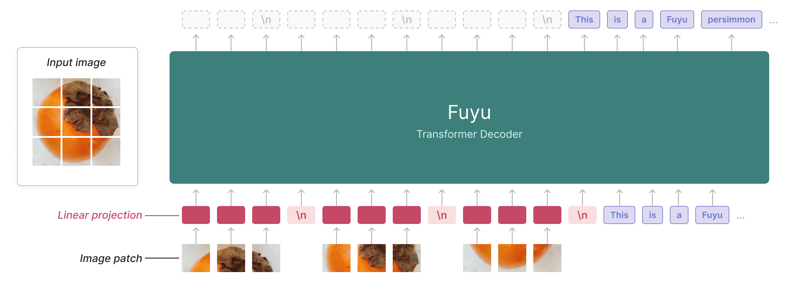
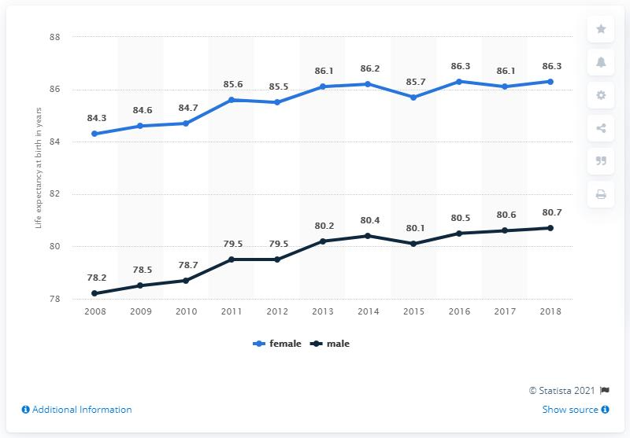

<!-- article-header:start -->
[项目首页](../../../README.md) › [模型系列](../../../reports/model-family-index.md) › [Fuyu](../README.md)
<!-- article-header:end -->

# Fuyu-8B：直接读取图像块的数字代理基础模型

<!-- article-toc:start -->
<a id="article-toc"></a>

**本篇目录** · [论文定位](#paper-info) · [快速概览](#overview) · [整体架构](#architecture) · [核心原理](#principles) · [数据构建](#data) · [训练流程](#training) · [实验结果](#experiments)
<!-- article-toc:end -->

<a id="paper-info"></a>

## 1. 论文信息与模型定位

- **条目名称**：Fuyu-8B: A Multimodal Architecture for AI Agents。
- **本介绍的直接来源**：[Adept 官方 Fuyu-8B 模型卡](https://huggingface.co/adept/fuyu-8b)，固定为 2026-10-08 获取并保存的版本；原发布博客见模型卡内的 [Adept 链接](https://www.adept.ai/blog/fuyu-8b)。该来源是模型卡，不是具有完整实验附录的论文。
- **研发机构与规模**：Adept AI，8B 版本。模型卡也列出 Fuyu-Medium 的实验，但没有披露其精确参数量。
- **模型定位**：输入图像和文本、输出文本的多模态基础模型，面向屏幕、图表、界面理解及数字代理研究。公开权重是基础模型，官方明确建议针对详细描述或多模态聊天继续微调。

<a id="overview"></a>

## 2. 快速概览

Fuyu 的出发点是简化图像进入语言模型的路径。模型没有独立预训练图像编码器，也没有把固定数量的视觉查询向量作为两种网络之间的接口；它把原始图像分块，经线性投影送入一个 decoder-only Transformer。

它通过逐行排列图像块和插入换行标记支持不同图像尺寸，不要求所有输入先变成同一个正方形。模型卡声称适合细粒度屏幕定位、图表问答和 UI 问答，但未给出完整屏幕操作基准。公开的标准指标显示它有可用的图像理解能力，同时与更大模型仍存在明显差距。

模型卡还报告大图响应可低于 100 毫秒。不过缺少对应硬件、图像大小、输出长度及首 token/完整响应定义，因此这是一项官方陈述，不能作为任意设备的可复现延迟保证。

<a id="architecture"></a>

## 3. 整体架构



**读图**：左侧柿子被拆成网格块，下方图像块经过红色线性投影；每行之间插入图像换行标记，后面连接文字 token。中间整个绿色模块都是同一个 Transformer Decoder。上方文字体现自回归预测，下方输入才是图像块和已有文本。

图像块绕过文本 embedding lookup，直接投影到 Transformer 第一层的输入空间。文本仍通过通常的 token 嵌入进入。解码器对图像与文本组成的序列使用因果注意力，图像端没有额外 pooling，也没有独立的双向 ViT 先把整图编码成高层语义。

图像块按 raster-scan 顺序逐行排列。模型去掉图像专用位置嵌入，利用原有的序列位置表示和图像换行 token 推断二维结构。不同尺寸对应不同数量的图像块和行标记，因而输入长度可变。“支持任意分辨率”在这里描述输入表示方式，仍然会受模型上下文、内存和计算资源约束。

模型卡没有提供层数、注意力头数、图像块精确尺寸和完整配置表，本介绍不从其他版本反推这些参数。

<a id="principles"></a>

## 4. 核心创新与数学原理

核心创新是把视觉学习放进同一个解码器：从像素块到语言回答之间只增加线性映射，空间及语义组合主要由解码器学习。与固定尺寸视觉编码器相比，输入图像块的数量不再由一个固定的图像 token 池决定。

可将其数据流解释为：

```math
z_i=W\mathrm{vec}(P_i)+b,\qquad
 S=[z_1,\ldots,z_k,e_{\mathrm{newline}},\ldots,e_{\mathrm{text}}].
```

$`P_i`$ 为图像块，$`z_i`$ 为投影向量，换行标记记录一行结束，文本向量接在后面。该公式是对模型卡线性投影和序列组织的说明，不是模型卡公开的专门损失函数。

这个设计的收益是结构简单、分辨率处理路径统一；代价是更大图片通常需要更长序列，而且解码器自身承担视觉表征学习。模型卡没有实验拆分“去掉视觉编码器”“加入换行标记”“去掉二维位置嵌入”的独立贡献，因此不能把架构动机写成已经逐项验证的因果结论。

<a id="data"></a>

## 5. 数据构建与处理

输入预处理包括图像分块、按行扫描、线性投影和添加图像换行 token。官方使用说明指出，`|SPEAKER|` 是图像块嵌入的占位 token，`|NEWLINE|` 表示图像块序列中的行边界；这些占位符不是模型从图片读出的自然语言。

模型卡没有披露训练图像数量、文本 token 规模、网页或图表数据来源比例、去重方式、过滤规则和各任务配比。图表、界面、自然图像问答是支持或演示的任务类型，不能据此推断其实际训练数据配方。



**读图**：蓝线为女性、深色线为男性；模型卡问题询问男性出生预期寿命的最高值，示例回答为 2018 年的 **80.7**。图中对应点确实位于深色线最右端。此图是官方调用示例的输入，不能当成大规模 ChartQA 基准结果。

<a id="training"></a>

## 6. 训练流程与目标

官方认为这套结构允许在训练中使用不同尺寸的图像，无需分别设计高分辨率和低分辨率阶段。不过模型卡未给出预训练步数、优化器、学习率、批大小、冻结范围和损失权重，也没有披露完整从初始化到发布的训练时间线。

输出是自回归文本，因此可以用条件语言建模理解：在图像块及提示作为上下文时，逐个预测回答 token。模型卡没有说明哪些文本片段参与损失、是否加入其他辅助目标，本文不把通用交叉熵解释扩展成未公开的精确训练 recipe。

发布版本尚未针对通用聊天进一步完善。官方建议用 few-shot 提示或针对任务微调，并建议问题末尾添加换行符。示例中的 `max_new_tokens` 是推理输出上限，不是训练超参数。本文未执行模型推理，也未验证硬件延迟。

<a id="experiments"></a>

## 7. 实验设置与主要结果

以下数字直接来自官方模型卡的 Evaluation 表；不同模型的分数由模型卡汇总，未提供统一提示、数据划分和详细复现协议。

| 任务 | Fuyu-8B | Fuyu-Medium | Qwen-VL（表中 10B） | PaLI-X（55B） |
|---|---:|---:|---:|---:|
| VQAv2 | 74.2 | 77.4 | 79.5 | 86.1 |
| OKVQA | 60.6 | 63.1 | 58.6 | 66.1 |
| COCO Captions | 141 | 138 | 未列出 | 149 |
| AI2D | 64.5 | 73.7 | 62.3 | 81.2 |

Fuyu-8B 的 VQAv2 低于表中 LLaVA 1.5（13.5B）的 80.0 和 Qwen-VL 的 79.5；OKVQA、AI2D 则高于该表的 Qwen-VL。Fuyu-Medium 在 VQAv2、OKVQA、AI2D 高于 8B，但 COCO Captions 为 **138，低于 8B 的 141**。因此规模增大并未在表中所有任务上同步提升。模型卡未明确写出 caption 指标单位，本文保留任务名称和分数，不自行补上评测定义。

公开材料没有提供架构组件消融、屏幕定位准确率、真实代理任务成功率、置信区间或多种图像预算的控制实验。能据此确认的是：这是一条省去独立视觉编码器、以可变图像块序列建立多模态基础模型的路线；它的专门代理表现和完整训练方法需要其他证据支持。

<!-- article-footer:start -->
---

[← 上一篇：MiniGPT-v2](../../minigpt/arxiv-2310.09478/README.md) · [按发表时间浏览](../../../reports/paper-reading-guide.md#year-2023) · [下一篇：SALMONN →](../../salmonn/arxiv-2310.13289/README.md)

[返回本篇目录](#article-toc) · [返回模型系列](../README.md)
<!-- article-footer:end -->
