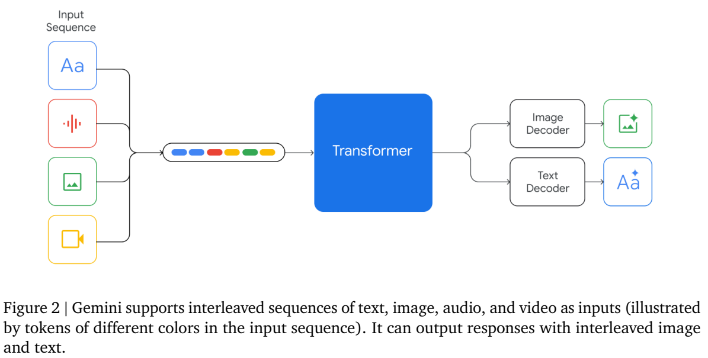
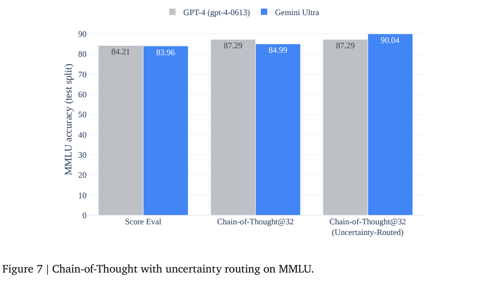
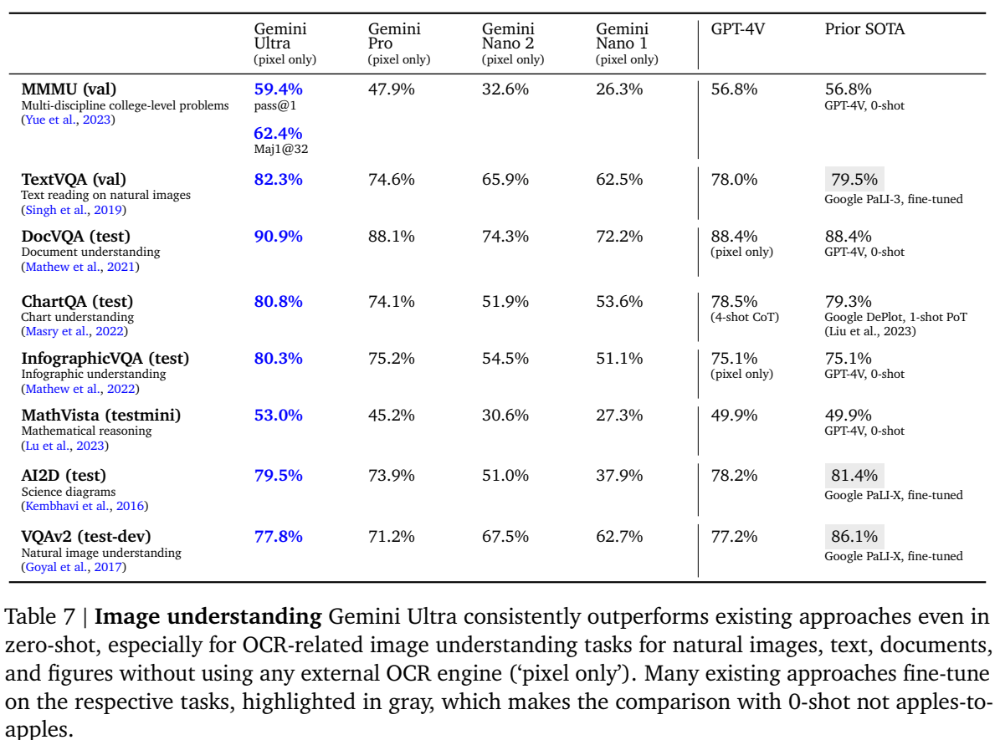
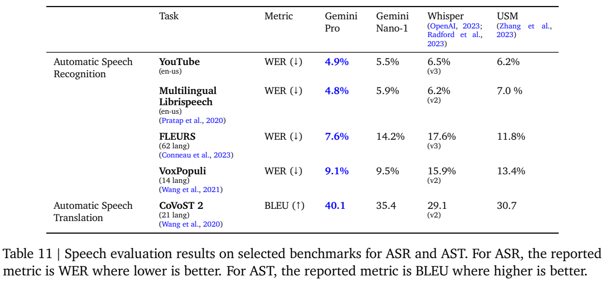

<!-- article-header:start -->
[项目首页](../../../README.md) › [模型系列](../../../reports/model-family-index.md) › [Gemini](../README.md)
<!-- article-header:end -->

# Gemini 初代：从联合多模态预训练到分层部署的模型家族

<!-- article-toc:start -->

**本篇目录** · [论文定位](#paper-info) · [快速概览](#overview) · [整体架构](#architecture) · [核心原理](#principles) · [数据构建](#data) · [训练流程](#training) · [实验结果](#experiments)
<!-- article-toc:end -->

## 1. 论文信息与模型定位

| 项目 | 信息 |
|---|---|
| 原文 | *Gemini: A Family of Highly Capable Multimodal Models* |
| 团队 | Gemini Team，Google / Google DeepMind |
| 固定版本 | [arXiv 2312.11805v1](https://arxiv.org/pdf/2312.11805v1)，2023-12-19，62 页；上游目录对应初代 Gemini 2023-12-06 发布条目 |
| 模型 | Ultra、Pro、Nano-1、Nano-2；Nano 参数分别为 1.8B、3.25B，Ultra/Pro 参数量未公开 |
| 输入与输出 | 输入文本、图像、音频、视频；可输出交错文本与图像。该版本没有报告原生语音生成 |
| 资料性质 | 模型家族技术报告；公开了能力评测和部分训练工程，没有完整公开可复现训练配方 |

Gemini 的定位是从训练起点就联合学习多种模态的通用模型家族：Ultra 面向复杂任务，Pro 平衡能力与规模，Nano 面向端侧部署。这里介绍的是初代报告，不能把后来 Gemini 的百万 token 上下文、实时语音或后续版本成绩归入这一篇。本文的全部图表和数值固定到上述 v1。（原文 §1–2，PDF 第 1–4 页）

## 2. 快速概览

这篇报告值得关注的内容有三个层面。模型层面，它把图像、音频、视频和文本放入同一序列建模框架，让空间信息、时间信息与语言推理能够共同参与回答。训练层面，它用跨数据中心 TPU 训练、冗余恢复和静默硬件错误检测支撑大规模联合学习，再通过指令微调与人类反馈调节帮助性、事实性和安全性。部署层面，同一家族涵盖大模型与经过蒸馏、可进行 4-bit 部署的小模型。

| 关键事实 | 阅读时要保留的条件 |
|---|---|
| Ultra 的 MMLU 为 90.04% | 32 次 CoT 采样加不确定性路由；普通 5-shot 为 83.7% |
| Ultra 的 MMMU 为 62.4% | 32 次多数投票；单次 pass@1 为 59.4% |
| 图像理解可仅用像素输入 | 没有外部 OCR；部分对照模型使用任务专门微调或不同提示 |
| 上下文长度为 32K | 不是后续版本的超长上下文；合成检索与真实复杂推理也不是同一任务 |
| 音频任务有较强结果 | Table 11 评测的是 Pro 与 Nano-1，尚未评测 Ultra |

本文最直接的贡献是展示联合多模态模型在不同规模下的能力覆盖。它的披露程度不足以让读者从报告独立复现原模型，成绩也不能脱离采样预算、提示和数据条件理解。

## 3. 整体架构

**原文 Figure 2，PDF 第 4 页。** 左侧不同颜色表示来自不同模态的序列元素，中间是 Transformer，右侧展示文本和图像输出。它是功能结构示意图，没有给出每个编码器的层数、连接器维度或图像解码器实现。读图的重点是输入和输出都可以交错，而不是认为所有原始信号直接以相同数值格式进入网络。

Gemini 以 Transformer decoder 为基础，并采用适合 TPU 的架构优化和高效注意力机制，例如 multi-query attention。不同模态在预训练阶段共同参与学习。报告称视觉部分受到 Flamingo、CoCa、PaLI 等工作的启发，但没有披露一个可以逐层复现的视觉编码器与适配器配置；也没有说明主模型是否为 MoE，不能据此补出专家数量。（§2，PDF 第 3–4 页）

图像输入支持不同分辨率，目标是保留文字、图表和细节信息。视频可以表示为一组帧，并与文本、音频交错，依赖序列关系形成时间上下文。音频以 16 kHz 信号对应的 USM 特征直接输入，而不是先全部转成 ASR 文本：这样的设计保留了文字转录容易丢失的声学细节。图像输出使用离散图像 token；具体图像 tokenizer、码本和解码机制没有在本报告详细公布。Figure 6 与 Figure 10 提供图文生成示例，但没有量化验证其生成质量，也没有展示语音输出架构。

Nano-1 与 Nano-2 的 1.8B、3.25B 参数和 4-bit 部署是端侧设计信息，不能推断 Ultra 的大小。报告提到蒸馏和小模型训练算法，但没有给出温度、教师组合或完整蒸馏损失。

## 4. 核心创新与数学原理

**联合序列建模。** 图像中的文字、布局，音频的声学信息和视频中的时间关系可以成为后续语言生成的条件。用下面的解释性表达概括这一思想：

$$
p_\theta(y\mid x)=\prod_{t=1}^{T}p_\theta(y_t\mid y_{<t},z(x)),\qquad
z(x)=\mathrm{Interleave}(z_{\rm text},z_{\rm image},z_{\rm audio},z_{\rm video}).
$$

其中 $`z(x)`$ 表示经各模态处理后组成的有序输入，$`y`$ 可以包含文本和图像的输出序列。这是本文为解释架构使用的抽象表达，**不是原文给出的精确训练公式**；报告没有公开所有模态 token 化方式和各类损失权重。联合输入的价值在于同一个回答可以同时调用感知与推理，不能据此证明它在每个细分任务上都优于专用模型。

**不确定性路由的思维链。** 普通多数投票会把推理样本中共同出现的错误也当成答案。Gemini 在 MMLU 上先生成 $`K`$ 个思维链样本，如果答案一致性达到验证集上选定的阈值，就采用多数答案；否则回退到没有 CoT 的贪心最大似然选项。按原文算法作解释性形式化，可写成：

$$
c=\max_a\frac{1}{K}\sum_{k=1}^{K}\mathbf{1}[a_k=a],\qquad
\hat a=\begin{cases}\mathrm{mode}(a_1,\ldots,a_K),&c>\tau,\\
a_{\rm greedy},&c\leq\tau.\end{cases}
$$

$`c`$ 是样本一致性，不是经过校准的正确概率；$`\tau`$ 由各模型的验证集表现优化，不能将测试集用于选阈值。此处公式表达 §9.1 的文字算法，原文未给出统一阈值或上述编号公式。（PDF 第 46 页）

**原文 Figure 7，PDF 第 46 页。** Gemini Ultra 的 Score Eval 为 83.96%，普通 CoT@32 为 84.99%，加路由后为 90.04%；作者同一评测下的 GPT-4 对应为 84.21%、87.29%、87.29%。因此，90.04% 的提升包含一个具体的推理时决策机制，不能描述成“只把采样次数提高到 32 就达到 90%”。图中的 Score Eval 也应与 Table 2 的标准 5-shot 成绩分别标注。

**大规模训练的可用算力。** Ultra 跨多个数据中心使用 TPUv4。4096 芯片是一个 SuperPod 的规模，不是 Ultra 总芯片数；SuperPod 内进行模型并行，跨 SuperPod 进行数据并行。JAX/Pathways、XLA GSPMD 和通信计算重叠减少分布式训练损耗。作者用内存中的冗余模型状态恢复故障，使 goodput 从 85% 提高到 97%；这里 goodput 是实际推进新训练步骤的有效时间比例，不等于模型 FLOPs 利用率。确定性重放和扫描器用于定位罕见静默数据损坏。（§3，PDF 第 4–5 页）

## 5. 数据构建与处理

预训练混合包括网页文档、书籍、代码，以及图像、音频和视频；文本覆盖多语言。SentencePiece tokenizer 用整个训练语料的大样本训练，以改善非拉丁文字的编码效率。作者根据计算预算设计大模型训练量，并为小模型的推理成本考虑更充分训练；公开报告没有给出总 token、图像数量、视频时长、音频小时数或各模态最终占比。（§4，PDF 第 5 页）

数据处理包含启发式规则、模型分类器质量筛选、高风险内容过滤和评测去污染。数据混合权重先在小模型上做消融，训练末期增加与目标领域更相关的数据。原文没有公开过滤阈值和完整消融表，因此不能把“筛选有效”改写成某个数据策略贡献了确定百分点，也不能断言所有评测都绝对无训练重叠。

指令数据同时覆盖文本和多模态任务。奖励模型的数据需要平衡应拒绝的请求和应正常回答的请求，避免只学会拒答；作者围绕约 20 类伤害风险生成测试请求，用人工与高能力语言模型构造候选、修订响应并补充 SFT 数据。事实性数据分别训练忠实引用上下文、闭卷事实回答，以及不可回答问题上的适当保留意见。（§6.4，PDF 第 20–22 页）

一个明确例外是 **FLEURS**：Table 11 最佳 Pro 结果用了 FLEURS 训练集。报告另列去掉该训练集后的成绩，读者必须保留这一条件，而不能将该结果解释为完全未见目标数据的零样本泛化。

## 6. 训练流程与目标

训练可以按公开流程理解为：联合多模态预训练，文本/多模态监督指令微调，利用多头奖励模型的人类反馈强化学习，以及针对风险与事实性的定向数据迭代。Nano 另外涉及大模型蒸馏和适合端侧的训练部署优化。Pro 的预训练可在数周完成，资源仅为 Ultra 的一部分；这些是定性说明，不是公开训练步数表。（§2–4、§6.4.2）

SFT 让模型学会遵循请求，RLHF 在帮助性、事实性、安全性之间权衡。原文明确使用这些奖励分数的加权和训练多头奖励模型；可作解释性记号 $`R=w_hR_h+w_fR_f+w_sR_s`$，但没有公开权重、强化学习算法和 KL 系数。报告也没有提供各阶段学习率、优化器、batch size、冻结模块或完整损失，因此不能自行套用其他模型的两阶段训练配方。

事实性改进提供了一个可核验的训练前后对照。Table 14 比较已经经过指令微调、但没有专门事实性适配的 Pro，与最终阶段 Pro：事实错误率从 7.9% 降到 3.4%，AIS 归因指标从 40.2% 升到 59.7%，不可回答问题上的 hedging 准确率从 0% 升到 69.30%。这些结果针对专门挑战集，原文还报告了前两项的 95% 置信区间；评测没有引入检索或工具，不能理解为日常所有回答的错误率只有 3.4%。（PDF 第 22 页）

训练工程和评测同样相互衔接：开发评测用于改进模型，独立团队的 assurance 评测使用严格保留数据，外部评测与内部红队用于发现盲点。报告提供机制说明，没有公开完整第三方结果或所有评测样本。

## 7. 实验设置与主要结果

报告使用超过 50 个基准组成能力评测框架，正文展示其中一部分。表中的 Ultra、Pro、Nano 成绩和不同版本 GPT、专门微调模型都要分别读。下面保留对多模态能力最有代表性的结果。（§5、§9.2）

**原文 Table 7，PDF 第 12 页。** 四个 Gemini 列均为像素输入，不调用外部 OCR。灰底是经过任务专门微调的先前方法，MMMU 的 32 次多数投票单独列出；ChartQA 对照的提示条件也标在原表中。

| 基准 | Ultra | Pro | GPT-4V 原表对照 | 条件与含义 |
|---|---:|---:|---:|---|
| MMMU val | 59.4 / 62.4 | 47.9 | 56.8 | Ultra 单次 / Maj1@32 |
| TextVQA val | 82.3 | 74.6 | 78.0 | 自然图像文字理解 |
| DocVQA test | 90.9 | 88.1 | 88.4 | 文档理解；不能视为纯 OCR 字符准确率 |
| ChartQA test | 80.8 | 74.1 | 78.5 | GPT-4V 为 4-shot CoT，Gemini 为 0-shot |
| InfographicVQA test | 80.3 | 75.2 | 75.1 | 信息图理解 |
| MathVista testmini | 53.0 | 45.2 | 49.9 | 视觉数学推理 |
| AI2D test | 79.5 | 73.9 | 78.2 | 先前专门微调 PaLI-X 为 81.4 |
| VQAv2 test-dev | 77.8 | 71.2 | 77.2 | 先前专门微调 PaLI-X 为 86.1 |

Ultra 在上述 GPT-4V 对照上有提升，但 AI2D 与 VQAv2 没有超过表中专门微调模型，不能写成全面超越全部先前方法。MMMU 的学科分解也显示差异：Ultra 单次在 Business 为 56.7、Science 为 48.0，GPT-4V 对应 59.3、54.7；即使用多数投票，Science 49.3 仍低于 54.7。（Table 8，PDF 第 13 页）

**视频评测**统一从片段抽取 16 帧，部分数据使用 2023 年 11 月仍可获取的 YouTube 子集。Table 10 的 Ultra / Pro 分别是：YouCook2 135.4 / 123.2 CIDEr，采用 4-shot；ActivityNet-QA 52.2 / 49.8 accuracy，采用 0-shot；Perception Test 54.7 / 51.1 accuracy，采用 0-shot；NextQA 29.9 / 28.0 是 **WUPS**，不能与后来报告的 NextQA accuracy 直接比较。该报告没有 Video-MME 或后来版本的视频帧预算。（PDF 第 15 页）

**原文 Table 11，PDF 第 17 页。** 数值属于 Pro 与 Nano-1，而不是 Ultra。WER 越低越好，BLEU 越高越好；FLEURS 的中日韩泰四种语言使用 CER，表中汇总名称仍写 WER。

| 音频任务 | Pro | Nano-1 | 关键设置 |
|---|---:|---:|---|
| YouTube en-US | 4.9 | 5.5 | WER；Whisper large-v3 为 6.5 |
| Multilingual LibriSpeech en-US | 4.8 | 5.9 | WER；只列英语评测 |
| FLEURS 62 语言 | 7.6 | 14.2 | 有训练集参与；Pro 不用该训练集为 15.8 |
| VoxPopuli 14 语言 | 9.1 | 9.5 | WER |
| CoVoST 2，21 语言 | 40.1 | 35.4 | 翻译至英语的 BLEU，不是识别错误率 |

文本侧，Ultra 的标准 5-shot MMLU 为 83.7%，经前述路由为 90.04%；作者对 GPT-4 同样做 CoT@32 路由得到 87.29%，不能只拿 90.04 对比 GPT-4 的公开 5-shot 86.4 并声称同预算。HumanEval 74.4 是 0-shot、经过指令微调的模型结果，HellaSwag 87.8 反而低于原表 GPT-4 的 95.3。长上下文的合成键值检索在完整 32K 上达到 98%，不证明所有长文推理都达到同一水平。（Tables 2、3、Figure 4，PDF 第 7–10 页）

图像生成主要通过 Figure 6、10 展示遵循颜色要求、生成相关图文和跨图主体一致性，没有 FID、GenEval 或同预算生成对比。AlphaCode 2 的编程竞赛结果来自以 Pro 为基础专门调优、批量生成、过滤和重排的系统，不能作为裸 Pro 的单次编程能力。报告展示的是一个有广泛能力的模型家族；还需结合任务配置、数据重叠和公开细节不足，判断这些证据适用于什么场景。

<!-- article-footer:start -->
---

[← 上一篇：VaQuitA](../../vaquita/arxiv-2312.02310/README.md) · [按发表时间浏览](../../../reports/paper-reading-guide.md#year-2023) · [下一篇：OneLLM →](../../onellm/arxiv-2312.03700/README.md)

[返回本篇目录](#article-toc) · [返回模型系列](../README.md)
<!-- article-footer:end -->
