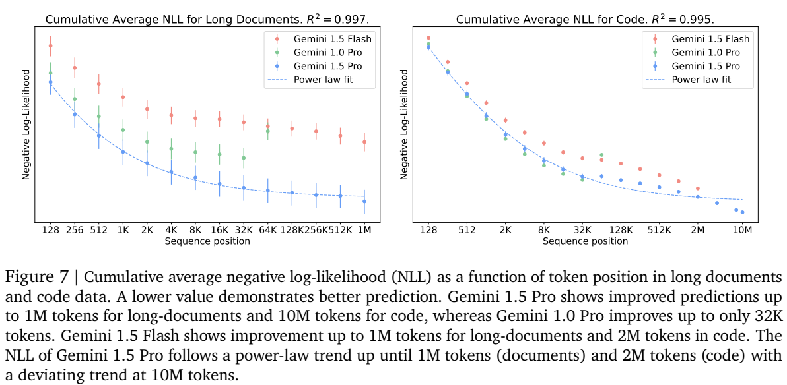
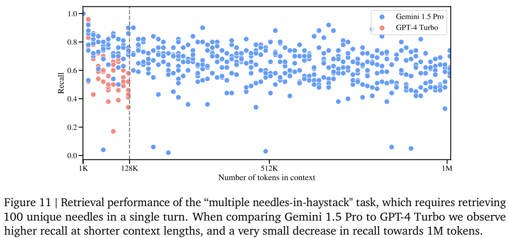
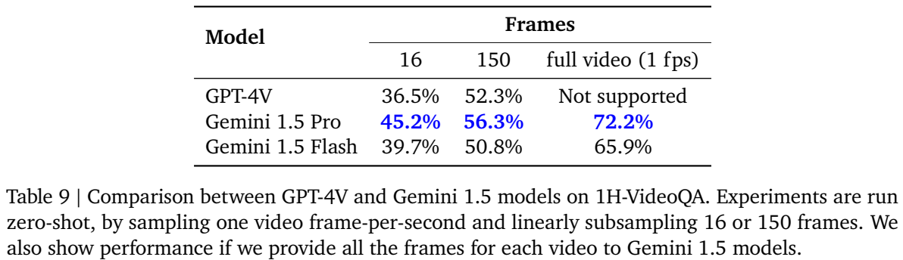
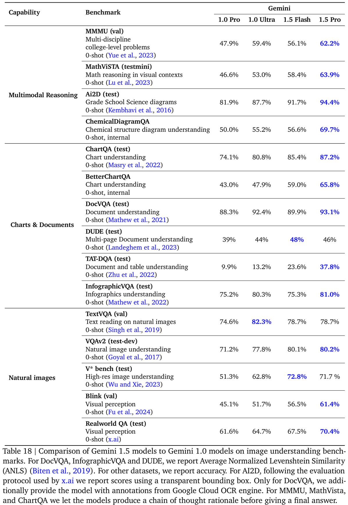

# Gemini 1.5：百万级混合上下文、稀疏专家模型与高效蒸馏

## 1. 论文信息与模型定位

原文是 Gemini Team、Google 的 **Gemini 1.5: Unlocking multimodal understanding across millions of tokens of context**。本文依据 [Google 官方技术报告](https://storage.googleapis.com/deepmind-media/gemini/gemini_v1_5_report.pdf)的 154 页缓存版本撰写，来源版本为 official-source-snapshot-2026-10-08，文件 SHA-256 见本目录资产清单。官方 PDF 会更新；当前文件同时介绍更新后的 Gemini 1.5 Pro、Flash，以及仍在开发中的 Flash-8B，不能全部当作 2024 年 2 月初次发布时的模型结果。

Gemini 1.5 的定位是接收文本、代码、图片、音频和视频，并生成文本的通用多模态模型。报告强调把完整代码库、长文档和连续视听材料放入同一次上下文，通过检索、跨片段推理和上下文学习完成任务。Pro 采用稀疏专家架构，Flash 采用面向吞吐与延迟的稠密架构。报告的主要贡献是长上下文能力及其系统性评估，内部结构和训练配方的披露相对有限。[原文第 1、5–7、105–107 页](https://storage.googleapis.com/deepmind-media/gemini/gemini_v1_5_report.pdf#page=1)

“支持千万 token”需要限定场景：报告探索了 Pro 在最高千万 token 的诊断实验，而模型卡描述的输入能力是最高两小时视频、22 小时音频。这些是不同长度、编码方式和模型使用条件下的描述；千万 token 实验不是对任意公开 API、所有模态组合的服务上限承诺，也不代表语音或图像生成能力。

## 2. 快速概览

| 阅读重点 | 原文实际内容 |
|---|---|
| 模型分工 | Pro 为稀疏 MoE Transformer；Flash 为在线蒸馏得到的稠密 Transformer；Flash-8B 是进一步压缩的实验型号 |
| 输入输出 | 文本、代码、图片、音频和视频可组成混合输入；模型卡输出为文本 |
| 长上下文证据 | 长序列 NLL、单针/多针检索、MRCR、长视频问答、长文档问答及低资源语言上下文学习 |
| 效率来源 | 稀疏路由、Flash 的并行注意力与前馈计算、蒸馏、训练和服务基础设施优化 |
| 训练披露程度 | 多个每组 4,096 芯片的 TPUv4 pod、多模态预训练、SFT、偏好训练；总算力、主模型参数量及完整超参未公开 |
| 结果的主要边界 | 找到一个关键词的准确率，不能代替多证据推理准确率；部分评测额外使用 OCR、CoT、模型裁判或专用模型 |

最值得抓住的变化是：模型不仅能接受很长的输入，还能继续利用较早出现的信息改善后续预测。不过，证据利用难度一旦从“返回一个号码”提高到“完整找回 100 个号码”“区分相似请求”或“解释整段视频”，效果会明显低于接近 100% 的单针结果。

## 3. 整体架构

**Pro 的计算骨干是稀疏 MoE Transformer。** 对一个输入位置，路由器选择部分专家参与计算，因此可以增加模型的总容量，同时控制每个 token 的实际计算。报告没有公开专家数量、每次激活数量、总参数、激活参数、层数或路由负载均衡损失。不能根据“MoE”推断它使用某个开源模型的 top-k、共享专家或注意力结构。[原文第 5、105 页](https://storage.googleapis.com/deepmind-media/gemini/gemini_v1_5_report.pdf#page=5)

**Flash 是稠密 Transformer decoder。** 原文明确写到注意力和前馈组件的并行计算，并通过在线蒸馏从 Pro 迁移知识；模型卡进一步确认其为 dense 模型。这里的“小”是相对 Pro 的效率定位，报告没有提供 Flash 主型号的准确参数量。Flash-8B 继承 Flash 的架构和优化思路，目标是更低延迟、更高吞吐，当前版本把它的结果标为初步评估。[原文第 6、45、105 页](https://storage.googleapis.com/deepmind-media/gemini/gemini_v1_5_report.pdf#page=6)

**多模态能力表现为统一的混合上下文接口。** 模型能够在同一输入中使用视频帧、音频与文字，输出对问题的文本回答。报告展示过整库代码问答、根据手绘草图定位小说情节、长电影片段定位等例子。这些例子说明不同输入形式可以共同成为条件信息，但没有足够结构细节绘出确定的视觉编码器、音频编码器、投影器层数与连接拓扑。因此本文不补画一张看似精确的内部模块图。

Flash 的服务速度测量也有明确单位。英文输出的报告值为 1.5 毫秒/字符，Pro 为 4.3 毫秒/字符；中文分别为 5.2 和 14.1 毫秒/字符。测试输入约 10,000 字符，统计过程包含多次请求并取其中最优表现。这不是 token/s，也不是首字延迟或固定硬件的完整吞吐测试。原文所述约 650 英文字符/秒不能直接换算成任意语言的 token 生成速度。[原文第 6 页](https://storage.googleapis.com/deepmind-media/gemini/gemini_v1_5_report.pdf#page=6)

## 4. 核心创新与数学原理

**第一项核心变化是长上下文中的持续信息利用。** 为便于理解，语言建模的累计平均负对数似然可以写成：

$$
\overline{\mathcal L}(n)=-\frac{1}{n}\sum_{t=1}^{n}\log p_\theta(x_t\mid x_{<t}).
$$

这是对原文 NLL 指标的数学展开，不是报告新提出的损失。输入前端信息少，预测的不确定性通常较高；随着上下文积累，如果模型能读懂文档结构、函数关系和重复模式，后续预测会更容易，累计平均 NLL 会下降。原文对曲线拟合使用 $L(x)=\alpha x^\beta+\gamma$，这是实验性的幂律拟合，不能当作训练时直接优化的目标或结构公式。

**读图方式：** Figure 7 左侧为长文档，右侧为代码；横轴是序列位置，纵轴是累计平均 NLL，越低越好。蓝色 Pro 曲线在文档约 1M token 和代码最高 10M token 处仍继续下降，红色 Flash 展示到文档 1M、代码 2M。虚线是 Pro 的幂律拟合。图没有给出可供跨论文直接比较的绝对 NLL 刻度；它证明的是该数据与模型条件下的预测趋势。代码接近 10M 时偏离拟合，作者认为重复代码块可能带来额外收益，尚需进一步研究。[原文第 10–11 页](https://storage.googleapis.com/deepmind-media/gemini/gemini_v1_5_report.pdf#page=10)

**第二项贡献是把长上下文评估从单针推进到更复杂的证据任务。** 单针实验把某个城市的随机号码插入重复文章，然后要求返回该号码。视频版本只在某一帧叠加一个词，音频版本在长录音中插入短语。它们主要考验定位和读取，不要求理解完整文档或电影的因果关系。

多针实验则要求一次找回 100 条信息，召回率可理解为“正确返回的目标条目数/全部目标条目数”。MRCR 再提高相似性难度：长对话中存在主题、体裁接近的请求，模型必须根据“第一首”“关于企鹅”等指代找出正确历史回复。MRCR 使用字符串相似度评分，并不等同于二分类回答准确率。

**读图方式：** 横轴是上下文 token 数，纵轴为召回率；蓝点为 Pro，红点为 GPT-4 Turbo。Pro 在约 128K 时维持约 70%，到 1M 仍超过 60%，与单针实验 99% 以上的数字差距很大。虚线表示对照模型约 128K 的窗口边界。脚注明确本图使用 **2 月版 Pro**，不能将它重新标成更新模型的结果。这个实验说明长上下文容量增加了可访问的信息，却没有保证所有信息都能在一次回答中完整输出。[原文第 14–16 页](https://storage.googleapis.com/deepmind-media/gemini/gemini_v1_5_report.pdf#page=14)

**第三项贡献是把上下文作为临时学习材料。** Kalamang 翻译实验将约 500 页语法书、词表和句对放入输入；many-shot 翻译则把数百到数千个示例直接提供给模型。可以用 $p_\theta(y\mid x,D_{\text{context}})$ 表达这种条件预测：学习资料改变了当前输入条件，参数 $\theta$ 没有因此被微调。它不同于重新训练一个语言专家，也不证明模型此前绝对没有见过该语言。

**第四项是高效模型的知识迁移。** Flash 在线学习 Pro 的行为，使较轻的稠密网络获得部分大模型能力。报告没有公开蒸馏损失的完整形式、教师采样策略、软标签温度与训练比例；本文不把常见 KL 蒸馏公式冒充 Gemini 1.5 的确切实现。

## 5. 数据构建与处理

预训练数据来自多种领域，包括网页文档、代码、图片、音频和视频，覆盖多语言。模型卡说明模型从随机初始化训练，是基于离线数据形成的静态模型。报告没有公开总 token、各模态样本数、混合比例、图片分辨率、视频帧率训练分布、音频 tokenizer 或完整去重阈值。[原文第 7、106 页](https://storage.googleapis.com/deepmind-media/gemini/gemini_v1_5_report.pdf#page=7)

已公开的过滤思路包括：对最严格的内容策略进行安全过滤；对部分预训练文本加入由分类器标注的控制标签，例如毒性标签，帮助模型形成可被后训练调节的表征；使用基于 n-gram 的基准污染缓解措施。作者明确承认 n-gram 清理并不完美，因此增设 PhysicsFinals、HiddenMath、Natural2Code 等未公开内部评测。报告展示了一项污染分析：给 Gemini 1.0 Ultra 继续训练包含 HumanEval 测试集的数据后，分数从 74.4% 升至 89.0%，即使测试题以 JSON 或 HTML 包装，影响仍存在。此结果解释了为什么不能仅凭公开代码榜单判断泛化。[原文第 29、32、51 页](https://storage.googleapis.com/deepmind-media/gemini/gemini_v1_5_report.pdf#page=29)

SFT 使用多模态“指令—适当回答”配对。安全相关样本通过人机或模型间交互寻找问题行为，既包括违规回答，也包括本可帮助用户却拒答的情况。再由人工修改或定制生成流程修正回答，反复监测安全与一般能力，避免单纯提高拒答率。RLHF 则收集多个候选回复的人工比较，将偏好用于奖励模型和策略训练。[原文第 51–52 页](https://storage.googleapis.com/deepmind-media/gemini/gemini_v1_5_report.pdf#page=51)

长上下文评测数据应与训练集分开理解。文本针实验重复拼接 Paul Graham 文章；视频针实验将 AlphaGo 纪录片重复七次，按 1 fps 采样，总计 37,994 帧；音频针实验拼接 VoxPopuli 音频。真实长视频任务 1H-VideoQA 则包含 125 道五选一问题，视频长约 40–105 分钟。这些是作者构建的测试设置，不是公开披露的 Gemini 预训练配比。[原文第 11–14、24 页](https://storage.googleapis.com/deepmind-media/gemini/gemini_v1_5_report.pdf#page=11)

低资源语言实验同样有不同证据级别。Kalamang 文字翻译使用语法手册、约 2,000 词词表和约 400 句对，总上下文约 250K token；语音实验从较大 ASROB 语料中只选了六段、约 45 分钟，其中五段作上下文示例、一段作测试，而且测试与部分示例来自同一说话者。因此它展示的是有限设置中的上下文语音适应，不是所有说话者上的泛化结论。[原文第 17–21 页](https://storage.googleapis.com/deepmind-media/gemini/gemini_v1_5_report.pdf#page=17)

## 6. 训练流程与目标

公开流程可以概括为：**多模态预训练 → 多模态指令微调 → 人类偏好对齐**；Flash 还加入从 Pro 的在线蒸馏。预训练使网络建立语言和感知表示，指令微调使输入被理解为用户任务，偏好对齐则调整多种候选答案中应优先生成哪一种。原文安全部分明确使用 SFT、奖励模型与 RLHF，但未提供完整 RL 算法、KL 系数、奖励权重或训练轮数。

报告在长序列实验中将下一 token 预测称为语言模型训练目标。可以用 $\mathcal L_{\text{NTP}}=-\sum_t\log p_\theta(x_t\mid x_{<t})$ 理解这一目标，但它不是对全部音频、图像训练损失的完整披露。SFT 的条件回答预测也可概念性写成 $-\sum_t\log p_\theta(y_t\mid m,q,y_{<t})$，其中 $m$ 是多模态输入、$q$ 是指令；报告没有明确每类 token 的掩码规则与权重，不能据此断言所有模态使用完全相同的优化损失。

硬件方面，训练使用跨多个数据中心的多个 **4,096 芯片 TPUv4 pod**。这表示每个 pod 的规模，不是总共只使用 4,096 块芯片，也不是 GPU 数量。软件为 JAX、Pathways、XLA 和 GSPMD；单控制器程序组织大规模训练。Flash 使用较高阶的预条件优化方法，但原文没有给出可复现实验的优化器全名和配置。[原文第 6–7、106 页](https://storage.googleapis.com/deepmind-media/gemini/gemini_v1_5_report.pdf#page=6)

需要保留的披露边界包括：主模型层数和参数量、训练总算力、token 总量、batch、学习率、训练步数、长上下文扩展课程、位置编码机制、哪些模块冻结、视觉音频编码器细节，都不能从这份报告完整恢复。模型卡直接将 compute requirements 和 model stats 标为未报告。

数学专用 Pro 是另一条研究分支：经过专门训练，并增加推理时的候选搜索。Table 21 的 MATH 80.6 是专用模型单样本结果，91.1 是从 256 个候选中由奖励模型选答；普通 Pro 为 67.7。报告明确这部分仅用于当时内部研究。不能把 91.1 写成标准 Gemini 1.5 Pro 的零样本、单次解码能力。[原文第 43–44 页](https://storage.googleapis.com/deepmind-media/gemini/gemini_v1_5_report.pdf#page=43)

## 7. 实验设置与主要结果

一般评测使用同一后训练检查点，默认温度 0、贪心解码；原文显式标记的预训练模型、多数投票、专用数学模型和 2 月版 Pro 是例外。音频常规评测为公平比较使用 **指令微调之前**的模型。比较时必须首先检查模型版本、采样数、shot 数、指标和额外输入。[原文第 7、30、42 页](https://storage.googleapis.com/deepmind-media/gemini/gemini_v1_5_report.pdf#page=7)

单针文本检索中，Pro 在最高约 530K token 达到 100%，1M 为 99.7%，10M 为 99.2%；Flash 在最高 2M 达到 100%。这些数字说明随机目标的定位很强，但多针检索和 MRCR 已显示更复杂任务有明显下降。长文档问答使用完整《悲惨世界》上下文，并与 TF-IDF 检索约 4K token 的 RAG 设置比较。评分使用 Gemini 1.5 Pro 作为裁判，再用 Bradley–Terry 模型估计偏好强度，完整上下文 Pro 对其 RAG 版本的拟合偏好概率约 78%。这是裁判下的成对偏好，存在自评偏差，不能称作“问答准确率 78%”。[原文第 10–16、21–23 页](https://storage.googleapis.com/deepmind-media/gemini/gemini_v1_5_report.pdf#page=10)

**读表方式：** 列为输入 16 帧、150 帧和全视频 1 fps 帧；行是不同模型，指标为五选一准确率。Pro 从 45.2% 提高到 56.3%、72.2%，Flash 从 39.7% 提高到 50.8%、65.9%；GPT-4V 的 16/150 帧为 36.5%/52.3%，当时接口不能接受全帧设置。Pro 在相同 150 帧条件下的优势和接收全帧后的优势是两个不同证据。全帧仍未解决所有问题，附录 Table 47 给出计数、小字识别和情节位置等失败案例。这比单帧叠字找针更接近实际长视频理解。[原文第 24–25、111 页](https://storage.googleapis.com/deepmind-media/gemini/gemini_v1_5_report.pdf#page=24)

**读表方式：** 表格按多模态推理、图表文档、自然图像分组；DocVQA、DUDE、InfographicVQA 使用 ANLS，其他多数为准确率。更新 Pro 的 MMMU val 为 62.2%、MathVista testmini 为 63.9%、ChartQA 为 87.2%；Flash 对应 56.1%、58.4%、85.4%。这些任务均为零样本，但 MMMU、MathVista、ChartQA 允许生成推理过程。**DocVQA 额外提供 Google Cloud OCR 标注**，Pro 93.1% 不能作为纯视觉、无 OCR 的结果引用。Pro 在 TextVQA 的 78.7% 低于 1.0 Ultra 的 82.3%，在 DUDE 的 46% 也低于 Flash 的 48%，因此新一代没有在每项任务上普遍领先。

| 其他实验 | Flash | Pro | 读数边界 |
|---|---:|---:|---|
| HumanEval | 74.3% | 84.1% | 零样本，代码单测通过率；公开集污染仍难完全排除 |
| MATH | 54.9% | 67.7% | 4-shot Minerva 提示，普通后训练模型 |
| EgoSchema | 65.7% | 72.2% | 零样本视频问答，与 1H-VideoQA 为不同数据集 |
| FLEURS | 9.8% | 6.5% | 错误率越低越好，仅 55 种语言；中日韩泰使用 CER 后汇总 |
| CoVoST-2 | 36.1 | 39.4 | BLEU，20 种语言向英语翻译，仅覆盖训练见过的语言子集 |

长音频内部 YouTube 测试约 15 分钟，Pro WER 为 5.5%、Flash 为 8.8%；Whisper v3 整段处理为 12.5%，分成 30 秒片段为 7.3%。因此“长音频优于基线”必须说明基线是否分段。Kalamang 英语→Kalamang 的人工评分为 5.46/6，参照学习者为 5.60；反方向 Pro 为 4.00，参照为 5.52。人工参照和评分者是根据同样材料学习该语言的非母语学习者，这不是两方向均达到母语专家水平的证据。[原文第 18、23、30、40、42 页](https://storage.googleapis.com/deepmind-media/gemini/gemini_v1_5_report.pdf#page=18)

报告还观察到安全训练的取舍：图文内容违规相对 1.0 Ultra 减少，但部分本可回答的有依据问题出现更多拒答；手工提示注入在模拟检索任务中仍有较高成功率。职业任务研究报告 26%–75% 的时间节省，来自同职业评审者对输出可节省时间的估计，而非实际工作计时。Gemini 1.5 的可靠价值在于扩大一次输入内可用的证据范围，同时保留模型、评测协议和任务难度的差异；整仓库比较应沿用这些边界。[原文第 37–38、52、59–62 页](https://storage.googleapis.com/deepmind-media/gemini/gemini_v1_5_report.pdf#page=37)
