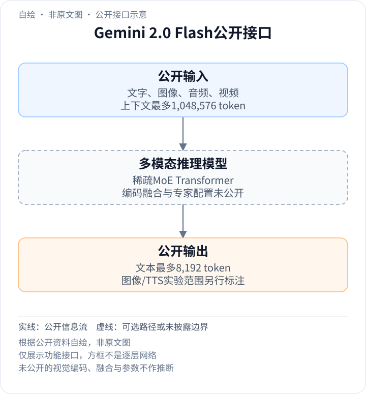
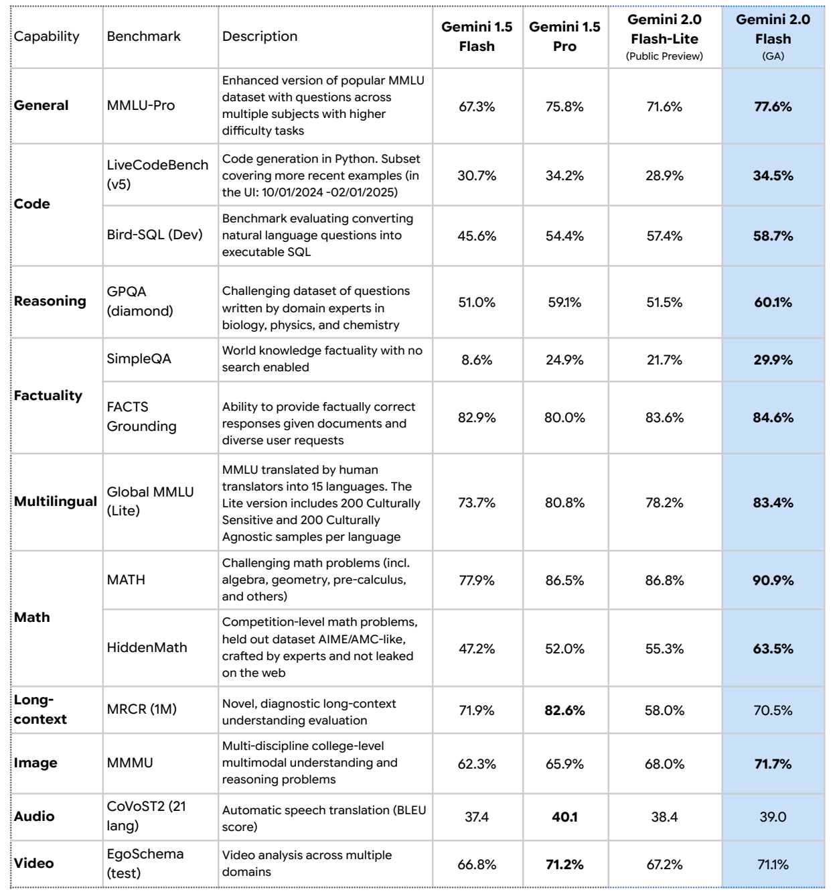

<!-- article-header:start -->
[项目首页](../../../README.md) › [模型系列](../../../reports/model-family-index.md) › [Gemini](../README.md)
<!-- article-header:end -->

# Gemini 2.0 Flash：稀疏多模态、流式接口与工具使用

<!-- article-toc:start -->
<a id="article-toc"></a>

**本篇目录** · [论文定位](#paper-info) · [快速概览](#overview) · [整体架构](#architecture) · [核心原理](#principles) · [数据构建](#data) · [训练流程](#training) · [实验结果](#experiments)
<!-- article-toc:end -->

<a id="paper-info"></a>

## 1. 论文信息与模型定位

| 项目 | 信息 |
|---|---|
| 原文 | Gemini 2.0 Flash Model Card |
| 机构 | Google DeepMind |
| 模型首发 | 2024-12-11实验版发布 |
| 本文版本 | 卡片标注2025-04-15，原始PDF于2026-10-13获取 |
| 定位 | 文本、图像、音频、视频理解与低延迟代理接口 |

Gemini 2.0 Flash延续稀疏MoE Transformer，目标是在较快响应下提高多模态与工具能力。首发博文与后来的GA卡片描述不同发布阶段，本文以[2025年4月模型卡](https://storage.googleapis.com/deepmind-media/Model-Cards/Gemini-2-0-Flash-Model-Card.pdf)的规格和结果为主；[2024年12月发布说明](https://blog.google/technology/google-deepmind/google-gemini-ai-update-december-2024/)仅补充当时实验输出、工具和Live API的范围，不能把GA成绩写成首发当天成绩。

<a id="overview"></a>

## 2. 快速概览

- **输入**：文字、图像、音频、视频；上下文1,048,576 token。
- **卡片输出**：文本最多8,192 token；原生图像输出在卡片日期仍标为实验功能。
- **模型架构**：系列采用稀疏MoE Transformer，未披露参数量、专家数、top-k或视觉token形状。
- **多模态结果**：MMMU 71.7%，CoVoST2翻译BLEU 39.0，EgoSchema 71.1%。
- **训练栈**：TPU、JAX、ML Pathways；公开数据类型及过滤方法，但无完整算力或优化配置。

<a id="architecture"></a>

## 3. 整体架构

<!-- derived-architecture:start -->


*自绘公开接口示意（非原文图）。依据下述公开资料归纳；方框表示功能组件，不代表逐层实现。*

依据：[PDF p.2 Model Information](https://storage.googleapis.com/deepmind-media/Model-Cards/Gemini-2-0-Flash-Model-Card.pdf)。
<!-- derived-architecture:end -->

图文、音频与视频文件作为原生多模态输入进入模型。稀疏MoE对每个token启用部分专家参数；这是计算与容量的组织方式，不说明每种模态固定对应某个专家。视觉编码、音视频同步与图文融合的逐层实现没有公开。[Model Information，PDF第2页](https://storage.googleapis.com/deepmind-media/Model-Cards/Gemini-2-0-Flash-Model-Card.pdf#page=2)

| 模块 | 输入与输出 | 公开机制 |
|---|---|---|
| 多模态输入 | 文本/图片/音频/视频 → 上下文 | 输入窗口1,048,576；各模态编码与压缩细节未列 |
| 稀疏MoE Transformer | 上下文token → 隐藏状态 | 系列继承1.5的MoE思路，具体专家和注意力配置未知 |
| 文本输出 | 隐藏状态 → 文本答案 | 卡片上限8192；实验图像输出与稳定文本端点分开 |
| 原生工具调用 | 模型请求 → 搜索、代码或用户函数 | 首发博文公布；实际执行由外部工具完成 |
| Multimodal Live API | 实时音视频输入 ↔ 交互响应 | 面向低延迟双向交互，是API接口而非公开编码器层 |
| 训练与部署防护 | 数据/响应 → 过滤及评测 | 训练过滤、反馈学习和产品层过滤作用位置不同 |

普通文件问答与实时Live接口共享模型能力范畴，但不能由API名推导完全相同的音频输出结构。原生TTS和图文混合生成在首发时仅向early-access伙伴提供。[发布说明Gemini 2.0 Flash](https://blog.google/technology/google-deepmind/google-gemini-ai-update-december-2024/)

<a id="principles"></a>

## 4. 核心创新与数学原理

### 4.1 稀疏激活解耦存储容量与每token计算

MoE让路由按token选择参数子集。用通用解释记号表示某个稀疏变换，可写成：

```math
h'=\sum_{e\in\mathcal S(h)}g_e(h)E_e(h).
```

$`E_e`$是专家变换，$`\mathcal S(h)`$是被选择的集合，$`g_e`$是路由权重。该式是帮助理解已公开MoE概念，**不是模型卡提供的实现公式**；卡片没有公布集合大小、路由归一化、共享专家或负载均衡损失。所有专家通常仍需存储，因此少量激活不等于完整模型内存按相同比例下降。[第2页Architecture](https://storage.googleapis.com/deepmind-media/Model-Cards/Gemini-2-0-Flash-Model-Card.pdf#page=2)

### 4.2 原生多模态、生成研究与稳定接口有不同范围

输入图片、音频和视频说明模型能直接处理这些模态，不意味着任意公开端点都输出全部模态。12月博文描述原生图像和可控多语言TTS，但同时明确一般开发者当时获得多模态输入与文本输出，图像/TTS面向早期伙伴；4月卡也把图像输出列为实验。

这种范围区分防止将研究原型的功能全部归给稳定文本型号。Project Astra、Mariner和Jules是围绕Gemini构建的代理系统，例如Mariner的WebVoyager结果包含浏览器扩展与任务执行，不能作为裸模型视觉识别分数。[第2、5页；首发博文](https://blog.google/technology/google-deepmind/google-gemini-ai-update-december-2024/)

### 4.3 实时观察与工具反馈扩展证据

Live API接收持续音视频输入，工具调用则可取得搜索事实、代码结果或函数返回。两者分别改变观察到达方式与外部证据来源，并不保证零延迟；模型生成请求、工具执行和读取返回仍需时间。首发资料没有给出能复现的流式缓存、帧采样与语音解码结构，本文不补成特定双工网络。[第5页Intended Usage；发布说明Live API](https://storage.googleapis.com/deepmind-media/Model-Cards/Gemini-2-0-Flash-Model-Card.pdf#page=5)

<a id="data"></a>

## 5. 数据构建与处理

预训练数据覆盖公开网页、代码、图片、语音及其他音频、视频。后训练使用经检查的指令数据、图文等多模态指令响应、人类偏好和工具使用数据。处理包含去重、安全过滤与质量过滤；没有公开每类样本数量、混合比例和具体阈值。[Model Data，第3页](https://storage.googleapis.com/deepmind-media/Model-Cards/Gemini-2-0-Flash-Model-Card.pdf#page=3)

卡片知识截止为2024年6月，与4月卡片发布日期以及模型12月首发日是三个不同时间。后两者不能直接当训练语料截止。评测中的MRCR、MMMU、CoVoST2与EgoSchema各自测量不同任务，不是卡片列出的训练集配方。[第4–5页](https://storage.googleapis.com/deepmind-media/Model-Cards/Gemini-2-0-Flash-Model-Card.pdf#page=4)

<a id="training"></a>

## 6. 训练流程与目标

公开职责为多模态预训练、后训练与部署缓解。卡片列出的缓解方法包括conditional pre-training、监督微调，以及来自人类和critic反馈的强化学习；并未给这些技术的完整阶段顺序或统一损失。[第7页Risks and Mitigations](https://storage.googleapis.com/deepmind-media/Model-Cards/Gemini-2-0-Flash-Model-Card.pdf#page=7)

训练使用TPU、JAX与ML Pathways，支持跨设备分布式计算。没有TPU代际/数量、总token量、学习率、奖励系数和冻结层配置，因此不能据软件栈反推总训练成本。产品层安全过滤也不能当作主模型可微训练模块。[第3页Implementation](https://storage.googleapis.com/deepmind-media/Model-Cards/Gemini-2-0-Flash-Model-Card.pdf#page=3)

<a id="experiments"></a>

## 7. 实验设置与主要结果



*PDF第4页评测表裁图，保留指标说明及Flash-Lite Preview/Flash GA列，避免混淆型号和发布阶段。*

| 任务 | 2.0 Flash GA | 1.5 Pro | 指标 |
|---|---:|---:|---|
| MMMU | 71.7% | 65.9% | 多学科图文理解 |
| CoVoST2，21语言 | 39.0 | 40.1 | 语音翻译BLEU |
| EgoSchema test | 71.1% | 71.2% | 视频分析 |
| MRCR，1M | 70.5% | 82.6% | 长上下文理解 |
| MMLU-Pro | 77.6% | 75.8% | 文字知识/推理 |

2.0 Flash在不少关键任务提高，但音频翻译、视频及该1M长上下文测量并未全部超过1.5 Pro。“两倍速度”也是官方特定对比声明，卡片没有充分硬件和延迟分布供推导统一倍率；不能将MMMU提升解释成所有模态同幅升级。[第4页](https://storage.googleapis.com/deepmind-media/Model-Cards/Gemini-2-0-Flash-Model-Card.pdf#page=4)

官方结果未经本文独立复现；模型卡未提供视觉架构消融来识别数据、稀疏结构与优化的独立作用。

<!-- article-footer:start -->
---

[← 上一篇：InternVL 2.5](../../internvl/arxiv-2412.05271/README.md) · [按发表时间浏览](../../../reports/paper-reading-guide.md#year-2024) · [下一篇：StreamChat →](../../streamchat/arxiv-2412.08646/README.md)

[返回本篇目录](#article-toc) · [返回模型系列](../README.md)
<!-- article-footer:end -->
