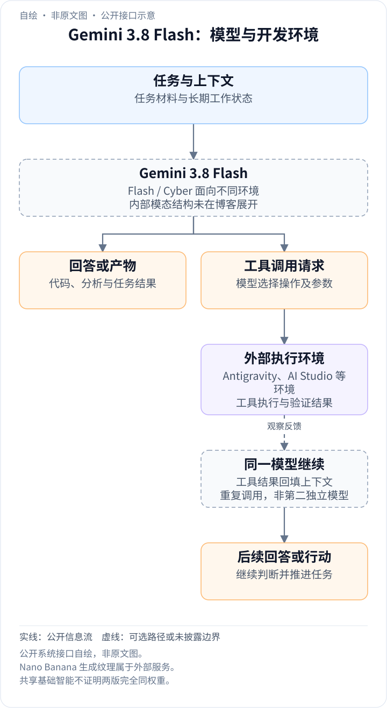
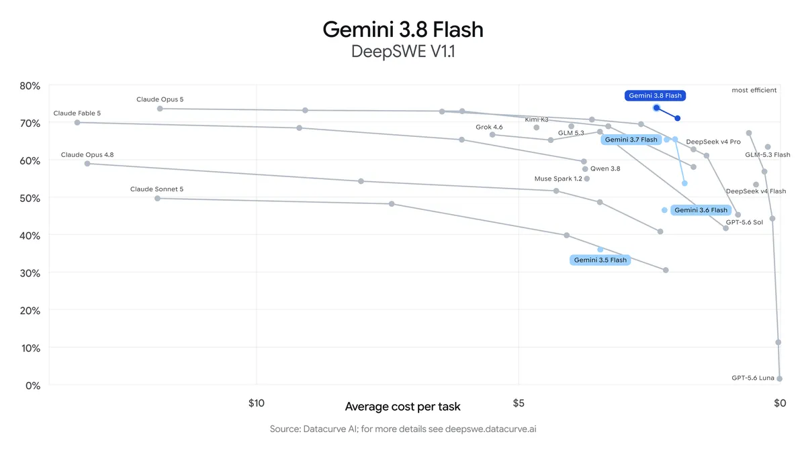
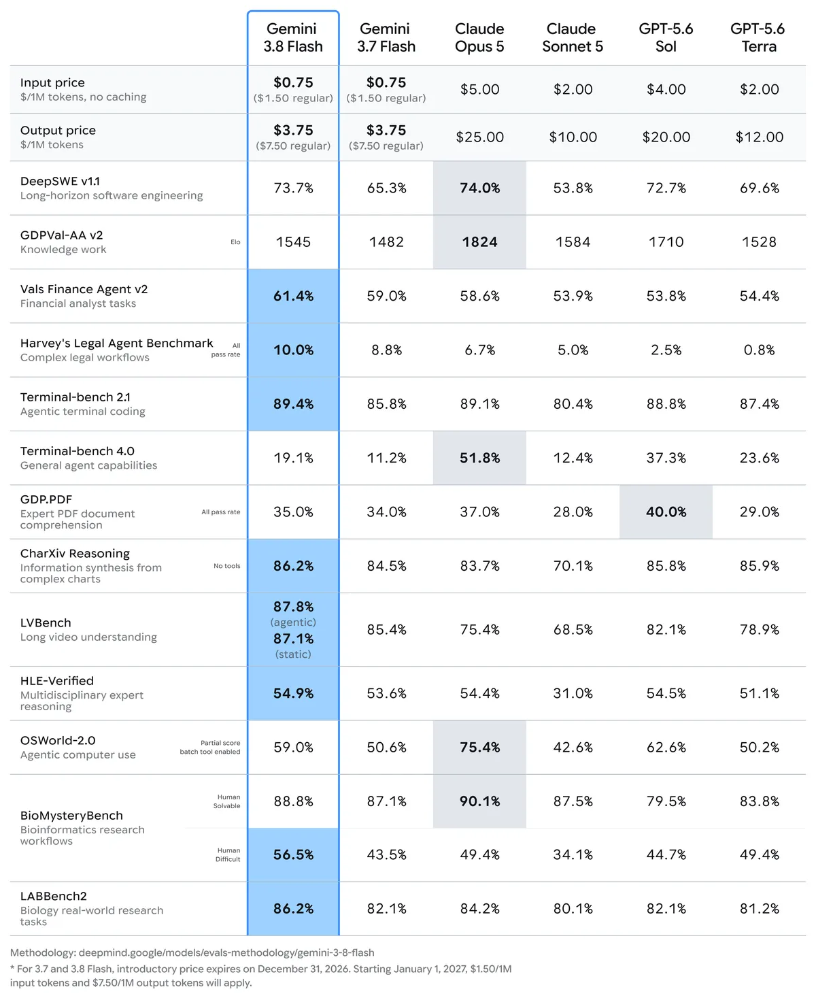
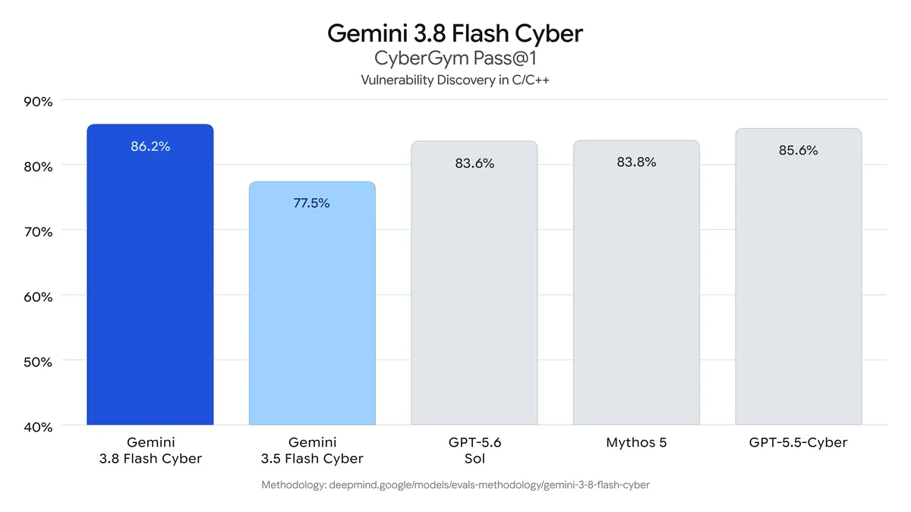
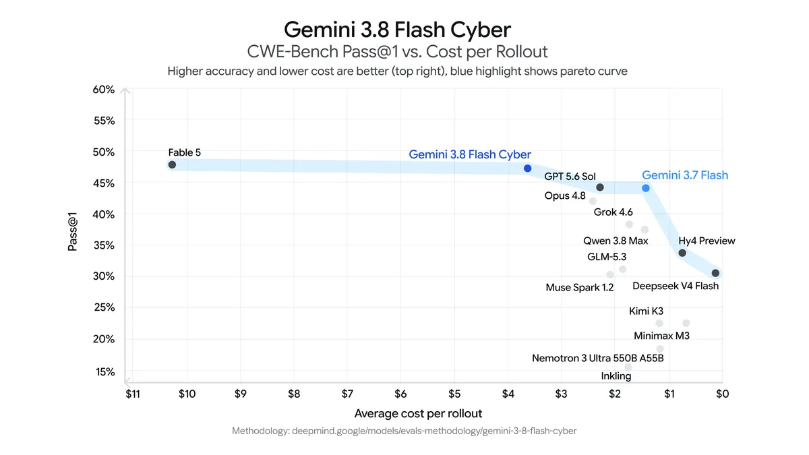

<!-- article-header:start -->
[项目首页](../../../README.md) › [模型系列](../../../reports/model-family-index.md) › [Gemini](../README.md)
<!-- article-header:end -->

# Gemini 3.8 Flash 与 Flash Cyber：长程 agent 与安全专项评测

<!-- article-toc:start -->
<a id="article-toc"></a>

**本篇目录** · [论文定位](#paper-info) · [快速概览](#overview) · [整体架构](#architecture) · [核心原理](#principles) · [数据构建](#data) · [训练流程](#training) · [实验结果](#experiments)
<!-- article-toc:end -->

<a id="paper-info"></a>

## 1. 论文信息与模型定位

原文是 Google / Google DeepMind 于 **2026 年 9 月 2 日**发布的 **Introducing Gemini 3.8 Flash and 3.8 Flash Cyber**，署名 Tulsee Doshi、Raluca Ada Popa。本介绍依据 **2026 年 10 月 8 日官方页面快照**。[官方发布文章](https://blog.google/innovation-and-ai/models-and-research/gemini-models/3-8-flash-and-3-8-flash-cyber/)。

这是一份模型发布博客。Flash 面向软件工程、长程 agent、多步骤知识工作与多模态任务；Flash Cyber 面向安全防御、漏洞发现和修复。综合表包含 PDF、图表和长视频理解，因此本条目属于 Gemini 官方多模态发布材料。它没有提供完整架构与训练报告，不能从其他代际反推 3.8 的视觉编码器、参数或训练语料。

<a id="overview"></a>

## 2. 快速概览

相较 3.7 Flash，3.8 在复杂任务中执行更多推理步骤和迭代工具调用，高 effort 时可能使用更多 token。单 token 单价相同，不表示每个任务总成本相同，仍需看实际生成量和循环次数。

Flash 的 DeepSWE v1.1 从 **65.3% 到 73.7%**，CharXiv Reasoning 从 **84.5% 到 86.2%**。LVBench 报告 **87.8% agentic / 87.1% static**，两种模式需要分别记录。Cyber 的 CyberGym pass@1 为 **86.2%**，CWE-Bench 修复为 **47.2%**；后者接近但低于图中最高 47.8%，优势主要在成本与成功率的折中。

<a id="architecture"></a>

## 3. 整体架构

<!-- derived-architecture:start -->


*自绘公开接口示意（非原文图）。依据下述公开资料归纳；方框表示功能组件，不代表逐层实现。*

依据：[official-source-snapshot-2026-10-08; Long-horizon agent / application demos](https://blog.google/innovation-and-ai/models-and-research/gemini-models/3-8-flash-and-3-8-flash-cyber/)。
<!-- derived-architecture:end -->

原文称两版本共享基础智能，面向不同部署环境，并配有不同安全缓解策略。这个说法不足以证明二者完全同权重，也没有披露稠密/MoE 类型、模态编码器、连接器或上下文结构。

发布页还称长期 agent 循环会递归评估和改进基础模型，安全领域训练促进共同的编码与推理能力。但没有说明循环如何生成数据、何时更新权重或采用什么奖励，不能将其直接写成某个确定的强化学习或自蒸馏算法。

推理侧明确允许更多步骤与工具迭代，可理解为持续利用任务状态和工具结果选择后续动作。演示中的 Nano Banana 负责生成纹理，Antigravity/AI Studio 是开发环境，不能将这些外部系统当作 Flash 内部图像生成头。原文没有网络结构图，本文使用其实际提供的评测原图。

| 模块 | 输入与输出 | 公开机制 |
|---|---|---|
| 共享基础智能 | 任务上下文 → 推理与动作 | Flash / Cyber 面向不同环境；是否完全同权重未披露 |
| 长任务代理循环 | 任务状态、工具反馈 → 后续步骤 | 复杂任务使用更多思考及迭代工具调用 |
| 外部应用与媒体服务 | 模型代码或调用 → 运行中的产物 | Antigravity / AI Studio 等宿主；纹理示例由 Nano Banana 生成 |
| 评测与部署约束 | 候选配置 → 成功率、任务成本与访问条件 | effort 影响预算；Cyber 使用独立缓解和访问策略 |

<a id="principles"></a>

## 4. 核心创新与数学原理

### 4.1 长任务推理预算与总成本

这里可讨论的主要原理是推理预算与任务成功率的关系，而非新的训练公式。任务成本可以解释为


```math
C_{\mathrm{task}}=p_{\mathrm{in}}N_{\mathrm{in}}+p_{\mathrm{out}}N_{\mathrm{out}}+C_{\mathrm{tools}}.
```


计数和单价需用一致单位。**这是分析成本的解释式，不是 Google 的训练目标或完整计费公式。** 更多循环可能增加输入历史与输出量，单位价格低不能独立保证任务更便宜。



图来自 **Flash: built for long-horizon coding and autonomous agents**，无独立 Figure 编号。纵轴为软件工程成功率，横轴平均成本从左边较高到右边零，**向右更便宜**。同一模型的连线表示不同配置的效果/成本点，不是训练 epoch 曲线，也不能从连线判断参数规模。

每次工具调用都可能把新观察加入历史，后续输入成本会随之变化；额外思考也增加输出预算。因此较低单位价格与较长轨迹可能同时存在。发布页强调更高 effort 下的勤勉执行，评估效率应比较完成同类任务所用总资源，而非只比较一次请求单价。[依据：Long-horizon coding and autonomous agents](https://blog.google/innovation-and-ai/models-and-research/gemini-models/3-8-flash-and-3-8-flash-cyber/)。

### 4.2 成功率与成本的 Pareto 比较

Pareto 前沿表示不存在另一配置同时更成功、更便宜；处于前沿不意味着绝对成功率最高。Cyber 修复评测就应按这个原则解读。

若一个配置更便宜但成功率略低，另一个更贵但更成功，二者可能都不能被对方支配。前沿因此是多目标选择集合，选点仍取决于任务容错率和预算。图中的不同点需要对应各自 effort 和工具设置，不能把最优成本点与另一点的最高成功率拼成一个虚构配置。

### 4.3 训练循环与推理循环的披露边界

博客称长期代理循环用于评估和改进基础模型，但没有给出采样、数据筛选及参数更新规则；而推理时调用工具是可见的任务执行。两者发生在不同阶段，不能仅由“递归改进”推断测试期间持续自训练，或指定某个自蒸馏损失。

<a id="data"></a>

## 5. 数据构建与处理

原文没有公开图文/音视频规模、代码训练来源、采样、合成占比、去重、SFT 数据量或偏好标注。它仅概述安全领域训练和循环评估改进，不能据此构造一份确定数据清单。

可确认的评测域包括 DeepSWE 长程软件工程、CyberGym 的 C/C++ 漏洞发现、覆盖 **20 种编程语言**的内部现实漏洞评测、外部 CWE-Bench 修复。这些是能力测量集合，不等于已披露训练来源。

PDF、图表、视频成绩也没有配套公布视觉处理流程：帧数、裁块数、页面分辨率、视觉 token 预算均未在该页面说明。训练数据与评测输入处理的缺口在本文保留，不用其他 Gemini 版本补填。

<a id="training"></a>

## 6. 训练流程与目标

发布文章没有给出明确的阶段、冻结配置、loss、优化器、GPU、学习率、batch、step、训练 token 或 epoch。它也没有命名 SFT/RL 算法，本文不将推广性描述展开为确定的预训练—SFT—GRPO 流程。

effort 属于推理投入控制。原文称较高 effort 可能使用更多 token，但没有给每档固定预算或各基准统一限制。不同配置的效果必须结合相应评测口径，不能把部署选项当作训练超参数。

发布时优惠单价是每百万输入/输出 token **0.75/3.75 美元**，脚注称优惠截至 **2026 年 12 月 31 日**，之后计划常规价 **1.50/7.50 美元**。这里只记录历史快照，不保证永久现行价格，也不是训练成本。原文“相同速度”没有统一硬件下的吞吐表，不能换算为固定 token/s。

<a id="experiments"></a>

## 7. 实验设置与主要结果



综合原表未编独立 Table 号。它明确区分 **GDPval-AA v2 的 Elo、Harvey/GDP.PDF 的 all pass rate、CharXiv 的 no tools、LVBench 的 agentic/static、OSWorld 的 batch tool enabled partial score**。这些列不能统一当作单题准确率，更不能直接平均成一个总分。

| 指标 | 3.7 Flash | 3.8 Flash |
|---|---:|---:|
| DeepSWE v1.1 | 65.3% | 73.7% |
| Vals Finance Agent v2 | 59.0% | 61.4% |
| Harvey Legal Agent，all pass | 8.8% | 10.0% |
| GDP.PDF，all pass | 34.0% | 35.0% |
| CharXiv Reasoning，无工具 | 84.5% | 86.2% |
| LVBench | 85.4% | 87.8% agentic / 87.1% static |
| HLE-Verified | 53.6% | 54.9% |
| OSWorld-2.0，partial score | 50.6% | 59.0% |

与其他模型比较仍有明显差异：DeepSWE **73.7%** 略低于 Claude Opus 5 **74.0%**；Terminal-bench 4.0 **19.1%** 低于其 **51.8%**，GDPval-AA Elo **1545** 低于其 **1824**。因此不能把“接近昂贵模型”扩展为所有工作流都领先。



这幅图位于 **Autonomous vulnerability discovery**。Cyber **86.2%** 高于旧 3.5 Flash Cyber **77.5%**，略高于图中 GPT-5.5-Cyber **85.6%**。纵轴从 40% 起，应看数字判断差距，避免被柱高夸大。内部 20 语言评测只称超过 **70%**，没有完整公开构成，不能和 CyberGym 平均。



图位于 **Automated patching**，图内标题为 CWE-Bench。横轴向右成本更低，蓝带是 Pareto 前沿。正文给 Cyber **47.2%**，最高前沿模型 **47.8%**；合理结论是接近最高效果、成本较低，而非准确率超过全部模型。

Chrome 的正确补丁“2.6 倍”、Wiz 的召回/成本对照、两小时发现案例属于内部或合作方测试，未充分提供抽样、置信区间及复现环境，不能泛化为所有代码库保证。Gray Swan 提示注入评测被用于说明鲁棒性进步，也不意味着提示注入已消除。Cyber 通过 Fairwind 向受信防御者开放，这反映部署策略，不是一个能量化替代模型能力的指标。

本材料支持发布时的能力、效率和评测口径介绍，底层网络、数据与训练流程仍大多未披露。本介绍核对官方全文与四幅原图，没有调用模型或运行安全测试。

<!-- article-footer:start -->
---

[← 上一篇：GLM-5.3-Flash](../../glm/document-e213666dcb0d/README.md) · [按发表时间浏览](../../../reports/paper-reading-guide.md#year-2026) · [下一篇：GPT-6 Astra →](../../gpt/document-0d9109ba3678/README.md)

[返回本篇目录](#article-toc) · [返回模型系列](../README.md)
<!-- article-footer:end -->
