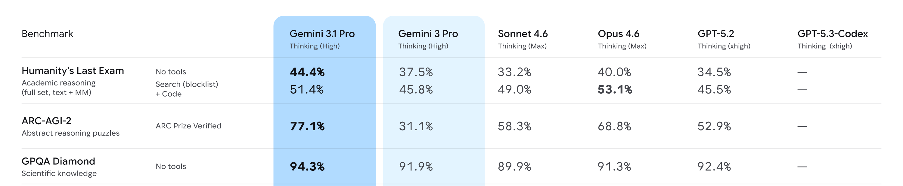
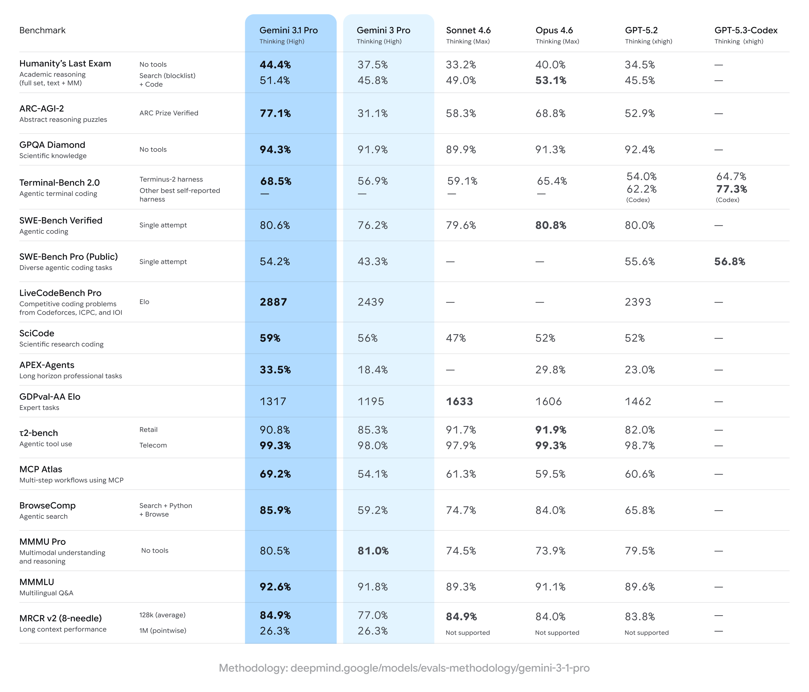

# Gemini 3.1 Pro：复杂推理与应用构建能力的官方发布说明

## 1. 论文信息与模型定位

| 项目 | 信息 |
|---|---|
| 原文 | Gemini 3.1 Pro: A smarter model for your most complex tasks |
| 发布方与时间 | Google Gemini 团队，2026 年 2 月 19 日 |
| 材料类型 | 官方发布博客，包含能力说明、基准对比和应用演示；不是披露完整训练配方的技术论文 |
| 本文依据 | [官方原文](https://blog.google/innovation-and-ai/models-and-research/gemini-models/gemini-3-1-pro/)，2026-10-08 保存的页面快照 |
| 模型定位 | Gemini 3 系列中面向复杂问题求解、编程及工具工作流的 Pro 模型升级 |

文章将 Gemini 3.1 Pro 称为支撑此前 Gemini 3 Deep Think 更新的“核心智能”升级，但这不意味着两个产品具有相同的推理预算或服务配置。这里整理的是 **3.1 Pro** 的发布内容。发布当时，开发者可在 Gemini API、AI Studio、Gemini CLI、Antigravity 和 Android Studio 中使用预览版本，企业入口包括 Vertex AI 与 Gemini Enterprise，消费者入口包括 Gemini app 与 NotebookLM。这些是发布日期的产品状态。

这篇材料适合回答“3.1 Pro 的公开能力相比 3 Pro 有何变化”，不适合据此复现训练。页面没有披露参数规模、专家数、视觉编码器、模态连接器或优化器；把 Gemini 1 或其他版本的结构直接写成 3.1 Pro 的结构，会超出证据。

## 2. 快速概览

发布的重点是复杂推理能力增强及其在编程、搜索和交互应用中的表现。官方基准表中，ARC-AGI-2 从 Gemini 3 Pro 的 **31.1%** 提升到 **77.1%**；无工具 GPQA Diamond 从 91.9% 提升到 94.3%；Terminal-Bench 2.0 在 Terminus-2 harness 下从 56.9% 提升到 68.5%。这些结果涵盖不同任务和评测条件，不能合并成一个“综合准确率”。

多模态能力没有在所有项目上同步提高。MMMU Pro 无工具成绩是 **80.5%**，略低于表中 3 Pro 的 81.0%。长上下文 MRCR v2 的 128k 平均分有所提高，但 1M 点位得分仍为 26.3%。因此，文章体现的是多个能力维度的升级，而非每个基准都领先上一代或所有竞争模型。

上图是官方原表的无重绘局部，保留模型列、推理配置和 HLE、ARC-AGI-2、GPQA 三组完整结果。HLE 的两行分别对应无工具和搜索加代码条件；3.1 Pro 在无工具行高于表中其他模型，在工具行则低于 Opus 4.6 的 53.1%。完整原表保留在第 7 节，局部图并不代表另一次实验。

## 3. 整体架构

原文没有模型内部架构图。公开描述能支持的系统流程是：用户提出任务，3.1 Pro 进行推理或生成代码，相关应用与工具执行代码、调用 API，并展示结果。基准表也明确区分无工具问答、终端 harness、搜索加 Python 加浏览器，以及使用 MCP 的多步骤工作流。模型分数中的一部分来自这些执行环境，不能全部归因于一个孤立的文本生成函数。

四类官方演示说明了输出和执行层之间的关系：

- **SVG 动画**：模型从文字需求生成可直接放进网页的 SVG 代码。动画由代码和浏览器渲染产生；“动画输出”在这里不等于模型直接生成视频像素。
- **航空航天仪表盘**：演示把公共实时遥测、国际空间站轨道和用户界面组织成应用，体现 API 连接及信息展示能力。
- **椋鸟群交互**：模型编写三维鸟群场景，结合手部追踪和随运动变化的生成式配乐。配乐是应用体验的一部分，原文没有说明模型在此直接输出原生音频 token。
- **文学主题网页**：以《呼啸山庄》的主题构建现代个人作品集页面，展示文本理解向视觉界面和交互代码的转化。

这些例子是官方挑选的应用演示。博客未给出完整提示词、工具日志、失败重试次数或独立成功率，不能将展示效果解释为所有相似需求都能一次完成。

## 4. 核心创新与数学原理

页面没有方法公式，也没有可核验的结构创新或训练算法描述。“核心推理升级”是一项能力结论，其依据是基准成绩与演示，不能从结果反推出具体的强化学习奖励、搜索算法或模型内部思维机制。

为理解发布中的“超过两倍”，可以对 ARC-AGI-2 的公开得分做简单算术：

\[
\Delta=77.1-31.1=46.0\text{ 个百分点},\qquad
\frac{77.1}{31.1}\approx2.48.
\]

这是本文对原表的解读，不是原文提出的数学原理。分数比值约为 2.48，表示该评测得分的比例；它不是“推理计算量增加 2.48 倍”，也不证明模型在所有任务上的能力都翻倍。

不同工具条件也需要独立分析。3.1 Pro 的 HLE 从无工具 44.4% 变为搜索加代码 51.4%，差值为 7.0 个百分点。这个差值对应整套评测配置的变化，包含检索、执行与推理协作，不能单独解释为某个编码器或某种训练损失的贡献。官方表头的 Thinking High、Max 与 xhigh 是各模型的配置标记；原文没有提供统一的计算量换算，跨厂家比较不能假定它们消耗相同 token 或成本。

## 5. 数据构建与处理

文章没有披露预训练语料规模、图文数据比例、视频或音频来源、合成数据占比、过滤和去重方案，也没有给出后训练样本构建方法。公共实时遥测在仪表盘演示中属于应用接入的数据，不能把它写成模型训练数据；《呼啸山庄》主题在演示中属于任务内容，也不是一项已披露的训练语料来源。

基准表将 HLE 标为完整集合、文本加多模态，将 MMMU Pro 标为多模态理解与推理。这能说明评测覆盖了多模态问题，但不能恢复模型的训练模态配比。浏览搜索行特别标注了 blocklist，说明该设置受到搜索约束；博客没有列出其全部规则或数据污染审计。相关复现细节应回到原表底部指向的评测方法说明，而不能自行补写。

## 6. 训练流程与目标

本发布说明没有公开预训练阶段数、SFT 数据、偏好优化算法、RL 奖励、是否冻结视觉模块、学习率、batch size、训练步数或硬件成本。因而不能据此给出一条可复现的“预训练—SFT—DPO/RL”配方，也不能以通用交叉熵或 DPO 公式冒充本文的训练目标。

能够确认的是产品推进流程：3.1 Pro 在发布时以预览形式进入开发者产品，团队继续验证更新并探索更复杂的 agent 工作流，然后再考虑一般可用版本。这属于发布与验证安排，和模型训练日程是两个层面。页面所说“核心智能”及“更强的基线”，也没有说明新增能力主要来自参数规模、数据、后训练还是推理时计算中的哪一项。

## 7. 实验设置与主要结果

完整原图保留所有模型列、任务、工具条件及底部方法链接。3.1 Pro 与 3 Pro 使用 Thinking High；Claude 两个模型标为 Max；OpenAI 两列标为 xhigh。终端任务还分 Terminus-2 与其他自报最佳 harness，两种行不能混用。横线表示未报告，不能当作零分。

| 任务与原表条件 | Gemini 3.1 Pro | Gemini 3 Pro | 如何解读 |
|---|---:|---:|---|
| HLE，无工具 | 44.4% | 37.5% | 提高 6.9 个百分点 |
| HLE，搜索 blocklist 加代码 | 51.4% | 45.8% | 提高 5.6 个百分点，但低于 Opus 4.6 的 53.1% |
| ARC-AGI-2，ARC Prize Verified | 77.1% | 31.1% | 提高 46.0 个百分点，是本文最突出的推理结果 |
| GPQA Diamond，无工具 | 94.3% | 91.9% | 科学知识问答提升 2.4 个百分点 |
| Terminal-Bench 2.0，Terminus-2 | 68.5% | 56.9% | 在同名 harness 行提升 11.6 个百分点；GPT-5.3-Codex 该行是 64.7% |
| SWE-Bench Verified，single attempt | 80.6% | 76.2% | 提高 4.4 个百分点，略低于 Opus 4.6 的 80.8% |
| SWE-Bench Pro Public，single attempt | 54.2% | 43.3% | 提高 10.9 个百分点，但低于 GPT-5.2 的 55.6% 和 GPT-5.3-Codex 的 56.8% |
| APEX-Agents | 33.5% | 18.4% | 长跨度专业任务提升 15.1 个百分点 |
| MCP Atlas | 69.2% | 54.1% | 多步骤工具工作流提升 15.1 个百分点 |
| BrowseComp，搜索、Python、浏览器 | 85.9% | 59.2% | 提高 26.7 个百分点，是带工具的系统结果 |
| MMMU Pro，无工具 | 80.5% | 81.0% | 下降 0.5 个百分点，多模态推理没有全面超越上一代 |
| MRCR v2，128k average | 84.9% | 77.0% | 长上下文平均成绩提升 7.9 个百分点 |
| MRCR v2，1M pointwise | 26.3% | 26.3% | 该点位保持不变，不能由 128k 成绩推断 1M 同幅改善 |

其余结果同样需要保留指标类型：LiveCodeBench Pro 是 **Elo 2887**，3 Pro 为 2439；GDPval-AA 也是 Elo，3.1 Pro 的 1317 低于表中 Sonnet 4.6 的 1633、Opus 4.6 的 1606 和 GPT-5.2 的 1462。这些分数不能与百分比直接平均。SciCode 为 59%，MMMLU 多语言问答为 92.6%；工具使用 t2-bench 的 Retail 为 90.8%，Telecom 为 99.3%，后者与 Opus 4.6 并列。

博客没有给出每项任务的置信区间、完整运行日志或统一的推理成本。因此，这组成绩支持“3.1 Pro 在多个复杂推理、编码及工具任务上明显改善”，但不能证明全部多模态任务领先，也不能用于计算训练创新的独立贡献。本文依据公开材料整理，没有运行模型或复现这些评测。
