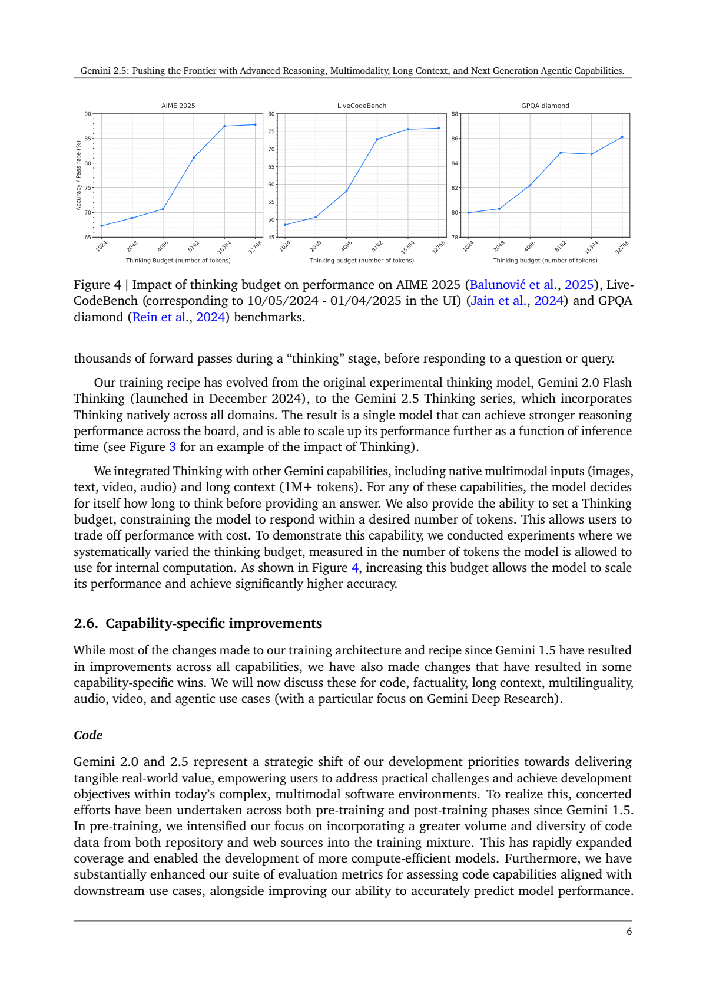
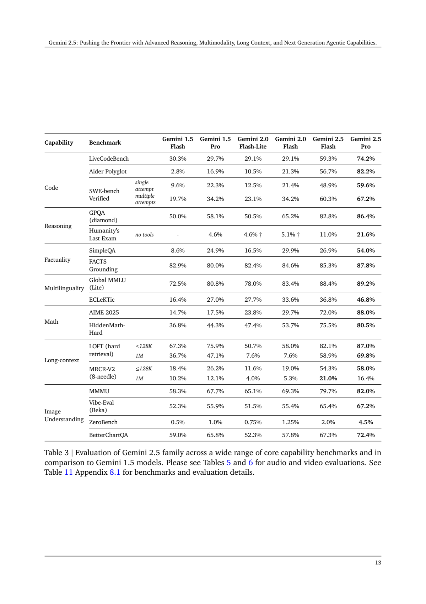
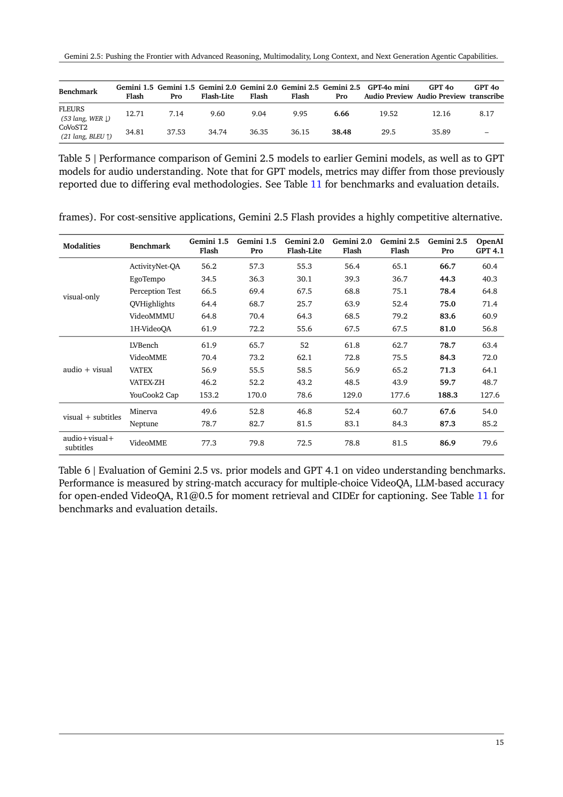
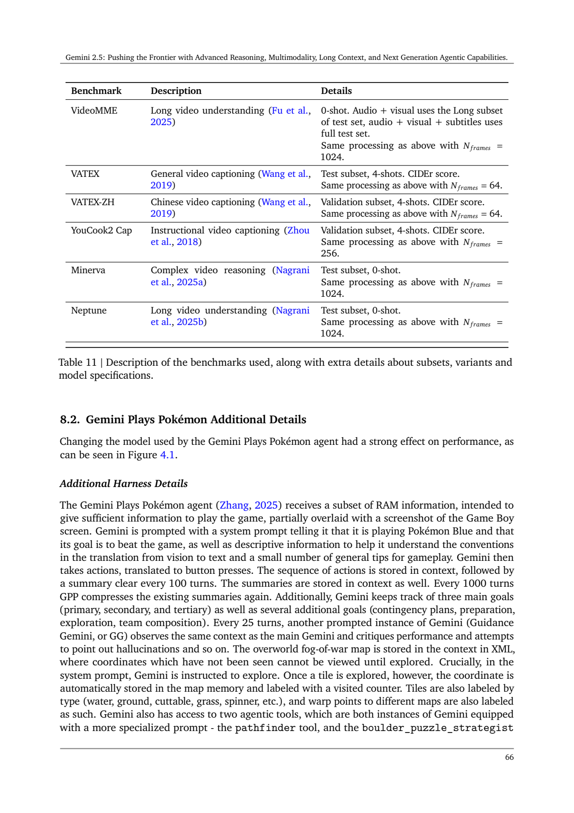

# Gemini 2.5：原生多模态、思考预算与长上下文

## 1. 论文信息与模型定位

| 项目 | 信息 |
|---|---|
| 原报告 | **Gemini 2.5: Pushing the Frontier with Advanced Reasoning, Multimodality, Long Context, and Next Generation Agentic Capabilities** |
| 团队 | Gemini Team，Google |
| 固定来源 | [官方技术报告](https://storage.googleapis.com/deepmind-media/gemini/gemini_v2_5_report.pdf)，2026-10-08 保存的 73 页 PDF；内容描述 2025 年 6 月发布状态 |
| 范围 | 重点为 Gemini 2.5 Pro、Flash，同时回顾 2.0 Flash、Flash-Lite 和若干实验变体 |

Pro 定位于高能力推理、代码与多模态理解，Flash 是可控制推理成本的较轻模型。本文固定于该报告，不能把此后产品功能或不同 Preview 版本追溯到所有 2.5 模型。报告原生支持文本、图像、音频、视频输入；音频输出主要是另外标出的 Preview TTS 和 Native Audio Dialog 选项，原生图像生成的回顾对象则是 **2.0 Flash 实验变体**。

## 2. 快速概览

- Gemini 2.5 使用稀疏 **MoE Transformer**；总参数、激活参数、专家数量及层数未公开。
- Pro、Flash 的 Table 1 输入窗口均为 **1M token**，输出上限 64K；前代 1.5 Pro 的 2M 不能混作 2.5 Pro 的该表规格。
- 强化学习训练模型在回答前使用额外计算，运行时可限制思考 token 预算；Flash 以下较小模型使用蒸馏。
- 视频低媒体分辨率将每帧视觉 token 从 258 降到 66，支持在 1M 窗口内处理约三小时视频；这是特定编码设置下的长度能力。
- 结果从 MMMU、语音识别扩展到长视频与代码代理；百万 token 的困难多目标检索仍明显弱于较短上下文。

## 3. 整体架构

Section 2.1 描述统一支持视觉和音频输入的稀疏 MoE 主干：每个 token 动态路由至一部分专家，借此使模型总容量和每 token 的计算量分离。报告称改善了大模型训练稳定性、信号传播和优化动态，但没有给出可复现的路由器、归一化或视觉连接器结构图。本文不补画一张假定为官方实现的编码器架构。

多模态输入、长上下文与思考在同一模型中结合，并可与搜索、代码执行、函数调用交替使用。工具返回的内容会成为后续推理依据；完成一项代理任务仍依赖工具和运行环境，不能把整个代理系统等同于单次模型调用。

音频部分提到用于低延迟流式对话的**因果音频表示**，支持边输入、边输出。它没有公开 codec、语音 token 速率或解码器细节。视频部分公开 66/258 token 每帧的成本折中，但未提供像素分辨率、全部采样与融合公式。TTS、原生音频对话、Deep Think 的专用变体应按原文分别理解。

## 4. 核心创新与数学原理

稀疏 MoE 的原理是只调用部分专家，而不是每次执行全部参数；实际 top-k、门控概率及负载均衡项没有披露，不能把通用 MoE 公式冒充此模型具体目标。

蒸馏把教师的下一 token 分布近似为词表上的 **k-sparse 分布**，减轻储存完整概率向量的成本。报告称存储及数据吞吐负担仍约为原来的 k 倍，换取小模型质量。它没有公开 k、温度、损失权重或教师身份，故本文只解释“压缩教师输出分布”的机制。

思考预算约束回答前可使用的额外计算，不是提升模型参数量。RL 让模型学习如何分配推理步骤，随后可随预算提高表现；报告没有公开 RL 算法与可执行损失。Deep Think 进一步采用并行思考、多个假设和批判选择，是另一个实验推理方案，不能混入主表单次尝试成绩。

**读图：Figure 4，PDF 第 6 页。** 横轴为 1024–32768 思考 token，纵轴为准确率或通过率。总体随预算提高而改善，但局部并非严格单调，GPQA 曲线在中间点略降；大预算的边际增益也趋缓。图的证据是此处三个基准上的预算实验，不是所有请求总能通过延长思考解决。

## 5. 数据构建与处理

预训练包含公开网页、多个编程语言的代码、图像、语音及其他音频、视频。2.5 数据截止日期为 **2025 年 1 月**，2.0 为 2024 年 6 月。团队改进过滤和去重、增加代码和视频数据，音频预训练覆盖超过 200 种语言；具体 token 数、样本规模、配比、清洗阈值及跨模态去重规则没有公布。

后训练采用经筛选的多模态指令响应对、人类偏好和工具使用数据，并由模型参与质量控制。安全 SFT 从人模、模模交互中收集覆盖不同策略的提示，再修订有问题响应；偏好比较用于训练 Data Reward Model，Critic 模型按量规评分（Section 5.3）。这些途径解释反馈从何而来，无法还原全部训练集。

评测污染控制在 n-gram 清除之外增加语义相似度及模型辅助清除，并报告非公开 HiddenMath。原文明确网页规模训练下泄露和偏差难以完全排除，不能据此承诺污染已经消失。

## 6. 训练流程与目标

预训练使用跨数据中心的同步数据并行，运行在多个 **8960 芯片 TPUv5p pod** 上；原文并未给出总 pod 数或完整 FLOPs。随后进行 SFT、奖励建模和 RL，增加 RL 计算并结合可验证奖励及模型生成奖励，覆盖多步行动和工具环境。完整优化器、学习率、batch、epoch、冻结范围均未披露。

基础设施采用按 TPU slice 弹性恢复，在局部失败时继续训练，恢复期约保持 97% 吞吐；可疑静默数据损坏通过确定性重放和设备中间校验定位。报告称 93.4% 时间执行 TPU 计算，约 0.25% 步因疑似损坏重放，其中 6% 确认硬件问题。这些是工程利用率和恢复统计，不是端到端模型训练效率与其他模型的受控比较。

推理时动态决定思考长度，并可由预算约束。API 的成本、输出速度取自 2025 年 6 月外部快照，输出 token/s 图还明确从首块返回之后计时；因此不等同于首 token 延迟，也不是今天的实时价格和吞吐。

## 7. 实验设置与主要结果

Section 3.1 默认采用 API 默认采样、单次尝试 pass@1，少量小基准平均多轮以降方差；多次尝试可选择候选但单列。对手多数来自各厂家自报，SWE-bench scaffolding 不同而**不可直接等同对照**。部分视觉任务用 Gemini 评判，包括 Vibe-Eval、ZeroBench、BetterChartQA。

**读图：Table 3，PDF 第 13 页。** 最右两列是 2.5 Flash 与 Pro。长上下文按不超过 128K 和恰好 1M 分开，多次代理尝试也单列；切勿把它们各取最高值拼成一个设置。

| 指标（Table 3） | 1.5 Pro | 2.5 Flash | 2.5 Pro |
|---|---:|---:|---:|
| MMMU | 67.7% | 79.7% | 82.0% |
| BetterChartQA | 65.8% | 67.3% | 72.4% |
| GPQA diamond | 58.1% | 82.8% | 86.4% |
| AIME 2025 | 17.5% | 72.0% | 88.0% |
| SWE-bench Verified 单次 | 22.3% | 48.9% | 59.6% |
| SWE-bench Verified 多次 | 34.2% | 60.3% | 67.2% |
| LOFT hard，1M | 47.1% | 58.9% | 69.8% |
| MRCR-V2 八目标，1M | 12.1% | **21.0%** | 16.4% |

Pro 的 MRCR-V2 从 ≤128K 的 58.0% 降到 1M 的 16.4%，且在 1M 低于 Flash。Table 4 中 MMMU 82.0% 低于 o3 的 82.9%，AIME 88.0% 低于 o4-mini 的 92.7%；结果不支持“所有任务全面领先”。正文曾给出与 Table 3 不同的前代 LiveCodeBench 数字，本文以明确列名的原表为准。

**读图：Table 5/6，PDF 第 15 页。** FLEURS 越低越好，翻译 BLEU 越高越好。2.5 Pro/Flash 的 FLEURS 为 6.66/9.95，1.5 Pro 为 7.14；CoVoST2 为 38.48/36.15。FLEURS 选取 53 种语言，其中中日韩泰聚合字符错误率，其余为词错误率，并非完整 102 语言测试。

视频中 Pro 的 VideoMMMU 为 83.6、1H-VideoQA 为 81.0、LVBench 为 78.7，GPT-4.1 对应 60.9/56.8/63.4。不同基准仍有不同采样预算，caption 的 CIDEr 也不能算作问答准确率。

**读图：Table 11 续页，PDF 第 66 页。** VideoMME **音频加视觉使用 Long 子集**，Pro/Flash 为 84.3/75.5；**再加字幕使用全测试集**，为 86.9/81.5。两组不只字幕不同，不能把 Pro 的 2.6 分差直接解释为字幕增益。附录设置为 1 fps 后均匀下采样，最大 1024 帧；GPT-4.1 因 API 限制使用 500 帧，虽正文称输入可比较，实际帧预算需要明确保留。1H-VideoQA 的 Gemini 上限则为 7200 帧。

Pokémon 案例第二轮固定 harness 用 406.5 小时通关，但大量信息由游戏 RAM 转成文本；去掉视觉一段仍能工作，超过 100K 历史也出现重复动作。它证明的是模型与特定工具环境的案例能力，不能直接证明可靠的原始像素游戏理解。报告也记录图像输入自动安全指标的回退，故不将安全概括为所有场景无风险。以上均为固定原报告证据，未复现模型。
