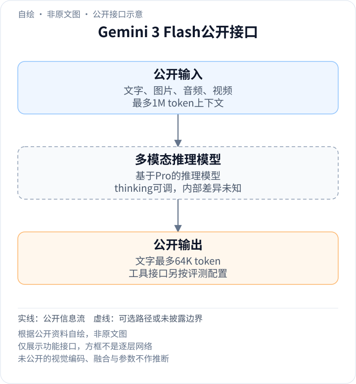
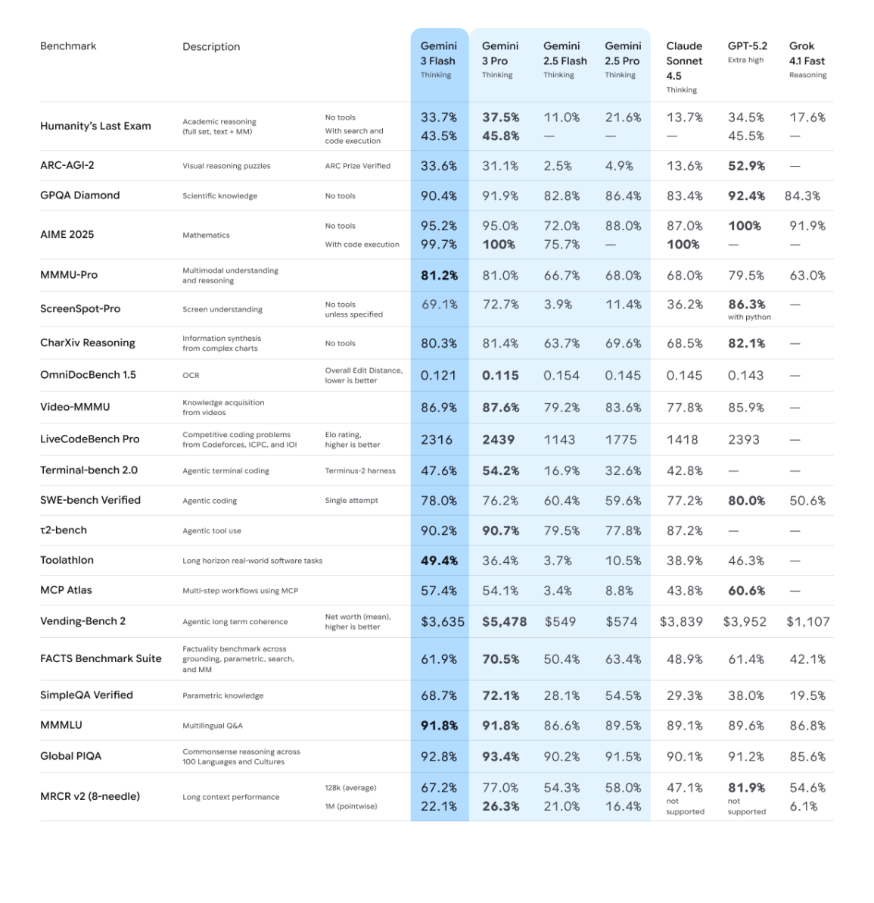

<!-- article-header:start -->
[项目首页](../../../README.md) › [模型系列](../../../reports/model-family-index.md) › [Gemini](../README.md)
<!-- article-header:end -->

# Gemini 3 Flash：基于Pro的多模态推理与速度取舍

<!-- article-toc:start -->

**本篇目录** · [论文定位](#paper-info) · [快速概览](#overview) · [整体架构](#architecture) · [核心原理](#principles) · [数据构建](#data) · [训练流程](#training) · [实验结果](#experiments)
<!-- article-toc:end -->

## 1. 论文信息与模型定位

| 项目 | 信息 |
|---|---|
| 原文 | Gemini 3 Flash Model Card |
| 发布 | Google DeepMind，2025-12-17 |
| 固定版本 | 2025年12月卡片，2026-10-13原始字节快照 |
| 补充依据 | 卡片明确引用的Gemini 3 Pro模型卡；其2026年5月版本单独固定缓存 |
| 定位 | 以速度、成本和可调思考预算服务多模态理解与代理工作流 |

Gemini 3 Flash基于Gemini 3 Pro推理基础，卡片将数据、架构和部分限制直接指向Pro文档。本文区分[Flash自身披露](https://deepmind.google/models/model-cards/gemini-3-flash/)与[Pro卡的家族背景](https://deepmind.google/models/model-cards/gemini-3-pro/)；“基于Pro”不等于已经公开蒸馏或剪枝方法。

## 2. 快速概览

- **输入/输出**：文字、图像、音频、视频，最多1M输入，64K文字输出。
- **推理控制**：thinking levels控制质量、成本和延迟；具体预算分配算法未公布。
- **视觉表现**：MMMU-Pro 81.2%，CharXiv 80.3%，ScreenSpot-Pro 69.1%，Video-MMMU 86.9%。
- **相对效率**：首发资料称典型流量比2.5 Pro平均少用30% token；该工作负载统计不能当作每题保证。
- **未知项**：参数量、专家数量、编码压缩配置、继承Pro的具体训练过程均未公开。

## 3. 整体架构

<!-- derived-architecture:start -->

*自绘公开接口示意（非原文图）。依据下述公开资料归纳；方框表示功能组件，不代表逐层实现。*

依据：[PDF pp.2–3 Model Information/Model Data](https://deepmind.google/models/model-cards/gemini-3-flash/)。
<!-- derived-architecture:end -->

Flash卡未重列网络层，而是说明基于Pro并引用其架构资料。Pro公开为原生多模态稀疏MoE Transformer；这支持家族背景，但不能据此复制Pro全部参数配置给Flash。图像问题通过多模态接口进入推理模型，所选thinking level影响投入，最终生成文字或工具请求；没有原生图像/音频生成头的公开说明。[Flash第2–3页；Pro第3页](https://deepmind.google/models/model-cards/gemini-3-flash/#page=2)

| 模块 | 输入与输出 | 公开机制 |
|---|---|---|
| 多模态输入 | 图文、音频、视频 → 当前上下文 | 最多1M token；采样、编码与压缩细节未列 |
| 基于Pro的推理主干 | 上下文 → 推理表示 | 架构引用Pro卡，具体Flash差异与专家配置未给 |
| thinking levels | 任务配置 → 推理投入 | 控制质量/成本/延迟取舍，不代表多个独立模型尺寸 |
| 工具条件 | 搜索/代码等结果 → 新证据 | 评测表区分有无工具；环境执行不等于主模型内置执行器 |
| 文字生成 | 多模态与推理状态 → 文本 | 输出上限64K，音视频输入不意味着音视频输出 |
| 训练实现 | 数据及反馈 → 模型更新 | 自身卡给TPU/JAX/Pathways，其余数据详情指向Pro |

## 4. 核心创新与数学原理

### 4.1 模型依赖不等于披露知识迁移算法

Flash基于Pro可以说明家族关系，却没有给出教师logits、蒸馏损失、剪枝层或专家裁剪规则。因此不能把81.2%的视觉结果解释成某种已证实蒸馏技术的收益。引用Pro数据与架构也不保证两模型训练样本量、路由或激活参数完全一致。[Flash第2–3页](https://deepmind.google/models/model-cards/gemini-3-flash/#page=2)

### 4.2 可调思考使“快”具有任务条件

模型卡公开thinking levels，发布说明进一步称即使最高thinking level也能调节实际思考量：复杂任务可多花推理，典型流量平均比2.5 Pro少用30% token。平均数无法推断每个请求都节省30%，也不说明相同tokenizer、硬件、缓存和工具等待下具有固定时延倍率。[Flash第2页；首发说明效率段](https://blog.google/products/gemini/gemini-3-flash/)

博文的三倍速度基于Artificial Analysis比较，不能当作自己公开了一套普适服务基准。质量、token消耗和速度是不同测量轴；代码代理78.0%的成功率不能单独说明每项任务更快完成。

### 4.3 相近综合分可能掩盖任务差异

MMMU-Pro中Flash81.2%、同表Pro81.0%接近，但ScreenSpot-Pro为69.1%对72.7%、Video-MMMU为86.9%对87.6%。另一方面Toolathlon为49.4%对36.4%，SWE-bench Verified为78.0%对76.2%。这说明排序随任务改变，不能用一个平均数字证明Flash在全部场景取代Pro。

长上下文MRCR v2八针在128K平均67.2%、1M单点22.1%，也低于同表Pro的77.0%/26.3%。支持同样窗口只是容量规格，实际可靠性仍受任务与长度影响。[Flash第4页能力表](https://deepmind.google/models/model-cards/gemini-3-flash/#page=4)

## 5. 数据构建与处理

Flash卡没有另给独立训练集，而是把数据来源与处理指向Pro。所引用Pro卡列出公开网页/代码/图像/音视频、商业授权、按条款及用户控制使用的数据、内部/员工与合成数据；后训练还包含指令、强化学习和人类偏好。本文将这些明确标为**被引用的Pro家族资料**，不声明Flash逐项使用了完全相同数量。[Flash第3页；Pro第3页](https://deepmind.google/models/model-cards/gemini-3-pro/#page=3)

Pro资料描述去重、robots.txt、安全及质量过滤；Flash未给清洗阈值、模态配比、采样率或图像分辨率。卡片中的多模态基准是评测集合，不能直接写成模型训练集。

## 6. 训练流程与目标

Flash卡公开TPU硬件和JAX/ML Pathways软件栈，其余训练过程主要引用Pro卡。Pro背景包括预训练后利用指令、偏好及强化学习资料发展能力，但Flash没有公开重新预训练、继续训练或蒸馏的完整阶段边界。[Flash第3页；Pro第3–4、9页](https://deepmind.google/models/model-cards/gemini-3-pro/#page=3)

因此本介绍保留“基础多模态能力—后训练与推理能力—部署接口”的职责描述，不填未经披露的优化器、奖励系数、冻结表或总算力。thinking levels属于测试时计算设置；能够在推理时调节思考不证明训练时每一档独立优化或参数共享方式已公开。

安全评测卡还说明内部评价进行了改进，与更早卡片的安全结果不直接可比；不能把跨卡百分比差直接当作同一评价上的训练增益。[Flash第5–6页](https://deepmind.google/models/model-cards/gemini-3-flash/#page=6)

## 7. 实验设置与主要结果

*PDF第4页原图表区域，保留thinking列、工具条件、分数单位与128K/1M口径。表中数字为实际查看裁图后核对，未仅依赖PDF文本提取。*

| 任务 | Flash | 同表Pro | 指标条件 |
|---|---:|---:|---|
| MMMU-Pro | 81.2% | 81.0% | 多模态理解 |
| ScreenSpot-Pro | 69.1% | 72.7% | 默认无工具，其他模型特殊条件见原表 |
| CharXiv Reasoning | 80.3% | 81.4% | 无工具 |
| OmniDocBench 1.5 | 0.121 | 0.115 | 编辑距离，越低越好 |
| Video-MMMU | 86.9% | 87.6% | 视频知识获取 |
| SWE-bench Verified | 78.0% | 76.2% | Single attempt |

同名Pro在两份表中的τ2-bench值不同：Flash表为90.7%，早期Pro表为85.4%，卡片没有在这一行解释差异；应保留来源版本，不能跨表拼接出自定义榜单。模型卡未提供视觉结构消融，本文未执行模型或复现实验。[Evaluation，第4页](https://deepmind.google/models/model-cards/gemini-3-flash/#page=4)

<!-- article-footer:start -->
---

[← 上一篇：GPT-5.2](../../gpt/document-e2a1f413a7a5/README.md) · [按发表时间浏览](../../../reports/paper-reading-guide.md#year-2025) · [下一篇：Seed1.8 →](../../seed/document-6cb43357175b/README.md)

[返回本篇目录](#article-toc) · [返回模型系列](../README.md)
<!-- article-footer:end -->
