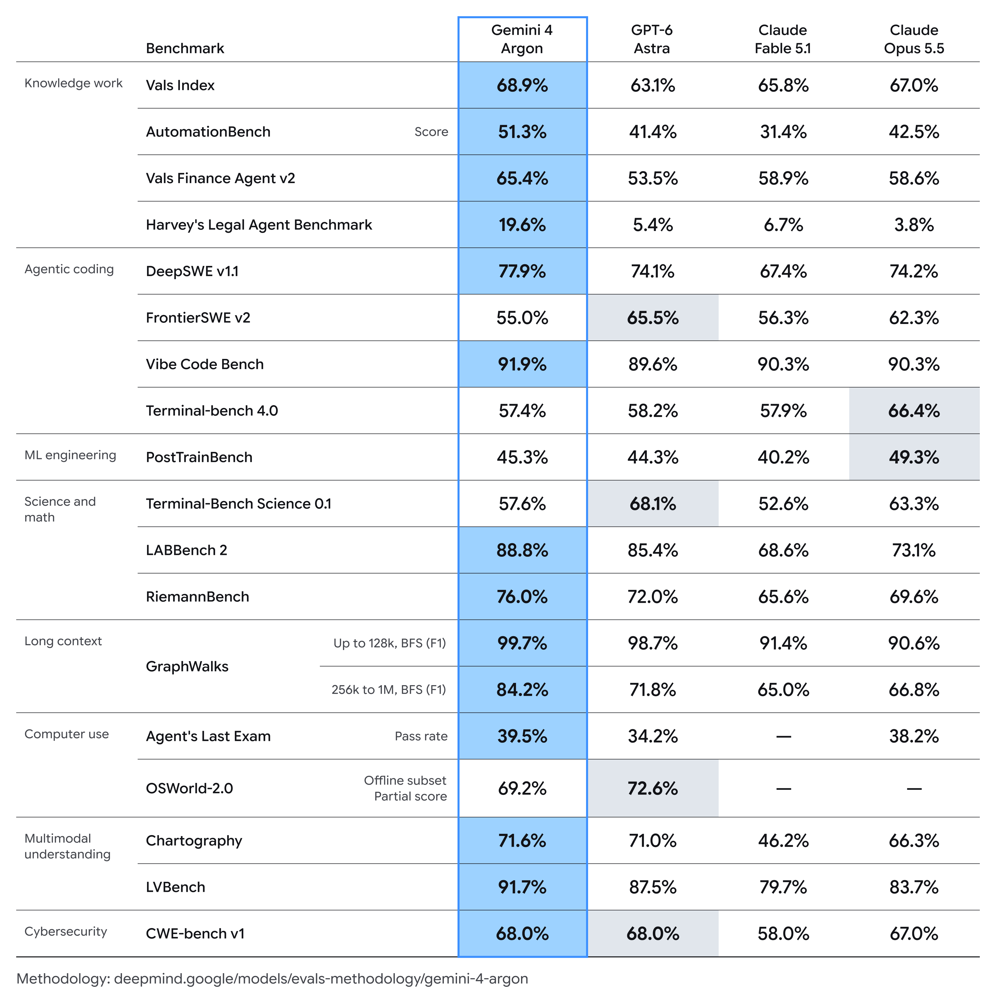
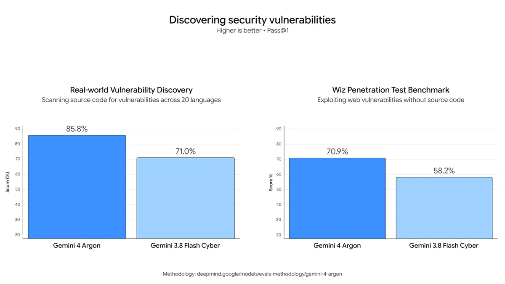

<!-- article-header:start -->
[项目首页](../../../README.md) › [模型系列](../../../reports/model-family-index.md) › [Gemini](../README.md)
<!-- article-header:end -->

# Gemini 4 Argon：面向长程专业任务的推理模型

<!-- article-toc:start -->

**本篇目录** · [论文定位](#paper-info) · [快速概览](#overview) · [整体架构](#architecture) · [核心原理](#principles) · [数据构建](#data) · [训练流程](#training) · [实验结果](#experiments)
<!-- article-toc:end -->

## 1. 论文信息与模型定位

- **原始来源**：[Gemini 4 Argon: our next era of frontier intelligence](https://blog.google/innovation-and-ai/models-and-research/gemini-models/gemini-4-argon/)，Google 官方发布页，**2026-09-30**。
- **署名**：Koray Kavukcuoglu，Google DeepMind。本文固定于 2026-10-08 保存的官方正文和原始评测图。
- **模型定位**：面向真实软件工程、法律和金融等专业知识工作、长程多步工作流以及网络防御的前沿模型，包含图表和长视频理解能力。

这是发布博客，未公开完整架构与训练方法。正文描述初期经 Fairwind Program 向可信网络防御者提供访问，并逐步测试后扩大开放；本介绍记录发布时状态，不将计划推广等同于已经全面部署。

## 2. 快速概览

Argon 把“长时间围绕一个复杂任务推理和使用工具”作为主要能力。原文最明确的容量改变是最大 **输出 token 上限从 64K 提高到 1M**，让单条轨迹有更大的推理和生成空间。该数值不是输入上下文窗口：网页的自动摘要容易混淆这一点，本文依据正式正文解释。

多模态方面，官方声称能分析专业图表、从长视频识别细节，并基于多份文档执行任务。原始表给出 Chartography **71.6**、LVBench **91.7**；软件工程 DeepSWE v1.1 为 **77.9**，AutomationBench 为 **51.3**。这些成绩有任务边界，不能转换为任意企业工作流程的成功率。

发布材料同时提供内部生产力案例及安全机制。但模型的网络结构、参数量、数据配比、完整推理预算与组件消融没有在本博客展开，技术介绍以真实披露的范围为限。

## 3. 整体架构

没有公开模型层数、稠密或 MoE 架构、注意力设计、视觉编码器、音频输入链路、视频 token 表示和模型规模。博客也没有原始架构图，因此本介绍不根据 Gemini 家族其他版本补出一张网络图。

系统层面可以确认：模型支持长轨迹推理，可在代理工作流中分析材料、调用工具和检查中间结果。内部应用包括多轮编译器分析、性能测量和代码修改。更长的输出空间让这些多步过程容纳更多推理，但实际效果还依赖任务环境、工具返回、验证和停止条件。

发布页的防护层涵盖请求识别与拒绝、间接提示注入防御、推理与动作监控，以及隔离的训练/评测环境。推理链和动作监控能在必要时停止执行；这属于系统控制机制，不能当成已披露的模型内部层结构。

## 4. 核心创新与数学原理

本材料的核心主张是增加推理轨迹空间，并让模型在长期工程和专业任务中保持执行能力。它没有公布新的注意力公式、强化学习更新式或视觉对齐目标。因此本文不把通用语言模型公式作为 Argon 特有贡献。

公开例子展示了**提出方案—执行—测量—继续修改**的迭代过程。视频解码器案例中，代理检查编译器输出并进行多轮性能实验，以安全 Rust 替换 SIMD 代码，让编译器自动向量化；效率来自这一有反馈的工作流，而不仅是单次生成代码。来源没有隔离模型、工具预算和搜索轮数各自贡献。

安全结果的指标方向也不同：漏洞发现 pass@1 越高越好；提示注入攻击成功率越低越好。后者图中的 $k$ 表示攻击尝试次数，柱顶数字为 **k=15**。不能把 0.7% 写成安全任务完成率，也不能将其推广为一切攻击都被阻止。

## 5. 数据构建与处理

博客没有公开预训练 token 数、图文视频比例、数据集来源、标注和去重规则。评测和实际使用材料包括代码库、性能遥测、专业图表、长视频以及企业文档；这些材料被用来展示任务，但不能据此反推训练语料配方。

漏洞发现内部基准覆盖 **20 种编程语言**；Wiz 的黑盒评测在没有源代码的情况下分析 Web 系统。两者观察条件不同，不宜合并成一个漏洞发现总分。Chartography 和 LVBench 的抽图、抽帧、分辨率、视频时长及工具条件在本文所用博客没有详述。

原始汇总图保留数据划分说明：OSWorld-2.0 为 **offline subset、partial score**，GraphWalks 是 BFS 的 F1，区分 up to 128K 与 256K–1M。这些限定是数据和指标的一部分，不能把离线子集分数写成完整在线电脑操作成功率。

## 6. 训练流程与目标

官方说明专门训练网络防御能力，并使用自动红队和对抗训练改善提示注入鲁棒性。来源未披露对应数据量、损失、奖励、优化器、学习率或训练阶段顺序，因此不能给出精确可复现 recipe。

监控系统同时用于训练运行，发现异常后向专门响应人员告警。官方强调避免把这些监控发现反馈到训练中，以降低模型学会规避监控的风险。这是公开的训练监控原则，不是宣称所有行为偏离都已解决。

对于可信防御者及内部团队，官方计划提供无网络领域 guardrails 的版本；全面推广前继续增强其他防护。因此不同访问对象和策略配置需要区分，不把可信测试配置的能力与最终面向所有用户的服务行为等同。

发布材料没有证明最大输出 1M 的独立贡献，也没有全量图像编码与无图像编码的消融。本文未运行模型、执行代理任务或验证生产案例。

## 7. 实验设置与主要结果

**读表**：蓝框为 Gemini 4 Argon，后面依次为 GPT-6 Astra、Claude Fable 5.1、Claude Opus 5.5。高亮表明各行领先者，但 Argon 并未在所有行都领先；指标定义和子集注记应随数字阅读。

| 任务 | Gemini 4 Argon | GPT-6 Astra | Claude Opus 5.5 |
|---|---:|---:|---:|
| Chartography | 71.6 | 71.0 | 66.3 |
| LVBench | 91.7 | 87.5 | 83.7 |
| DeepSWE v1.1 | 77.9 | 74.1 | 74.2 |
| AutomationBench | 51.3 | 41.4 | 42.5 |
| Vals Index | 68.9 | 63.1 | 67.0 |
| Vals Finance Agent v2 | 65.4 | 53.5 | 58.6 |
| Harvey's Legal Agent Benchmark | 19.6 | 5.4 | 3.8 |
| GraphWalks BFS F1，256K–1M | 84.2 | 71.8 | 66.8 |
| FrontierSWE v2 | 55.0 | 65.5 | 62.3 |
| Terminal-bench 4.0 | 57.4 | 58.2 | 66.4 |
| CWE-bench v1 | 68.0 | 68.0 | 67.0 |

LVBench、Chartography 和长上下文图遍历给出多模态/长程能力的正面证据；FrontierSWE、Terminal-bench 则低于对照。OSWorld 离线子集为 **69.2**，低于 GPT-6 Astra 的 **72.6**；PostTrainBench 为 **45.3**，低于 Claude Opus 5.5 的 **49.3**。CWE-bench 与 GPT-6 Astra 同为 68.0，是并列而非独占第一。

**读图**：左图是跨 20 语言的内部源代码漏洞发现，右图是 Wiz 无源代码黑盒评测，均为 pass@1。Argon 分别为 **85.8/70.9**，Gemini 3.8 Flash Cyber 为 **71.0/58.2**。两组任务的内容及观察权限不同，没有提供样本数和置信区间，不将两者简单平均。

**读图**：攻击成功率越低越好，柱顶为 15 次攻击预算。Argon 为 **0.7%**，Claude Opus 5.5 和 Fable 5.1 都为 **1.0%**，Gemini 3.8 Flash Cyber 为 **6.0%**。该协议下表现更稳健，仍不代表任何外部内容都可以无条件信任。

内部生产案例采用不同口径：已经部署的优化释放超过 **300 TiB** 内存，**500 TiB–1 PiB** 是预估总节省；libgav1 的安全 Rust 方案相对原有 Rust 移植版快 **2.7 倍**，并非相对优化 C++ 快 2.7 倍；Fuchsia Zircon 的 800K+ 行迁移仍需审计与测试，不能写成已全部上线。量子子程序例子报告时空资源相对公开基线减少 40%，范围为单个示例，不代表所有量子算法。

博客提供有意义的任务和生产证据，但欠缺模型规模、训练配方、统一工具预算及完整组件消融。适合据此判断长程任务与视觉评测的进步，尚不能从排行榜推出跨所有专业领域的稳定自主执行能力。

<!-- article-footer:start -->
---

[← 上一篇：Qwen3.8-Omni-Flash](../../qwen/document-2ea7273632dc/README.md) · [按发表时间浏览](../../../reports/paper-reading-guide.md#year-2026)

[返回本篇目录](#article-toc) · [返回模型系列](../README.md)
<!-- article-footer:end -->
