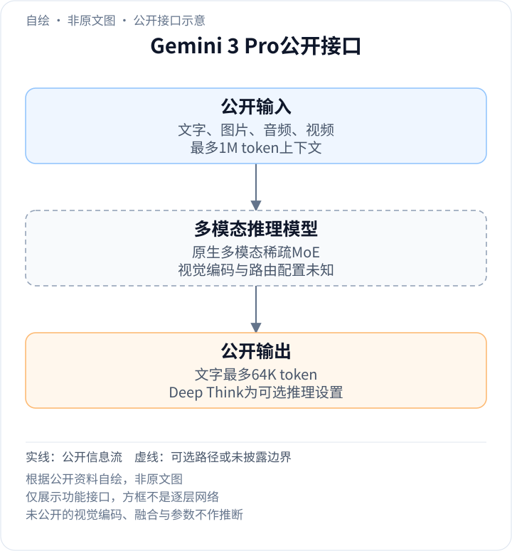
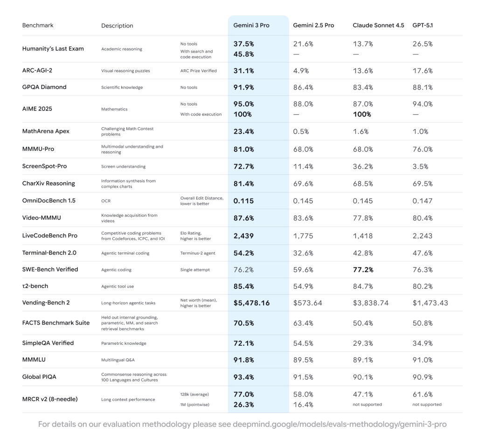

<!-- article-header:start -->
[项目首页](../../../README.md) › [模型系列](../../../reports/model-family-index.md) › [Gemini](../README.md)
<!-- article-header:end -->

# Gemini 3 Pro：原生多模态MoE与测试时推理

<!-- article-toc:start -->

**本篇目录** · [论文定位](#paper-info) · [快速概览](#overview) · [整体架构](#architecture) · [核心原理](#principles) · [数据构建](#data) · [训练流程](#training) · [实验结果](#experiments)
<!-- article-toc:end -->

## 1. 论文信息与模型定位

| 项目 | 信息 |
|---|---|
| 原文 | Gemini 3 Pro Model Card |
| 模型发布 | Google DeepMind，2025-11-18 |
| 本文卡片 | 标注2026年5月更新，2026-10-13获取；能力表仍注明2025年11月结果 |
| 定位 | 原生文本、视觉、音频输入的稀疏MoE推理模型 |

Gemini 3 Pro以原生多模态和推理为模型基础，支持长代码库、图文与音视频理解，并提供Deep Think推理模式。模型卡明确它不是前代模型的简单修改或微调；同一家族后续型号再以Pro为基础。本文按[固定官方卡](https://deepmind.google/models/model-cards/gemini-3-pro/)介绍可确认的架构与训练类型，首发日期由[发布博文](https://blog.google/products/gemini/gemini-3/)核对。

## 2. 快速概览

- **输入与输出**：文字、图像、音频、视频，最多1M输入上下文，64K文字输出；不应把Pro Image等其他型号的生成能力算给本型号。
- **稀疏结构**：按token动态激活专家子集；参数总量、专家数、视觉编码与融合层仍未披露。
- **视觉评测**：MMMU-Pro 81.0%，ScreenSpot-Pro 72.7%，CharXiv 81.4%，Video-MMMU 87.6%。
- **推理接口**：Deep Think在推理阶段增强复杂问题求解，但卡片未给搜索树、并行路径或投票算法。
- **数据披露**：公开/授权/用户控制范围内数据及合成数据，后训练包括指令、偏好和多步推理资料。

## 3. 整体架构

<!-- derived-architecture:start -->

*自绘公开接口示意（非原文图）。依据下述公开资料归纳；方框表示功能组件，不代表逐层实现。*

依据：[PDF pp.2–3 Model Information/Architecture](https://deepmind.google/models/model-cards/gemini-3-pro/)。
<!-- derived-architecture:end -->

卡片将Gemini 3 Pro明确称为稀疏MoE Transformer，原生支持文本、视觉与音频。每token的路由选取专家子集，解耦可存储容量与计算；但原生输入的具体编码器、patch分配和跨模态连接方法没有公开。一次图文问答可确认的是输入多模态材料、在所选推理配置下处理，再生成文字；不能从产品示例补成某种ViT加MLP内部实现。[第2–3页](https://deepmind.google/models/model-cards/gemini-3-pro/#page=3)

| 模块 | 输入与输出 | 公开机制 |
|---|---|---|
| 多模态输入 | 文字、图像、音频、视频 → 任务上下文 | 最多1M token，具体编码和token预算未知 |
| 稀疏MoE骨干 | 上下文token → 隐藏表示 | 学习动态路由到专家子集，不等于固定按模态分专家 |
| 推理模式 | 任务与推理设置 → 求解过程 | 公开Deep Think可选模式，内部测试时算法未详列 |
| 外部工具条件 | 搜索/代码结果 → 增量任务证据 | 能力表分别区分有无search/code execution的评测 |
| 文字输出 | 多模态与推理状态 → 文本 | 上限64K；Pro Image等属不同家族型号 |
| 训练栈 | 混合语料及反馈 → 参数更新 | TPU/JAX/Pathways，硬件规模和损失系数未公开 |

## 4. 核心创新与数学原理

### 4.1 原生多模态与稀疏容量解决不同问题

原生多模态描述模型可共同处理不同信息源，MoE描述token如何调用部分参数。两者并不意味着音频只走音频专家、图像只走视觉专家；卡片没有这样的专家分工表。总参数对应容量与权重存储，激活参数对应部分计算，稀疏路由还可能产生通信与负载不均，因此不能由MoE名称直接推出服务成本。[Architecture，第3页](https://deepmind.google/models/model-cards/gemini-3-pro/#page=3)

### 4.2 Deep Think、工具与图文推理不可混为一个开关

卡片将Deep Think定义为推理阶段增强复杂问题求解的可选设置，没有解释其内部是否采用并行搜索。能力表又在HLE等任务区分无工具和search/code execution，说明额外推理计算与取得外部证据是两个维度。模型想得更久仍无法知道未检索到的网页内容；工具结果也需要模型正确整合。[第2、5页](https://deepmind.google/models/model-cards/gemini-3-pro/#page=5)

例如HLE无工具37.5%、有搜索及代码45.8%，不能把二者差距单归因于Deep Think；81.0%的MMMU-Pro也不能被写成Deep Think模式下的独立成绩，因为该表没有给出这样的分解。

### 4.3 长窗口容量与多证据检索精度不同

卡片的MRCR v2八针任务在128K平均为77.0%，1M单点为26.3%。平均设置和单点长度不同，不能把下降简单拟合为长度函数；但它说明支持1M输入不保证复杂多证据任务接近满分。更多上下文还可能带来干扰与超时，Card将偶发缓慢或超时列入限制。[第5–6页](https://deepmind.google/models/model-cards/gemini-3-pro/#page=5)

图表、OCR、屏幕定位和视频知识分别使用不同评价；OmniDocBench以编辑距离衡量且越低越好，不能同81.4%的CharXiv一起按准确率平均。

## 5. 数据构建与处理

预训练涵盖公开网页、文字、代码、图像、语音及其他音频、视频。来源还包括公开可下载数据、爬取、商业授权、按产品条款和用户控制使用的数据、业务/员工获得或生成的数据，以及AI合成数据。卡片并未提供各来源样本量与比例。[Model Data，第3页](https://deepmind.google/models/model-cards/gemini-3-pro/#page=3)

处理包括去重、遵循robots.txt、安全与质量过滤，并针对不同类型内容过滤无关或有害材料。后训练包含指令、强化学习和人类偏好数据，RL可利用多步推理、问题求解及定理证明资料。以上是数据类别披露，不能自动推断某个公开数据集被纳入，或所有训练样本均经过完全相同阈值。[第3页](https://deepmind.google/models/model-cards/gemini-3-pro/#page=3)

知识截止2025年1月与2026年5月卡片修订日期不同，后者不能当作模型知识截止。

## 6. 训练流程与目标

公开训练结构是预训练建立多模态与语言基础，再通过指令、偏好及强化学习类数据发展推理和响应行为。缓解列表进一步列出conditional pre-training、SFT以及人类/critic反馈RL；报告没有公布具体奖励模型、PPO/GRPO等优化器选择、冻结方案和目标权重。[第3、9页](https://deepmind.google/models/model-cards/gemini-3-pro/#page=9)

训练使用TPU、JAX和ML Pathways；没有足够设备数、总训练token和时间信息计算总成本。公开评测和红队反馈在开发中用于检查行为，不能把评测表中的全部题目直接写成训练目标。

卡片强调Pro并非前代微调版本，而Flash及其他后续家族成员基于Pro；“基于”描述模型依赖，不单独证明蒸馏、剪枝或参数复制方法。[第2–4页](https://deepmind.google/models/model-cards/gemini-3-pro/#page=2)

## 7. 实验设置与主要结果

*PDF第5页原图表区域，保留模型列、工具条件、指标方向及评测方法链接；表格原本为嵌入图片，数值经实际查看图像核对。*

| 任务 | Gemini 3 Pro | 同表Gemini 2.5 Pro | 单位/条件 |
|---|---:|---:|---|
| MMMU-Pro | 81.0% | 68.0% | 多学科多模态理解 |
| ScreenSpot-Pro | 72.7% | 11.4% | 屏幕理解 |
| CharXiv Reasoning | 81.4% | 69.6% | 图表综合推断 |
| OmniDocBench 1.5 | 0.115 | 0.145 | Overall Edit Distance，越低越好 |
| Video-MMMU | 87.6% | 83.6% | 视频知识获取 |
| MRCR v2八针，128K/1M | 77.0% / 26.3% | 58.0% / 16.4% | 前者平均、后者单点 |

图文任务有明显提升，但不同基准并不隔离视觉编码或MoE的单项贡献。当前卡片5月修订仍将能力表标为11月结果，应与后来其他卡片重新报告的同名模型数字分开；本文未独立复现或声称全部场景全面可靠。[Evaluation，第5页](https://deepmind.google/models/model-cards/gemini-3-pro/#page=5)

<!-- article-footer:start -->
---

[← 上一篇：Nemotron Nano V2 VL](../../nemotron/arxiv-2511.03929/README.md) · [按发表时间浏览](../../../reports/paper-reading-guide.md#year-2025) · [下一篇：HunyuanOCR →](../../hunyuan/arxiv-2511.19575/README.md)

[返回本篇目录](#article-toc) · [返回模型系列](../README.md)
<!-- article-footer:end -->
