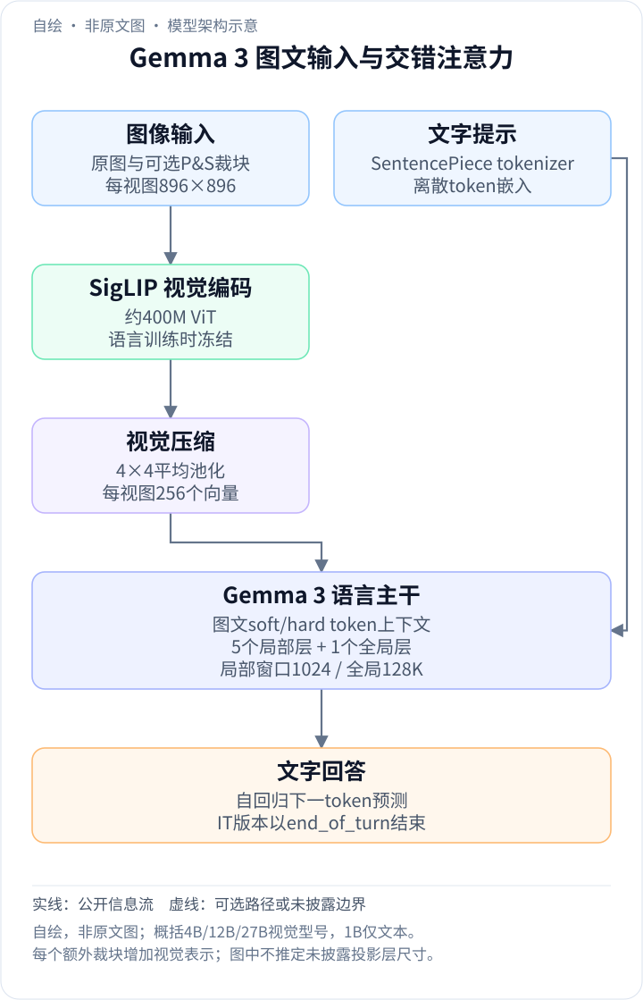
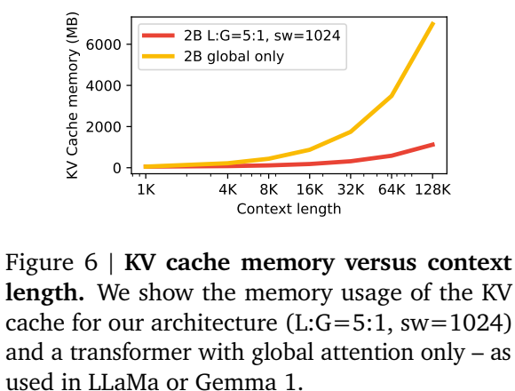
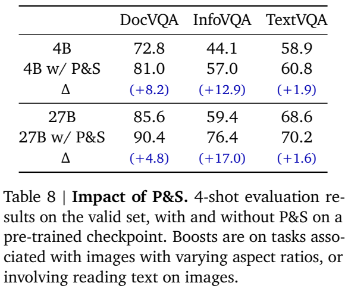
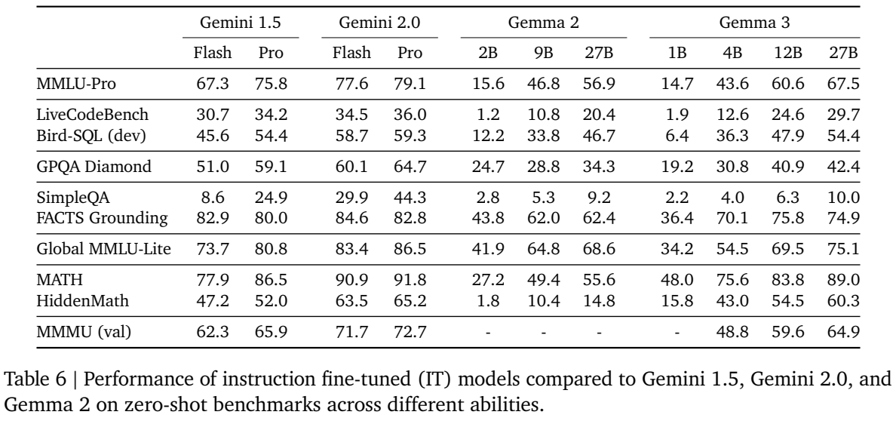

<!-- article-header:start -->
[项目首页](../../../README.md) › [模型系列](../../../reports/model-family-index.md) › [Gemma](../README.md)
<!-- article-header:end -->

# Gemma 3：冻结视觉编码器、局部注意力与长上下文

> 解读 Google DeepMind 的 **Gemma 3 Technical Report**，固定采用 arXiv **2503.19786v1**。报告首页日期为 2025-03-12，arXiv 首次提交为 2025-03-25；本文分别记录两者，不将后来抓取日期当作模型发布日期。

<!-- article-toc:start -->
<a id="article-toc"></a>

**本篇目录** · [论文定位](#paper-info) · [快速概览](#overview) · [整体架构](#architecture) · [核心原理](#principles) · [数据构建](#data) · [训练流程](#training) · [实验结果](#experiments)
<!-- article-toc:end -->

<a id="paper-info"></a>

## 1. 论文信息与模型定位

| 项目 | 内容 |
|---|---|
| 题名与团队 | Gemma 3 Technical Report；Gemma Team，Google DeepMind |
| 家族与版本 | Gemma 第三代；1B、4B、12B、27B，均有预训练 PT 与指令 IT 版本 |
| 模态边界 | 4B/12B/27B 接收图像与文字、输出文字；1B 为纯文本模型 |
| 上下文 | 视觉型号 128K token；1B 为 32K |
| 研究定位 | 在消费级硬件预算下加入视觉、多语言与长上下文，重点控制视觉序列和 KV cache 成本 |
| 官方资源 | [固定报告](https://arxiv.org/pdf/2503.19786v1) · [官方实现](https://github.com/google-deepmind/gemma) · [27B IT 模型卡](https://huggingface.co/google/gemma-3-27b-it) |

这篇报告不只说明模型变大，而是讨论视觉输入和长上下文如何影响内存：每幅送入编码器的图像被压缩成固定数量的向量，大多数语言层只读取短窗口，少量全局层保留跨长序列的信息连接。视觉分支在语言模型训练期间冻结，使视觉特征还可以预先计算。[§1–2，PDF 第 1–3 页](https://arxiv.org/pdf/2503.19786v1#page=2)

<a id="overview"></a>

## 2. 快速概览

Gemma 3 沿用 decoder-only Transformer，使用 GQA、RMSNorm 和 QK-norm。视觉侧采用约 400M 的 SigLIP 变体，输入分辨率为 896×896；其输出经平均池化压成 256 个视觉 token，再作为连续向量参与语言生成。高分辨率的收益来自编码阶段保留细节，并不要求把全部 patch 原样送给语言模型。

长上下文依靠每五层局部注意力穿插一层全局注意力。局部窗口为 1,024 token；全局层承担跨窗口交互。预训练先使用 32K 序列，再通过 RoPE 调整扩展至 128K。视觉输入还支持仅在推理时启用的 Pan & Scan：必要时将长宽比极端或细节密集的图像切成多个视图，提高读图能力，同时增加编码和上下文成本。

训练采用教师分布蒸馏，后训练加入多目标奖励与偏好反馈。原文公开了若干关键设计及消融，但没有给出可完整复刻的所有数据比例、教师身份和后训练超参数。下文据此解释公开机制，不补造完整训练配方。

<a id="architecture"></a>

## 3. 整体架构

<!-- derived-architecture:start -->


*自绘模型架构示意（非原文图）。依据下述公开资料归纳；方框表示功能组件，不代表逐层实现。*

依据：[§2–2.1，PDF2；§5.5，PDF8](https://arxiv.org/pdf/2503.19786v1)；[§3，PDF4](https://arxiv.org/pdf/2503.19786v1)。
<!-- derived-architecture:end -->

一次图文问答从图像与提示分开处理开始：图像经 SigLIP 产生视觉特征，平均池化减少空间 token；文本经 tokenizer 产生离散 token。视觉向量和文字嵌入共同形成语言模型的上下文，语言主干逐步预测回答文字。启用 Pan & Scan 时，同一原图会产生额外裁块，每个视图都经过同一视觉编码流程；256 是每次图像编码的表示数，不能理解为任意数量裁块都只占 256 token。

| 模块 | 输入与输出 | 公开机制 |
|---|---|---|
| 图像视图构建 | 原图 → 896×896 输入视图 | 标准缩放；必要时使用非重叠等尺寸裁块，Pan & Scan 为可关闭的推理优化 |
| SigLIP 视觉编码器 | 图像视图 → 空间视觉表示 | 约 400M ViT，Table 1 记为 417M；4B/12B/27B 共享并在语言训练时冻结 |
| 视觉压缩 | 高分辨率视觉序列 → 256 个向量 | 896 编码器输出使用 4×4 平均池化；作为 soft token 输入语言模型 |
| 文字编码 | 提示文字 → token 嵌入 | SentencePiece，保留空白、拆分数字与字节级编码；词表约 262K |
| 语言主干 | 多模态上下文 → 下一文字 token 分布 | decoder-only Transformer，GQA、RMSNorm、QK-norm；五个局部层与一个全局层交错 |
| 位置与缓存 | 序列位置/历史 KV → 注意力可用上下文 | 局部窗口 1,024；全局 RoPE 基频 1M、局部 10K；视觉型号支持 128K |
| 回答终止 | 已生成文字 → 完成的回答 | PT 使用 eos，IT 使用 end_of_turn，训练/推理格式需匹配 |

Table 1 将视觉、嵌入和非嵌入参数分开统计，例如 27B 行分别为 417M、1,416M、25,600M。型号名是规模标签，不能把语言参数与视觉参数口径混用。原文没有给出连接投影的逐层尺寸表，因此此处不自行指定投影层数或隐藏维度。[§2、Table 1，PDF 第 2 页；§5.5，第 8 页](https://arxiv.org/pdf/2503.19786v1#page=2)

<a id="principles"></a>

## 4. 核心创新与数学原理

### 4.1 五局部一全局：让长上下文的缓存只在部分层增长

普通全局注意力层要保留整个历史的 K/V。Gemma 3 的局部层只使用长度为 1,024 的滑动窗口，全局层仍读取长历史。这样，长距离信息不会在每一层都直接交互，而是通过间隔的全局层汇合；局部层负责邻近上下文的加工。

可用下面的缓存量级解释这个选择，**这是根据公开层类型建立的阅读辅助估算，并非论文的新损失或精确部署内存公式**：

```math
M_{\mathrm{KV}}\propto n_g T+n_l\min(T,W),\qquad W=1024.
```

$`n_g`$、$`n_l`$ 分别为全局和局部层数，$`T`$ 为历史长度，$`W`$ 为窗口。省略的常数还含 batch、KV 头数、头维度、精度及缓存实现；因此它解释增长趋势，不直接输出 GB。五比一的安排减少随 $`T`$ 增长的层数，但每个全局层的缓存仍随上下文增长。



*原文 Figure 6，PDF 第 7 页。该消融比较的是 2B 纯文本配置，不能将曲线直接当作最终 27B 视觉模型的实测内存。*

Figure 3–6 结合困惑度和内存检查这一取舍：更多局部层在相应消融中没有明显损害困惑度；固定 32K 上下文时，缩短窗口也能降低缓存。它们支持架构方向，但并未逐一验证所有视觉输入长度下的精度。[§5.2，PDF 第 6–7 页](https://arxiv.org/pdf/2503.19786v1#page=6)

### 4.2 高分辨率编码与平均池化：在细节和序列成本之间分工

896×896 图像先由视觉编码器处理，再以 4×4 平均池化将相邻表示聚合，最终固定为 256 个视觉向量。设一个池化窗口的向量为 $`h_{ab}`$，其计算可以写成下式；**这是平均池化的标准定义，用于解释原文操作**：

```math
\bar h=\frac{1}{16}\sum_{a=1}^{4}\sum_{b=1}^{4}h_{ab}.
```

提高视觉编码分辨率与增加语言上下文长度并不是同一件事。前者帮助编码器辨认细字和局部结构，后者影响语言端的计算；池化把二者部分解耦。代价是多个位置的信息被合并，不能据此宣称压缩无损。原文 Table 7 在短训练的 2B 消融中保持每图 256 token，896 分辨率的 DocVQA 为 59.8，256 分辨率为 31.9，说明编码分辨率本身具有价值。[§5.5、Table 7，PDF 第 8 页](https://arxiv.org/pdf/2503.19786v1#page=8)

### 4.3 Pan & Scan：用多个视图恢复整图缩放丢失的细节

单次将宽图或高图缩成正方形，会挤压文字与小物体。Pan & Scan 在需要时覆盖整图、切成非重叠等尺寸裁块，分别缩到编码器的固定分辨率。它提供更局部的观察尺度，语言模型再结合多视图回答。

这不是额外训练一个检测器，也不是在所有图片上强制使用固定数量裁块。报告说明它属于推理优化、限制最大裁块数并可关闭，但未在正文列出全部触发阈值。更多裁块会增加视觉编码次数及语言端 token，因此提升 OCR/文档表现需要付出延迟和内存成本。



*原文 Table 8，PDF 第 8 页。表注称预训练 checkpoint 的 4-shot 验证集结果；相邻正文又写 IT，本文保留表注口径，不将其并入最终 IT 的 zero-shot 成绩。*

以表注口径，27B 的 InfoVQA 从 59.4 提高至 76.4，DocVQA 从 85.6 至 90.4，TextVQA 从 68.6 至 70.2。收益在不同任务上差异明显，不能把最高增幅推广到所有图像问答。[§2.1、§5.5，PDF 第 2、8 页](https://arxiv.org/pdf/2503.19786v1#page=8)

### 4.4 稀疏教师分布蒸馏与量化感知微调

预训练为每个位置按教师概率抽取 256 个 logits，对未选项赋零概率并重新归一化，再让学生用交叉熵学习这个目标。关键是目标来源于教师的概率分布，而非只保留一个正确 token；抽样缩减保存或处理完整大词表分布的负担。报告没有将这些样本称为固定 top-256，不能把概率抽样替换成确定性截断。

若抽样结果的支持集记为 $`S`$，其目标分布可概括为 $`q_S(v)=q(v)/\sum_{u\in S}q(u)`$（$`v\in S`$），其余为零；这是对正文“置零并归一化”的数学转写，原文没有披露重复抽样的实现细节。教师大小消融还发现，短训练时小教师可能更好，长训练时大教师更好，所以“教师越大总是越优”不成立。

量化版本另外进行通常约 5,000 步的 QAT，以未量化 checkpoint 的概率作目标，覆盖 per-channel int4、per-block int4 和 switched fp8。它是发布量化模型的适配阶段，不应与主模型训练精度或所有推理引擎的速度混为一谈。[§2.2–2.3，第 3 页；§5.4，第 7–8 页](https://arxiv.org/pdf/2503.19786v1#page=3)

<a id="data"></a>

## 5. 数据构建与处理

| 数据环节 | 原文披露 | 作用与边界 |
|---|---|---|
| 预训练预算 | 1B/4B/12B/27B 分别为 2T/4T/12T/14T token | 是 token 预算，不是图像数；包含文字和图像相关表示 |
| 多语言组成 | 增加单语与平行数据，处理语言分布不均 | 未公开每种语言的精确采样比例 |
| 清洗 | 隐私/敏感内容过滤、评测去污染、质量重加权 | 不代表可以证明所有评测完全无污染 |
| 图像特征 | 预计算冻结视觉编码器的输出 | 语言训练可直接消费嵌入，减少重复视觉计算 |
| 后训练数据 | 过滤重复、错误自我识别、不安全样本，加入归因/不确定性/拒答相关样本 | 完整来源清单和规模未在报告披露 |

报告 Table 1 以“256k”概括词表，§2.2 的 tokenizer 段写“262k”；两处都属于报告自己的近似表述，本文不将其中一个数字当成精确 token ID 上界。对复现而言，还必须使用固定 tokenizer 文件以及正确 BOS/终止符，而不是只按词表规模重新构造词表。[§2.2–2.4、§3，PDF 第 3–4 页](https://arxiv.org/pdf/2503.19786v1#page=3)

<a id="training"></a>

## 6. 训练流程与目标

| 环节 | 公开安排 | 优化目的 |
|---|---|---|
| 视觉准备 | SigLIP 在视觉助手任务数据上适配，语言训练时冻结 | 提供固定视觉表示 |
| 预训练 | 教师概率抽样蒸馏，使用图文与多语言数据 | 形成基础生成与视觉理解 |
| 长上下文扩展 | 先 32K，再对视觉型号扩展至 128K；全局 RoPE 重缩放因子 8 | 调整长距离位置泛化 |
| 指令与偏好后训练 | 大型 IT 教师蒸馏，结合改进的 BOND/WARM/WARP 与 RL | 提高聊天、推理、指令跟随及多语言表现 |
| 奖励来源 | 人类反馈训练的权重平均奖励模型、代码执行、数学真值等奖励 | 不同任务使用不同反馈，非一项统一人工分数 |
| 量化适配 | 以未量化模型概率作目标进行 QAT | 降低发布权重的存储成本并保持能力 |

主模型使用 TPUv4/v5e/v5p，优化器状态按 ZeRO-3 思路分片；视觉嵌入预计算使语言模型训练期间无需重复运行视觉编码器。原文没有给出这些后训练方法的全部修改公式、奖励权重或教师配置，因此无法仅凭引用的算法名复刻最终 recipe。[§2.4、§3，PDF 第 3–4 页](https://arxiv.org/pdf/2503.19786v1#page=4)

<a id="experiments"></a>

## 7. 实验设置与主要结果



*原文 Table 6，PDF 第 6 页；zero-shot 指令模型结果。各列为固定报告中的版本，不代表当前在线服务的最新分数。*

| 指标 | Gemma 3 4B IT | 12B IT | 27B IT |
|---|---:|---:|---:|
| MMMU val | 48.8 | 59.6 | 64.9 |
| MMLU-Pro | 43.6 | 60.6 | 67.5 |
| MATH | 75.6 | 83.8 | 89.0 |
| Global MMLU-Lite | 54.5 | 69.5 | 75.1 |
| GPQA Diamond | 30.8 | 40.9 | 42.4 |

这些结果支持视觉、多语言与推理能力随规模提升，但纯文本数学分数不等于图像数学理解。报告另给出 27B IT 在 Chatbot Arena 的初步 Elo 1338，收到结果的时间为 2025-03-08；该评测不包含视觉能力，不能用于证明视觉模型领先。

缓存与量化也有独立口径。Table 3 给出 27B bf16 权重约 54.0GB，加入 32,768 上下文、8-bit KV 后约 72.7GB；per-channel int4 权重约 14.1GB，但同样加入缓存后约 32.8GB。仅报权重体积会低估长上下文部署占用。[Table 3，第 3 页；§4、Table 5–6，第 5–6 页](https://arxiv.org/pdf/2503.19786v1#page=6)

还需区分三组实验：最终 IT 的 zero-shot 结果、短训练 2B 视觉编码器消融、以及 Pan & Scan 表注中的 4-shot 预训练验证集结果。它们帮助回答不同设计问题，不能将某组最佳数值拼成一个实际发布型号的综合成绩。

<!-- article-footer:start -->
---

[← 上一篇：Mistral Small 3.1](../../mistral-pixtral/document-652708f323d7/README.md) · [按发表时间浏览](../../../reports/paper-reading-guide.md#year-2025) · [下一篇：GPT-4o 原生图像生成附录 →](../../gpt/document-0b8790d1de58/README.md)

[返回本篇目录](#article-toc) · [返回模型系列](../README.md)
<!-- article-footer:end -->
