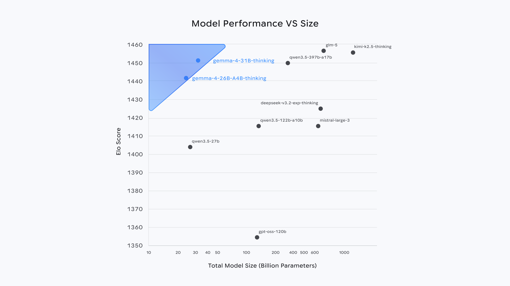

<!-- article-header:start -->
[项目首页](../../../README.md) › [模型系列](../../../reports/model-family-index.md) › [Gemma](../README.md)
<!-- article-header:end -->

# Gemma 4：端侧多模态、统一解码器与稀疏专家模型

<!-- article-toc:start -->

**本篇目录** · [论文定位](#paper-info) · [快速概览](#overview) · [整体架构](#architecture) · [核心原理](#principles) · [数据构建](#data) · [训练流程](#training) · [实验结果](#experiments)
<!-- article-toc:end -->

## 1. 论文信息与模型定位

| 项目 | 信息 |
|---|---|
| 发布方 | Google DeepMind / Gemma Team |
| 本目录主来源 | [Gemma 4 官方模型页](https://deepmind.google/models/gemma/gemma-4/)，2026-10-08 快照 |
| 技术补充来源 | [Gemma 4 官方模型卡](https://ai.google.dev/gemma/docs/core/model_card_4)，同日保存正文与哈希 |
| 材料性质 | 官方模型页与模型卡；本介绍没有把模型卡未披露的训练细节补写成技术报告结论 |
| 模型家族 | E2B、E4B、12B Unified、26B A4B、31B Dense，提供预训练和指令微调权重 |
| 模态 | 全家族接受文本、图像及按帧处理的视频；E2B/E4B/12B 另支持音频输入；输出是文本 |
| 许可 | 模型卡标注 Apache 2.0 |

Gemma 4 面向从手机、边缘设备到个人工作站的本地模型部署。它结合来自 Gemini 3 的研究和技术，但“源于同一技术体系”没有说明两者参数、结构或训练数据完全相同。模型卡可核对的细节比宣传页丰富：尤其明确 12B Unified 没有独立模态编码器，26B A4B 是 MoE，而 E2B/E4B 的 E 表示有效参数，三者不能用同一个“多模态编码器加稠密 LLM”模板介绍。

## 2. 快速概览

| 档位 | 模型卡参数口径 | 层数 | 局部窗口 | 上下文 | 音频 |
|---|---|---:|---:|---:|---|
| E2B | 2.3B effective；计入嵌入为 5.1B | 35 | 512 | 128K | 支持 |
| E4B | 4.5B effective；计入嵌入为 8B | 42 | 512 | 128K | 支持 |
| 12B Unified | 11.95B | 48 | 1024 | 256K | 支持，直接投影原始输入 |
| 26B A4B MoE | 25.2B 总参数、3.8B 激活 | 30 | 1024 | 256K | 不支持 |
| 31B Dense | 30.7B | 60 | 1024 | 256K | 不支持 |

E2B/E4B 使用逐层嵌入 PLE：大嵌入表主要通过查表访问，有效计算参数小于物理参数总量。因此 E2B 不能被当成只需保存 2.3B 个参数。26B A4B 的 A 是激活参数口径，又与 PLE 的 effective 含义不同。

多模态推理、编程、数学和工具使用是主要能力维度。模型卡的 MMMU Pro 中，31B 为 76.9%、26B A4B 为 73.8%、12B 为 69.1%、E4B 为 52.6%、E2B 为 44.2%。大档位显著强于 Gemma 3 27B 的 49.7%，而最小档位仍低于这一旧的大模型，不能据家族整体升级宣称每个小模型都全面超过旧旗舰。

## 3. 整体架构

共同主干采用 **局部滑动窗口与全局注意力交错**，最后一层始终是全局注意力。全局层使用统一的 Keys 与 Values，并采用 Proportional RoPE（p-RoPE）以优化长上下文内存。模型卡没有公开交错周期、头数或 p-RoPE 的精确公式；尤其不能因为存在滑动窗口，就把整个主干写成严格线性复杂度。

模态输入路径按模型变化。E2B/E4B 具有约 150M 视觉编码器和约 300M 音频编码器；31B 与 26B A4B 具有约 550M 视觉编码器，但没有音频编码器。12B Unified 直接用轻量线性层把图像 patch 与音频波形投影到语言嵌入空间，让所有模态进入同一个 decoder-only Transformer。因此，12B 的“encoder-free”是无独立模态编码器，并不意味着不对输入进行任何分块或投影。

26B A4B 的专家配置是 **128 个总路由专家、8 个激活专家，加 1 个共享专家**。其 3.8B 激活参数已经是官方口径，不应根据专家数简单按 8/128 乘总参数恢复，因为注意力、共享专家、嵌入和其他共享模块也参与计算。

图像可以改变宽高比和分辨率，并以视觉 token 预算控制细节。预算档位为 **70、140、280、560、1120**。低预算适合分类、描述或处理较多视频帧，高预算适合 OCR、细小文字与文档。这些数是视觉表征预算，模型卡没有提供将其转换成输入像素、patch 总数或实际每层序列长度的完整规则。

## 4. 核心创新与数学原理

模型卡没有编号方法公式。以下用标准表达解释其公开机制，不是复现原文未披露的函数。

在局部因果注意力中，位置 $t$ 的可见位置受窗口限制，例如 $\mathcal N_t=\{s:\max(1,t-W+1)\le s\le t\}$。只在这些位置计算 softmax，可使一层注意力的配对计算量从全局的 $O(N^2d)$ 变为约 $O(NWd)$。但如果 $L_g$ 层仍为全局、$L_l$ 层为局部，注意力部分仍包含 $O(L_gN^2d+L_lNWd)$。这是本文的复杂度解释，不包含实际 kernel、缓存和投影成本，也不支持“256K 推理免费”的结论。

PLE 可以概括为每层按 token ID 取一个层专属向量：$e_{\ell,t}=T_\ell[x_t]$。查表只访问对应行，不必对整个表做稠密矩阵计算，所以物理参数与主要计算参数可分离。模型卡没有公开这一向量如何融合进每层残差流，本文不补造加法、门控或投影公式。

MoE 的标准示意为：

$$
u(h)=E_{\mathrm{shared}}(h)+\sum_{i\in\operatorname{Top8}(r(h))}g_i(h)E_i(h)
$$

公开材料确认专家数量及激活数，但没有给出 $g_i$ 的归一化、路由容量或负载平衡损失。这一表达能说明为什么 26B A4B 用较少激活计算容纳更多专家权重，不能据此推导它与 4B 稠密模型在所有硬件上相同延迟。

12B Unified 的输入可概括为 $z_v=P_v\operatorname{patchify}(I)$、$z_a=P_a\operatorname{segment}(a)$，然后与文本嵌入共同送入主干。这里的分块记号只是解释原始图像 patch 和波形的线性投影；patch 大小、音频分段长度和序列布局并未在模型卡中给出。

## 5. 数据构建与处理

模型卡披露预训练数据包括网络文档、代码、数学文本、图像与音频，截止日期为 **2025 年 1 月**，覆盖超过 140 种语言。它同时把开箱语言能力写成 35 种以上：训练覆盖范围和经描述的即用语言能力口径不同，不能把 140 种语言都说成已有同质量评测。

数据处理包括多阶段非法有害内容过滤、自动过滤部分个人与敏感信息，以及按内容质量与安全规则进一步筛选。模型卡没有给出总训练 token、各模态比例、合成数据规模、去重阈值、编码器独立预训练集合或后训练样本数，不能从“来自 Gemini 3 技术”恢复这些细节。

推理处理与训练数据也应分开：图像 token 预算是运行时的细节与计算取舍；模型卡建议图像放在提示文本之前，音频放在文本之后。音频最长 **30 秒**；视频在每秒一帧假设下最长 **60 秒**。128K/256K 的上下文窗口不直接等于任意更长视频支持，更不能由 token 总量反推未经披露的长视频采样策略。

## 6. 训练流程与目标

公开材料确认提供预训练与指令微调权重，并描述整个模型家族具有可配置 thinking、原生 system 角色及函数调用能力；模型卡未公开完整预训练阶段、SFT 配方、偏好优化算法、奖励定义、冻结安排、学习率或 GPU/TPU 训练时间。因而本介绍不把通用 RL、DPO 或蒸馏配方写成 Gemma 4 的真实训练流程。

12B 无独立编码器意味着模态路径更统一，官方称可在一次流程中对整个模型微调。这是结构带来的微调可能性，不证明本发布模型实际只做过一次训练，也不证明其他档位一定冻结编码器。

模型卡给出的 temperature=1.0、top_p=0.95、top_k=64 是**使用建议**，不能自动当成全表所有实验的统一采样参数。thinking 由系统提示中的控制 token 启用；模型输出先出现思考区再给最终回答。历史多轮通常仅保留最终回复，工具调用轮例外。这些是会话模板的操作规范，不是新的训练损失公式。

## 7. 实验设置与主要结果

[下载官方 SVG 原图](figures/official-elo-size.svg)。横轴是**总模型参数量**，纵轴是文本 Arena Elo，图示 Gemma 31B/26B 与更大模型有接近的偏好评测表现。它不是视觉基准，也没有提供统一延迟或功耗；不能把横轴换成激活参数后继续使用同一曲线。官网 HTML 表截至 2026-04-02 给出 31B/26B Elo 1452/1441，图中位置约为 1451/1442，存在约 1 分的页面表示差异；本文不据这种差距判定统计显著胜负。

官网与模型卡的能力结果主要是 HTML 表。此处忠实摘录数值并保留来源链接，**没有把重新制作的表格图片当作原图**。下面采用模型卡的命名与数据：

| 指标 | 31B | 26B A4B | 12B Unified | E4B | E2B | Gemma 3 27B |
|---|---:|---:|---:|---:|---:|---:|
| MMLU Pro | 85.2% | 82.6% | 77.2% | 69.4% | 60.0% | 67.6% |
| AIME 2026，无工具 | 89.2% | 88.3% | 77.5% | 42.5% | 37.5% | 20.8% |
| LiveCodeBench v6 | 80.0% | 77.1% | 72.0% | 52.0% | 44.0% | 29.1% |
| GPQA Diamond | 84.3% | 82.3% | 78.8% | 58.6% | 43.4% | 42.4% |
| Tau2，三个领域平均 | 76.9% | 68.2% | 69.0% | 42.2% | 24.5% | 16.2% |
| MMMLU | 88.4% | 86.3% | 83.4% | 76.6% | 67.4% | 70.7% |
| MMMU Pro | 76.9% | 73.8% | 69.1% | 52.6% | 44.2% | 49.7% |
| OmniDocBench 1.5，平均编辑距离↓ | 0.131 | 0.149 | 0.164 | 0.181 | 0.290 | 0.365 |
| MATH-Vision | 85.6% | 82.4% | 79.7% | 59.5% | 52.4% | 46.0% |
| MRCR v2，8 needle、128k 平均 | 66.4% | 44.1% | 43.4% | 25.4% | 19.1% | 13.5% |

官网把 85.2/82.6/69.4/60.0 这一行标作“MMMLU Multilingual Q&A”，模型卡却将同组数标为 **MMLU Pro**，并另给出真正的 MMMLU 行。两个页面的标签并不一致，不能混合摘录后称为同一实验。官网 τ2 Retail 为 86.4/85.5/57.5/29.4，模型卡的 Tau2 是三领域平均，也不能互相替换。

音频只覆盖支持的三个模型：CoVoST 的 12B/E4B/E2B 分别为 38.5/35.54/33.47；FLEURS 越低越好，分别为 0.069/0.08/0.09。12B 两个结果带有排除中文的脚注，不能宣称其中文测试达到这些数值。大模型不支持音频的空白不是零分。MedXPertQA MM 属于能力基准，不能由其成绩推断临床适用性。

这组结果说明家族中结构不同的档位提供多种容量、模态及计算取舍：例如 12B 的 Tau2 69.0 高于 26B A4B 的 68.2，并非所有任务严格随总参数量排序。安全评测在不加安全过滤器的条件下检查模型行为，模型卡给出整体改善的描述，但缺少完整数值表，本文不虚构违规率。材料也未完整报告每项实验的运行预算或置信区间；本介绍是官方来源解读，没有运行权重或复现评测。

<!-- article-footer:start -->
---

[← 上一篇：Qwen3.5-Omni](../../qwen/document-54010b187750/README.md) · [按发表时间浏览](../../../reports/paper-reading-guide.md#year-2026) · [下一篇：Qwen3.6-Plus →](../../qwen/document-67bea1fbb2c5/README.md)

[返回本篇目录](#article-toc) · [返回模型系列](../README.md)
<!-- article-footer:end -->
