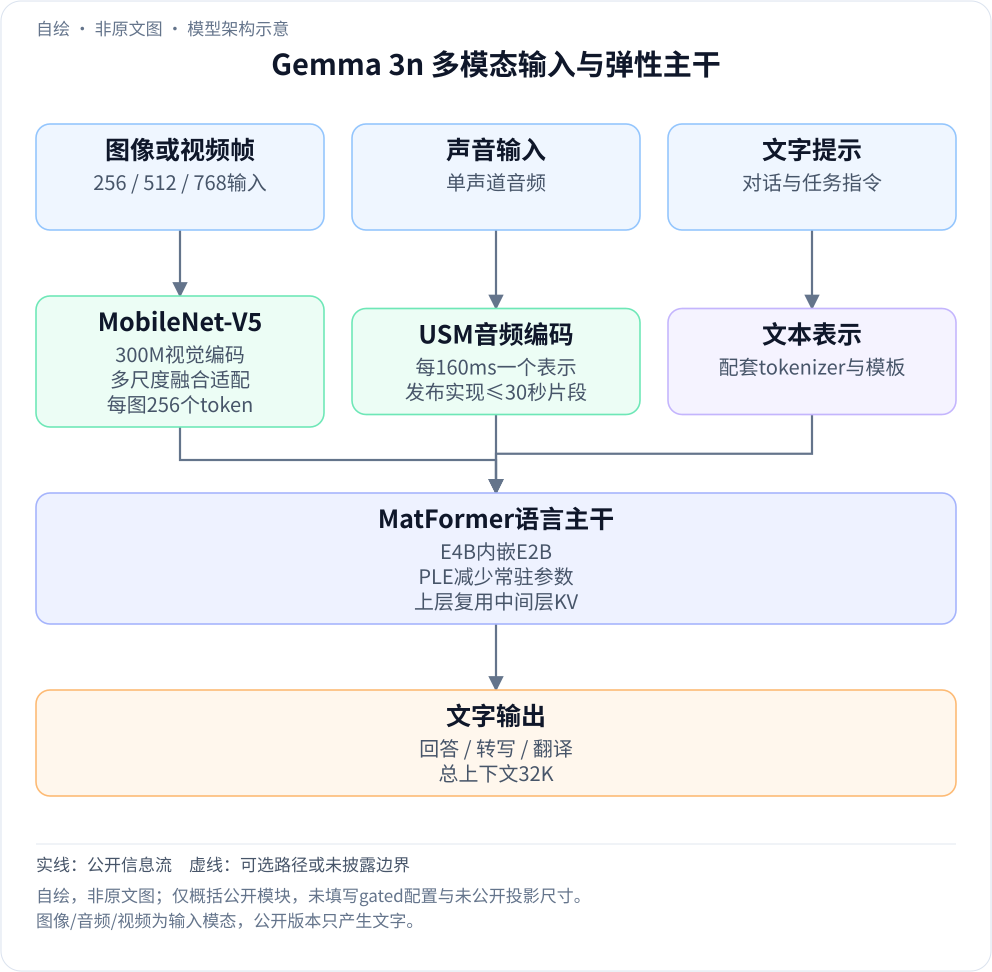
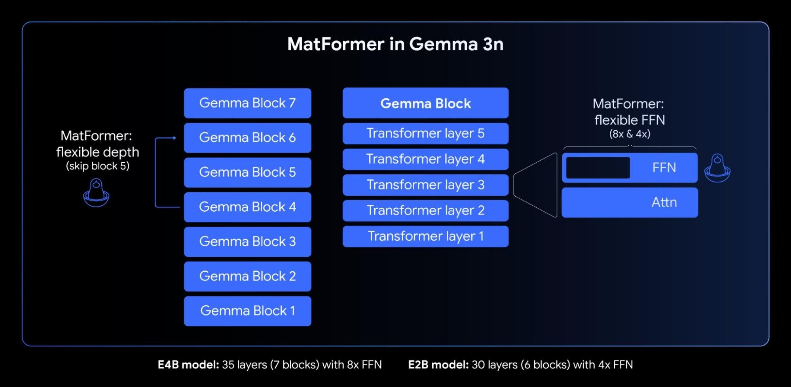
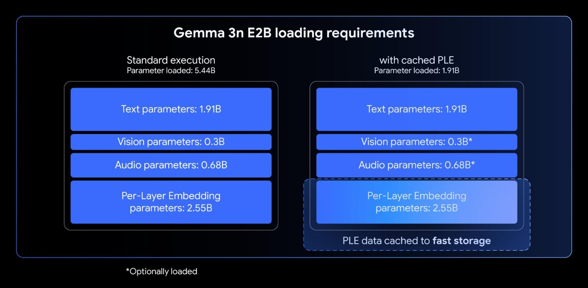

<!-- article-header:start -->
[项目首页](../../../README.md) › [模型系列](../../../reports/model-family-index.md) › [Gemma](../README.md)
<!-- article-header:end -->

# Gemma 3n：MatFormer、分层嵌入与端侧多模态理解

> 本文解读 Google 官方技术博客 **Introducing Gemma 3n: The developer guide**（2025-06-26），主来源固定为 2026-10-13 抓取的原始页面；输入规格和评测补充采用官方 E4B IT 模型卡的固定 HF revision **c1221e9c62e34a43ab7ffacd1be0ea71f126ef10**。本文未读取受访问限制的配置或权重，不据此推定未公开训练细节。

<!-- article-toc:start -->

**本篇目录** · [论文定位](#paper-info) · [快速概览](#overview) · [整体架构](#architecture) · [核心原理](#principles) · [数据构建](#data) · [训练流程](#training) · [实验结果](#experiments)
<!-- article-toc:end -->

## 1. 论文信息与模型定位

| 项目 | 内容 |
|---|---|
| 材料与团队 | Google DeepMind；官方架构技术博客与模型卡，非完整训练论文 |
| 发布日期 | 2025-06-26 正式发布；此前预览与本次完整版本分开 |
| 型号 | E2B、E4B；有效参数约 2B/4B，总参数约 5B/8B |
| 输入输出 | 文本、图像、视频、音频输入，文字输出 |
| 上下文 | 总计 32K token，输出预算需减去已用输入 |
| 定位 | 手机、平板、笔记本等资源受限设备上的多模态理解 |
| 官方资源 | [技术博客](https://developers.googleblog.com/en/introducing-gemma-3n-developer-guide/) · [固定模型卡](https://huggingface.co/google/gemma-3n-E4B-it/blob/c1221e9c62e34a43ab7ffacd1be0ea71f126ef10/README.md) · [官方文档](https://ai.google.dev/gemma/docs/gemma-3n) |

有效参数是部署和激活口径，不能当作完整模型文件中的总参数数目。模型通过共享子网、低频使用参数卸载、视觉/音频分支的按需加载及缓存复用降低运行成本；这些机制具有不同作用，并不等于只保留原模型的一小部分权重便可获得全部模态能力。

## 2. 快速概览

Gemma 3n 的视觉编码器采用 MobileNet-V5-300M，音频分支基于 Universal Speech Model。图像支持 256、512、768 三种边长，每图编码为 256 个 token；音频每 160ms 产生一个表示，即每秒 6.25 个。语言主干将这些表示与文字结合，输出文字回答、转写或翻译。

主干的 MatFormer 同时训练较大模型及内嵌子模型，允许预先提取 E2B，或通过 Mix-n-Match 选择中间规模。PLE 将大量逐层嵌入从加速器高带宽内存中分离，KV sharing 让部分上层直接复用中间层的键值表示。博客也提到 LAuReL 与 AltUp，但没有完整推导其在本模型中的全部实现；本文不借算法名称补造配置。

公开材料说明了多个降低端侧成本的方向，却不提供完整数据配比、优化超参数或统一端到端延迟实验。读图时应把视觉编码速度、语言 prefill、单步解码和整段交互耗时分开。

## 3. 整体架构

<!-- derived-architecture:start -->

*自绘模型架构示意（非原文图）。依据下述公开资料归纳；方框表示功能组件，不代表逐层实现。*

依据：[MatFormer / PLE / KV sharing / Audio / MobileNet-V5](https://developers.googleblog.com/en/introducing-gemma-3n-developer-guide/)；[Inputs and outputs](https://huggingface.co/google/gemma-3n-E4B-it/blob/c1221e9c62e34a43ab7ffacd1be0ea71f126ef10/README.md)。
<!-- derived-architecture:end -->

沿一次图文/语音问答的输入到输出路径理解：文字形成 token，图片或视频帧由视觉编码器形成图像表示，声音由音频编码器形成时间序列。这些输入进入同一个支持多模态的语言主干，产生文字。视觉、声音是输入模态，公开版本不产生语音波形或图像。

| 模块 | 输入与输出 | 公开机制 |
|---|---|---|
| 视觉编码 | 图像/视频帧 → 图像表示 | MobileNet-V5-300M，MobileNet-V4 基础块与混合深金字塔，支持 256/512/768 分辨率 |
| 视觉融合适配 | 多尺度视觉特征 → 语言可用 token | 博客公开 Multi-Scale Fusion VLM adapter；模型卡记每图 256 token，未提供全部投影尺寸 |
| 音频编码 | 单声道音频 → 时间表示 | USM 路线编码器，每 160ms 一个 token；发布实现处理最长 30 秒音频片段 |
| 文字输入 | 提示/对话 → 文本表示 | 使用模型配套 tokenizer 和对话模板；与其他模态共同构成上下文 |
| MatFormer 主干 | 多模态上下文 → 文字预测 | E4B 内嵌 E2B；官方示意 E4B 35 层、E2B 30 层，FFN 宽度可选择 |
| PLE | 逐层嵌入参数 → 对应层使用的表示 | 可在 CPU 侧加载/计算或缓存，减少加速器常驻权重 |
| KV sharing | 中间层局部/全局 K/V → 上层复用 | 减少上层重复生成/处理相应键值表示的成本 |

在多模态预处理之后，推理仍受上下文预算约束。图像数、视频帧数和音频时长都会消耗输入空间，32K 不是额外独立的输出长度。博客没有给出视频抽帧的唯一固定策略或全部连接器尺寸，因此图示只表达公开模块与信息方向。[博客 What’s new / Audio understanding / MobileNet-V5；模型卡 Inputs and outputs](https://developers.googleblog.com/en/introducing-gemma-3n-developer-guide/)

## 4. 核心创新与数学原理

### 4.1 MatFormer：联合训练嵌套子网，而非推理时随意删除参数

*来源：官方博客 MatFormer 小节。该图公开层块跳过与 FFN 弹性宽度，图中 E4B 为 35 层，E2B 为 30 层；模型图原始字节保留。*

E4B 的训练同时优化内部 E2B 子模型，使小网络的路径在训练中也接受监督。因此 E2B 是被共同训练并提取的子网，不是把任意大模型权重截断后就自动得到的小模型。Mix-n-Match 主要通过逐层调整 FFN 中间维度（8,192–16,384）和选择跳过部分层，获得 E2B 与 E4B 之间的配置。

宽度控制 FFN 每层计算量，深度控制经过的层数，两者都影响精度和成本。博客发布了已选配置的工具与基准结果，但未给出本模型联合优化目标的全部权重，因此不应自行写出一个确定的多子网损失配比。

还要区分预先选型与运行时切换：发布材料明确说，单次部署中动态切换 E4B/E2B 路径属于后续能力，并非当时发布实现已具备的行为。[官方博客 MatFormer 小节](https://developers.googleblog.com/en/introducing-gemma-3n-developer-guide/)

### 4.2 PLE：把参数容量与加速器常驻内存拆开

*来源：官方博客 Per-Layer Embeddings 小节。图中的 CPU/缓存与可选视觉、音频组件解释了不同加载口径，1.91B 不是完整模型总参数。*

普通语言模型的常驻权重与整体参数规模容易紧密绑定。PLE 为各层增加嵌入参数，同时让这部分低利用率矩阵可以在 CPU 侧加载、计算，或按部署方式预先缓存，从而让更多模型容量不必全部常驻加速器显存。

图中 E2B 的标准加载参数为 5.44B：文字 1.91B、视觉 0.3B、音频 0.68B、PLE 2.55B；采用缓存与可选模态加载后，图示的核心文字常驻量为 1.91B。它解释“约 5B 总参数、约 2B 有效参数”的区别，但不表示完整视觉语音应用的总内存只有 1.91B 权重，也不包含所有运行激活与 KV 缓存。

具体收益取决于 CPU/存储速度、缓存是否已准备、是否启用视觉和音频，以及量化格式。PLE 转移的是参数放置与访问负担，不是无条件消除计算和数据传输。[官方博客 PLE 小节与原图](https://developers.googleblog.com/en/introducing-gemma-3n-developer-guide/)

### 4.3 KV sharing：让上层复用中间层的历史表示

长输入的 prefill 需要处理全部上下文，而后续逐 token 解码需要使用历史 K/V。Gemma 3n 将中间局部和全局注意力层的 K/V 共享给上层，避免上层重复生成各自的一整套键值表示。

共享并不是把所有层的输出隐藏状态设为相同，也不意味着全局注意力的长序列成本完全消失。博客给出的 2 倍改善针对相对于 Gemma 3 4B 的 prefill，不是每个设备上每个输出 token 都快两倍。未公开的共享起始层号、完整精度消融和统一硬件条件不在本文硬填。[官方博客 KV Cache sharing 小节](https://developers.googleblog.com/en/introducing-gemma-3n-developer-guide/)

### 4.4 多模态低 token 表示：控制输入预算仍要保留模态差异

MobileNet-V5 的高效编码减少视觉端成本，图像经多尺度适配形成固定 256 token；声音以每 160ms 一个表示进入语言主干，保留时间结构。两者的压缩单位不同：每图固定数与每秒固定数不能直接比较为同一“压缩率”。

可用 $`N\approx256n_{\mathrm{img}}+6.25T_{\mathrm{audio}}+N_{\mathrm{text}}`$ 作输入预算的阅读估算，$`n_{\mathrm{img}}`$ 为实际编码图像/帧数，$`T`$ 为音频秒数；这是根据模型卡规格建立的估算，实际还需特殊 token、分段与取整规则。它不是论文提出的损失或精确处理器实现。

发布时音频实现只处理最长 30 秒片段。编码器具备流式设计，不等于该版本已对任意长音频完成训练和运行支持；博客明确将额外长音频训练及后续实现列为进一步工作。[博客 Audio understanding / MobileNet-V5；固定模型卡输入规格](https://huggingface.co/google/gemma-3n-E4B-it/blob/c1221e9c62e34a43ab7ffacd1be0ea71f126ef10/README.md#inputs-and-outputs)

## 5. 数据构建与处理

固定模型卡披露约 11T token，训练数据知识截止为 2024-06，包括超过 140 种语言的网页文字、代码、数学、图像和声音。这里是混合 token 预算，不能换算成图片总数或音频小时数；博客另外称多模态理解覆盖 35 种语言，与文本语料超过 140 种语言属于不同口径。

清洗包括敏感个人信息和不合规内容过滤、内容质量与安全处理。材料没有给出各模态的完整数据量、语言采样比例、音频转写数据来源或去重阈值；无法据此复刻全量数据构建管线。[固定模型卡 Model Data](https://huggingface.co/google/gemma-3n-E4B-it/blob/c1221e9c62e34a43ab7ffacd1be0ea71f126ef10/README.md#model-data)

## 6. 训练流程与目标

| 环节 | 明确公开的安排 | 未公开部分 |
|---|---|---|
| 基础多模态学习 | 模型卡给约 11T token 与数据类别，提供 PT/IT 版本 | 各阶段样本数、冻结状态和完整混合比例 |
| 嵌套模型优化 | E4B 与内部 E2B 同时优化 | 联合损失权重及全部子网采样方式 |
| 视觉/音频组件 | 视觉与多模态数据共同训练，视觉使用蒸馏；音频基于 USM | 教师配置、模态损失系数和编码器完整预训练 recipe |
| 指令版本 | 使用配套对话模板的 IT 发布 | 完整 SFT/偏好/RL 各阶段配置 |
| 系统 | TPUv4p/v5p/v5e，JAX 与 ML Pathways | 逐型号训练时长、芯片数量和总成本 |

技术博客适合解释架构取舍，模型卡适合补充输入和数据边界；两者均不构成完整训练方法论文。本文不套用 Gemma 3 的蒸馏或 RL 配方，推定 Gemma 3n 采用了同样的全部参数与阶段。[固定模型卡 Implementation Information；官方博客](https://huggingface.co/google/gemma-3n-E4B-it/blob/c1221e9c62e34a43ab7ffacd1be0ea71f126ef10/README.md#implementation-information)

## 7. 实验设置与主要结果

| 基准 | 版本/设置 | E2B | E4B |
|---|---|---:|---:|
| HellaSwag | PT，10-shot，Accuracy | 72.2 | 78.6 |
| MGSM | IT，0-shot，Accuracy | 53.1 | 60.7 |
| Global-MMLU | IT，0-shot，Accuracy | 55.1 | 60.3 |
| GPQA Diamond | IT，0-shot，模型卡混合标注 RelaxedAccuracy/accuracy | 24.8 | 23.7 |
| HumanEval | IT，0-shot，pass@1 | 66.5 | 75.0 |
| MMLU-Pro | IT，0-shot，Accuracy | 40.5 | 50.6 |

固定模型卡说明这些评测使用 float32；它们主要是语言任务，不能当作视觉或音频理解的直接排名。E4B 也不是每项都高于 E2B，例如 GPQA 和模型卡中的 ECLeKTic。两个不同版本的 LiveCodeBench 在卡中分别列出，不将它们混为同一个测试集。[固定模型卡 Evaluation](https://huggingface.co/google/gemma-3n-E4B-it/blob/c1221e9c62e34a43ab7ffacd1be0ea71f126ef10/README.md#evaluation)

效率侧，官方称视觉编码器在 Google Pixel Edge TPU 上，相比 Gemma 3 的 SoViT 具有量化 13 倍、未量化 6.5 倍加速，参数减少 46%，内存占用约为四分之一。它们描述视觉编码器及特定硬件条件，不是整个 VLM 的端到端加速。约 60 帧/秒同样不代表一秒能对 60 张图都完成完整文字问答。

公开证据支持 Gemma 3n 通过模块和主干的联合设计降低端侧负担；对实际应用，还需要在选定模型、模态、输入长度、量化与设备上测量总内存和完整响应延迟。[官方博客 MobileNet-V5 小节](https://developers.googleblog.com/en/introducing-gemma-3n-developer-guide/)

<!-- article-footer:start -->
---

[← 上一篇：MMSearch-R1](../../mmsearch-r1/arxiv-2506.20670/README.md) · [按发表时间浏览](../../../reports/paper-reading-guide.md#year-2025) · [下一篇：Qwen VLo →](../../qwen/document-244376c2123a/README.md)

[返回本篇目录](#article-toc) · [返回模型系列](../README.md)
<!-- article-footer:end -->
