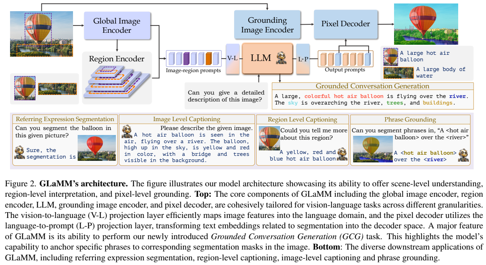
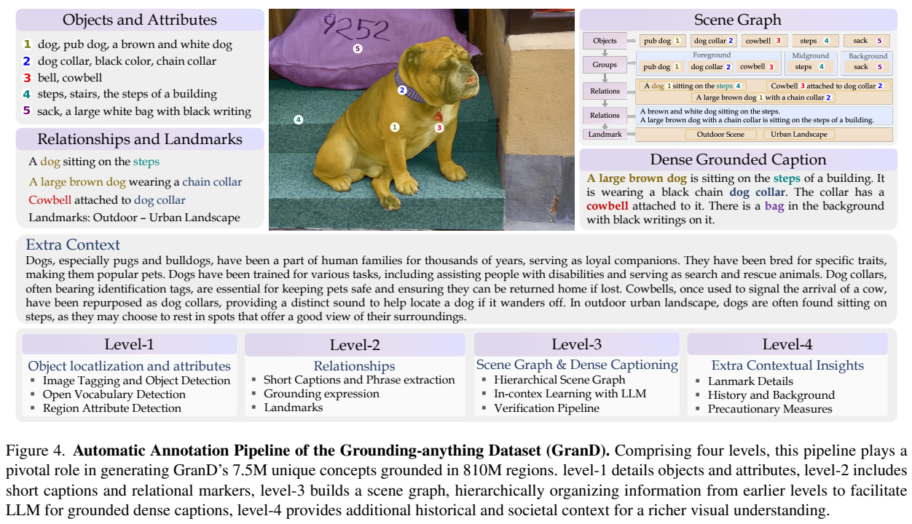
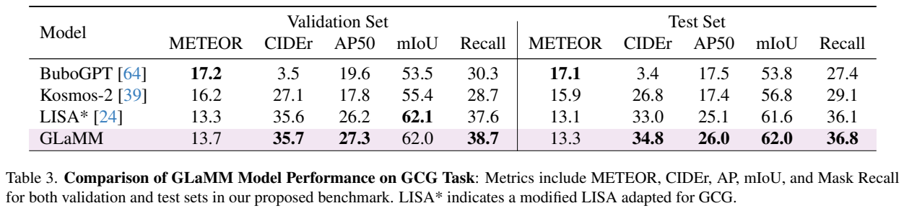
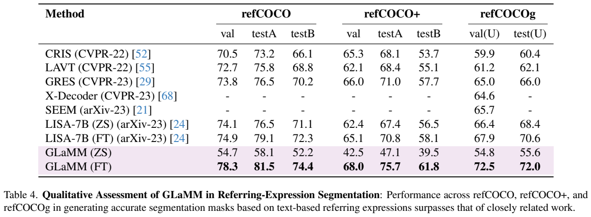
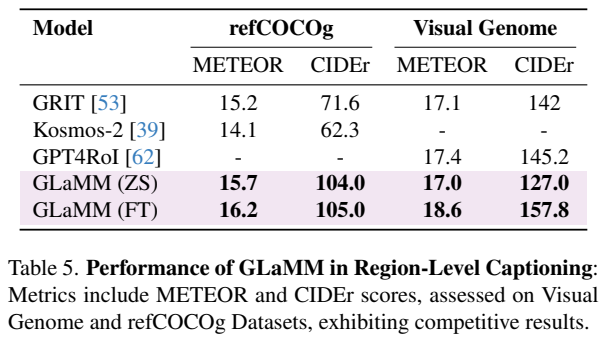

<!-- article-header:start -->
[项目首页](../../../README.md) › [模型系列](../../../reports/model-family-index.md) › [GLaMM](../README.md)
<!-- article-header:end -->

# GLaMM：让回答中的短语对应图像里的像素掩码

<!-- article-toc:start -->
<a id="article-toc"></a>

**本篇目录** · [论文定位](#paper-info) · [快速概览](#overview) · [整体架构](#architecture) · [核心原理](#principles) · [数据构建](#data) · [训练流程](#training) · [实验结果](#experiments)
<!-- article-toc:end -->

<a id="paper-info"></a>

## 1. 论文信息与模型定位

| 项目 | 信息 |
|---|---|
| 原文 | *GLaMM: Pixel Grounding Large Multimodal Model* |
| 作者 | Hanoona Rasheed、Muhammad Maaz、Sahal Shaji 等；前两位共同一作 |
| 机构 | MBZUAI，联合 ANU、Aalto、CMU、UC Merced、Linköping、Google Research 等 |
| 本文依据 | [arXiv:2311.03356v1](https://arxiv.org/pdf/2311.03356v1)，2023-11-06，14 页 |
| 官方项目 | [GroundingLMM 项目主页](https://mbzuai-oryx.github.io/groundingLMM) |
| 定位 | 可接受整图、文字和可选区域输入，生成文本及与短语绑定的分割掩码 |

GLaMM 的重要变化是把“描述物体”和“指出物体的像素范围”放在同一回答中。它不仅输出检测框，也能把物体部件、属性短语、背景stuff等绑定到mask。语言主干为Vicuna-7B，基于LLaVA-1.1构建；完整系统还包含视觉与分割模块，不能只按7B理解全部参数量。

<a id="overview"></a>

## 2. 快速概览

| 贡献 | 具体内容 |
|---|---|
| 多粒度输入 | 整图CLIP表示、用户指定框的RoI特征、文本问题 |
| 多粒度输出 | 普通问答、整图/区域caption、指代表达分割、图文短语逐一落地 |
| 新任务GCG | Grounded Conversation Generation：连贯caption中的多个短语分别关联mask |
| 自动数据GranD | 11M图像，810M区域，7.5M概念，84M指代表达，33M grounded captions |
| 高质量微调GranD-f | 约214K图文样本，以已有区域注释为基础重组caption，另含小规模人工核验 |
| 评估重点 | 同时测caption质量、mask质量和短语-mask对应，不能仅看语言流畅度 |

“7.5M概念”包含标签与描述性表达，不能直接视作750万互斥类别。810M是区域注释数，11M是图像数；同图有很多区域和不同层级注释。论文提供了大规模数据构建方法，但本v1的训练超参和损失组合披露有限，介绍中明确保留这一边界。

<a id="architecture"></a>

## 3. 整体架构



*原文Figure2，PDF第4页，图表区域裁切。左路CLIP/region encoder向LLM提供语义输入；上方另一路grounding image encoder向pixel decoder提供空间特征；右侧mask由两路信息共同决定。*

模型含五个核心模块。全局图像编码器按第3.1节记载为ViT-H/14 CLIP，输出256个图像token，用vision-to-language投影映射到Vicuna空间。区域编码器从CLIP四个选定层构建特征金字塔，对用户框做RoIAlign得到14×14区域特征，再组合成RoI表示，与全局特征共享V-L投影。文本中的`<bbox>`位置用该区域表示替换，而不是把一个坐标字符串当作完整视觉内容。

LLM负责生成自然语言以及`<p>`、`</p>`、`<SEG>`标记；grounding image encoder用预训练SAM提取分割空间特征；pixel decoder采用SAM decoder式结构。LLM末层中`<SEG>`位置的隐状态经language-to-prompt投影后，成为分割decoder的语义prompt。于是一个回答中的多个分割标记能够分别对应不同掩码。

region encoder是**输入框→区域理解**，pixel decoder是**生成语义→输出mask**，二者方向不同。普通整图描述或自动GCG不要求用户提前为每个对象框选区域；需要精确询问局部时可提供可选框。报告也展示多轮交互，例如先问一辆车的区域描述，再追问车的型号。

| 模块 | 输入与输出 | 公开机制 |
|---|---|---|
| CLIP 全局编码与 V-L 投影 | 图像 → 256 个 LM 视觉 token | 正文指定 ViT-H/14，线性映射语言空间，替换 image 占位 |
| Region encoder | 四层 CLIP 特征、可选框 → RoI 向量 | 构建金字塔并 RoIAlign 为 14×14，再用共享 V-L 投影替换 bbox 占位 |
| Vicuna 与标记生成 | 全局/区域特征和对话 → 短语、SEG 隐状态 | p 标记定义短语边界，SEG 位置提供与语义上下文绑定的分割提示 |
| L-P 投影与 SAM 图像编码 | SEG 隐状态、原图 → prompt 与空间特征 | 语言到 prompt 变换与独立 SAM 视觉路径分别提供语义、几何依据 |
| Pixel decoder | 语义 prompt 与 SAM 特征 → 对应 mask | SAM decoder 式模块；多个 SEG 对应不同掩码，而不是把掩码像素当文字生成 |


<a id="principles"></a>

## 4. 核心创新与数学原理

### 4.1 全局语境与可选区域提示共享语言接口

全图 token 提供场景，RoI token 提供用户指定的局部信息；共享 V-L 投影让两者进入同一语言维度，但不说明其视觉内容完全可替代。区域路径首先从多个 CLIP 层构造金字塔，再做 RoIAlign，利用不同层级的空间与语义信息。没有区域输入时，模型仍可依靠全图路径完成自动 grounded caption。[原文 §3.1 Scene/Region-Level Understanding，PDF 第 4 页](https://arxiv.org/pdf/2311.03356v1#page=4)

第3.1节以未编号公式表达语义融合。记图像为$`x`$、文本为$`t`$、全局编码器$`I`$、区域编码器$`R`$、V-L投影$`f`$，则：

```math
y=L(f(I(x)),t),\qquad y=L(f(I(x)),t'),\quad t'=[t\leftarrow f(R(I(x),r))].
```

第一式处理整图，第二式将区域$`r`$的特征放入提示。这里写的是模块关系，实际生成仍是自回归序列，不是一次函数调用同时得出所有文字。原文用简化向量维度记号，不能据此忽略256个图像位置的序列结构。

### 4.2 语言决定分割对象而空间编码器保留形状

SEG 的最后层表示已经受前文短语和对话影响，L-P 投影把它转成 decoder 能读的语义条件；SAM 图像编码器单独提供密集空间信息。把这两路分开，语言主干不必直接输出每个像素，也让同一图像特征可服务不同短语提示。输入 RoI 理解和输出 pixel grounding 因此不能合并成一个方向相同的模块。[原文 §3.1 Pixel-Level Grounding，PDF 第 4–5 页](https://arxiv.org/pdf/2311.03356v1#page=5)

像素落地在同节表述为：

```math
M=P(g(l_{\mathrm{seg}}),V(x)),\qquad M_i\in\{0,1\}.
```

$`l_{seg}`$是LLM生成`<SEG>`时的末层表示，$`g`$将其映射到prompt空间，$`V(x)`$提供SAM图像特征，$`P`$输出最终二值mask。分割prompt因此可以包含此前描述和对话的上下文，能够区分“红色衣服的人”这样的组合语义。二值条件描述最终输出，训练时仍需可微预测；原文未给精确阈值或概率损失，不能自行写成已披露的固定实现。

### 4.3 短语与 mask 绑定是联合输出的核心约束

GCG 要求完整句子保持可读，同时将对象、部件和属性短语与对应 mask 配对。p/SEG 标记规定配对位置，但仍可能出现句子正确而 mask 错、mask 正确而短语错的情况。论文因此并列评测 caption、mask AP/IoU 和区域 recall，而不是用单一文字分数代表视觉落地能力。[原文 §3.2 GCG Output Representation/Evaluation Criteria，PDF 第 5 页](https://arxiv.org/pdf/2311.03356v1#page=5)

GCG回答格式例如`<p>一个人</p><SEG>坐在<p>长椅</p><SEG>上`。语言生成位置负责绑定短语边界和分割提示，pixel decoder负责形状。重要的是词与形状对应，单独生成漂亮mask但配错短语仍算失败。

报告提出的mask recall先对预测与真值掩码做一对一匹配，要求IoU大于.5，再要求对应短语BERT相似度大于.5，满足两项才算TP。按正文规则记号化为：

```math
\mathrm{Recall}_{mask}=\frac{\sum_{(i,j)\in\mathcal A}\mathbf1[\mathrm{IoU}(M_i,G_j)\gt .5]\mathbf1[\mathrm{BERTSim}(p_i,q_j)\gt .5]}{\vert G\vert }.
```

这是对第3.2节评估规则的整理，不是原文编号公式。IoU采用标准交并比$`\vert M\cap G\vert /\vert M\cup G\vert`$，$`\mathcal A`$为一对一配对。该指标同时要求空间和语义正确，但BERT相似度阈值本身也会影响评分，不能把它当作完全无偏的人类语义判断。

<a id="data"></a>

## 5. 数据构建与处理



*原文Figure4，PDF第6页。上部把对象、属性、关系组织成scene graph，再合成dense caption；下部Level4的背景常识超出图像直接可见内容，读图时应与可验证视觉描述区别开。*

GranD对11M张SAM图像建立四级流水线。Level1用Tag2Text/RAM打标签，Co-DETR、EVA-v02、OWL-ViT、POMP检测；各检测器先做class-agnostic NMS，再比较模型间IoU，至少两个模型共同检测到的框才作为对象保留。GRiT/GPT4RoI产生属性，MiDAS估深度，区域配分割mask。跨模型一致性可降低部分错误，不代表被多个相似模型同时遗漏的对象也能恢复。

Level2用BLIP2、LLaVA1.5给短描述与场景类别，spaCy抽短语，MDETR把表达对齐到对象。Level3将对象、属性、关系、框和深度转为分层scene graph，按前景/中景/背景组织，再用Vicuna1.5-13B的in-context示例生成dense caption。核验时从caption抽对象清单，若有不在scene graph中的对象，带反馈重新生成。这个检查主要验证对象存在性，不能自动证明关系、数量和背景常识全部正确。

Level4根据scene graph生成地标历史、交互提示等额外常识；它不是像素标注直接支持的事实。GranD总量包含84M referring expressions、22M grounded short captions、11M dense grounded captions，合计33M；Table2的5B tokens为数据文本统计，不能当作已证明模型实际看过5B训练token。

GranD-f重新利用RefCOCOg约24K、PSG约31K、Flickr30K约158K样本。GPT4将既有表达/关系和COCO等caption融合，同时保留短语与区域的原映射；Flickr的框用HQ-SAM转mask。另约1000个样本由标注员将表达匹配到SAM真值mask。保留原映射可以避免重配错位，但不能保证GPT4新增描述或HQ-SAM边界零误差。报告称总体约214K，留2.6K验证和5K测试；第3.2节验证数写2.5K，存在小幅口径差异。

<a id="training"></a>

## 6. 训练流程与目标

训练先在大规模自动GranD-p上预训练，学习区域、语言与分割语义的对齐，再在高质量GranD-f上为GCG微调。第5节给出这一顺序，区域描述和指代表达分割还分别报告了ZS与任务FT结果。这里ZS应理解为未对当前评测任务额外微调，不能扩展为模型从未接触过相关概念或原始图像分布。

GLaMM需要两种监督：文字/结构标记要形成正确序列，分割decoder要得到与短语对应的区域。这是任务要求层面的说明；本v1没有详细列出联合损失项与权重，也没有公开在正文中的BCE/Dice组合、学习率、batch、epoch、optimizer、LoRA rank、冻结模块表或总GPU时间。虽然论文说端到端训练，并不意味着五个模块的每一参数都已确认全量更新。不能沿用LISA、SAM或后续版本的配方来填这些空白。

当前14页v1多次引用Appendix A/C与后续Figure9–14，但所选PDF在参考文献后结束，没有这些附录实体。因此本文使用已读到的第3–5节，不将未出现的附录当成已核验来源。复现级训练细节需要另行核对官方代码或新版，本文没有声称已做该复现。

<a id="experiments"></a>

## 7. 实验设置与主要结果







*原文Tables3–5，PDF第9页。Table 3 是新任务 GCG，Table 4 同时列 ZS 和 FT 的分割结果，Table 5 是区域描述；同一模型在不同设置下差距明显，不应把FT数值标成零样本成绩。*

| GCG test，Table3 | GLaMM | 适配GCG的LISA* | Kosmos2 |
|---|---:|---:|---:|
| METEOR |13.3|13.1|15.9|
| CIDEr |34.8|33.0|26.8|
| AP50 |26.0|25.1|17.4|
| mIoU |62.0|61.6|56.8|
| mask recall |36.8|36.1|29.1|

GLaMM的定位与mask指标较好，但METEOR低于Kosmos2和BuboGPT17.1，说明它没有全面赢得所有文本质量指标。LISA*经过适配，不能拿这行代表未经改造LISA的多对象能力。AP是class-agnostic mask评估，而mask recall还加文本相似约束，两者不是同一个“语义正确率”。

Table4的RefCOCO val：GLaMM ZS54.7、FT78.3，LISA-7B ZS74.1、FT74.9；RefCOCOg test(U)：GLaMM ZS55.6、FT72.0，LISA FT70.6。优势主要出现在任务微调之后，零样本分割反而明显落后，不能把结论写成预训练后分割普遍领先。FT在RefCOCO+ testA75.7，RefCOCOg val72.5等，也应保留数据集/分割名称。

区域caption Table5：VisualGenome FT METEOR18.6/CIDEr157.8，GPT4RoI17.4/145.2；GLaMM ZS17.0/127.0。RefCOCOg FT16.2/105.0，ZS15.7/104.0。整图caption Table6标零样本，Flickr30K CIDEr95.3/SPICE18.8，但NoCap CIDEr106.8低于BLIP2的121.6、InstructBLIP123.1。GranD-f包含重组的Flickr30K数据，v1未给足训练/评测图像拆分细节，故保留作者ZS标签，同时不宣称严格证明与该数据域完全无接触。

LLaVA-Bench的GPT4评判分63.3，与LLaVA1.5的63.4接近，支持增加落地能力后仍保留一定普通对话能力，不能据此证明所有语言推理无退化。整体贡献是可输出短语与像素共同表示的统一接口和数据流水线；新GCG测试仍有约36.8的mask recall，离可靠完整落地有明显差距。所有数值来自报告，本文未运行模型。

<!-- article-footer:start -->
---

[← 上一篇：CoVLM](../../covlm/arxiv-2311.03354/README.md) · [按发表时间浏览](../../../reports/paper-reading-guide.md#year-2023) · [下一篇：mPLUG-Owl2 →](../../mplug/arxiv-2311.04257/README.md)

[返回本篇目录](#article-toc) · [返回模型系列](../README.md)
<!-- article-footer:end -->
