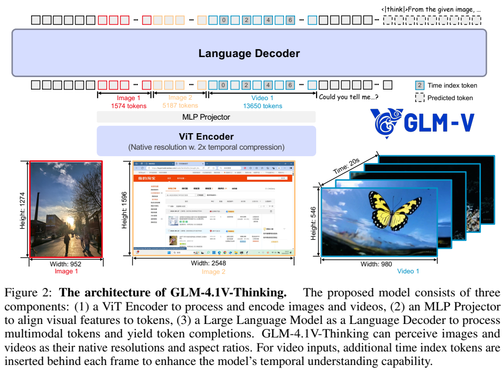
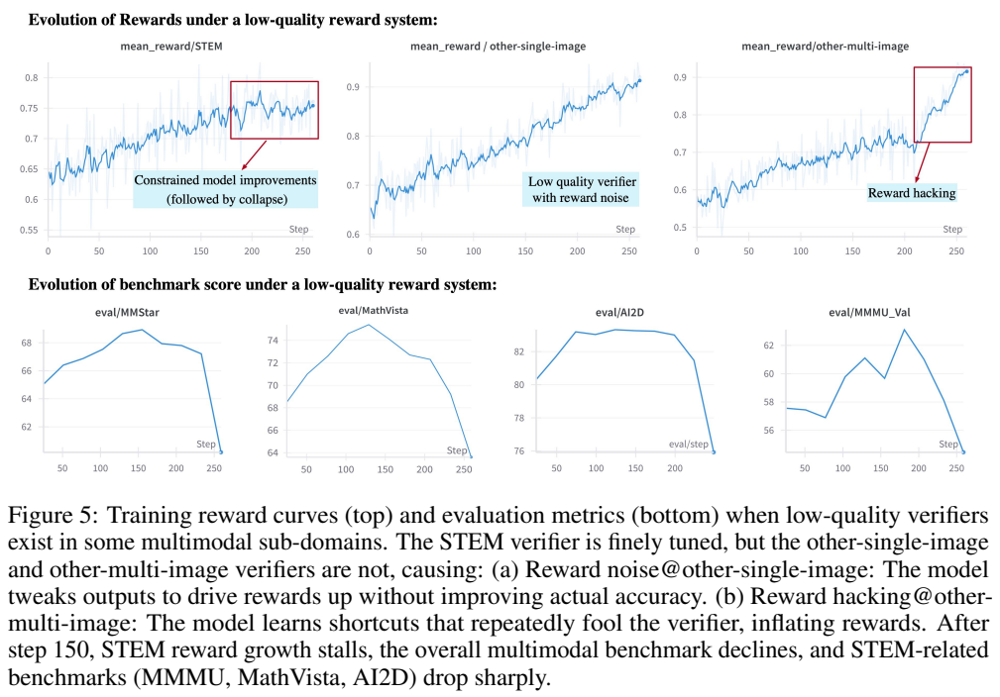
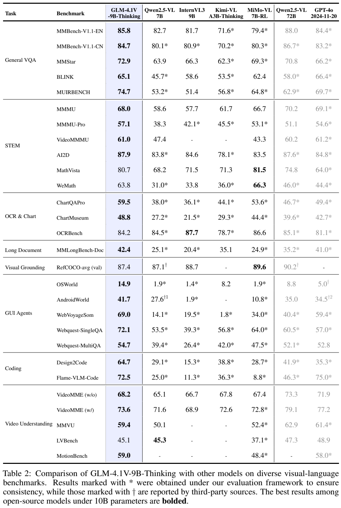
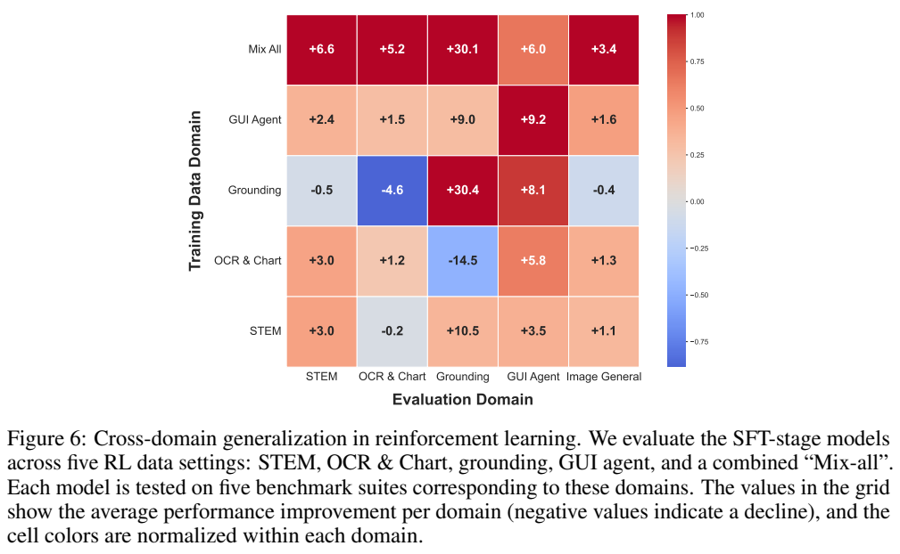

<!-- article-header:start -->
[项目首页](../../../README.md) › [模型系列](../../../reports/model-family-index.md) › [GLM / VisualGLM](../README.md)
<!-- article-header:end -->

# GLM-4.1V-Thinking：原生分辨率视觉基础与跨领域课程强化学习

<!-- article-toc:start -->

**本篇目录** · [论文定位](#paper-info) · [快速概览](#overview) · [整体架构](#architecture) · [核心原理](#principles) · [数据构建](#data) · [训练流程](#training) · [实验结果](#experiments)
<!-- article-toc:end -->

## 1. 论文信息与模型定位

**报告**：*GLM-4.1V-Thinking: Towards Versatile Multimodal Reasoning with Scalable Reinforcement Learning*；**作者**：GLM-V Team；**机构**：智谱 AI、清华大学；**版本**：[arXiv:2507.01006v1](https://arxiv.org/abs/2507.01006v1)，2025 年 7 月 1 日；**项目**：[THUDM/GLM-4.1V-Thinking](https://github.com/THUDM/GLM-4.1V-Thinking)。本文依据首版 35 页 PDF。

团队发布 GLM-4.1V-9B-Base 与 GLM-4.1V-9B-Thinking。前者作为视觉语言基础模型，后者经过长思考风格 SFT 和多领域强化学习，覆盖 STEM、图表、长文档、视觉定位、GUI、代码与视频。方法重点不是仅让回答变长，而是搭建能跨任务提供可靠反馈的奖励系统，并随能力变化调整训练题目难度。[原文 §1–§2](https://arxiv.org/pdf/2507.01006v1#page=2)

本文公开视觉输入与文字输出架构，没有原生声音理解或音频生成模块。GUI 成绩来自特定代理评测设置，不应直接理解为任何桌面任务都能自动完成。报告也承认最终答案正确时，中间解释仍可能错误。

## 2. 快速概览

| 要点 | 首版内容 |
|---|---|
| 视觉编码器 | AIMv2-Huge，图像与视频共用；视频时间维压缩 2 倍 |
| 语言架构 | MLP 投影连接 GLM，视觉侧 2D-RoPE，语言侧扩展 3D-RoPE |
| 动态输入 | 支持可变分辨率、宽高比；保留并插值原绝对位置嵌入 |
| 视频时间 | 帧后插入以时间戳字符串实现的 time index token |
| 基础训练 | 8K 上下文 120K 步，再 32K 上下文 10K 步 |
| SFT | 全参数、32K 上下文、全局 batch 32；统一思考与答案格式 |
| RL | GRPO，按领域验证，RLCS 难度课程与 ratio EMA 扩大采样 |
| 代表结果 | MathVista 80.7、MMMU-Pro 57.1、长文档 42.4、OSWorld 14.9 |

报告称 28 项评测中在小于 10B 开放模型范围取得 23 项最佳。实际优劣仍应逐项看：OCRBench、视觉定位、部分数学与长视频指标不处于该表最佳；与 72B 模型也有明显落后项目。[原文 Table 2、§6.2](https://arxiv.org/pdf/2507.01006v1#page=15)

## 3. 整体架构

**读图方式**：两张不同尺寸的图产生不同长度视觉序列；视频除视觉 token 外还有蓝色 time index。MLP 将编码器特征投影到语言输入，解码器统一处理文字与视觉。图中的 1574、5187、13650 是示例输入的 token 数，不是固定的每图/每视频预算。

视觉编码器以 AIMv2-Huge 初始化，语言解码器采用 GLM，二者由 MLP 适配器连接。视觉编码器将原 2D 卷积替换为 3D 卷积，视频在时间维压缩 2 倍；单图复制以兼容同一处理方式。为处理动态宽高比，视觉层加入 2D-RoPE，同时保留原可学习绝对位置嵌入，并按输入网格插值。语言侧扩展为 3D-RoPE，提高多模态空间表达。[原文 §2，PDF 第 3–4 页](https://arxiv.org/pdf/2507.01006v1#page=3)

视频帧后加入字符串形式的真实时间戳，提示帧间距离。它与单纯帧序号不同，可以表达不均匀采样的时间差；首版未完整披露所有任务的 FPS、统一采样时长或具体时间编码超参数。方法称可处理极端超过 200:1 的宽高比与高于 4K 的分辨率，这是架构适应范围的说明，不代表全部基准都使用这些输入。

基础模型提供可探索的答案空间，SFT 统一解答风格，RL 再从可验证题目与人类偏好类反馈中改善表现。报告把这条链视为整体系统：弱感知无法靠长思考自动恢复，被误判的奖励也可能推动模型学习错误行为。

## 4. 核心创新与数学原理

可变分辨率位置适配首先把 patch 整数坐标 $`g=(w,h)`$ 转为连续归一化位置。对 $`H_p\times W_p`$ 网格，原文 Eq. (1)–(2) 为：

$$
g_{norm}=2\left(\frac{w+0.5}{W_p},\frac{h+0.5}{H_p}\right)-1,\qquad
P_{adapted}(g)=I_{bicubic}(P_{orig},g_{norm}).
$$

第一式用 patch 中心映射至 $`[-1,1]`$，第二式从原位置表作双三次插值。保留原表让新模型继续利用预训练 ViT 的位置知识，RoPE 则补充动态空间关系。它不是简单丢弃绝对位置、完全换成旋转编码。[原文 §2，PDF 第 4 页](https://arxiv.org/pdf/2507.01006v1#page=4)

RLCS 的核心是动态选择有学习价值的问题。离线用多个模型或旧 RL 检查点的 pass@k、人工难度标注分档；在线记录 rollout 的正确情况，更新难度与领域表现，再下调过易、当前过难题，增加中等难题。组内全部正确或全部错误时，GRPO 的相对奖励不能提供有效区分，继续大量抽这些题会浪费 rollout。此处“没有有效梯度”按报告在移除 KL、熵损失的设置理解，并非对所有 RL 目标的普遍结论。[原文 §5.3](https://arxiv.org/pdf/2507.01006v1#page=11)

动态采样扩张以无效组比例 $`p`$ 计算：

$$
\text{expansion\_ratio}=\frac{1}{1-p}.
$$

再维护该比值的 EMA，作为下一轮超采样系数，选取正确与错误数量较均衡的组。若无效比例为一半，公式给约 2 倍抽样需求，这是公式含义的例子；原文没有公布 EMA 系数、上限或 $`p\to1`$ 时的全部边界处理，本文不补成确定实现。[原文 §5.3.1，PDF 第 12 页](https://arxiv.org/pdf/2507.01006v1#page=12)

奖励必须按任务含义区分。例如“43”和“43.0”在数学中可等价，在 OCR 中可能是不同文字。Table 1 的 OCR 奖励为 $`1-d_{edit}(ans,gt)/\max(\vert ans\vert ,\vert gt\vert )`$；定位奖励按超过 IoU 阈值的框数量占比；GUI 动作同时检查动作与空间正确性。长文档等难以精确验证的内容使用语义评审或奖励模型。[原文 §5.2、Table 1](https://arxiv.org/pdf/2507.01006v1#page=11)

**读图方式**：上排训练奖励越来越高，下排 MMStar、MathVista、AI2D、MMMU 却在后期下降。多图验证器被输出捷径欺骗后，甚至使高质量 STEM 奖励领域的学习停滞。这说明训练 reward 与真实能力不能等同，验证器需检查任务语义与异常输出。

报告没有完整展开 GRPO 的目标式、组大小、各域权重和全部 clipping 数值。介绍保留作者披露的机制，不把其他项目的标准配方当成 GLM 的具体实现。

## 5. 数据构建与处理

图文初始池超过 **100 亿对**，来自 LAION、DataComp、DFN、Wukong 和网络搜索。这是候选池，不能当成最终全部训练规模。清洗包括低分辨率/纯色/描述长度规则与图像去重，CLIP 分数阈值 **0.3**，概念平衡重采样，以及以事实为中心的 recaption 模型。原描述和新描述按一定比例混合，但报告没有披露该比例及最终 caption 条数。[原文 §3.1，PDF 第 5 页](https://arxiv.org/pdf/2507.01006v1#page=5)

交错数据清洗网页中的无关图片、广告、二维码、图片很多文字很少的相册，并用知识密度分类器优先保留图表、科学插图、工程图、教学图和地图。书籍来源先收集超过 **1 亿本**数字书，再筛 STEM 和解析 PDF；这也是原始来源规模，未披露最后留下多少书或页。

OCR 数据含 **2.2 亿图**：合成文档把文字以多字体、尺寸、颜色和方向渲染到背景；自然场景用 PaddleOCR 生成文字及框；学术论文把 LaTeX 经 LaTeXML 转 HTML、轻量标记，再按 PDF 页切分与栅格化，得到页面与结构化源文字对。[原文 §3.1，PDF 第 6 页](https://arxiv.org/pdf/2507.01006v1#page=6)

自然图像定位由 LAION-115M 上 GLIPv2 自动预测名词短语的框，只保留至少两个有效框的样本，最终报告 **4000 万 grounding 标注**；这些是自动标注，不是逐框人工审核。GUI 从 CommonCrawl URL 截图，用 Playwright 读取可见 DOM 的位置与内容，构造超过 **1.4 亿 QA 对**，覆盖 referring expression 生成与理解。DOM 提供网页元素监督，不代表所有真实应用都提供同等信息。

视频来自学术、网页及专有来源，人类参与细粒度动作、场景文字、镜头运动与构图标注；先检查文件完整性，再按视频和文字双重嵌入相似度去重，未公开最终视频数。基础训练还纳入约 **5000 万指令样本**，覆盖一般视觉、STEM、长文档、GUI 与 UI 代码，并对开放数据做人工与自动污染检查。报告未提供逐基准污染审计数值。[原文 §3.1，PDF 第 6–7 页](https://arxiv.org/pdf/2507.01006v1#page=6)

后训练冷启动另构建长推理数据，中英文为主，少量其他语言，过滤过易/过难题和格式错、混合语言、重复解释；统一 `<think>`、`<answer>` 格式，可验证任务要求唯一的专用答案框。RL 检查点里有价值的样本又回流更新冷启动集。RL 还把有唯一答案的选择题改为填空，以减少随机猜测噪声，经过准确性检查、难度分级与分领域试训。首版没有公开 SFT 长推理集及 RL 总题数与完整配比。[原文 §4–§5.1](https://arxiv.org/pdf/2507.01006v1#page=7)

## 6. 训练流程与目标

基础预训练全参数更新：**120000 步**、上下文 **8192**、全局 batch **1536**、TP=2，数据包括前述来源但暂不含视频，样本打包提高利用率。随后长上下文继续训练 **10000 步**，加入视频及超过 8K 的交错序列，上下文增到 **32768**、batch 保持 1536，TP=2 与 CP=4 组合。[原文 §3.2，PDF 第 7 页](https://arxiv.org/pdf/2507.01006v1#page=7)

SFT 全参数、上下文 **32768**、全局 batch **32**；除多模态长推理，也加入文字数学、多轮对话、规划和指令数据。其角色是把已有知识变为适于 RL 的解答方式，作者有意不先做短推理 SFT。报告举例把冷启动 1000 步增到 2000 步，初始平均高约两点，RL 后却近似收敛到相同水平；不能把这两组实验步数当成发布模型确定的 SFT 总步数。[原文 §4.2、§5.3.1](https://arxiv.org/pdf/2507.01006v1#page=8)

RL 混合 RLVR 与 RLHF。可验证任务从专用答案框提取结果，返回二值或连续分；开放任务用奖励模型评分，还检查格式、语言混杂、重复与指令满足。作者移除 **KL 损失与熵损失**，采用 **top-p=1** rollout、较高重要性比率上裁剪及 per-sample 归一化；这些是在其多领域实验中的经验，不能概括成任何任务都应移除正则。

当思考达到长度预算，系统插入结束思考与开始答案标记，要求给出最终结果后评价，避免把有价值但过长的路径全部当作零分。该做法支持测试时预算控制，首版未给出每领域统一的最佳思考长度。训练基础设施按长度平衡 DP rank，32K 打包与累积，以样本数加权微步梯度；作者报告重组优化约减半前反向时间，但没有提供完整硬件、基线与吞吐表。[原文 §5.3–5.4，PDF 第 12–14 页](https://arxiv.org/pdf/2507.01006v1#page=12)

报告未披露完整学习率、优化器参数、总 GPU 数、型号、总 token、SFT/RL 确定步数、GRPO 组大小与奖励全权重。公式与配置只写已公开项；本仓库没有运行或复现模型。

## 7. 实验设置与主要结果

**读表方式**：粗体比较小于 10B 的开放模型；星号是作者统一框架重测，匕首为第三方数据。并非每个对照都属于同一重测条件。Video-MME 的 w/o、w/ 表示无/有字幕，GUI 脚注还区分 SoM 与截图加 accessibility tree。

推理使用 vLLM，最大输出 **8192 token**，图像最大预期输入 **6144 token**、视频 **30000 token**。需要语言模型抽取或评分时使用 GPT-4o **2024-11-20**。作者要求每项成功请求率至少 95%，生成或 API 失败样本**排除评分**，所以主分数不包含全部失败请求；没有逐模型失败率可再算端到端成功率。[原文 §6.1，PDF 第 14 页](https://arxiv.org/pdf/2507.01006v1#page=14)

| 任务 | GLM-9B | Qwen2.5-VL-72B | 原表 GPT-4o |
|---|---:|---:|---:|
| MMBench-V1.1-EN | 85.8 | 88.0 | 84.4 |
| MMMU-Pro | 57.1 | 51.1 | 54.6 |
| MathVista | 80.7 | 74.8 | 64.0 |
| ChartMuseum | 48.8 | 39.6 | 42.7 |
| MMLongBench-Doc | 42.4 | 35.2 | 41.0 |
| RefCOCO-avg val | 87.4 | 90.2 | 未列 |
| OSWorld | 14.9 | 8.8 | 5.0（第三方） |
| AndroidWorld | 41.7 | 35.0 | 34.5（不同输入脚注） |
| Flame-VLM-Code | 72.5 | 46.3 | 75.0 |
| Video-MME 无字幕 | 68.2 | 73.3 | 71.9 |

在多个 STEM、图表、长文档与代理任务，9B 模型超过表中的 72B 对照。但 MMBench、MMMU、定位和若干视频任务未超过它。引言称 MMBench-EN 85.8 超过 Qwen72B，与 Table 2 的 88.0 不一致，本文以表为准。对 Qwen7B 也存在例外：OCRBench **84.2 < 84.5**、LVBench **45.1 < 45.3**。MiMo-VL 在 MathVista 81.5、WeMath 66.3 仍高于本文 80.7/63.8。[原文 §1、Table 2](https://arxiv.org/pdf/2507.01006v1#page=15)

**读图方式**：纵轴是训练数据领域，横轴是评测领域，数字是相对 SFT 检查点的平均增量；颜色按各评测领域归一化，不能把不同列颜色深浅直接当成同一绝对增益。负数是实际下降。

混合 RL 提高 STEM/OCR图表/定位/GUI/一般图像平均 **6.6/5.2/30.1/6.0/3.4**。然而定位单训提升 **30.4**，GUI 单训提升 **9.2**，分别高于混合的 30.1/6.0；OCR图表单训还使定位下降 **14.5**，定位单训使 OCR图表下降 **4.6**。这支持部分跨领域促进，也揭示干扰。单领域样本数与它在 mix-all 中看到的数相等，但 mix-all 总训练量包含所有领域，不是总计算完全相同的对照。[原文 §6.3](https://arxiv.org/pdf/2507.01006v1#page=17)

报告最后明确：最终答案奖励不能保证中间解释正确，模型可能以错误步骤获得正确结论；遮挡、拥挤和模糊图像仍会导致感知错误。RL 稳定性对冷启动质量与奖励设计敏感，基准分数也未直接验证真实应用的长期可靠性。它的贡献是把基础视觉、统一格式、领域验证器和课程采样结合成广泛的推理训练框架，实际收益与未解决问题均应保留。[原文 §7，PDF 第 18 页](https://arxiv.org/pdf/2507.01006v1#page=18)

<!-- article-footer:start -->
---

[← 上一篇：DenseWorld-1M](../../denseworld-1m/arxiv-2506.24102/README.md) · [按发表时间浏览](../../../reports/paper-reading-guide.md#year-2025) · [下一篇：Step3 →](../../step/document-26d59ba3132d/README.md)

[返回本篇目录](#article-toc) · [返回模型系列](../README.md)
<!-- article-footer:end -->
