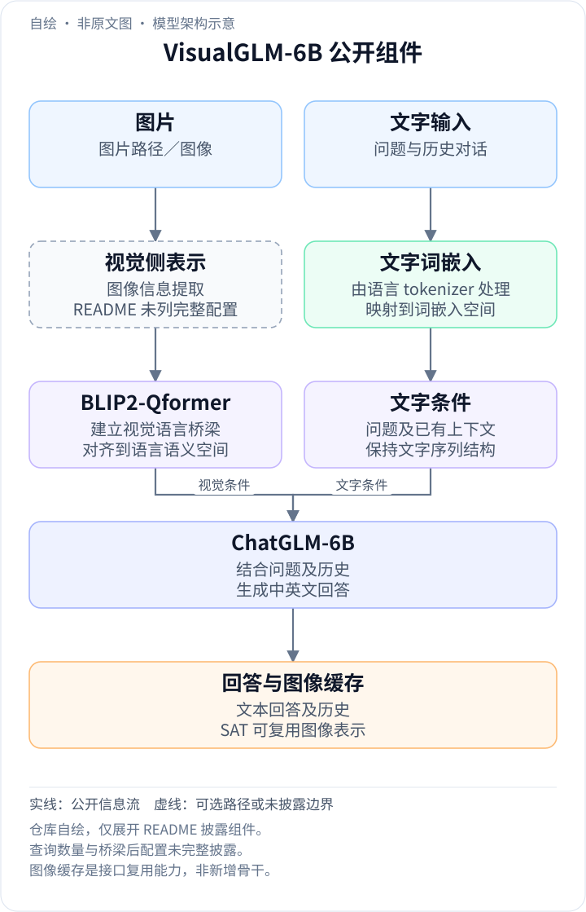
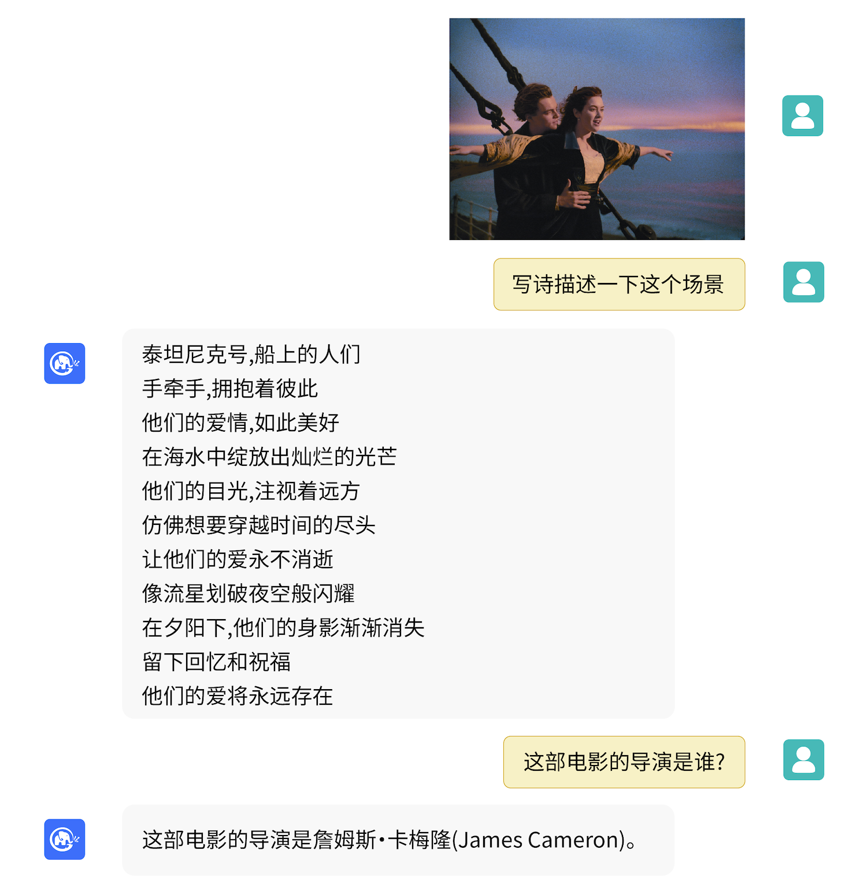
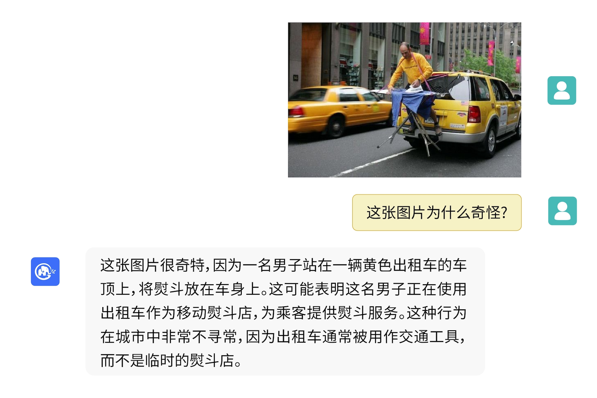

<!-- article-header:start -->
[项目首页](../../../README.md) › [模型系列](../../../reports/model-family-index.md) › [GLM / VisualGLM](../README.md)
<!-- article-header:end -->

# VisualGLM-6B：以 Q-Former 连接视觉表征与中英双语 ChatGLM

<!-- article-toc:start -->
<a id="article-toc"></a>

**本篇目录** · [论文定位](#paper-info) · [快速概览](#overview) · [整体架构](#architecture) · [核心原理](#principles) · [数据构建](#data) · [训练流程](#training) · [实验结果](#experiments)
<!-- article-toc:end -->

<a id="paper-info"></a>

## 1. 论文信息与模型定位

**VisualGLM-6B** 是 THUDM / 智谱团队在 2023 年公开的图像对话模型。本条目依据官方仓库 README 的 **2026 年 10 月 8 日快照**，资料类型为模型发布说明，而非一篇完整独立技术报告。[官方仓库](https://github.com/zai-org/VisualGLM-6B)；[保存时使用的官方 README](https://raw.githubusercontent.com/zai-org/VisualGLM-6B/main/README.md)；[模型权重](https://huggingface.co/THUDM/visualglm-6b)。快照中也包含后续增加的微调与部署说明，不能把所有内容都视作首次发布当天的披露。

模型支持图像、中文和英文对话，语言部分基于 **ChatGLM-6B，6.2B 参数**，图像侧通过训练 **BLIP-2 Q-Former** 与语言模型对接，整体为 **7.8B 参数**。因此名称里的 6B 是语言底座规模标识，不能当作整套视觉语言模型的准确参数总量。

它主要用于图像描述、结合图片的知识问答与多轮交互。这里介绍的是 VisualGLM 初版；README 顶部提及的新一代 CogVLM 属于另一模型，不能将其视觉专家架构或榜单结果归到 VisualGLM。

<a id="overview"></a>

## 2. 快速概览

VisualGLM 的关键是把一个已有双语语言模型改造成能接收视觉信息的对话模型。相较仅用一个线性层直接映射所有视觉 patch，Q-Former 作为中间模块，用查询机制从视觉表征中提取适于语言任务的信息，再将其接入 ChatGLM。

预训练使用 **30M 中文图文对**与 **300M 筛选后的英文图文对**，但原文明确说中英文权重相同。数据存量是 1:10，不表示有效优化权重也是 1:10。随后在长视觉问答数据上微调，以获得更适合交互的回答。官方没有给出标准测试集的定量成绩，主要证据是问答示例和小样本适配案例。

这个初版的重要边界是 **224×224 输入分辨率**、图像长描述幻觉、物体属性错配，以及**尚不具备中文 OCR 能力**。中文对话流畅不等于能读出图中的中文文字。

<a id="architecture"></a>

## 3. 整体架构

<!-- derived-architecture:start -->


*自绘模型架构示意（非原文图）。依据下述公开资料归纳；方框表示功能组件，不代表逐层实现。*

依据：[官方README固定快照：介绍、使用／模型推理](https://raw.githubusercontent.com/zai-org/VisualGLM-6B/main/README.md)。
<!-- derived-architecture:end -->

官方披露的流程可以概括为：图像进入视觉模型，视觉特征由 Q-Former 提取并对齐，随后作为图像条件参与 ChatGLM 的文本生成。Q-Former 是视觉与语言之间的接口，而 ChatGLM 负责根据当前问题、图像条件和对话历史生成回答。

原文没有提供模型结构原图，也没有完整列出视觉骨干名称、查询数量、接口维度或精确层数。因此本介绍不把 BLIP-2 论文中的所有具体配置直接移植到 VisualGLM，也不把结构示意伪标为原文 Figure。



这幅原图来自 README **样例**，没有 Figure 编号。上部是图片输入，中部是用户要求以诗歌描述场景的对话，下部是追问电影导演。读图时可区分两种能力：图像内容为回答提供条件，电影导演来自语言模型已有知识。原图支持“能将视觉条件与语言知识结合”的定性说明，不能证明所有场景识别和事实回答都正确。

推理接口同时支持 Hugging Face 和 SwissArmyTransformer（sat），多轮接口返回 history；sat 示例还能缓存图像特征供后续轮次使用。这是避免重复视觉处理的接口设计，不是模型获得新的外部知识来源。

按公开实现入口，一次对话先提供图片路径与问题：视觉侧提取图像信息，BLIP2-Qformer 桥梁使其能被 ChatGLM-6B 使用；ChatGLM 同时结合问题与对话历史生成中英文回答。官方资料明确了桥梁的职责，但未在 README 中给出视觉骨干、查询数量及桥梁后投影的完整配置，所以示意图只展开已公开组件。SAT 的第二轮调用可传入首轮返回的 `cache_image`，复用已处理的图像条件，再加入新问题和 `history`；复用图像表示与每轮重新生成回答是两个不同环节。[官方固定快照“介绍”“使用／模型推理”](https://github.com/zai-org/VisualGLM-6B#使用)

| 模块 | 输入与输出 | 公开机制 |
|---|---|---|
| 视觉模型 | 图片 → 视觉表征 | 官方 README 公开图像路径，未列完整视觉骨干、patch 与网格规格 |
| BLIP2-Qformer 桥梁 | 视觉表征 → ChatGLM 可用图像条件 | 通过训练建立视觉与语言语义接口；不从 BLIP-2 论文移植未披露配置 |
| ChatGLM-6B | 图像条件、问题、history → 中英文回答 | 6.2B 语言模型，整套 7.8B；多轮生成使用先前对话作为条件 |
| SAT cache_image 接口 | 首轮处理结果 → 后续轮的复用图像条件 | 示例允许后续传 image=cache_image，减少重复图像处理；不是外部检索模块 |
| LoRA/量化适配 | ChatGLM 权重 → 低成本部署或微调 | 示例仅在指定语言层加入低秩更新；量化主要针对语言侧 |


<a id="principles"></a>

## 4. 核心创新与数学原理

### 4.1 桥接模块负责模态接口而语言模型负责续写

图像表征进入 Q-Former 后成为语言生成的条件，问题和历史则规定当前应回答什么。将两者分开有助于理解多轮示例：模型可以复用同一图像条件，仍需为新问题重新进行语言计算。缓存视觉表示并不会缓存所有未来回答，也不能证明模型每轮都重新观察了原图细节。[官方固定 README“介绍”“使用／模型推理”](https://github.com/zai-org/VisualGLM-6B#使用)

Q-Former 的桥接作用可以用标准注意力形式解释。若视觉表示为 $`F`$，查询表示为 $`Q`$，则查询通过视觉键和值聚合信息：


```math
H=\mathrm{softmax}\left(\frac{(QW_Q)(FW_K)^\top}{\sqrt d}\right)FW_V.
```


该式说明查询不是直接复制所有像素，而是根据学习到的相关性读取视觉特征。**这是通用交叉注意力的解释式，README 没有给出该公式，也没有披露 VisualGLM 内部全部投影和注意力实现。** 不能由此推断精确查询数、压缩倍率或训练时的注意力掩码。

### 4.2 数据数量与语言优化权重的区别

中文 30M、英文 300M 是图文对数量，原文另外说明中英文权重相同。因此样本量相差十倍不能直接推出英文梯度贡献为十倍；语言权重应在训练采样或损失组织中理解，但具体实现未公开。后续长视觉问答训练改善回答形式，README 的“符合人类偏好”描述不等于已采用 RLHF 或 DPO。[官方固定 README“介绍”](https://github.com/zai-org/VisualGLM-6B#介绍)

双语加权是另一设计要点。可以把中文与英文的优化贡献抽象写成 $`\lambda_{zh}\mathcal L_{zh}+\lambda_{en}\mathcal L_{en}`$，原文称两者权重相同。这个表达仅说明加权意图；README 没有明确它通过过采样、批次调度还是损失权重实现，也没有公开每种数据的训练轮次。

### 4.3 小样本适配改变有限参数而非重做预训练

20 张背景问答的示例说明如何用特定任务数据调整语言侧低秩参数；rank 和层范围是该示例选择，不是全模型始终存在的固定结构。量化主要压低语言权重存储，视觉侧及推理中间状态仍占资源，因此部署显存和微调显存应按各自精度、方法和配置阅读。[官方固定 README“模型微调”](https://github.com/zai-org/VisualGLM-6B#模型微调)

模型量化与参数高效微调服务于使用成本。README 的量化说明明确是主要量化 **ChatGLM**，因为 ViT 量化误差较大；不能说整套视觉语言模型统一变成 4-bit。微调例子用 LoRA，在 ChatGLM 的第 0 与第 14 层加入 **rank=10** 的低秩更新。通用解释为 $`W'=W+BA`$，其中低秩矩阵只训练少量参数；这解释了小样本适配方式，不是 VisualGLM 基础预训练的新损失。

<a id="data"></a>

## 5. 数据构建与处理

中文图文预训练数据来自 **CogView 数据集的 30M 高质量配对**，英文为 **300M 经筛选图文对**。原文只披露了规模、来源和双语相同权重，没有给出英文数据全名单、筛选阈值、去重率、文本长度分布或具体采样比例。

后续使用长视觉问答数据。致谢中确认指令数据包含 **MiniGPT-4、LLaVA 的部分英文图文数据**及多个经典跨模态数据集，但没有列出完整总量和逐项构成。不能将别的项目的完整数据规模视为 VisualGLM 实际用了同样数量。

图像输入以 224×224 处理。这对粗粒度场景描述足够紧凑，但缩放会损失小文字、密集物体和精细属性。官方将提高分辨率列为未来改进方向，并明确初版没有中文 OCR；预训练中存在中文文本配对，并不等于含有足够中文文字识别监督。

<a id="training"></a>

## 6. 训练流程与目标

公开说明包含两大阶段：先以图文对训练视觉语言桥梁，把视觉信息对齐到 ChatGLM 的语义空间；随后在长视觉问答数据上微调，使模型形成更适合人类交互的回答。README 以“符合人类偏好”描述回答目标，但**没有披露奖励模型、PPO、DPO 或其他强化学习训练**，本文不将这个用语改写成经过 RLHF。

条件文本生成可用 $`-\sum_t\log p_\theta(y_t\mid y_{\lt t},I,q)`$ 解释，其中 $`I`$ 为图像、$`q`$ 为请求；这是任务层面的解释，不是官方公开的逐阶段精确损失。基础训练的冻结关系、学习率、batch、step、epoch、GPU 数量均未完整披露，不能从 BLIP-2 通用配方反推。

用户适配示例与基础模型训练应分开。官方提供 **20 张标注图片**，专门改善“背景里有什么”的回答，支持 LoRA、QLoRA 和 P-tuning。其中 QLoRA 例子对 ChatGLM 线性层进行 4-bit 量化，报告微调需要 **9.8GB 显存**；它不是基础模型预训练显存。部署方面，说明中有 INT4 最低 **6.3GB** 的近似要求、Hugging Face FP16 约 **15GB**，以及另一 sat 推理例子的 **7GB**；这些数字属于不同实现/配置，不能用一个数保证所有硬件和输入长度均可运行。

提示形式也影响双语生成。原文称英文训练问答使用 `Q: A:`，中文使用 `问：答：`，中文网页默认提示可能让英文回答夹杂中文。这是训练格式与推理提示匹配问题，不能将其直接解释为英文视觉预训练不足。

<a id="experiments"></a>

## 7. 实验设置与主要结果

这份发布材料**没有给出 VQAv2、MMBench、OCRBench 等标准评测表，也没有公布受控架构消融**。因此不能据它声称 VisualGLM 在某个测试集领先，或给 Q-Former 贡献一个未经报告的准确率增量。



这幅原图同样来自 **样例**。用户询问画面为何奇怪，回答尝试把出租车、人物、熨衣行为与常识结合。长解释包含“站在车顶”等具体判断，应逐项对照图片，而不能因为语言流畅就视为事实可靠。它展示可交互的视觉解释能力，同时说明官方列出的细节识别与幻觉风险为何重要。

小样本微调提供了更具体的前后对照：原模型对雨天背景给出无关的抽象回答，20 张图片适配后能够回答雨天；护照场景由同时列举键盘与护照，变成更聚焦背景键盘。但随后的地板颜色回答仍有不准确的迹象。该例没有独立测试集、置信区间或重复实验，所以可说明任务定向适配可行，不能推导通用视觉性能全面提升。

VisualGLM 的意义是较早开放一套中文/英文视觉对话接口，并提供本地部署和小样本适配路径。它的公开证据更偏向功能展示，缺少完整训练配置和定量评测。本介绍已核对 README 全文与两幅官方原图，没有运行模型，也没有将后续 CogVLM 成绩混入本条目。

<!-- article-footer:start -->
---

[← 上一篇：InstructBLIP](../../blip/arxiv-2305.06500/README.md) · [按发表时间浏览](../../../reports/paper-reading-guide.md#year-2023) · [下一篇：PMC-VQA →](../../pmc-vqa/arxiv-2305.10415/README.md)

[返回本篇目录](#article-toc) · [返回模型系列](../README.md)
<!-- article-footer:end -->
