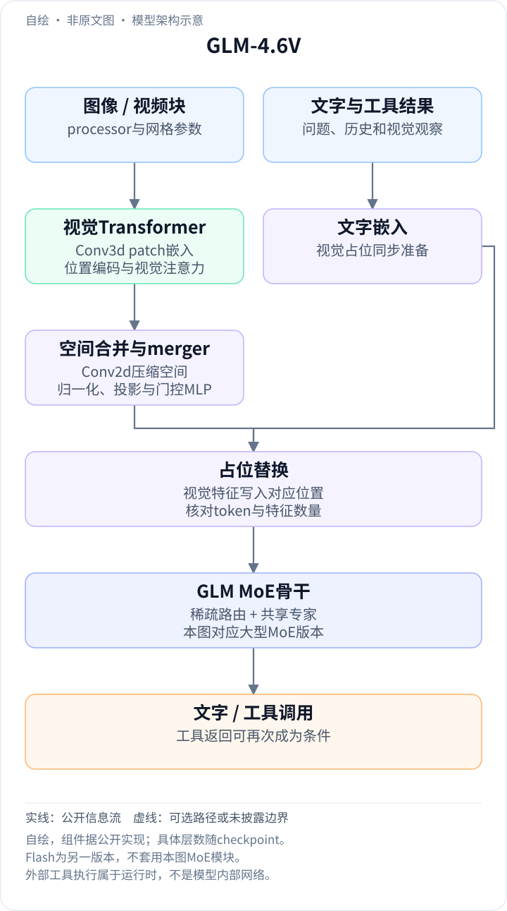
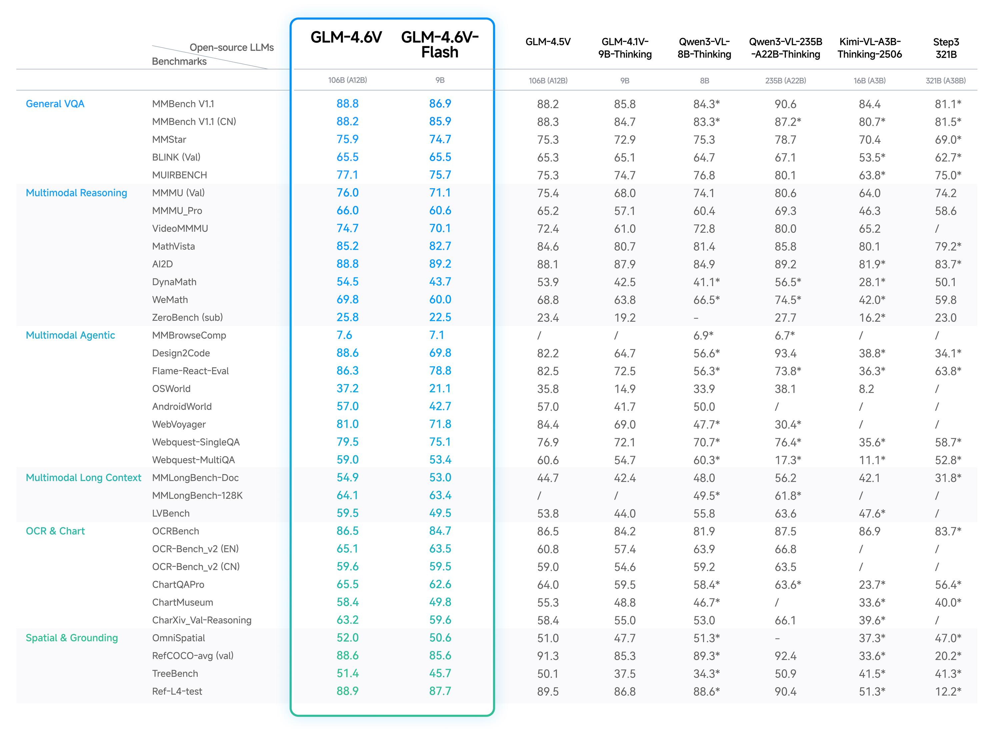

<!-- article-header:start -->
[项目首页](../../../README.md) › [模型系列](../../../reports/model-family-index.md) › [GLM / VisualGLM](../README.md)
<!-- article-header:end -->

# GLM-4.6V：128K多模态上下文与原生视觉工具调用

<!-- article-toc:start -->
<a id="article-toc"></a>

**本篇目录** · [论文定位](#paper-info) · [快速概览](#overview) · [整体架构](#architecture) · [核心原理](#principles) · [数据构建](#data) · [训练流程](#training) · [实验结果](#experiments)
<!-- article-toc:end -->

<a id="paper-info"></a>

## 1. 论文信息与模型定位

| 项目 | 信息 |
|---|---|
| 官方资料 | **GLM-4.6V**模型发布说明、模型卡与实现 |
| 团队与日期 | 智谱AI / Z.ai，**2025-12-08** |
| 固定主来源 | [发行日官方README](https://github.com/zai-org/GLM-V/blob/f093b70998bec336acbc00d1a545e05893e3c9fa/README.md)，commit `f093b70998bec336acbc00d1a545e05893e3c9fa` |
| 模型与代码 | [GLM-4.6V模型卡](https://huggingface.co/zai-org/GLM-4.6V) · [官方仓库](https://github.com/zai-org/GLM-V) |
| 规模 | GLM-4.6V为106B-A12B级MoE；Flash为9B小型版本 |
| 主要接口 | 图像、视频、文档及文字输入，文字、代码与工具协议输出 |

本条目整理4.6V的独立版本增量。官方仍引用2507.01006家族论文，但该arXiv已收录在GLM-4.1V条目中，本文没有再次把它计为一篇新报告。4.6V重点是训练到128K的多模态上下文，以及图像可直接进入工具参数和工具结果的交互闭环。[Project Updates / GLM-4.6V Model Overview](https://github.com/zai-org/GLM-V/blob/f093b70998bec336acbc00d1a545e05893e3c9fa/README.md)

<a id="overview"></a>

## 2. 快速概览

| 增量 | 公开机制 | 适用场景 |
|---|---|---|
| 原生多模态Function Calling | 图像、截图、页面可作工具输入；视觉结果返回上下文 | 视觉搜索、网页复现、带图分析 |
| 128K上下文训练 | 长文档/多文档与视频条件共同输入 | 跨页比较与长片段总结 |
| 云端与本地规模 | 106B-A12B级与9B Flash | 能力、延迟和部署资源的不同取舍 |
| 思考模式控制 | 可关闭thinking，部分后端提供思考预算 | 控制推理开销；不能保证所有问题相同收益 |

这里的图文交错创作包含工具检索图片、选择视觉内容并组织报告，固定资料未公开原生像素生成头。识图、检索图像与直接合成图像是不同能力，不宜因“图文生成”字样混为同一出口。

<a id="architecture"></a>

## 3. 整体架构

<!-- derived-architecture:start -->


*自绘模型架构示意（非原文图）。依据下述公开资料归纳；方框表示功能组件，不代表逐层实现。*

依据：[Model Implementation Code / GLM-4.6V Model Overview](https://github.com/zai-org/GLM-V/blob/f093b70998bec336acbc00d1a545e05893e3c9fa/README.md)；[L653–703、L916–1027、L1348–1513、L378–490](https://github.com/huggingface/transformers/blob/v5.0.0rc0/src/transformers/models/glm4v_moe/modeling_glm4v_moe.py)。
<!-- derived-architecture:end -->

官方README把GLM-4.6V的模型实现指向Transformers的`glm4v_moe`模块。以下对大型MoE版本按该公开实现的`v5.0.0rc0`进行机制说明；它解释组件计算路径，不能替代每个checkpoint的配置文件，也不将MoE模块套给9B Flash。[Model Implementation Code](https://github.com/zai-org/GLM-V/blob/f093b70998bec336acbc00d1a545e05893e3c9fa/README.md) · [公开实现](https://github.com/huggingface/transformers/blob/v5.0.0rc0/src/transformers/models/glm4v_moe/modeling_glm4v_moe.py)

| 模块 | 输入与输出 | 公开机制 |
|---|---|---|
| 视觉patch嵌入 | 预处理图像 / 视频块 → 视觉嵌入 | `Conv3d`按配置的时间与空间patch大小投影，再做归一化 |
| 视觉Transformer | 视觉嵌入及空间位置 → 视觉特征 | 图像位置嵌入、视觉RoPE与多层注意力block |
| 空间下采样与merger | 视觉网格 → 语言宽度视觉序列 | `Conv2d`按`spatial_merge_size`合并空间位置，再经投影、LayerNorm、GELU和门控MLP |
| 多模态占位替换 | 图像 / 视频特征及文字 → 联合输入嵌入 | 检查视觉特征与占位数量一致后，将特征写入相应位置；计算多模态位置索引 |
| GLM MoE语言路径 | 联合序列 → 下一token | 注意力与稀疏路由专家、共享专家共同计算；具体规模以checkpoint为准 |
| 工具交互层 | 模型工具调用 → 外部执行及视觉返回 | 运行时执行搜索、裁图或页面渲染，结果重新作为模型条件 |

实现中先完成视觉编码和空间合并，再把所得连续特征写入文字序列的视觉占位；它不必先将整页转写为纯文本。对一次视觉搜索请求，模型先读图形成查询/工具调用，外部工具执行检索，再把返回的图像或页面交回模型进行分析。外部执行器负责调用工具，语言模型负责决定调用及理解返回结果。[实现L653–703、L916–1027、L1348–1513](https://github.com/huggingface/transformers/blob/v5.0.0rc0/src/transformers/models/glm4v_moe/modeling_glm4v_moe.py)

<a id="principles"></a>

## 4. 核心创新与数学原理

### 4.1 稀疏路由与共享专家的互补

公开实现包含路由专家与共享专家。其前向计算可用以下说明式概括，非本版发布博客的新编号公式：

```math
h'=E_{\mathrm{shared}}(h)+\sum_{j\in S(h)}g_j(h)E_j(h).
```

$`S(h)`$是路由选中的专家集合，$`g_j`$为选中专家的权重。实现先用sigmoid计算路由分数，选择时加入校正偏置并按组筛选，再取专家；计算加权贡献时使用原sigmoid分数，并按配置选择归一化与缩放。选择偏置与输出权重因此并非简单相同的一组数字。共享专家每次提供公共变换，稀疏专家提供条件化容量，总参数不等于每token激活量。[`Glm4vMoeTextMoE`，实现L378–490](https://github.com/huggingface/transformers/blob/v5.0.0rc0/src/transformers/models/glm4v_moe/modeling_glm4v_moe.py)

这些代码说明计算路径，没有证明4.6V的训练采用何种负载均衡系数、RL奖励或专家训练日程，本文不从实现存在某个loss函数反推实际训练recipe。

### 4.2 视觉网格压缩与占位一致性

若视觉网格为$`T\times H\times W`$，空间合并尺度为$`s`$，实现按$`THW/s^2`$拆分每个媒体的语言侧特征。其含义是压缩空间位置而保留相应时间网格；并不是把所有视频都压成一个全局向量。边界预处理、时间patch和特殊token由处理器配置决定，不能据这个计数式自行指定所有视频的fps或输入尺寸。

模型还检查占位数量与视觉特征长度，不匹配会报错。这个约束解释了为什么多模态processor和模型配置需要一致，也说明媒体接口不仅是给聊天文字附一个图片文件名。[`get_image_features`、`get_video_features`、`get_placeholder_mask`](https://github.com/huggingface/transformers/blob/v5.0.0rc0/src/transformers/models/glm4v_moe/modeling_glm4v_moe.py)

### 4.3 原生工具调用把视觉信息留在闭环中

传统纯文字工具接口需要在调用前后将图像转成文字摘要。4.6V允许原始视觉内容参与工具参数及返回：例如裁出的图表可直接交回模型检查，检索图片可继续参与比较。它减少中间文字转写的信息损失，但效果仍依赖工具返回内容、裁区和调用策略。

可把交互过程写成一般接口示意：$`a_k=\pi(C_k)`$、$`o_k=\mathrm{Tool}(a_k)`$、$`C_{k+1}=[C_k;a_k;o_k]`$。$`a_k`$为调用，$`o_k`$为工具观察，方括号表示按序追加到上下文；该式不是论文原创训练公式，也不假设所有任务都需要工具。[Native Multimodal Function Calling](https://github.com/zai-org/GLM-V/blob/f093b70998bec336acbc00d1a545e05893e3c9fa/README.md)

### 4.4 128K上下文扩展能力范围，也增加输入预算要求

官方明确说上下文在训练时扩至128K，而非只在API里放大一个最大长度参数。多文档图像、视频和文字共享该预算；图片越多、分辨率越高，可留给历史与生成的空间就越少。128K是token容量，不是固定可处理页数、视频时长或保证每一处信息被完整利用的准确率。

长文档成绩也不能替代工具调用质量。两者分别要求保留较长条件与有目的地获得新证据，4.6V把它们组合用于带图报告和视觉网页任务。[GLM-4.6V Model Overview](https://github.com/zai-org/GLM-V/blob/f093b70998bec336acbc00d1a545e05893e3c9fa/README.md)

<a id="data"></a>

## 5. 数据构建与处理

发行说明公开了任务范围、工具接口和长上下文训练目标，没有列4.6V专属训练语料规模、图文比例、合成管线与完整去重规则。视觉输入使用模型对应processor，图像/视频特征再按网格拆分与占位对接；文档页面作为图像直接读取。

README同时介绍GLM-4.5V和GLM-4.1V，因此章节归属必须分清。4.1V的RLCS描述以及旧论文的数据配方可以作为家族背景，不能在缺乏本版说明时直接宣称为4.6V完整训练过程。[Model Overview各版本小节](https://github.com/zai-org/GLM-V/blob/f093b70998bec336acbc00d1a545e05893e3c9fa/README.md)

<a id="training"></a>

## 6. 训练流程与目标

| 环节 | 本版公开内容 | 当前资料边界 |
|---|---|---|
| 多模态基础模型 | 106B-A12B级与9B两个发布版本 | 精确层数/连接配置以相应权重配置为准 |
| 长上下文训练 | 上下文训练扩展到128K | 未列各阶段长度课程与token量 |
| 工具能力 | 原生多模态Function Calling | 未给专属SFT数据规模或完整RL目标 |
| 下游训练支持 | README链接微调生态与数据格式示例 | 部分例子明确针对4.1V / 4.5V，不能当成本版预训练超参 |

因此本文不补造4.6V的优化器、batch、学习率、训练设备和奖励函数。公开推理实现中的MoE前向、位置编码与图像压缩属于架构证据，和实际训练目标是两类信息。

<a id="experiments"></a>

## 7. 实验设置与主要结果



*发行日README引用的`resources/bench_46v.jpeg`；保留模型规模、全部任务分组与比较列。*

| 指标 | GLM-4.6V | Flash | GLM-4.5V |
|---|---:|---:|---:|
| MMMU val | 76.0 | 71.1 | 75.4 |
| MathVista | 85.2 | 82.7 | 84.6 |
| Design2Code | 88.6 | 69.8 | 82.2 |
| OSWorld | 37.2 | 21.1 | 35.8 |
| MMLongBench-Doc | 54.9 | 53.0 | 44.7 |
| MMLongBench-128K | 64.1 | 63.4 | 未列 |
| OCRBench（图中尺度） | 86.5 | 84.7 | 86.5 |
| RefCOCO-avg val | 88.6 | 85.6 | 91.3 |

长文档与若干工具相关任务提升明显，但不是每项都更高：4.6V的RefCOCO88.6低于4.5V的91.3，WebVoyager81.0低于84.4；OCRBench持平。9B Flash在AI2D上89.2略高于大版本88.8，说明规模和任务收益并非严格单调。表中Qwen3-VL-235B在MMMU80.6和Design2Code93.4也高于4.6V。[官方Benchmarks图](https://github.com/zai-org/GLM-V/blob/f093b70998bec336acbc00d1a545e05893e3c9fa/README.md)

固定发布说明没有给出所有基准的统一采样参数、视觉预算和完整工具执行配置，部分比较行还带星号而本页没有充分展开其含义，本文保留原图并不擅自解释为统一复测。OCRBench沿用图中百分尺度，不与原始1000分量纲直接混比。所有数字均为作者报告，本仓库没有运行模型或复现实验。Remaining Issues还提示可能过度思考、重复回答、计数与人物识别不足，应作为实际使用边界一起阅读。[Remaining Issues](https://github.com/zai-org/GLM-V/blob/f093b70998bec336acbc00d1a545e05893e3c9fa/README.md)

<!-- article-footer:start -->
---

[← 上一篇：Mistral 3](../../mistral-pixtral/document-6276d6c37ba5/README.md) · [按发表时间浏览](../../../reports/paper-reading-guide.md#year-2025) · [下一篇：GPT-5.2 →](../../gpt/document-e2a1f413a7a5/README.md)

[返回本篇目录](#article-toc) · [返回模型系列](../README.md)
<!-- article-footer:end -->
