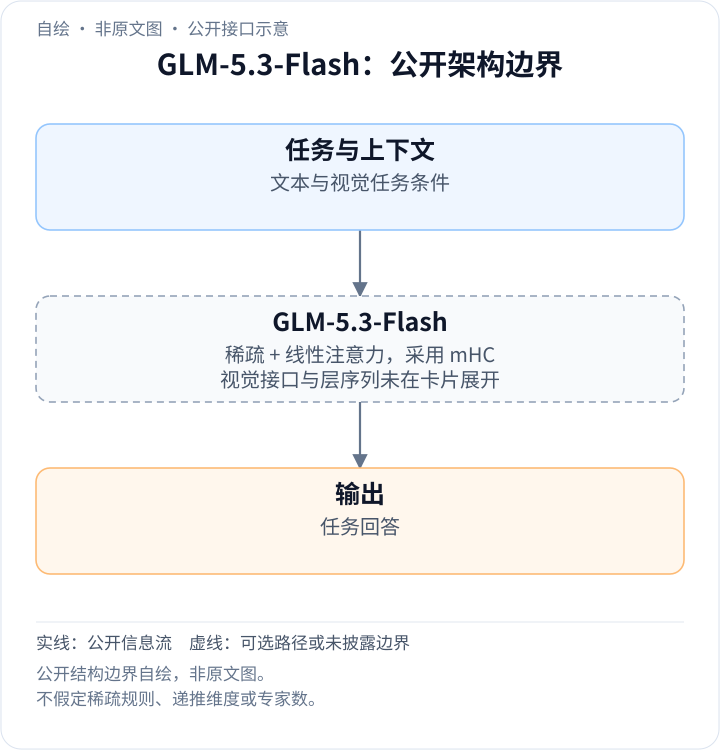
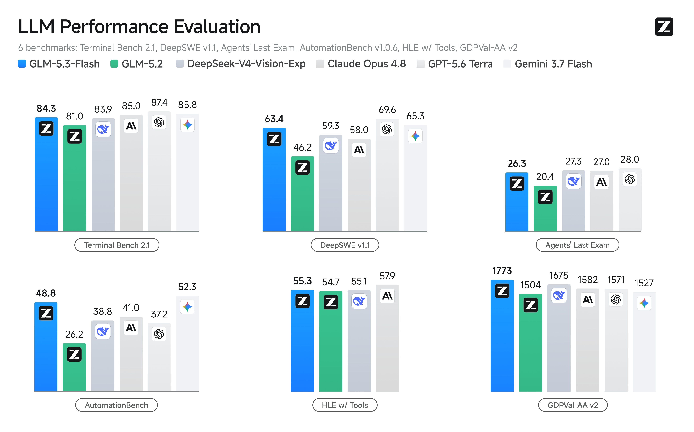

<!-- article-header:start -->
[项目首页](../../../README.md) › [模型系列](../../../reports/model-family-index.md) › [GLM / VisualGLM](../README.md)
<!-- article-header:end -->

# GLM-5.3-Flash：稀疏与线性注意力结合的原生多模态模型

<!-- article-toc:start -->

**本篇目录** · [论文定位](#paper-info) · [快速概览](#overview) · [整体架构](#architecture) · [核心原理](#principles) · [数据构建](#data) · [训练流程](#training) · [实验结果](#experiments)
<!-- article-toc:end -->

## 1. 论文信息与模型定位

- **条目标题**：GLM-5.3-Flash: Frontier Intelligence, Flash Cost。
- **直接来源**：[Z.ai 官方模型卡](https://huggingface.co/zai-org/GLM-5.3-Flash)，固定为 2026-10-08 获取的版本；模型卡指向 [官方发布页](https://z.ai/blog/glm-5.3-flash)。
- **机构、规模与许可**：Z.ai，**320B 总参数、18B 激活参数**，模型卡标注 MIT。
- **模型定位**：GLM-5 系列首个原生多模态模型，关注编码、代理任务和长上下文服务效率。

本文依据该版本模型卡，公开内容少于完整论文。其引用栏指向《GLM-5: from Vibe Coding to Agentic Engineering》，不能把该前代报告的训练细节自动当成 GLM-5.3-Flash 的细节。

## 2. 快速概览

新模型从重新训练的基础模型开始，官方称架构与训练方案围绕能力和效率重新设计。公开的三个技术关键词是：**稀疏注意力与线性注意力的混合架构、Manifold-Constrained Hyper-Connections（mHC）、30T token 的多模态预训练语料**。

官方原图中，模型在六项编码、代理和工具使用评测上均高于 GLM-5.2，但相对其他模型并非每项领先。图中没有完整视觉理解基准，模型卡只单独说明了 BabyVision 的输入设置，没有给出这一评测的结果数字。因此原生多模态定位与所展示的主要实测任务应分别理解。

模型卡声称价格为 GLM-5.2 的十分之一。这是该来源发布时的商业陈述，未提供价格分项、缓存条件及模型间统一请求预算，本文不据此计算当前账单或精确性价比。

## 3. 整体架构

<!-- derived-architecture:start -->

*自绘公开接口示意（非原文图）。依据下述公开资料归纳；方框表示功能组件，不代表逐层实现。*

依据：[official-model-card-2026-10-08; Model overview](https://huggingface.co/zai-org/GLM-5.3-Flash/raw/main/README.md)。
<!-- derived-architecture:end -->

模型卡公开了总参数与激活参数，以及同时采用稀疏、线性注意力和 mHC 的设计。18B 激活参数相对于 320B 总参数，说明每次推理只动用总参数中的一部分，但并不等于全部服务成本只剩下 18/320；视觉处理、注意力、KV 状态、共享层及跨设备开销仍需要计入。

稀疏注意力的通常思路是在有限位置之间保持显式关联，线性注意力则利用不同的计算形式减轻随上下文长度增长的负担。混合两者旨在兼顾精确长程访问与效率。这里是概念解释：模型卡没有公开层级交替比例、稀疏选择规则、线性核函数和状态维度，所以本文不画一张貌似确定的网络层图。

mHC 是官方明确采用的连接机制，但当前模型卡没有提供连接矩阵、约束算子和实现超参数。同样，视觉编码器、视觉 token 压缩方式、图像与文本融合位置、专家数量及路由细节未在来源中展开。

原始模型卡仅有一张实质性的基准图，没有编号架构图。本介绍保留原基准图，不把品牌标识或自行绘制的示意图当作原文技术图。

| 模块 | 输入与输出 | 公开机制 |
|---|---|---|
| 多模态输入接口 | 图像与文字 → 统一模型条件 | 官方标为原生多模态；视觉编码器、压缩率及融合层未公开 |
| 混合注意力主干 | 上下文表示 → 兼顾长程访问与效率的表示 | 同时采用 sparse/linear attention；层级比例、稀疏规则、核与状态维度未披露 |
| mHC 连接机制 | 层间表示 → 后续层输入 | 官方确认 Manifold-Constrained Hyper-Connections，未给连接矩阵和约束实现 |
| 部分参数激活路径 | 上下文 → 输出分布 | 320B 总参数、18B 激活；专家数量、路由规则与共享层配置未披露 |
| 思考预算与聊天模板 | reasoning_effort、history → 回答 | 支持 low/high/max；默认 max；聊天场景说明显式 clear_thinking=true |

## 4. 核心创新与数学原理

### 4.1 混合机制针对不同成本环节而披露有限

稀疏与线性注意力针对上下文关联计算，mHC 针对连接与扩展效率，部分参数激活针对单次计算所用容量。它们可以共同降低服务成本，但总参数、激活参数和注意力状态不是同一资源口径；模型卡也没有提供能逐项分离收益的消融。组件表因此按公开功能组织，避免把名词组合补成未公布的层图。[固定模型卡 Introduction](https://huggingface.co/zai-org/GLM-5.3-Flash/raw/main/README.md)

本来源能确认的创新组合，是通过重新训练的基础模型、混合注意力和 mHC 同时改善能力与长上下文服务成本。原文没有给出单独组件消融，故不能判断每个组件贡献多少，也不能把六项结果的提升全部归因于其中一种机制。

### 4.2 思考预算与上下文管理共同影响可复现结果

思考档位改变输出计算预算，评测脚注还分别规定最大生成长度、上下文长度和任务运行框架。比如 HLE with tools 用 300K 上下文并有 context management，不能把这一运行条件等同于所有请求的默认长度。聊天模板的 clear_thinking 另控制对话思考状态处理，不应与低/高思考档位混作同一个开关。[固定模型卡 Note/Footnotes](https://huggingface.co/zai-org/GLM-5.3-Flash/raw/main/README.md)

推理时可设置 `reasoning_effort` 为 `low`、`high`、`max`，默认是 `max`；未传或传入其他值也采用默认值。该参数调节思考预算，说明“模型名称相同”仍可能对应不同推理成本和成绩。公开排行榜复现应保留默认 `max`，不能拿 `low` 的速度和 `max` 的分数直接组成一个性能承诺。

模型卡没有公开新的训练损失公式、强化学习奖励函数或 mHC 的具体推导。因此这里保留机制层面的解释，不将通用注意力或策略优化公式伪装为本报告独有原理。

## 5. 数据构建与处理

预训练语料规模为 **30T token**，官方将其称为多模态语料。来源未分解文本、图片、视频等比例，也未给出图像 token 计数口径、网页来源、合成数据比例、去重流程或质量过滤规则。30T 不等于 30T 独立图文样本，也不能解释为纯文本 token 数量。

评测侧，BabyVision 将输入图像缩放，使短边至少达到 **1.5K 像素**，保持与对照设置一致；温度 1.0、top-p 0.95、最大上下文 164K。这是评测预处理，不能反推训练分辨率或通用部署时必须采用的图片预算。

NL2Repo 使用规则和语言模型判断避免特定恶意行为，属于评测过程的有效性控制，不是预训练数据过滤流程。AutomationBench 固定在 v1.0.6，以纳入 `null` 类型处理问题的修正。这些版本细节会改变可比性，不能只写一个不带版本的任务名。

## 6. 训练流程与目标

公开信息确认基础模型是新训练的，训练方案重新设计，并使用所述多模态语料。模型卡未报告预训练阶段划分、监督微调样本量、强化学习任务组合、奖励模型、学习率、批大小、GPU 数量或冻结策略。本文不将前代 GLM-5 配方迁移填入这些空缺。

模型可在 SGLang、vLLM、TokenSpeed、Transformers、KTransformers 等框架部署。框架支持是工程兼容声明，不能证明所有配置都有相同吞吐或相同评测表现。聊天模板的 `clear_thinking` 默认 `false`，来源建议聊天时明确传 `true`；本文仅记录该版本说明，没有运行服务或基准。

训练投入、服务效率及实际成本之间的关系需要统一硬件、上下文长度和生成预算才能衡量。当前来源没有这种完整对照，因此不能从“Flash”名称直接推导固定倍数的加速。

## 7. 实验设置与主要结果

**读图**：蓝色为 GLM-5.3-Flash，绿色为 GLM-5.2，其余灰色系列按上方图例辨认。六个子图采用不同指标，GDPval-AA 的千位数不能与其他任务的两位数直接平均。图像完整保留了模型图例、任务名和数值。

| 评测 | GLM-5.3-Flash | GLM-5.2 | Claude Opus 4.8 |
|---|---:|---:|---:|
| Terminal Bench 2.1 | 84.3 | 81.0 | 85.0 |
| DeepSWE v1.1 | 63.4 | 46.2 | 58.0 |
| Agents' Last Exam | 26.3 | 20.4 | 27.0 |
| AutomationBench v1.0.6 | 48.8 | 26.2 | 41.0 |
| HLE with tools | 55.3 | 54.7 | 57.9 |
| GDPval-AA v2 | 1773 | 1504 | 1582 |

相对于 GLM-5.2，六项均提升，其中 DeepSWE 和 AutomationBench 增幅较大；HLE 提升仅 0.6。相对于 Claude Opus 4.8，DeepSWE、AutomationBench、GDPval-AA 更高，Terminal Bench、Agents' Last Exam、HLE 更低，不能概括为全面超越。原图中 GPT-5.6 Terra 的 Terminal Bench 为 87.4、DeepSWE 为 69.6，Gemini 3.7 Flash 的 AutomationBench 为 52.3，也高于本模型。

结果所需预算较大且协议不同。HLE 全集带工具：温度 1.0、top-p 0.95，最长生成 **163,840 token**，最大上下文 **300,000 token**并做上下文管理，评审为 GPT-5.6-luna medium。NL2Repo 使用 1M 上下文、64K 最大生成。DeepSWE 使用 mini-swe-agent、温度 0.95、400K 上下文、6 小时超时；Terminal-Bench 则使用 Claude Code 2.1.207、温度 1.0、65,536 最大生成和 6 小时超时。不能将这些条件合并为一个统一上下文配置。

Toolathlon Verified 由官方评测服务获取结果，pass@1 在三个独立运行间平均，但该模型卡原图没有列出该分数；Agents' Last Exam 的脚注没有展开协议。GDPval-AA 由 Artificial Analysis 评测。来源未给出置信区间、注意力/mHC 组件消融或完整视觉结果，本文的结论限制在原图和脚注明确披露的范围。

<!-- article-footer:start -->
---

[← 上一篇：DeepSeek-V4-Flash-Vision-Exp](../../deepseek/document-6648a6adbc11/README.md) · [按发表时间浏览](../../../reports/paper-reading-guide.md#year-2026) · [下一篇：Gemini 3.8 Flash 与 Flash Cyber →](../../gemini/document-390f20b2fe8b/README.md)

[返回本篇目录](#article-toc) · [返回模型系列](../README.md)
<!-- article-footer:end -->
