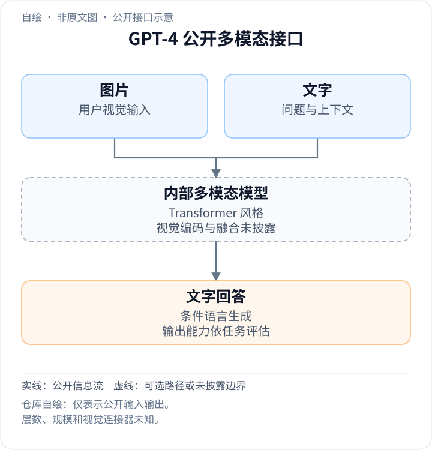
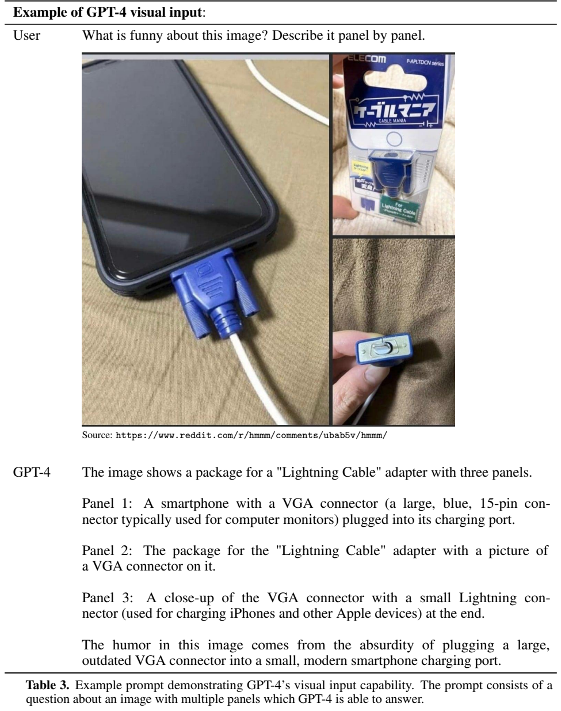
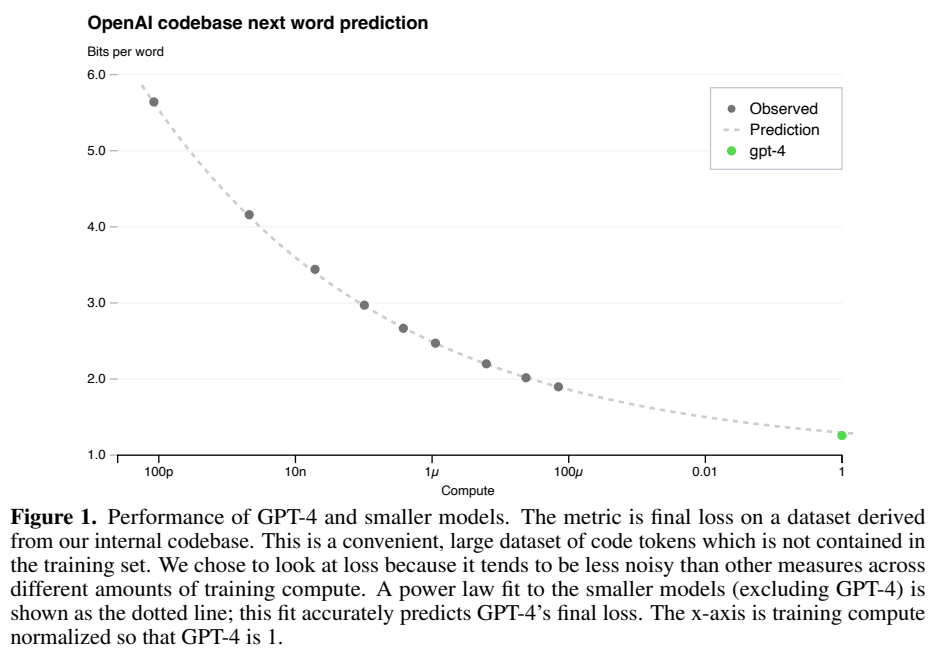
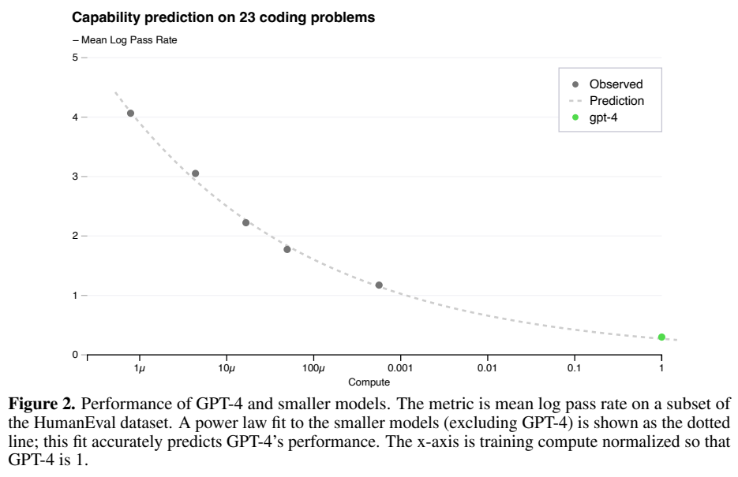
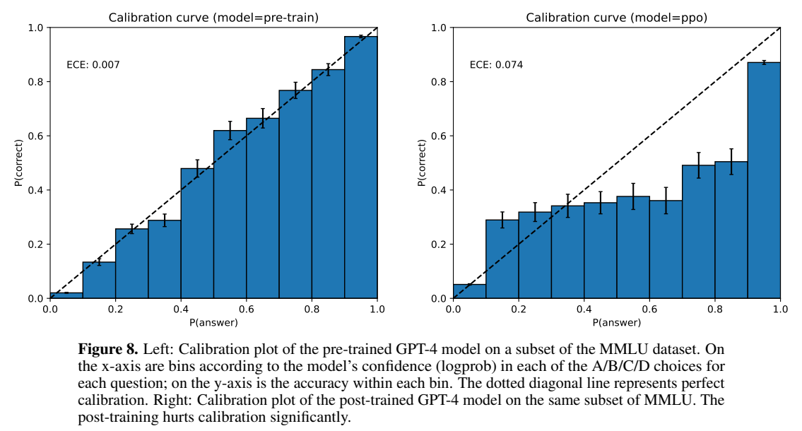
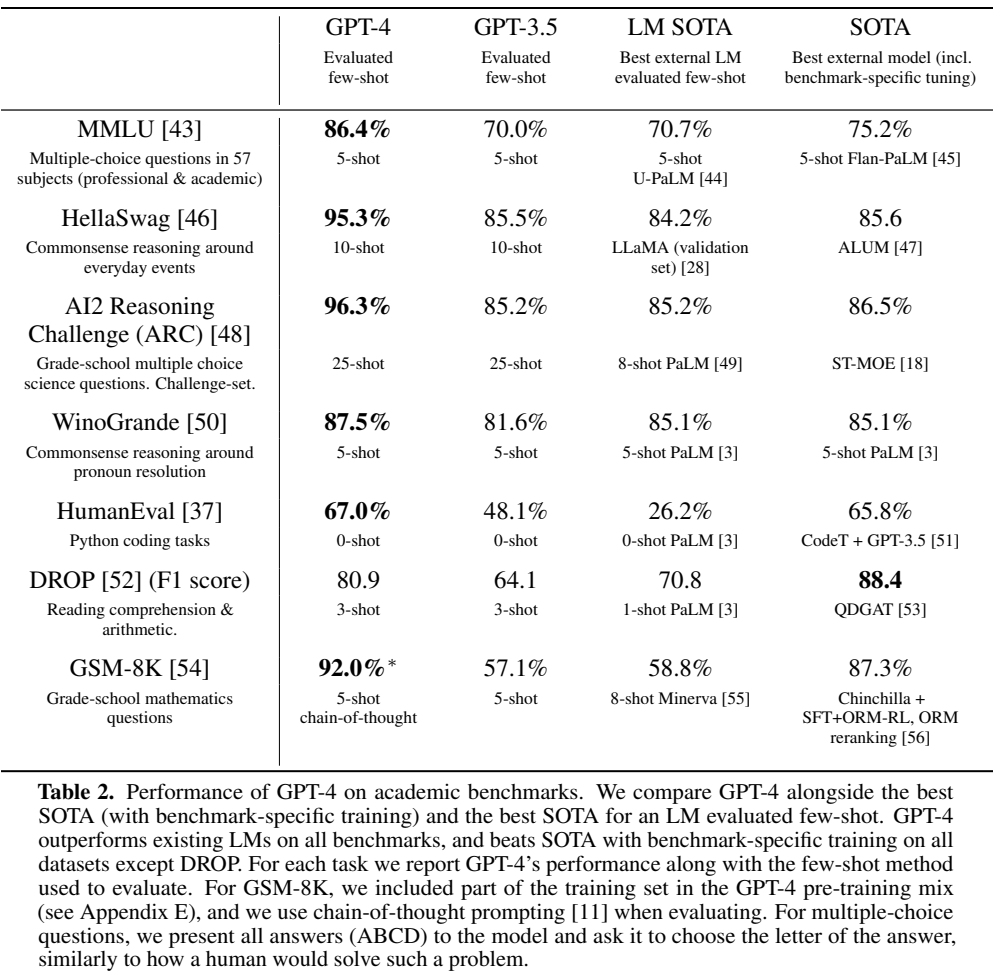

<!-- article-header:start -->
[项目首页](../../../README.md) › [模型系列](../../../reports/model-family-index.md) › [GPT](../README.md)
<!-- article-header:end -->

# GPT-4：图文输入、可预测扩展与反馈对齐

<!-- article-toc:start -->
<a id="article-toc"></a>

**本篇目录** · [论文定位](#paper-info) · [快速概览](#overview) · [整体架构](#architecture) · [核心原理](#principles) · [数据构建](#data) · [训练流程](#training) · [实验结果](#experiments)
<!-- article-toc:end -->

<a id="paper-info"></a>

## 1. 论文信息与模型定位

| 项目 | 信息 |
|---|---|
| 原报告 | **GPT-4 Technical Report**，OpenAI |
| 固定来源 | [arXiv 2303.08774v1](https://arxiv.org/abs/2303.08774v1)，2023-03-15，99 页 PDF（含附录与系统卡） |
| 模态 | 图像和文本输入，文本输出 |
| 定位 | 通用多模态模型的能力、规模预测、局限与安全报告 |

本文讨论最初报告版本，不套用后来的 GPT-4V、GPT-4o 或原生图像生成配置。报告展示交错图文提示、专业考试、语言和代码能力，但明确不披露模型尺寸、具体视觉架构、硬件及完整训练方法。它不是可按公开配方重训的开源模型报告。

<a id="overview"></a>

## 2. 快速概览

- GPT-4 是以预测下一 token 为预训练目标的 Transformer 风格模型，之后使用人类反馈强化学习对齐。
- 输入可交错包含文本和图像，输出是文字；报告没有承诺原生音频、视频输入或图像输出。
- 用计算量至多为最终训练约万分之一的小模型预测保留代码数据上的最终损失，用至多千分之一计算的小模型预测特定 HumanEval 子集表现。
- 语言基准使用预训练 base，模拟考试使用后训练模型。两组实验不能合并为同一状态。
- 能力提升伴随剩余幻觉和对齐后的校准下降；“某些考试接近人类”不等于在现实专业工作中可靠替代人类。

<a id="architecture"></a>

## 3. 整体架构

<!-- derived-architecture:start -->


*自绘公开接口示意（非原文图）。依据下述公开资料归纳；方框表示功能组件，不代表逐层实现。*

依据：[§1–2，PDF pp.1–2](https://arxiv.org/pdf/2303.08774v1)。
<!-- derived-architecture:end -->

Section 2 只给出 Transformer-style、下一 token 预测和后续 RLHF。图像如何编码、视觉 token 如何与文本结合、是否冻结视觉主干、层数、注意力形式及参数量都没有披露。本文因此不画猜测性的视觉连接器图，也不把后来的工程传言当作论文事实。

从接口看，用户给出交错图像与文字，模型依据联合输入生成文本。Section 4.1 列举文档、照片、图表、截图等域，并称少样本提示、思维链提示也可用于图文。这里的任务覆盖属于输入输出行为描述，不足以反推图像 token 化、分辨率或内部空间位置编码。



**读图：Table 3，PDF 第 9 页。** 一个包含三块内容的拼图呈现 VGA 外形的 Lightning 转接线，模型逐块描述并解释物体尺寸与常见用途的反差。这个例子说明可结合对象识别、图块关系和常识作文字回答；它是作者选择的单个案例，没有给出同类图像的整体成功率。

从公开接口看，一次视觉问答由图片、问题及已有对话构成输入，模型返回文字。图片负责提供视觉条件，文字负责指定任务与输出要求；生成的仍是语言 token。报告没有说明两类输入在网络何处融合，因此能确定的是“图文条件 → Transformer 风格模型 → 文本回答”这条外部路径，不能进一步标成某种视觉压缩器或注意力连接方式。[原文 §1–2，PDF 第 1–2 页](https://arxiv.org/pdf/2303.08774v1#page=2)


<a id="principles"></a>

## 4. 核心创新与数学原理

最明确的数学结果是可预测规模扩展。Section 3.1 使用带不可约损失项的幂律：

```math
L(C)=aC^b+c.
```

$`C`$ 是训练计算量，$`c`$ 是随着计算增加也无法消除的拟合下限；系数由小训练拟合，预测在最终训练刚开始时登记，不借用其部分结果。用于验证的数据来自内部代码库且不包含在训练集。横轴把 GPT-4 计算归一为 1，**没有公布绝对 FLOPs**。

Section 3.2 对 HumanEval 子集拟合：

```math
-\mathbb E_{P}[\log(\mathrm{pass\_rate}(C))]=\alpha C^{-k},\quad\alpha,k>0.
```

左侧是题目成功率的负平均对数，不是通常 pass@1 的线性平均。为能估计对数，只取在足够大采样预算下每个小模型至少解决过一次的问题；最难的 15 题被排除，其余按难度分桶。Figure 2 展示其中 23 题，不能将“预测准确”扩大到全部能力或每一道题。





**读图：Figures 1、2，PDF 第 3 页。** 灰点为小模型，虚线为不使用最终模型数据的拟合，绿点为 GPT-4 实际结果。该结果强调训练栈的可预测性；其他桶中最简单一桶仍有低于预测的情况，单题表现也可能随规模变差。

反馈对齐的创新还包含 **rule-based reward models（RBRM）**：以零样本 GPT-4 分类器读取提示、候选回答和人写量规，判断正确拒绝、拒绝风格不当、不允许内容或安全回答，作为额外奖励。这里规则规定评价类别，分类器本身仍是模型；报告没有完整 PPO 损失、各奖励权重与超参数，本文不编造专属目标。

<a id="data"></a>

## 5. 数据构建与处理

预训练使用公开可得数据及第三方授权数据，绝大多数截至 **2021 年 9 月**，另含少量之后材料。总 token、模态配比、图像语料、图文标注及清洗细节均未公开。附录 E 特别说明混入 MATH 和 GSM-8K 的部分**训练数据**以提升数学推理，不能把 GSM-8K 成绩描述为完全未见该任务的迁移。

评测去污染将训练和题目去掉空格符号，从题目随机选三个 50 字符子串查匹配（短题用全题），删除疑似污染题后再估分。此法会产生误报、漏报，且未明确检查全部 RLHF 数据。BIG-bench 的部分内容误入训练，因而不报告该基准。Appendix C 的一些作文题污染率达到 100%，不存在对应未污染子集分数；“去除后大多变化小”不代表每个考试完全无污染。

跨语言 MMLU 使用 Azure Translate 翻译问题和选项，以外部模型减少自译偏差，保留 A–D 与 Answer 标记，因部分语言 token 更长采用 3-shot。自动翻译可能丢失细微语义，也可能保留英文专名，因此它测量的是翻译题上的迁移能力，不等同于原生多语言全面评估。

<a id="training"></a>

## 6. 训练流程与目标

预训练学习下一 token；系统卡进一步披露后训练的基本流程：人工示范用于 SFT，候选排序用于训练奖励模型，再用 **PPO** 优化 SFT 模型（PDF 第 60–61 页）。安全相关提示、RBRM 以及额外 SFT 数据共同调整拒绝和正常回答的边界。50 多名领域专家的对抗测试反馈进入评估和缓解过程。

完整 optimizer、batch、训练时长、精度、硬件规模、冻结范围及视觉专门阶段未报告。报告中的规模公式是预测规律，不是替代缺失的训练配方。模型完成训练后也不会仅因日常聊天自动学习新权重；有限上下文与更新后的知识仍是实际限制。



**读图：Figure 8，PDF 第 12 页。** 在同一 MMLU 子集按选项 log probability 分桶，base 的 ECE 为 **0.007**，PPO 后为 **0.074**。越接近对角线表示预测置信度越匹配正确率；这里对齐改善回答行为，却削弱置信度校准，不能从流畅或自信的回答推断可靠性。

<a id="experiments"></a>

## 7. 实验设置与主要结果

模拟考试使用 RLHF 模型，依据公开试题、题型提示和考试评分量规；需要图片的题目带图，并同时报告 no vision 设置。Table 1 统一律师考试为 **298/400，约第 90 百分位**，GPT-3.5 为 213/400，GPT-4 有无视觉成绩相同。GRE Quantitative 则有图 163/170、无图 157/170。视觉得分并非总升高：USNCO 为有图 36/60、无图 38/60，AMC10 为 30/150、无图 36/150。不能把考试总体进步全部归因于图像理解。



**读图：Table 2，PDF 第 7 页。** 此表评测的是预训练 base。列中的 LM SOTA 与含任务专门训练的 SOTA 不同，shot 数亦不同；以下保留 GPT-4 的提示设置。

| 指标 | GPT-4 | GPT-3.5 | GPT-4 设置 |
|---|---:|---:|---|
| MMLU | 86.4% | 70.0% | 5-shot |
| HellaSwag | 95.3% | 85.5% | 10-shot；私有保留集 |
| ARC Challenge | 96.3% | 85.2% | 25-shot |
| WinoGrande | 87.5% | 81.6% | 5-shot |
| HumanEval | 67.0% | 48.1% | 0-shot |
| DROP F1 | 80.9 | 64.1 | 3-shot |
| GSM-8K | 92.0% | 57.1% | 5-shot 思维链；部分训练数据参与预训练 |

Table 2 中 DROP 仍低于专用 QDGAT 的 88.4。附录 D 的 HumanEval 污染比例为 25%，只计未污染题时为 65.58%；这提供一个重要敏感性检查，而不是完全独立的无泄露证明。

附录 B 多项考试选择题平均 base/RLHF 为 **73.7%/74.0%**，支持此组题主要能力来自预训练；各考试仍有升降，自由问答也未作公平的同方式比较。5214 条筛选后的真实用户提示中，人工偏好 GPT-4 的比例为 70.2%，是相对 GPT-3.5 的偏好结果，不是绝对正确率。内部对抗事实性提升 19 个百分点、拒绝有害请求改善等也有特定评测范围。

报告没有在主文提供完整视觉基准分数表，而将有限初步结果指向发布博客；本文保留图文例子与考试有无图对照，不补进其他版本的 MMMU、OCR 或视频数字。原文承认幻觉、推理错误、偏差和 jailbreak 仍存在。本文据固定来源解读，没有运行 GPT-4，也未将模拟考试百分位解释为真实职业认证。

<!-- article-footer:start -->
---

[← 上一篇：PaLM-E](../../palm-e/arxiv-2303.03378/README.md) · [按发表时间浏览](../../../reports/paper-reading-guide.md#year-2023) · [下一篇：LLaMA-Adapter →](../../llama-adapter/arxiv-2303.16199/README.md)

[返回本篇目录](#article-toc) · [返回模型系列](../README.md)
<!-- article-footer:end -->
