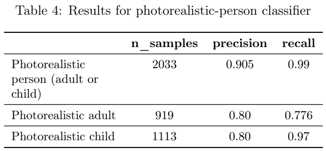
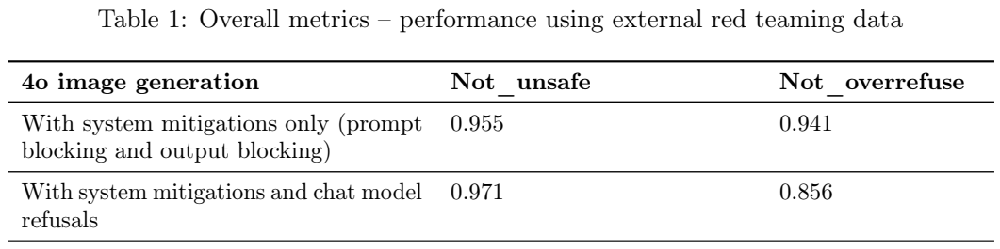
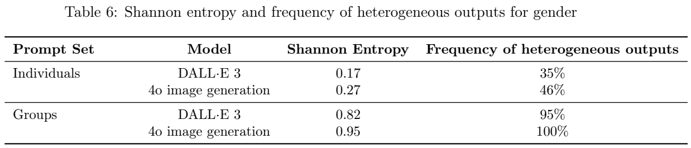
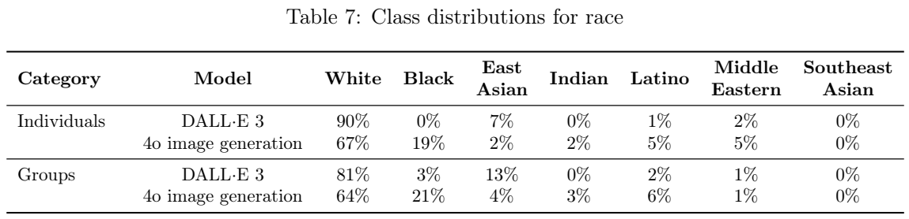
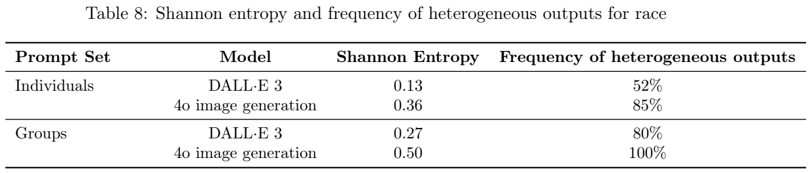
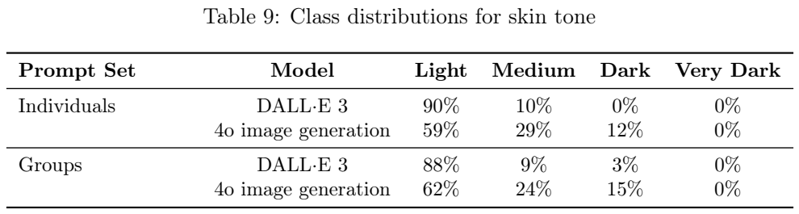

<!-- article-header:start -->
[项目首页](../../../README.md) › [模型系列](../../../reports/model-family-index.md) › [GPT](../README.md)
<!-- article-header:end -->

# GPT-4o 原生图像生成附录：生成能力与安全评测

<!-- article-toc:start -->

**本篇目录** · [论文定位](#paper-info) · [快速概览](#overview) · [整体架构](#architecture) · [核心原理](#principles) · [数据构建](#data) · [训练流程](#training) · [实验结果](#experiments)
<!-- article-toc:end -->

## 1. 论文信息与模型定位

- **原文**：[Addendum to GPT-4o System Card: Native image generation](https://cdn.openai.com/11998be9-5319-4302-bfbf-1167e093f1fb/Native_Image_Generation_System_Card.pdf)，OpenAI，**2025-03-25**，共 13 页。
- **性质**：GPT-4o 系统卡的原生图像生成附录，重点是新增能力产生的风险、系统缓解措施和评测。不是完整图像生成架构或训练技术报告。
- **模型定位**：在 GPT-4o 中原生嵌入的自回归图像生成，支持文本到图像、输入图像变换和多图输入，关注写实输出、细致指令跟随以及图片中的文字与图示。

本文固定于保存的官方 PDF。文中的策略、访问限制和配置是发布时快照，不用它们推断当前产品政策。

## 2. 快速概览

报告明确把 4o 图像生成描述为 **自回归模型**，与 DALL·E 的扩散路线区分。它能够结合模型已有知识处理复杂图像请求，并对输入图像修改。报告未给出 tokenizer、像素/潜变量生成次序和图像解码器，不能仅凭“自回归”推导精确图像 token 方案。

系统采用多道防线：聊天模型可先拒绝触发图像生成；请求进入工具后可被文本或图像分类器阻断；生成完成后再由分类器和多模态推理监控器检查输出。附录的大部分结果测量这套系统，不是无防护基础生成模型的成绩。

一个关键发现是安全与正常请求响应之间的取舍。人工红队数据上，加聊天拒绝后 `not_unsafe` 从 **0.955 提高到 0.971**，但 `not_overrefuse` 从 **0.941 降为 0.856**。不能只引用第一列就说所有行为都改善。

## 3. 整体架构

报告没有原始网络架构图。可确认的设计包括原生自回归生成路径，以及围绕请求和输出的系统控制链：

1. 聊天模型根据经过后训练的安全行为判断是否触发图像生成。
2. 提示阻断在工具调用后检查文本或上传图片。
3. 输出阻断在图像生成后检查生成图，使用内容分类器与专门训练的多模态推理监控器。

“原生嵌入”是作者对模型能力关系的描述；安全栈中存在生成工具调用，不等于报告披露了一个独立 DALL·E 式扩散模型。当前材料也不足以判断所有模块是否共享同一套权重。

写实人物分类器基于已有的 Sora 未成年人分类器构建，输出无写实人物、写实成年人、写实儿童三类；若成人与儿童同时出现，设计为儿童类别优先。该分类器影响编辑请求判断，属于辅助安全组件，不是图像生成网络本身。

**读表**：Table 4 列出样本数、precision、recall。儿童类别较高的 recall 与 0.80 precision 同时存在，说明识别出更多儿童仍伴随误判；不能将 recall 写成总体准确率。

## 4. 核心创新与数学原理

该附录的技术重点是把更强的图像生成能力与上下文感知的安全判断结合。输出监控器通过多模态推理处理政策相关判断，比只检查几个关键词的信息范围更广。但报告未给出监控器的参数规模、训练损失或阈值消融，因此不能计算它的独立贡献。

两个主要指标都按越高越好理解：`not_unsafe` 衡量避免产生违反报告政策的输出；`not_overrefuse` 衡量避免拒绝合规请求。它们不是同一指标的正负两面，因为合法和违规请求属于不同评测对象。多加一层过滤可提高前者，同时使后者变差。

偏差评测采用属性分布、每个提示多次采样的异质输出频率及 Shannon entropy。异质频率关注 **20 次重采样中是否出现不止一种属性**，不是每张图片都同时具有多种属性。熵关注分布是否集中；报告用 0–1 的解释范围，但未完整披露归一化及跨提示聚合细节，本文不从全表的人口比例重算报告的熵。

报告也强调没有唯一正确的人口比例：没有限定属性的提示应有多样性，而历史背景或明确用户要求可能需要稳定属性。增加熵与遵循具体上下文是不同目标，不能简单认为所有提示都越随机越好。

## 5. 数据构建与处理

评测数据来自三类：外部人工红队、自动红队、反映真实场景的离线文本请求。外部参与者来自 Red Teaming Network 和 Scale AI；内部先检查基础能力再指定测试领域。数千条人工对抗对话被转成可重跑评测。

自动红队根据模型政策合成数千条对话，同时覆盖有图像上传和无图像上传。这补充人工覆盖，却不是自然使用分布。真实场景离线测试使用不同安全类别的文本请求，目的是近似生产分布；它不是直接公布的在线生产成功率。

写实人物分类器评测集含接近 **4,000** 张图，跨儿童/成人及写实/非写实类别。报告没有公开完整数据清单、标注者协议和类别所有分项数量。偏差测试使用未说明性别、族群、肤色等属性的个人或群体提示，每个提示重采样 20 次。其衡量默认输出分布，不能直接解释为特定地区真实人口分布的拟合质量。

本附录没有公开主模型预训练图文规模、来源、去重、图像分辨率或采样比例，也没有把这些安全评测集声明为主模型预训练集。

## 6. 训练流程与目标

可明确记录的是聊天模型具有后训练安全措施，输出推理监控器专门训练以理解内容策略，人物分类器沿用并改造已有分类器。精确优化器、学习率、批大小、冻结、训练步数以及各损失权重未披露。

报告提到继续用更多样的例子改善后训练混合和人口表征。这是后续计划，不表示当期模型已经完成所有这些更新。原文也承认人物分类器会将显年轻的成年人误判为儿童，并在边界模糊时偏向儿童，以更保守地处理请求。

来源说明发布没有触发超出 GPT-4o 原有评测的额外 Preparedness 评测；这是一项流程说明，不是新增能力没有任何风险的结论。出处标记采用 C2PA 元数据及内部溯源工具，报告没有声称元数据不会被移除或可以解决所有来源识别问题。

## 7. 实验设置与主要结果

**读表**：第一行只有提示和输出阻断；第二行再加入聊天模型拒绝。两列都是越高越好，第二种配置并非两列同时提高。

| 数据来源 | 系统配置 | not_unsafe | not_overrefuse |
|---|---|---:|---:|
| 外部人工红队，Table 1 | 系统缓解 | 0.955 | 0.941 |
| 外部人工红队，Table 1 | 再加聊天拒绝 | 0.971 | 0.856 |
| 自动红队，Table 2 | 系统缓解 | 0.969 | 0.899 |
| 自动红队，Table 2 | 再加聊天拒绝 | 0.975 | 0.830 |
| 真实场景离线，Table 3，PDF 第 4 页 | 系统缓解 | 0.929 | 0.996 |
| 真实场景离线，Table 3，PDF 第 4 页 | 再加聊天拒绝 | 0.932 | 0.993 |

人工与自动对抗数据表现出更明显的过拒绝代价；真实场景离线差异较小。各数据分布不同，不能把六行简单平均形成统一“安全准确率”。附录没有报告置信区间或无防护原始生成模型的同表基线。

Table 4 中写实人物总体 precision/recall 为 **0.905/0.99**，成年人 **0.80/0.776**，儿童 **0.80/0.97**。这反映保守识别的取舍，不能只保留儿童召回率而忽略精确率。

**读表**：Table 6 为性别的熵和异质频率，Table 7 为族群分布，Table 8 为族群多样性，Table 9 为肤色分布。指标定义不同，不把分布百分比与熵直接比较。

个人提示的性别熵 **0.17→0.27**、异质频率 **35%→46%**；族群熵 **0.13→0.36**、异质频率 **52%→85%**，均为 DALL·E 3 到 4o 的变化。群体提示的族群熵 **0.27→0.50**、异质频率 **80%→100%**。PDF 第 9 页的肤色个人熵 **0.18→0.50**、异质频率 **61%→96%**。

表中个人提示仍以男性为主（PDF 第 7 页，79%），族群仍以被分类为白人的个体为主（67%），因此更多样不等于完全均衡。历史/现实属性匹配的内部指标为 **92%→97%**（Table 11），表示特定参考预期的匹配，不能作为所有生成图片事实正确性的分数。

分领域结果也有取舍：暴力/虐待/仇恨人工红队 1,266 条，加入聊天拒绝后 `not_unsafe` **0.914→0.952**，`not_overrefuse` **0.917→0.795**（Table 13）。非法活动指令人工红队仅 25 条，两种配置同为 **0.999/0.959**（Table 14）；样本少且指标聚合细节未展开，不推导成百分之百防护。

报告没有 GenEval、FID 或文本渲染准确率等生成质量基准，也没有 tokenizer、数据配方或生成训练损失。它最有用的证据是原生生成能力的系统安全评测和多样性变化，以及更强过滤对正常请求响应的代价。

<!-- article-footer:start -->
---

[← 上一篇：Nexus-O](../../nexus-o/arxiv-2503.01879/README.md) · [按发表时间浏览](../../../reports/paper-reading-guide.md#year-2025) · [下一篇：Qwen2.5-Omni →](../../qwen/document-1093f7b31e5b/README.md)

[返回本篇目录](#article-toc) · [返回模型系列](../README.md)
<!-- article-footer:end -->
