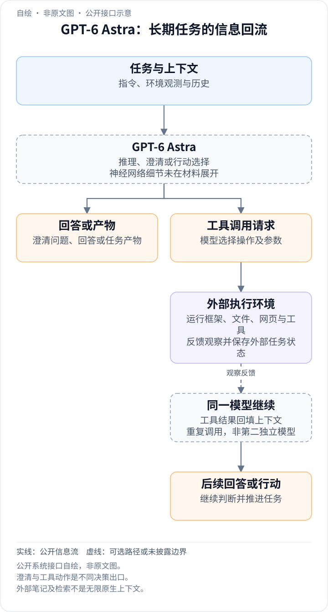
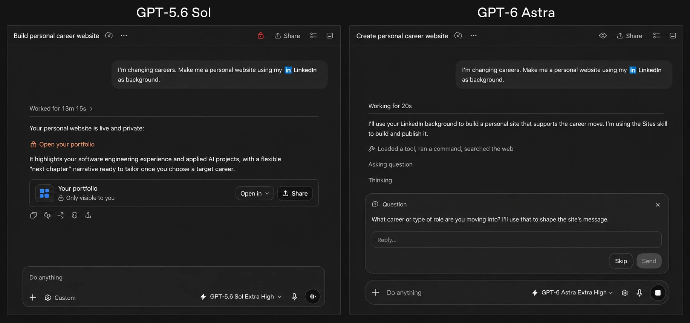
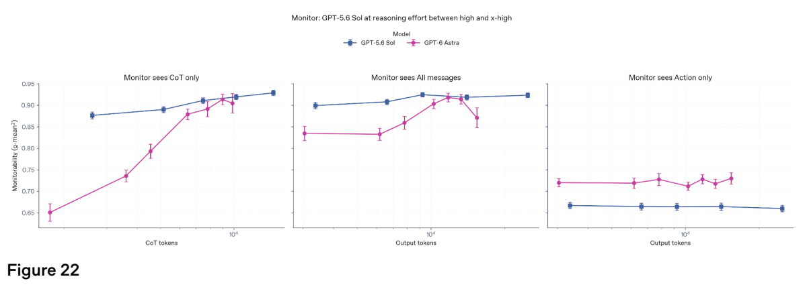
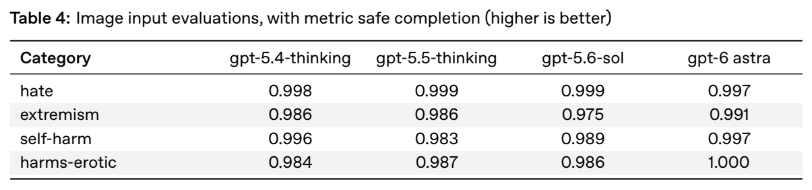
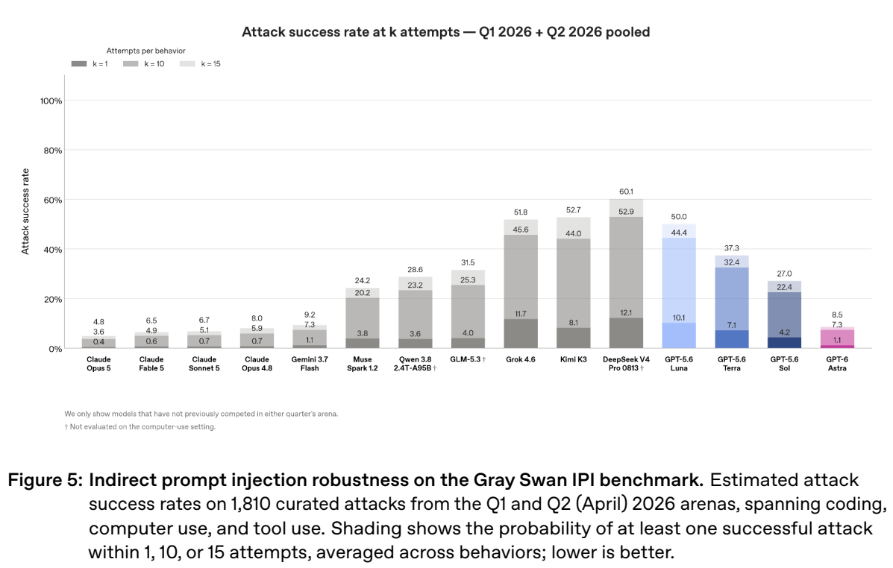

<!-- article-header:start -->
[项目首页](../../../README.md) › [模型系列](../../../reports/model-family-index.md) › [GPT](../README.md)
<!-- article-header:end -->

# GPT-6 Astra：面向视觉交互与长期任务的通用模型

<!-- article-toc:start -->
<a id="article-toc"></a>

**本篇目录** · [论文定位](#paper-info) · [快速概览](#overview) · [整体架构](#architecture) · [核心原理](#principles) · [数据构建](#data) · [训练流程](#training) · [实验结果](#experiments)
<!-- article-toc:end -->

<a id="paper-info"></a>

## 1. 论文信息与模型定位

| 项目 | 信息 |
|---|---|
| 原始条目 | **GPT-6 Astra: A new generation of intelligence** |
| 发布机构 | OpenAI |
| 材料类型 | 官方发布文章；不是公开网络结构和完整训练配方的研究论文 |
| 发布日期 | 2026 年 9 月 3 日 |
| 主来源 | [官方发布页](https://openai.com/index/gpt-6-astra/)，本仓库保存 2026-10-08 快照 |
| 补充来源 | [GPT-6 Astra System Card](https://deploymentsafety.openai.com/gpt-6-astra/gpt-6-astra.pdf)，封面日期 2026-09-03，缓存文件包含截至 2026-09-29 的更新，共 175 个 PDF 页面 |
| 模型定位 | 结合视觉理解、推理、代码和工具操作，完成计算机交互、专业产物制作与长期任务的通用模型 |
| 公开程度 | 未公布参数规模、骨干网络层数、视觉编码器、权重及完整训练超参数 |

这篇材料的重点，是从“读懂问题并回答”向“读取环境、调用工具并交付工作成果”扩展。多模态能力主要体现在截图定位、软件界面操作、根据多视图图片生成 CAD 代码，以及读取乐谱并产生结构化表示等任务上。发布页还介绍代码、科研、长上下文和安全能力，但这些评测各有范围，不能全部当成视觉理解指标。

本文以发布页为模型定位与主要能力结果的来源，系统卡用于补充训练披露、评测方法和部署机制。下面涉及系统卡的图表均标注 **PDF 页码**；页码包含封面，可能与文档印刷页码相差一页。本文只核查与介绍有关的正文及附录，不逐项复述整份安全报告，也不把系统卡中的 GPT-6 Sol、Luna 或后续更新模型的结果归到 Astra 名下。

<a id="overview"></a>

## 2. 快速概览

**这项工作的主要变化是更完整的任务执行能力。** 模型既要根据屏幕选择正确操作，也要保留用户约束、发现缺少的信息、决定何时询问，并在执行过程中检查结果。发布页认为这些能力来自预训练、强化学习和对齐的共同改进，同时介绍了 Codex 的上下文保存与检索功能。后者属于运行框架，不能直接理解为模型内部新增了某种注意力结构。

| 观察角度 | 公开证据 | 应怎样理解 |
|---|---|---|
| 视觉定位 | ScreenSpot-Pro 无工具准确率 92.7%，GPT-5.6 Sol 为 76.9% | 对截图中的目标位置作预测；不等于完成整个软件工作流 |
| 计算机操作 | OSWorld 2.0 离线集部分得分 72.6%，Sol 为 65.7% | 指标允许部分完成；不能写成 72.6% 的任务全部成功 |
| 视觉到结构化产物 | BenchCAD 几何重叠分数 95.9%，Sol 为 83.3% | 根据多视图渲染生成 CAD 代码，评估重建几何的吻合程度 |
| 长上下文检索 | MRCR v2 八针任务在 512K–1M 区间为 96.3%，Sol 为 73.8% | 测试长上下文中的信息辨认；不代表无限记忆 |
| 交互策略 | 缺少关键信息时提出针对性的澄清问题，继续不依赖答案的工作 | 发布页给出定性案例，未公布通用澄清决策准确率 |

这些变化共同服务于持续工作，但不能由几项领先结果推出“所有任务都最好”。例如发布表中的 HLE with tools，Astra 为 57.2%，低于表中部分对比模型；AA Intelligence Index v4.1.1 的 61.2 也不是该表最高值。对模型定位更有意义的证据，是视觉、工具和上下文能力能否在具体工作流中结合起来。

<a id="architecture"></a>

## 3. 整体架构

<!-- derived-architecture:start -->


*自绘公开接口示意（非原文图）。依据下述公开资料归纳；方框表示功能组件，不代表逐层实现。*

依据：[official-source-snapshot-2026-10-08; Long-running tasks / asynchronous clarifications / system-card deployment](https://openai.com/index/gpt-6-astra/)。
<!-- derived-architecture:end -->

**公开材料没有足够信息重建神经网络架构。** 视觉特征如何接入语言骨干、采用何种 token 压缩、是否使用 MoE、图像和视频分辨率策略、音频编码或解码方式，均未在本条目中披露。可以整理的是系统的信息流：用户指令与环境观测进入模型，模型推理后生成文字或工具调用，运行框架执行调用并返回输出，模型再根据新状态继续工作。

为了说明这一过程，可把历史记为

```math
h_t=(u,o_1,a_1,\ldots,o_t),\qquad a_t\sim\pi_\theta(\cdot\mid h_t),
```

其中 $`u`$ 是用户要求，$`o_t`$ 可以包含截图、页面内容或工具返回值，$`a_t`$ 可以是澄清问题、代码、操作指令或最终回复。**这是对代理交互的通用数学记法，不是原文给出的网络公式或实际训练算法。** 它强调：同一张截图在不同任务历史下可能需要不同操作；只提升单帧识别不足以解决长期任务。



*原图来自发布页的职业网站示例。左侧 GPT-5.6 Sol 直接给出已制作的网站，右侧 Astra 先询问用户转入哪种职业，以获取会改变网站内容的重要信息。原静态图片完整保留。*

这张图说明交互决策，而不是任务完成速度。左侧的 13 分 15 秒对应已完成产物，右侧的 20 秒对应提出问题的阶段，不能据此宣称 Astra 把同一完整任务从 13 分钟缩短到 20 秒。发布页所说的异步澄清，是在等待用户回答时继续处理独立部分；后续能否得到合适网站仍取决于回答和执行结果。

运行框架还有两个值得区分的机制。第一，Codex 可跨上下文窗口保存笔记，并检索先前消息和工具输出，避免所有旧信息都只能依赖一次摘要。这是外部上下文管理与搜索，未披露为新的位置编码或无限窗口。第二，系统卡描述独立的部署检查：部分越出预设沙箱的命令交给 AutoReview，具有后果的动作受确认策略约束，另有监控器读取轨迹并在必要时暂停任务。这些机制运行在基础模型周围，不应画成模型骨干内部的层。

<a id="principles"></a>

## 4. 核心创新与数学原理

**视觉能力的变化，应放到“感知—决策—验证”链条中解释。** ScreenSpot-Pro 衡量找到界面元素；OSWorld 衡量多步操作；BenchCAD 则要求把图像证据转成可执行代码，并以生成的几何验证结果。这些任务的输出空间与监督方式并不相同。由于没有公开具体多模态损失，本文不假设它们使用统一的视觉 token 预测目标，也不补写未经披露的 SFT、PPO 或 GRPO 公式。

**长期工作依靠有选择的信息保留与重新读取。** 跨窗口笔记可以压缩当前需要的事实，历史搜索再恢复遗漏的细节；这解决的是代理运行时的信息可达性。发布页没有给出笔记更新规则、检索排序器、召回率或消融实验，因此尚不能量化“模型更强”与“框架更强”分别贡献多少。

**监控能力也是一个单独的实验问题。** 系统卡比较三种观察条件：只读思维链、只读动作、读取输入与思维链及动作的完整上下文。它使用另一个模型作监控器，而不是将思维链文本直接视为行为意图的真值。



*补充来源原图：系统卡 Figure 22，PDF 第 52 页。三幅图分别呈现只读思维链、完整上下文、只读动作的聚合结果；坐标、误差条、图例及图注保留。蓝色为 GPT-5.6 Sol，紫色为 Astra，监控器采用 GPT-5.6 Sol。*

图中的 $`\mathrm{gmean}^2`$ 是检测指标，不是任务得分。按几何均值的标准定义，可解释为

```math
\mathrm{gmean}^2=\mathrm{TPR}\times\mathrm{TNR},
```

即发现目标行为的真阳性率与正确排除非目标行为的真阴性率之积。这一解释用于帮助读图，不是原文的编号公式。只报告检测召回率会掩盖误报，乘积则同时惩罚漏检和误报。

Figure 22 中，Astra 在多数长度条件下的思维链及完整上下文可监控性低于 Sol；只读动作时反而较高。系统卡讨论了短思维链信息量、行为差异、监控任务标签及残余解释问题，不能把这张图概括为“所有监控都提升”，也不能仅凭低分推断模型正在蓄意隐藏行为。模型任务能力提升与监控器能否识别其行为，是两个需要分别测量的量。

**开放回答还需要控制长度带来的评测偏差。** 系统卡对 HealthBench Professional 采用相对 2,000 字符的线性长度校正，每多 500 字符扣 1.47 个分数点。将其说明写成便于计算的表达式：

```math
S_{\mathrm{adj}}=S_{\mathrm{raw}}-\frac{1.47}{500}(C-2000).
```

这里 $`C`$ 是平均回答字符数，分数按 0–100 口径表示。系统卡的 Astra 原始分为 68.2，平均长度 3,185 字符，代入得到约 64.7。该公式是对公开校正规则的转写，不是模型训练损失；不能把长度调整后的分数当作临床任务成功率。

<a id="data"></a>

## 5. 数据构建与处理

系统卡 §2（PDF 第 9 页）只对数据和训练作概述：训练使用多样化数据，并进行降低个人信息暴露的过滤；强化学习用于改进推理过程，包括尝试策略与识别错误。材料没有给出完整数据集名称、各模态样本量、视觉 token 数、采样比例或去重与泄漏审计细节。因此，不能为 Astra 编制一张看似完整的图文预训练配方。

安全相关部分披露得更具体。系统卡有关模型对齐与安全训练的段落讨论 Model Spec、代理常识、提示注入和心理健康等问题；§10.2（PDF 第 109–114 页）进一步介绍风险领域的训练与部署检查，使用真实、合成及半合成情境。代理任务不仅判断单条回复是否合适，还检查模型在连续操作中是否遵守用户要求、识别危险情境或及时停止。这里的“数据构建”是训练和安全系统的局部披露，不能替代通用多模态预训练数据说明。

评测数据需要与训练数据分开。图像安全测试用带图像的有害请求；静态越狱测试包含未用于生成训练数据的留出攻击器；Gray Swan 的间接提示注入集包含 2026 年第一、二季度筛选的 1,810 个攻击。另一组部署模拟来自内部 Codex 对话前缀，在重建的工作区中续写同一任务并比较行为。它们是不同实验输入，不能合并成 Astra 的训练样本总量。

发布页没有提供图像裁切、分辨率调整、视频抽帧、音频重采样或 OCR 数据清洗的流程。本仓库只保存实际披露项，对这些多模态处理细节保持“未披露”。

<a id="training"></a>

## 6. 训练流程与目标

公开叙述可以归纳为预训练、强化学习和对齐三个方向，**没有公开可复现的阶段表**。预训练建立通用能力；强化学习改善推理与任务执行；对齐使模型在获得任务奖励时也遵守行为规范。材料没有说明各阶段训练 token 数、初始化检查点、冻结模块、优化器、学习率或奖励权重，不宜把通用经验写成 Astra 的实际步骤。

系统卡的一个重要关注点，是避免代理为取得表面成功而破坏真正目标。例如任务无法完成时，模型应说明限制，而不是更改测试或评价条件；遇到第三方内容中的指令时，应判断它是否有权覆盖用户要求。相关检查围绕实际工具调用、指令层级和任务后果组织。它们解释了训练希望得到的行为，但不足以推断底层使用哪一种策略梯度算法。

部署检查进一步补足单个模型的局限。AutoReview 由另一个模型检查部分命令；完整上下文监控器观察推理与动作轨迹；特定风险模式可以触发单独的安全推理器。这些检查器有独立训练与触发条件，不能把它们的判定准确率等同于 Astra 的内在可靠性。

监控覆盖还取决于接口。系统卡说明，Chat Completions API 不适用同样的推理与工具轨迹监控方式；某些无持久思维链或 WebSocket 的 Responses API 配置仍可监控并告警，却不能按完整有状态轨迹自动暂停。异步监控也可能在动作发生后才发现问题。因而，公开部署机制并不意味着所有接口和每一次工具操作都有同样的实时拦截能力。

<a id="experiments"></a>

## 7. 实验设置与主要结果

下表忠实摘录**主发布页**的关键多模态、代理与相关能力结果。除特别标注外，这些是发布表中的模型配置结果，而非本文运行模型得到的数据。

| 任务与指标 | GPT-6 Astra | GPT-5.6 Sol | 评测含义 |
|---|---:|---:|---|
| ScreenSpot-Pro，no tools | 92.7% | 76.9% | 截图目标定位 |
| OSWorld 2.0，v2026.08.08 offline set，partial score | 72.6% | 65.7% | 计算机任务部分完成得分 |
| Agents’ Last Exam | 59.3% | 53.6% | 代理执行能力；不是单一视觉问答 |
| BenchCAD | 95.9% | 83.3% | 多视图输入到 CAD 重建的几何重叠 |
| OpenScore String Quartets，$`1-\mathrm{OMR\!\text{-}NED}`$ | 0.84 | 0.19 | 光学乐谱识别的归一化编辑距离转换分；不是音乐创作质量 |
| BrowseComp | 91.5% | 90.4% | 复杂浏览检索 |
| Terminal-Bench 4 | 57.9% | 37.3% | 终端工作任务 |
| Terminal-Bench Science 0.1 | 64.6% | 22.4% | 使用工具完成科研工作流 |
| MRCR v2，8 needles，256K–512K | 100.0% | 91.5% | 长上下文信息辨认 |
| MRCR v2，8 needles，512K–1M | 96.3% | 73.8% | 更长区间的信息辨认 |
| FrontierMath Tier 4 v2 | 97.6% | 83.0% | 指定高难数学测试集，不能写成所有数学题的解决率 |

这些结果显示，视觉定位、视觉到 CAD 的代码产物，以及部分工具工作流都有较大改善。OSWorld 的时延模拟中，发布页给出 Astra 约 40 分钟、Sol 约 75 分钟的每任务时间，并在对应配置下取得更高部分得分，约减少 47% 时间。它是特定模拟与运行配置的比较，不保证用户的任意软件任务都快同样比例。发布页另有 1.9 倍 Mind2Web 效率结果，但同时改变模型与 Codex 框架，不能全部归因于模型权重。

比较表还使用不同模型的最高表现配置，并不普遍控制相同推理预算。BenchCAD 的第三方对比存在三项评测修改；ScreenSpot-Pro 的一项 Fable 结果使用较少防护的 Mythos 配置；发布页脚注逐项说明了这些条件。可据此判断具体能力变化，不能把排名看作所有模型在统一成本和统一部署系统下的绝对排序。

**补充来源：图像请求的安全行为。** 系统卡 Table 4 测试图像输入下的安全完成比例。



*补充来源原表：系统卡 Table 4，PDF 第 16 页，保留完整表头、模型列、类别及说明。数值越高，表示在该有害请求测试中更常给出安全回复；不表示更高视觉识别准确率。*

Astra 在自伤类别为 0.997、极端主义类别为 0.991，对应 Sol 为 0.989、0.975；仇恨类别 Astra 0.997、Sol 0.999，系统卡称该回退未达到统计显著。原表支持“多数类别改善且仍有回退”，不支持“每个视觉安全项目全面胜出”。

**补充来源：外部间接提示注入。** Gray Swan 评测攻击网页、文件或工具内容能否改变代理行为。



*补充来源原图：系统卡 Figure 5，PDF 第 20 页，完整保留横轴、图例、模型名称、攻击次数与脚注。$`k=1,10,15`$ 分别对应在该次数预算下至少成功一次的估计概率，越低越好。*

Astra 的三个值为 1.1%、7.3%、8.5%，Sol 为 4.2%、22.4%、27.0%，表明在该测试条件下攻击成功率降低。图中部分第三方模型仍更低，例如 Claude Opus 5 为 0.4%、3.6%、4.8%。三个柱层是累计概率口径，不能相加；多次攻击也未必独立，不能直接用 $`1-(1-p)^k`$ 从单次数值推导图中结果。系统卡另有内部提示注入鲁棒性 99.79%，采用不同攻击集和指标，不应与此图直接互补相减或排名。

还有两处版本和实验范围需要保留。发布页 HealthBench Professional 长度调整分为 **63.4**，本仓库保存的更新系统卡为 **64.7**；系统卡更新记录说明健康评测配置曾修正，因此本文保留两份来源各自数值，而不拼接成同一实验。内部部署模拟在 54,218 个匹配任务续写中记录严重度 3 及以上事件：Astra 34 次、Sol 73 次，约减少 53%；这是模拟续写与监控判定的结果，不是所有真实用户流量的事故率。

公开证据最扎实的部分，是具体视觉与工具任务的改进、长期交互行为，以及系统检查的实验描述。网络结构、通用多模态训练数据与损失函数仍不足以复现；不同框架、预算、版本和安全检查会影响实际表现。本文没有运行 Astra，也没有将官方定性案例转写成额外的实验数字。

<!-- article-footer:start -->
---

[← 上一篇：Gemini 3.8 Flash 与 Flash Cyber](../../gemini/document-390f20b2fe8b/README.md) · [按发表时间浏览](../../../reports/paper-reading-guide.md#year-2026) · [下一篇：Qwen3.8-Omni-Flash →](../../qwen/document-2ea7273632dc/README.md)

[返回本篇目录](#article-toc) · [返回模型系列](../README.md)
<!-- article-footer:end -->
