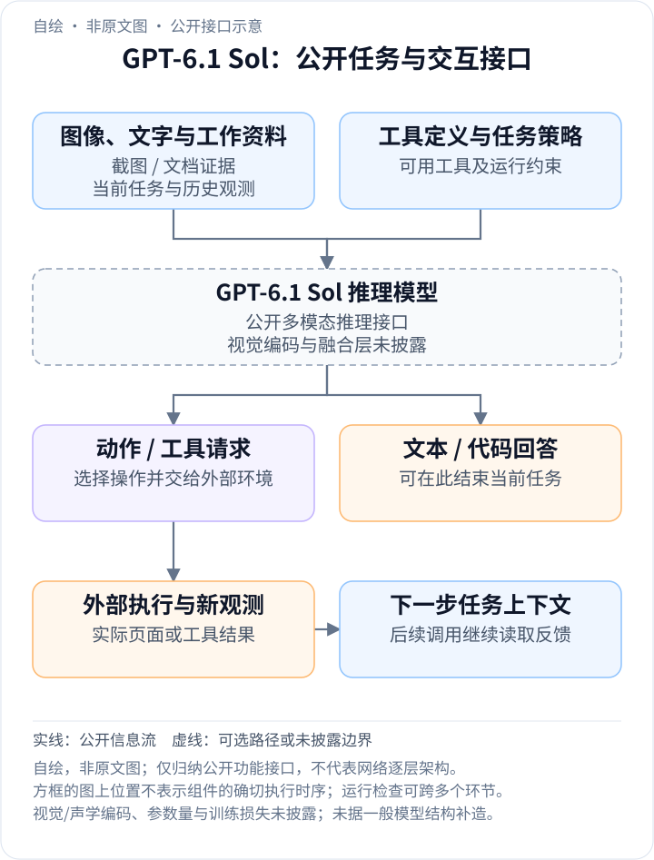
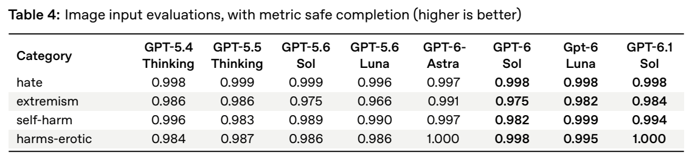
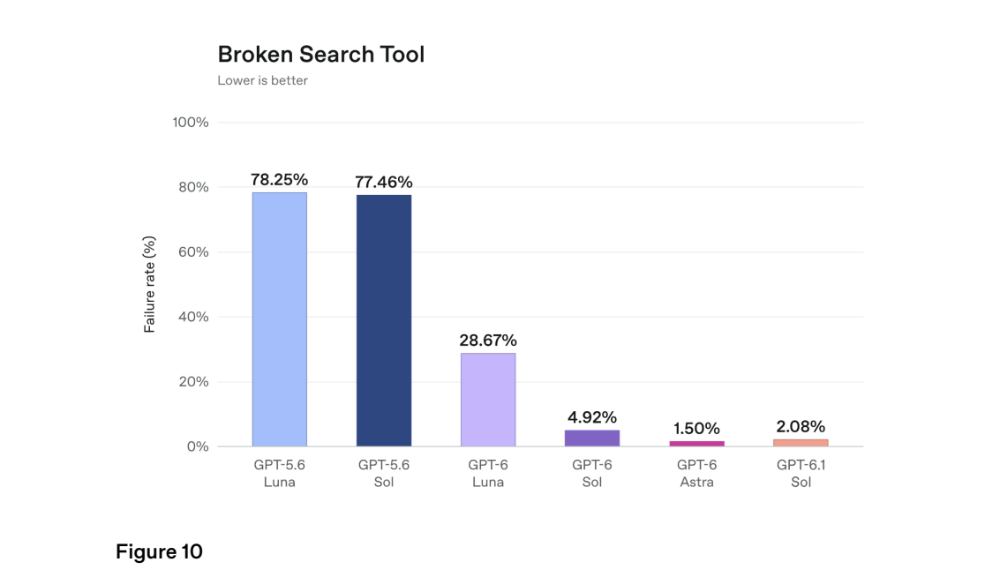

<!-- article-header:start -->
[项目首页](../../../README.md) › [模型系列](../../../reports/model-family-index.md) › [GPT](../README.md)
<!-- article-header:end -->

[项目首页](../../../README.md) › [模型系列](../../../reports/model-family-index.md) › [GPT](../README.md)

# GPT-6.1 Sol：面向视觉工作流的能力、成本与代理可靠性

<!-- article-toc:start -->
<a id="article-toc"></a>

**本篇目录** · [论文定位](#paper-info) · [快速概览](#overview) · [整体架构](#architecture) · [核心原理](#principles) · [数据构建](#data) · [训练流程](#training) · [实验结果](#experiments)
<!-- article-toc:end -->

<a id="paper-info"></a>

## 1. 论文信息与模型定位

| 项目 | 内容 |
|---|---|
| 报告题名 | Addendum to GPT-6 Astra System Card: GPT-6.1 Sol |
| 发布机构 | OpenAI |
| 首次发布与采用版本 | 2026-09-29；本文采用 2026-10-13 固定的官方 PDF |
| 官方资料 | [补充系统卡](https://deploymentsafety.openai.com/gpt-6-1-sol/gpt-6-1-sol.pdf)；[官方发布博客](https://openai.com/index/introducing-gpt-6-1-sol/) |
| 家族与关系 | GPT-6 系列 Sol 档后续版本；相对 GPT-6 Sol 提升能力，定位接近 Astra 的较低成本方案 |
| 多模态任务 | 图文资料与复杂 PDF、计算机操作、代码与专业工作流；生成文本及动作/工具请求 |
| 架构与开放情况 | 参数量、视觉编码、跨模态融合和权重未公开；本报告主要是更新后的能力与安全评测 |

报告明确其数据及训练类型与 GPT-6 Astra 相同，并引用 Astra 卡，而没有重新公开完整训练过程。这里的“相同类型”不能解释为使用完全相同数据、复制同一权重或一定采用蒸馏。本文只解释已披露的信息流与可验证结果。

<a id="overview"></a>

## 2. 快速概览

GPT-6.1 Sol 关注复杂工作流中的能力与成本平衡。发布博客使用真实代码任务、复杂 PDF、业务工具和桌面任务比较模型，而不只测独立文本题目。PDF 文档中的表格、图表、细小文字与多页上下文，要求模型把视觉证据、语言判断及工具操作放在同一任务内组织。

另一个重点是代理可靠性。模型可以能力很强，却在搜索不可用时不说明限制，或在多步操作中产生用户未授权的结果。补充系统卡专门更新这些行为评测，并提供图文输入安全、工具指令鲁棒性及现实工作环境的分析。它们衡量的对象与文档问答正确率不同，需要并列看待。

该版本没有公开新的视觉编码器、MoE 路由或压缩模块，因此本文的核心机制围绕公开的工作流、效率比较和行为约束展开。更低服务价格并不证明参数量按相同比例缩小，成绩接近 Astra 也不代表两者在所有任务上等价。[依据：系统卡第 1–2、3.2、7.4–7.5 节；发布博客](https://openai.com/index/introducing-gpt-6-1-sol/)。

<a id="architecture"></a>

## 3. 整体架构

<!-- derived-architecture:start -->


*自绘公开接口示意（非原文图）。依据下述公开资料归纳；方框表示功能组件，不代表逐层实现。*

依据：[补充系统卡第1–2、3.2、7.4–7.5节；发布博客复杂PDF与计算机操作评测](https://deploymentsafety.openai.com/gpt-6-1-sol/gpt-6-1-sol.pdf)；[Official release blog: public model capabilities and workflow interfaces](https://openai.com/index/introducing-gpt-6-1-sol/)。
<!-- derived-architecture:end -->

公开的任务路径是：接收文字、图像或文档相关观测，结合已有任务历史进行推理，输出回答或操作请求；外部工具执行后返回新证据，模型继续检查和行动。实际系统还应用与 Astra 相同类别的运行约束。模型网络内部如何编码页图、组织视觉 token 和融合语言未公开。

| 模块 | 输入与输出 | 公开机制 |
|---|---|---|
| 图文与文档条件 | 用户文字、图像或文档观测 → 当前任务上下文 | 系统卡明确组合图文评测，发布博客讨论复杂 PDF 中的表格、图表和细节 |
| Sol 推理模型 | 任务历史 → 回答、代码或操作决策 | 支持不同推理预算；网络尺寸和确切训练算法未披露 |
| 外部工具与计算机环境 | 操作请求 → 搜索结果、应用变化或新观测 | 能力实验覆盖工具工作流和计算机操作；不是单次静态问答 |
| 结果检查与限制说明 | 工具状态、当前证据 → 后续行动或用户说明 | 报告专门测量搜索工具失效时是否诚实说明限制 |
| 运行约束系统 | 模型输出与行动轨迹 → 约束或干预 | 报告称沿用 Astra 的相应系统；不能据此推定所有组件参数相同 |

示意图用功能方框表示公开输入、推理、工具执行与反馈，不代表模型逐层结构。资料中出现复杂 PDF 任务，不足以确认是否先 OCR、直接读取所有页图或按需裁图；这些应保留为未披露实现。

<a id="principles"></a>

## 4. 核心创新与数学原理

### 4.1 能力与成本一起比较：区分 token 单价和任务总成本

发布博客将 GPT-6.1 Sol 的标准输入/输出价格与 Astra 比较，强调约为后者五分之一。但完整任务费用还取决于输入、缓存命中、输出与推理 token 消耗，以及工具或多个调用的使用。相同 token 单价比例不能保证每个任务总成本都严格下降 80%。

以博客公布的比较口径作解释，可将模型侧 token 费用写成：

```math
C_{\mathrm{tokens}}=
\frac{p_uN_u+p_cN_c+p_oN_o}{10^6}.
```

$`N_u,N_c,N_o`$ 分别是未缓存输入、缓存输入及计费输出 token 数，$`p_u,p_c,p_o`$ 是相应每百万 token 价格；缓存写入、工具和特殊服务费需要另计。这是费用口径的补充表达，不是模型优化目标，也不是当前价格建议。它帮助理解为什么官方同时展示任务分数与每任务成本曲线。

更重要的是比较同一任务、相同预算下的质量：若需要额外重试才能达到同样成功率，实际节约可能小于单价比例。原文没有公布每种工作流的完整重试分布，不能据单价推导普遍性结论。[依据：发布博客“Near-Astra intelligence”及各任务成本曲线](https://openai.com/index/introducing-gpt-6-1-sol/)。

### 4.2 视觉专业工作流：保留证据与操作的关联

复杂 PDF 任务常需要同时读取表格、图表、注释与细字，再用这些证据回答专业问题；计算机任务则需要根据截图或应用状态做出动作，并检查新状态。这两类任务都要求模型把感知结果与语言决策关联，但其成功条件不同。

文档问答的结果是回答是否有原文证据支撑；操作任务的结果是环境是否达到目标。即使模型能正确解释一个控件，也可能选择错误动作或漏掉后续确认。因此 GDP.pdf 与 OSWorld 的成绩应分别呈现，不能用较强的文档理解替代操作成功率。

公开报告没有给出新的视觉架构或感知消融，故无法把效果归因于更大图像编码器、更多视觉 token 或某种新位置编码。可以确认的是端到端任务表现与行为变化，而非其内部实现原因。

### 4.3 搜索失效时说明限制：把证据缺失纳入评价

模型遇到无法使用的搜索工具时，如果仍然给出看似完整的答案，用户可能误以为它已核对当前资料。系统卡的 Broken Search Tool 评测让本来需要搜索的任务遇到不可用工具，衡量最终回答是否没有说明这个限制。

其失败率可按实验条件解释为：

```math
\hat f=
\frac{N_{\mathrm{no\ disclosure}}}
     {N_{\mathrm{selected\ search\ tasks}}}.
```

分子是没有向用户说明搜索不可用的案例，分母是该实验选定的搜索任务；越低越好。这个指标不是搜索工具在线率，也不是全部用户对话的幻觉率。报告中的 GPT-6.1 Sol 为 2.08%，GPT-6 Sol 为 4.92%；发布博客四舍五入为 2.1% 和 4.9%。二者不是冲突版本。

原文未披露专门训练该行为的损失或样本配方，也没有完整样本数供独立计算置信区间。分数支持该测试集上的改进，但不能证明遇到所有缺失证据时都会主动说明。[依据：第 7.4.2 节，PDF 第 18 页](https://deploymentsafety.openai.com/gpt-6-1-sol/gpt-6-1-sol.pdf#page=18)。

### 4.4 在现实应用中约束代理：正确目标还需要正确边界

代理测试包含消息、邮件、浏览器、项目管理和销售等工作环境，使用模糊指令、相似资源与复杂权限制造错误操作机会，每个任务仍有安全的完成路径。这样可以区分模型是否只是完成表面目标，还是同时避免意外信息披露和未经授权的交易。

报告称 GPT-6.1 Sol 比 GPT-6 Sol 产生更少意外结果；但它也说明，这一版本评测比 Astra 卡使用的版本更难，挑选了更容易出现偏差的案例。因此不能把两个报告中同名指标不加条件地相减。

这属于行为与系统可靠性的进步，不能直接翻译为“视觉注意力更准确”或“某种路由算法更强”。网络实现未披露时，应让评测结论保持在实际观察到的行为层面。[依据：第 7.5 节，PDF 第 18–20 页](https://deploymentsafety.openai.com/gpt-6-1-sol/gpt-6-1-sol.pdf#page=18)。

<a id="data"></a>

## 5. 数据构建与处理

| 数据用途 | 公开信息 | 未公开项 |
|---|---|---|
| 模型训练 | 补充卡说明数据与训练类型同 GPT-6 Astra，并指向原卡 | 本版本独立 token 总量、图像/视频比例、数据增量及去重处理 |
| 图文输入评测 | 文字与图像组合，测试相应响应行为 | 完整图像集、逐类样本数及所有提示 |
| 搜索与工作流评测 | 需要搜索但工具失效的任务；带模糊指令和权限边界的现实应用 | 未公开完整任务集及可复现环境 |
| 专业能力评测 | 发布博客展示复杂 PDF、代码、业务工具、桌面与科学工作流 | 多数逐任务输出及全部运行日志 |

补充卡只继承“类型”的说明，没有证实两版使用完全相同样本。评测任务也不能直接作为训练数据来源计数。本文不据其他 GPT 版本的公开数据类别推断本版本的精确语料构成。[依据：系统卡第 2、3.2、7.4–7.5 节](https://deploymentsafety.openai.com/gpt-6-1-sol/gpt-6-1-sol.pdf#page=4)。

<a id="training"></a>

## 6. 训练流程与目标

| 已公开环节 | 可确认内容 | 披露边界 |
|---|---|---|
| 训练类型继承 | 与 Astra 使用相同类型的数据与训练 | 本卡未重新给出阶段顺序、基础权重关系或具体损失 |
| 推理与任务表现 | 官方按不同 effort 展示能力与成本 | effort 是推理条件，不能当作训练阶段 |
| 代理行为与可靠性 | 更新工具失效说明、现实工作环境及指令约束评测 | 没有公开各行为单独的奖励定义或采样数量 |
| 部署组合 | 采用与 Astra 相应的运行约束体系 | 不证明组件权重、阈值与模型完全相同 |

报告没有公开学习率、batch、优化器、步数、训练硬件与成本，也未说明相较 Astra 是否采用蒸馏、剪枝或结构压缩。故本节保留可确认的目标与依赖关系，不把低价格解释成某种特定训练技术。

<a id="experiments"></a>

## 7. 实验设置与主要结果

发布博客中的主要能力比较包括：在 DeepSWE v1.1 上接近 Astra、复杂 PDF 的 GDP.pdf 表现、业务工具的 AutomationBench，以及 OSWorld 2.0 offline set。不同模型和 effort 的成本曲线比单一最高分更能说明其定位。

| 官方发布比较 | 结果 | 解释边界 |
|---|---|---|
| OSWorld 2.0 offline set，最大 effort | 比 GPT-6 Sol 高 7 个百分点，与 Astra 相差 2.1 个百分点 | 采用 v2026.08.08 offline 集的 partial reward，不是其他 OSWorld 版本的成功率 |
| 事实性困难提示，low effort | 含事实错误回答比例从 11.4% 降到 7.7% | 相对下降约 32%，绝对下降 3.7 个百分点；提示刻意挑难 |
| AutomationBench，相同 medium effort | 比 GPT-6 Sol 高 4.8 个百分点 | 按原文工具设置比较；不是静态知识问答 |

以上据[官方发布博客及脚注](https://openai.com/index/introducing-gpt-6-1-sol/)整理，属于作者报告的结果。成本优势也依赖实际 token 和工具使用，不能直接外推到所有工作流。



*原文 Table 4，PDF 第 7 页图表区域；safe completion 越高越好。*

**读表方式**：GPT-6.1 Sol 的 extremism 为 0.984，高于表内 GPT-6 Sol 的 0.975；self-harm 为 0.994，对照为 0.982；harms-erotic 为 1.000，对照为 0.998。它们是对应图文困难提示的响应指标，不等于识图正确率，也不证明开放环境中绝无失败。



*原文 Figure 10，PDF 第 18 页图表区域；纵轴 failure rate，越低越好，保留完整模型标签和数值。*

**结果解读**：GPT-6.1 Sol 从 GPT-6 Sol 的 4.92% 降到 2.08%，但仍高于 Astra 的 1.50%。因此可以说相对 Sol 有改进，不能说该行为已达到或超过 Astra。该测试只检查是否说明搜索失效，不单独评估答案每条事实是否正确。

系统卡的前代对照可能使用后续快照，评测环境与实际产品的提示、工具和预算也可能不同。本文使用同一卡内比较解释图表，并保留原文关于刻意挑难和评测更新的限制。

<!-- article-footer:start -->
---

[← 上一篇：Claude Opus 5.5](../../claude/document-783cf6ffbfbf/README.md) · [按发表时间浏览](../../../reports/paper-reading-guide.md#year-2026) · [下一篇：Gemini 4 Argon →](../../gemini/document-a07676c13763/README.md)

[返回本篇目录](#article-toc) · [返回模型系列](../README.md)
<!-- article-footer:end -->
