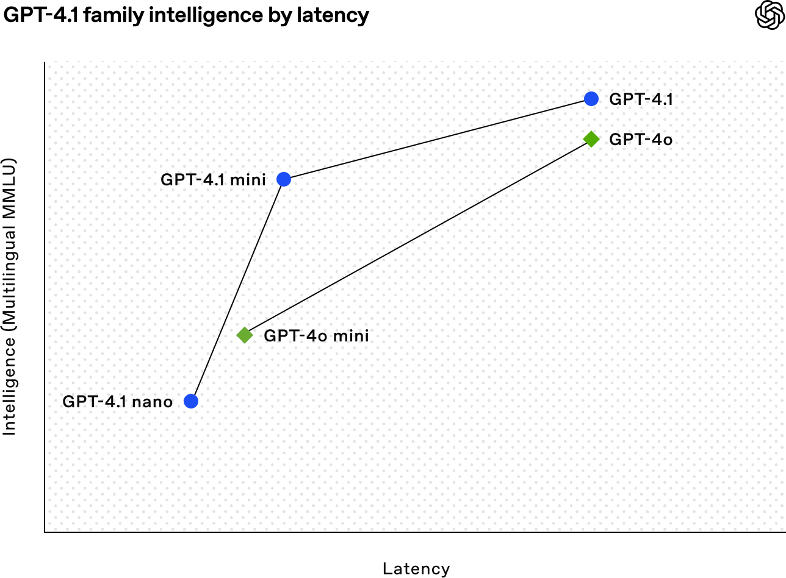
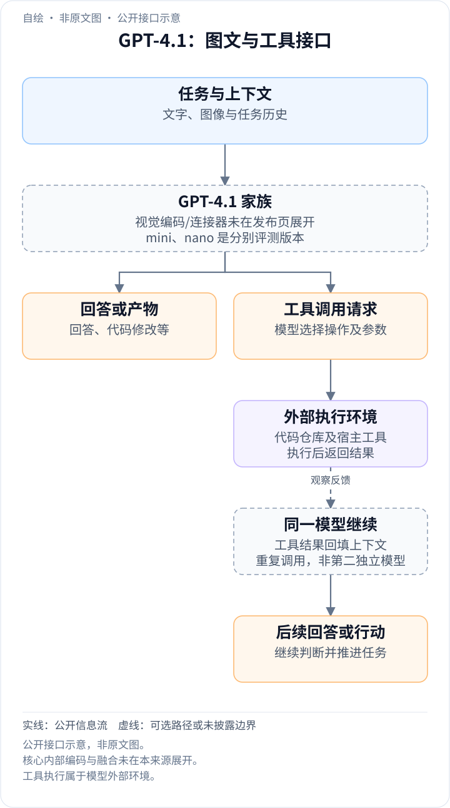
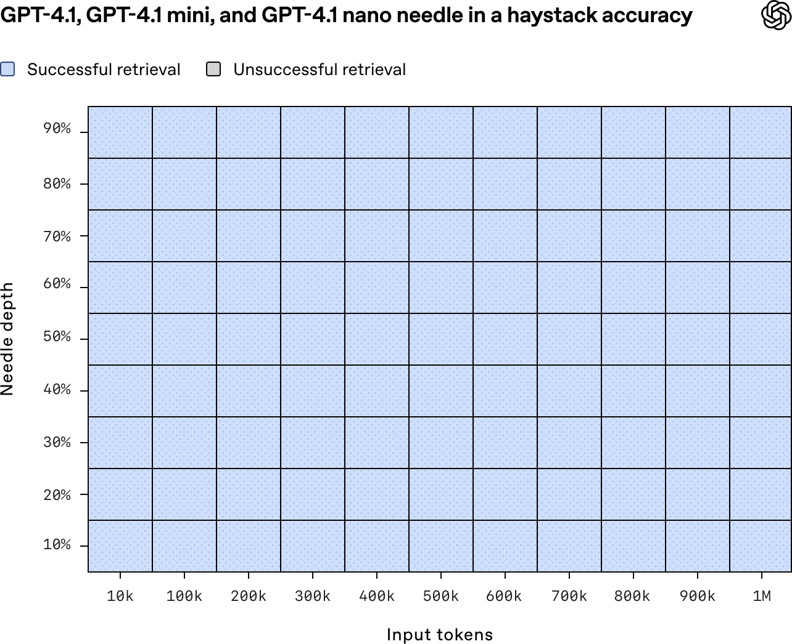
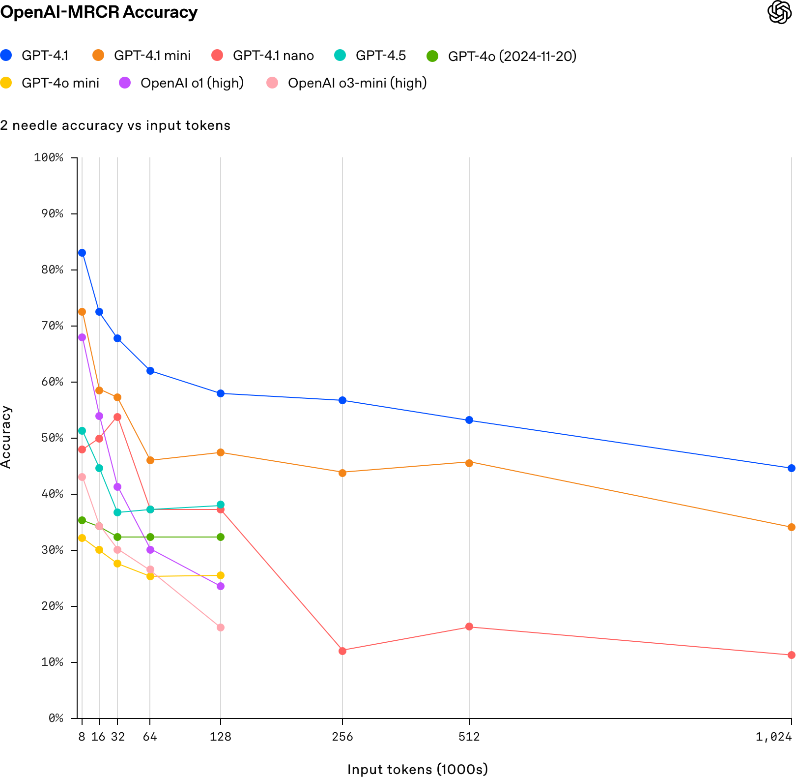

<!-- article-header:start -->
[项目首页](../../../README.md) › [模型系列](../../../reports/model-family-index.md) › [GPT](../README.md)
<!-- article-header:end -->

# GPT-4.1：面向代码、指令遵循与长上下文的多模态模型家族

<!-- article-toc:start -->

**本篇目录** · [论文定位](#paper-info) · [快速概览](#overview) · [整体架构](#architecture) · [核心原理](#principles) · [数据构建](#data) · [训练流程](#training) · [实验结果](#experiments)
<!-- article-toc:end -->

## 1. 论文信息与模型定位

| 项目 | 信息 |
|---|---|
| 原文 | Introducing GPT-4.1 in the API |
| 发布方与时间 | OpenAI，2025 年 4 月 14 日 |
| 文献类型 | 官方发布说明，包含评测附录；不是披露网络与训练配方的完整技术论文 |
| 模型 | GPT-4.1、GPT-4.1 mini、GPT-4.1 nano |
| 原始来源 | [官方发布页](https://openai.com/index/gpt-4-1/) |
| 本文依据 | 2026-10-08 留存的官方页面；缓存版本号是抓取日期，不是模型发布日期 |

这份材料介绍了一个以 API 应用为目标的闭源家族：模型理解文本和图像，生成文本、代码以及用于工具调用的输出；主要改进方向是代码编辑、复杂指令执行和长文档处理。三档模型均宣称支持最高约一百万 token 的上下文。原文还评测了长视频理解，但没有交代视频编码与采样方案，因此不能据此还原其视觉网络。

GPT-4.1 的定位并非单独的视觉专用模型。视觉任务是其通用能力的一部分，全文更重视开发者场景。mini 和 nano 是效率档位；名称并未对应公开的参数量，不能将其解读为某种确定的蒸馏比例或激活参数规模。

## 2. 快速概览

| 问题 | 原文给出的答案 |
|---|---|
| 为什么需要这一代？ | 代码任务既要解决问题，也要遵守指定的修改范围与输出格式；长上下文还要求在大量相似内容中找到正确对象 |
| 可确认的能力范围 | 文本与视觉理解、代码生成和编辑、指令遵循、长上下文检索与推理、工具使用 |
| 最大上下文 | 发布时三档均支持约 1M token；支持长度不等于每一长度上的正确率不变 |
| 主要视觉成绩 | GPT-4.1 的 MMMU 为 74.8，MathVista 为 72.2；Video-MME 的长视频、无字幕子集为 72.0 |
| 最大输出长度 | 发布页给出 GPT-4.1 为 32,768 token，对比 GPT-4o 的 16,384 |
| 复现边界 | 未公开参数量、网络结构、训练数据规模与优化超参数；本文只整理已披露的功能和测量 |

*原网页未编号配图“GPT-4.1 family intelligence by latency”；[下载原 SVG](figures/official-1.svg)。*

图的纵轴以 Multilingual MMLU 表征能力，横轴为延迟。蓝色的三档模型呈现不同的能力与效率位置，绿色为 GPT-4o 家族。它适合说明产品档位的取舍，不能当作全部多模态能力的统一测量。坐标轴没有数值刻度，因此也不能从图上读取某档的具体秒数、吞吐量或参数规模。

## 3. 整体架构

<!-- derived-architecture:start -->

*自绘公开接口示意（非原文图）。依据下述公开资料归纳；方框表示功能组件，不代表逐层实现。*

依据：[official-release-2026-10-08; Vision / Coding / Long context](https://openai.com/index/gpt-4-1/)。
<!-- derived-architecture:end -->

原文没有架构图，也没有给出视觉编码器、连接模块或语言主干的组成。可以确认的只是功能接口：文本或图像上下文与指令进入模型，模型输出回答、代码修改或工具调用所需的信息；外部工具的结果再作为后续上下文参与应用流程。这是对输入输出关系的描述，不是对内部网络的重建。

尤其需要区分三个层面。首先，图像理解成绩不意味着采用公开的 CLIP、ViT 或 Q-Former，原文未说明任何一种。其次，长视频成绩不意味着模型直接处理连续的原始视频流，发布页没有披露帧率、视觉 token 数或视频的位置编码。最后，一百万 token 的上下文也没有对应到公开的稀疏注意力、窗口注意力或压缩记忆方案。页面提及推理栈的改善，但不足以推导其实现。

这份材料不能回答“mini 是否由完整模型蒸馏”“是否采用 MoE”“视觉模块是否冻结”等问题。三档模型应作为分别评测的版本看待，不能将共同的家族名称替代结构证据。后文的数学说明聚焦公开评测所要求的运算，不将这些运算声称为模型内部机制。

## 4. 核心创新与数学原理

### 从找到一个关键词，走向区分多个相似请求

最简单的长上下文测试是 Needle in a Haystack：将目标信息放入大量无关内容，在末尾提问并检查是否找回。它主要测量检索，不足以证明多步骤推理。官方的 MRCR 则构造长对话，插入若干主题和类型相近的请求，让模型找出特定次序的那一次，例如第三次关于某主题的诗，而不是相似的故事或另一个主题的诗。困难来自内容相似性和出现顺序的共同约束。

*原网页未编号配图，标题包含 GPT-4.1、mini、nano；[下载原 SVG](figures/official-2.svg)。*

横轴为上下文长度，纵轴为目标信息所处深度；蓝色表示成功。该图展示发布方报告的测试覆盖，而不是三张分开的误差热图。原文没有由这张图给出独立样本量或置信区间；它也不支持“所有百万 token 应用均无错误”的结论。

*原网页未编号配图“OpenAI-MRCR accuracy, 2 needle”；[下载原 SVG](figures/official-3.svg)。*

MRCR 图的横轴按千 token 标注，纵轴为正确率。上下文拉长时，GPT-4.1 家族曲线明显下降，nano 的下降尤其显著。这说明检索出一个明显目标和区分多个相似目标是不同难度的任务。附录给出的两目标结果为：GPT-4.1 在 128K 为 57.2、在 1M 为 46.3；mini 为 47.2 和 33.3；nano 为 36.6 和 12.0。这里采用附录的明确数值，不从曲线像素反推额外精度。

### 跨位置的图推理

Graphwalks 用节点标识与有向边构造长上下文，要求返回从指定节点出发、给定深度的可达节点。以广度优先搜索为例，可用以下标准定义解释任务：

$$
F_0=\{s\},\qquad
F_{k+1}=\{v:\exists u\in F_k,(u,v)\in E\}\setminus\bigcup_{j=0}^{k}F_j.
$$

其中 $`F_k`$ 是第 $`k`$ 层新发现的节点。模型必须多次读取散布在上下文中的边，并保持已访问节点信息。这个式子是对评测任务的数学解释，原文没有把它作为网络公式，也没有证明模型内部执行了严格的 BFS。附录中 GPT-4.1 在低于 128K 的 BFS 测试为 61.7，超过 128K 为 19.0；长输入支持与稳定的深层图推理之间仍有距离。

### 代码编辑的约束也是能力的一部分

SWE-bench Verified 检查仓库问题是否真正解决，Aider polyglot 检查多语言代码修改。后者区分 whole-file 与 diff 两种输出形式；diff 要求模型定位要替换的片段，避免不必要的大范围重写。GPT-4.1 的 Aider diff 得分为 52.9，whole-file 为 51.6，不能把不同编辑形式的成绩混成一个指标。发布页还给出内部测量：不必要代码编辑从 GPT-4o 的 9% 降到 2%，但未披露足以独立重现的完整样本与规则。

## 5. 数据构建与处理

发布页给出的知识截止时间为 2024 年 6 月。它没有公开预训练文本或图像数量、来源配比、图像过滤策略、视频采样方式，也未给出指令数据的规模和生成器。因此，不能从知识截止时间推断训练数据的总量，更不能将评测集当成训练集。

原文能够详细说明的是部分评测材料的构建。MRCR 使用合成对话，控制目标请求的重复次数与相似干扰项；Graphwalks 用图的结构制造需要跨上下文位置追踪的信息。官方公开了 [MRCR 数据集](https://huggingface.co/datasets/openai/mrcr) 和 [Graphwalks 数据集](https://huggingface.co/datasets/openai/graphwalks)，便于研究者考察长上下文能力。公开这些评测并不表示它们参与了模型训练。

SWE-bench Verified 原有 500 个任务，发布方因基础设施无法运行其中 23 个，主要结果对应可运行任务。这个数据处理决定直接影响分母，是阅读分数时必须保留的条件。视觉评测使用 MMMU、MathVista、CharXiv 和 Video-MME，但页面没有交代模型侧的图像缩放、分辨率与帧抽取参数。

## 6. 训练流程与目标

官方说明强调开发者反馈，以及代码、指令遵循、长上下文三个改进方向。复杂指令覆盖输出格式、禁止行为、执行顺序、必须包含的内容和分类规则。材料可支持“训练目标侧重更可靠地落实约束”这一产品层面的判断，却未披露具体的预训练、监督微调、偏好优化或强化学习阶段。

因此，本节没有把通用交叉熵、DPO 或策略梯度公式填成 GPT-4.1 的实际目标。优化器、学习率、训练 token 量、并行规模、视觉模块更新范围和长上下文扩展办法均未公开。页面中的客户案例也是效果反馈，不是可复现的训练数据清单。

评测时的一些执行条件可以确认：Aider 允许一次重试；τ-bench 航空任务平均五次运行，并且不使用定制工具或提示。零售结果中的括号数值改用 GPT-4.1 充当用户模拟器，因此与原先 GPT-4o 模拟器的分数不是完全相同的测量。指令评测也受到裁判模型影响：MultiChallenge 正文为 38.3，而用 o3-mini 裁判重新评估时为 46.2。这是评分协议变化，不能当作模型训练后提升了 7.9 个百分点。

## 7. 实验设置与主要结果

下表采用发布页附录；视觉、代码与指令指标都保持各自的评测定义，不拼成综合正确率。

| 评测 | GPT-4.1 | mini | nano | GPT-4o（2024-11-20） |
|---|---:|---:|---:|---:|
| MMMU | 74.8 | 72.7 | 55.4 | 68.7 |
| MathVista | 72.2 | 73.1 | 56.2 | 61.4 |
| CharXiv reasoning | 56.7 | 56.8 | 40.5 | 52.7 |
| CharXiv descriptive | 87.9 | 88.4 | 73.9 | 85.3 |
| SWE-bench Verified | 54.6 | 23.6 | — | 33.2 |
| Aider polyglot diff | 52.9 | 31.6 | 6.2 | 18.2 |
| IFEval | 87.4 | 84.1 | 74.5 | 81.0 |

mini 在 MathVista 与两个 CharXiv 指标上略高于完整版，因此不能只按照模型档位推定所有任务的排名。nano 的某些视觉结果也低于 GPT-4o mini：例如 MMMU 为 55.4，对照为 56.3。家族整体改善不等于每个成员在每个视觉任务上都更好。

长视频方面，GPT-4.1 在 Video-MME **30–60 分钟、无字幕**子集达到 72.0，GPT-4o 为 65.3，提升 6.7 个百分点。这不是 Video-MME 全测试集的总体成绩，也不能直接用于预测任意长度和采样设置的视频表现。

代码方面，SWE-bench Verified 的 54.6 比 GPT-4o 的 33.2 高 21.4 个百分点。考虑被排除的 23 个任务，若把它们全部按失败计入原始 500 个任务，原文给出约 52.1；其关系可理解为 $`54.6\%\times477/500\approx52.1\%`$。这只是分母修正，不是新的模型运行结果。正文称相对 GPT-4.5 提升 26.6 个百分点，但附录 GPT-4.5 的分数是 38.0，与该差值不一致；本文保留这一来源冲突，不复述无法同时成立的提升值。

指令遵循方面，MultiChallenge 的 38.3 相比 GPT-4o 的 27.8 提高 10.5 个百分点；内部困难指令为 49.1 对 29.2。不过，裁判变化能显著改变得分，跨版本比较应使用同一评分协议。工具任务也并非全部领先：ComplexFuncBench 为 65.5，略低于 GPT-4o 的 66.5。

这些证据支持 GPT-4.1 在发布时的代码编辑、指令与部分视觉任务上取得明显改善。其长上下文能力仍随长度和任务复杂度变化。由于网络与训练配方没有公开，本材料更适合作为带评测条件的能力档案，不能充当实现同等模型的复现指南；本文也未运行模型或独立复测上述成绩。

<!-- article-footer:start -->
---

[← 上一篇：Kimi-VL](../../kimi/arxiv-2504.07491/README.md) · [按发表时间浏览](../../../reports/paper-reading-guide.md#year-2025) · [下一篇：InternVL3 →](../../internvl/arxiv-2504.10479/README.md)

[返回本篇目录](#article-toc) · [返回模型系列](../README.md)
<!-- article-footer:end -->
