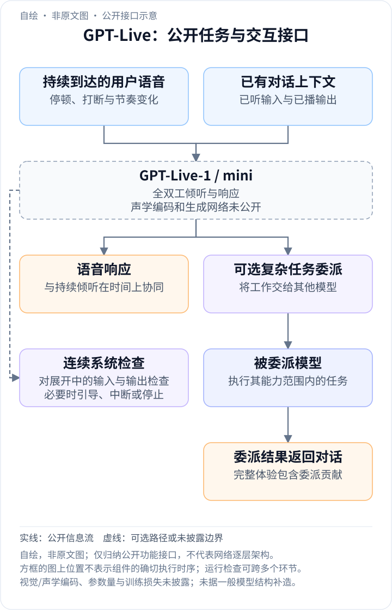
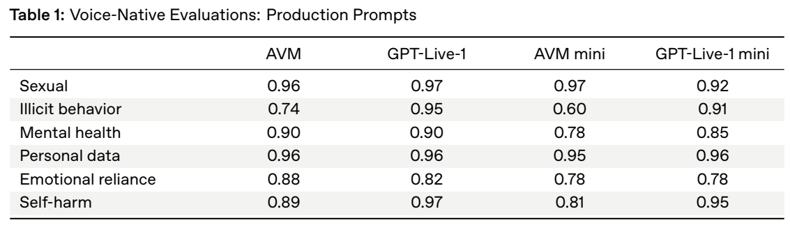
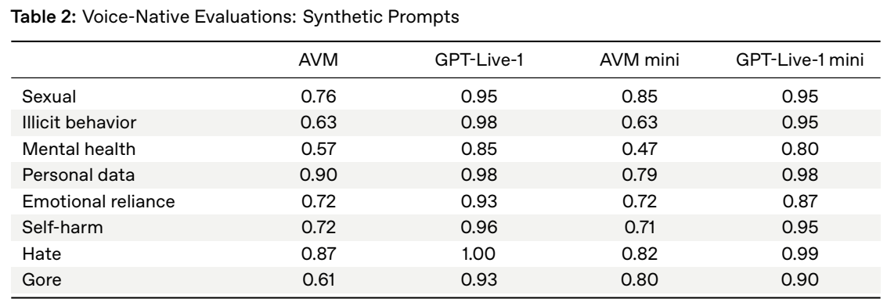

<!-- article-header:start -->
[项目首页](../../../README.md) › [模型系列](../../../reports/model-family-index.md) › [GPT](../README.md)
<!-- article-header:end -->

[项目首页](../../../README.md) › [模型系列](../../../reports/model-family-index.md) › [GPT](../README.md)

# GPT-Live：全双工语音交互、连续响应与模型委派

<!-- article-toc:start -->
<a id="article-toc"></a>

**本篇目录** · [论文定位](#paper-info) · [快速概览](#overview) · [整体架构](#architecture) · [核心原理](#principles) · [数据构建](#data) · [训练流程](#training) · [实验结果](#experiments)
<!-- article-toc:end -->

<a id="paper-info"></a>

## 1. 论文信息与模型定位

| 项目 | 内容 |
|---|---|
| 报告题名 | GPT-Live System Card |
| 发布机构 | OpenAI |
| 发布与采用版本 | 2026-07-08 发布；采用 2026-10-13 固定的 PDF，其中包含 2026-08-04 评测配置修正 |
| 官方资料 | [系统卡 PDF](https://deploymentsafety.openai.com/gpt-live/gpt-live.pdf)；[官方 HTML](https://deploymentsafety.openai.com/gpt-live) |
| 家族与版本 | GPT-Live-1、GPT-Live-1 mini；GPT 家族的语音交互分支 |
| 定位 | 持续倾听和发声的全双工语音模型，并可把复杂工作委派给其他模型 |
| 开放与规模 | 参数量、声学编码器、语音 token、网络层数及权重未公开 |

该卡提供的是全双工行为、训练资料类别、委派边界及安全实验，未给出完整声学架构。本文按原文公开路径解释语音系统，不将其描绘成已经证实的 ASR→LLM→TTS 串联方案，也不假定使用某种声码器或分块大小。

<a id="overview"></a>

## 2. 快速概览

传统按轮次交互的语音系统通常等待用户说完，再开始生成回答。GPT-Live 的关键变化是能够在倾听和响应之间持续协调：用户停顿、打断或改变语速时，系统决定继续听、开始说或调整当前响应。它所解决的是对话时间组织问题；系统卡没有报告响应延迟、打断检测准确率或双讲场景的独立基准，因此不能将“全双工”直接换算成某个毫秒级性能承诺。

模型还支持委派。复杂任务可以交给其他模型处理，随后工作结果进入用户的语音体验。这使“语音前端本身的能力”和“包含委派的完整系统能力”成为不同对象。原文的大部分部署评测按包含委派的体验进行，而没有委派时的能力限制另作说明。

系统卡同时关注语音模态特有的评测分布：真实用户同意分享的困难语音，以及根据政策边界合成的语音问题。两组结果互补，不能把合成提示上的安全分数当作真实流量发生率。[依据：系统卡第 1、3、5 节，PDF 第 2、4–6 页](https://deploymentsafety.openai.com/gpt-live/gpt-live.pdf#page=2)。

<a id="architecture"></a>

## 3. 整体架构

<!-- derived-architecture:start -->


*自绘公开接口示意（非原文图）。依据下述公开资料归纳；方框表示功能组件，不代表逐层实现。*

依据：[系统卡第1、2、5节，PDF第2–3、6页](https://deploymentsafety.openai.com/gpt-live/gpt-live.pdf)。
<!-- derived-architecture:end -->

公开的数据流包括连续音频输入、全双工对话决策、语音响应、可选模型委派与持续系统检查。全双工意味着输入与输出在时间上可以重叠，不能画成“用户录音结束→完整识别→完整回答→完整合成”四段互斥执行的流水线。

| 模块 | 输入与输出 | 公开机制 |
|---|---|---|
| 连续语音输入 | 用户语音、停顿、打断等对话信号 → 当前交互条件 | 模型可以持续听取语音；具体采样率、编码及时间分块未公开 |
| 全双工语音模型 | 已有交互条件 → 继续听、响应或调整发声 | GPT-Live-1/mini 支持连续倾听与回复；内部结构未披露 |
| 语音输出路径 | 模型响应 → 用户听到的语音 | 与倾听协同进行；语音 token、合成器和声码器结构未披露 |
| 可选模型委派 | 复杂任务 → 其他模型处理后的结果 | 评测默认包含相应委派体验；不能将被委派模型的全部能力归到语音主模型 |
| 流式系统检查 | 展开中的输入/输出 → 继续、引导、中断或停止 | 对话过程中检查；公开功能不等于某个确定的网络层 |

一次普通交互可以直接由语音模型完成；需要复杂处理时，系统增加委派路径。原文还说明，发布时语音模型没有独立广泛工具访问或代码执行能力。工具能力来自委派目标时，应在系统图和能力比较中保留这条边界。

<a id="principles"></a>

## 4. 核心创新与数学原理

### 4.1 全双工：在时间上同时组织倾听与响应

全双工解决的不是单纯“把回答生成得更快”，而是用户和模型可能同时发声时，怎样维持自然对话。用户的一次短停顿未必代表句子结束；新插入的信息也可能使已经开始的回答需要改变。原文描述模型可根据停顿、打断与节奏，在当前时刻判断是否响应或继续听。

用时间轴上的状态表示帮助理解，可以令 $`x_{\le t}`$ 表示目前收到的音频，$`y_{\lt t}`$ 表示此前已经输出的语音。一个对话控制决策需要同时考虑它们以及历史上下文 $`c`$：

```math
d_t=F(x_{\le t},y_{\lt t},c).
```

这里 $`d_t`$ 仅代表“此时继续倾听还是响应”的概念性决策，$`F`$ **不是已披露的独立控制器**。该表达式不预设离散音频 token、具体生成概率分解或某种同步损失。公开材料足以确认交互行为，却不足以说明网络怎样学习这个决定。[依据：第 1 节，PDF 第 2 页](https://deploymentsafety.openai.com/gpt-live/gpt-live.pdf#page=2)。

### 4.2 模型委派：区分语音主模型与完整体验

复杂任务可交由其他模型处理，意味着最终表现同时取决于语音交互、委派选择、目标模型以及结果返回。若只把最终结果归给 GPT-Live，会高估语音主模型独立解决问题的能力；反过来，忽略委派又不能反映实际部署体验。

原文因此明确：报告中的评测包含委派，而判断语音模型自身在能力框架中的位置时，又讨论不委派的情况。第 5 节指出，独立 GPT-Live 模型没有广泛工具访问或代码执行能力；委派后的任务继承目标模型对应的约束。这不等于报告公开了路由器训练、模型选择阈值或负载均衡算法，相关细节仍未知。

从工程上看，委派还会引入结果等待、上下文交接与错误传播，但原文没有逐项测量这些成本。它支持“交互模型与复杂任务模型协作”的结论，不支持推导独立模型的推理上限、委派比例或端到端延迟。

### 4.3 连续系统检查：约束作用于正在展开的对话

语音输出一旦播放，后续删改不能让已经听到的内容消失。因此原文描述输入与生成输出会随着对话展开而被检查，系统可以引导或中断响应、播放安全语音、提供文字资源，必要时结束语音会话。这些运行时措施与模型自身的安全训练共同组成部署体验。

应区分两个测量对象：红队测试中关闭系统级缓解以观察模型安全训练；部署体验则包含流式检查及委派。两者相差的是系统条件，而非简单“一个模型开关”。报告没有披露检查的逐帧频率、分类器结构、停止阈值或额外延迟，因而不能把该流程写成固定的二分类损失。

### 4.4 两类语音评测：定向挑战集与真实发生率不同

真实语音评测从用户同意分享的交互中挑选此前 AVM 表现不够理想的情况；合成语音则先构造政策边界问题，再转成语音输入。前者包含自然表达、模糊语义和较长上下文，后者能有目的地覆盖稀有或难采样的情况。

若用 $`\hat s=N_{\mathrm{safe}}/N`$ 表示所选测试集中的安全响应比例，它估计的是该测试分布下的表现。由于样本被刻意挑难，$`1-\hat s`$ 不能解释为所有真实语音通话的违规率。该式是对指标口径的解读，原文没有给出完整评分器公式或逐类样本数。[依据：第 3.1.1–3.1.2 节，PDF 第 4–5 页](https://deploymentsafety.openai.com/gpt-live/gpt-live.pdf#page=4)。

<a id="data"></a>

## 5. 数据构建与处理

| 数据用途 | 来源与处理 | 规模与披露情况 |
|---|---|---|
| 模型训练 | 公开互联网、合作方资料、用户或人工训练人员和研究者提供/生成的资料；执行质量、个人信息及敏感内容过滤 | 小时数、音频/文字配比和语言分布未公开 |
| 真实语音评测 | 用户同意分享的语音，核对许可与删除/退出状态，过滤不合格数据，并进行个人信息清理、去标识化与转写 | 聚焦 AVM 原先表现不理想的案例；不按真实流量频率加权 |
| 合成语音评测 | 根据政策和边界情况生成文本，再合成为语音输入 | 旨在补齐难获取场景；合成器与逐类规模未披露 |
| 红队素材 | 内外部、多语言测试，覆盖语音身份、情感依赖、音频扰动等问题 | 未公开完整攻击集 |

转写步骤在第 3 节的评测构建中出现，不能据此断言 GPT-Live 的推理架构必须先做 ASR。训练数据和评测提示也不应合并计数；系统卡没有公开两者的总量。[依据：第 2–4 节，PDF 第 3–6 页](https://deploymentsafety.openai.com/gpt-live/gpt-live.pdf#page=3)。

<a id="training"></a>

## 6. 训练流程与目标

| 环节 | 公开目标与过程 | 公开边界 |
|---|---|---|
| 基础能力训练 | 使用多来源资料构建语音交互模型 | 模态对齐、语音编码、预训练损失和阶段顺序未披露 |
| 安全训练与基础测试 | 使用与旗舰模型相同的基础设施进行安全训练；早期红队先测尚无模型安全训练的基线 | 不应据此推定基础权重来源或特定强化学习算法 |
| 迭代改进与复测 | 随后完成两轮测试，依据早期发现调整重点，再验证改进 | 红队测试轮次不是公开的三个完整训练阶段 |
| 部署组合 | 加入连续检查、委派及运行监控，按完整体验进行评测 | 这些系统组件不属于已披露的主模型参数更新 |

原文没有给出全双工监督信号、打断标签构造、重叠发声损失或委派目标函数。学习率、batch、训练步数、硬件和成本同样未知。能够确认的是全双工交互和安全改进的公开目标，不能用通用交叉熵或 RL 公式填补具体配方。

<a id="experiments"></a>

## 7. 实验设置与主要结果

采用的系统卡包含 2026-08-04 修订：作者发现评测后端配置与最终发布模型不一致，重新运行完整评测并更新结果。以下使用正文更新后的 Table 1–2，附录中标为 Previously reported 的值不作为最终成绩。



*原文 Table 1，PDF 第 4 页图表区域；四列分别为原 AVM、新 GPT-Live-1、原 AVM mini、新 GPT-Live-1 mini。*

| 真实语音困难提示类别 | AVM → GPT-Live-1 | AVM mini → GPT-Live-1 mini | 解读 |
|---|---|---|---|
| 非法行为 | 0.74 → 0.95 | 0.60 → 0.91 | 两档均有较大提升 |
| 自伤 | 0.89 → 0.97 | 0.81 → 0.95 | 两档均提高 |
| 情感依赖 | 0.88 → 0.82 | 0.78 → 0.78 | 主模型下降，mini 持平 |
| 性内容 | 0.96 → 0.97 | 0.97 → 0.92 | mini 出现退步，不能概括为所有类别提升 |



*原文 Table 2，PDF 第 5 页图表区域；采用同样四组模型。*

**读表方式**：在合成提示上，GPT-Live-1 的非法行为得分为 0.98、情感依赖 0.93，自伤为 0.96；mini 相应为 0.95、0.87、0.95。作者报告这些合成类别上均不弱于各自 AVM 基线，但真实提示中的退步说明两组评测覆盖不同困难，不能只保留合成结果。

**适用范围**：这些成绩衡量困难语音提示下的安全表现，并包含委派条件。报告没有给出 WER、音色相似度、语音自然度 MOS、首音频延迟或全双工打断恢复成功率，也没有独立消融来量化“去掉委派”或“关闭全双工”的收益。因此，结果支持部署行为的比较，尚不能用于完整排名语音理解、生成质量或交互速度。

<!-- article-footer:start -->
---

[← 上一篇：Seed2.0](../../seed/arxiv-2607.00248/README.md) · [按发表时间浏览](../../../reports/paper-reading-guide.md#year-2026) · [下一篇：GPT-5.6 →](../document-42bb90895c3a/README.md)

[返回本篇目录](#article-toc) · [返回模型系列](../README.md)
<!-- article-footer:end -->
