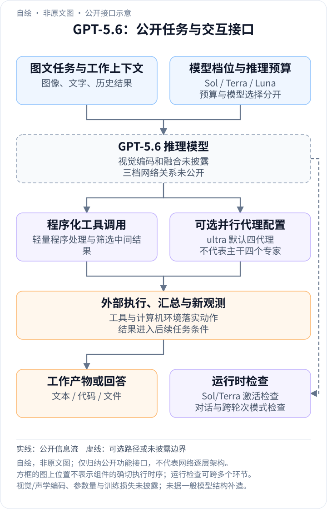
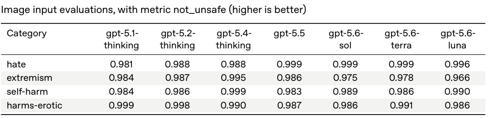
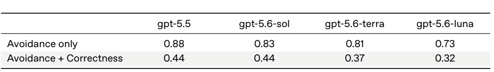

<!-- article-header:start -->
[项目首页](../../../README.md) › [模型系列](../../../reports/model-family-index.md) › [GPT](../README.md)
<!-- article-header:end -->

[项目首页](../../../README.md) › [模型系列](../../../reports/model-family-index.md) › [GPT](../README.md)

# GPT-5.6：三档多模态推理、程序化工具调用与代理效率

<!-- article-toc:start -->

**本篇目录** · [论文定位](#paper-info) · [快速概览](#overview) · [整体架构](#architecture) · [核心原理](#principles) · [数据构建](#data) · [训练流程](#training) · [实验结果](#experiments)
<!-- article-toc:end -->

## 1. 论文信息与模型定位

| 项目 | 内容 |
|---|---|
| 报告题名 | GPT-5.6 System Card |
| 发布机构 | OpenAI |
| 发表信息 | 2026-07-09 正式发布；采用 2026-10-13 下载的系统卡，含 8 月评测更新 |
| 官方资料 | [系统卡 PDF](https://deploymentsafety.openai.com/gpt-5-6/gpt-5-6.pdf)；[发布博客](https://openai.com/index/gpt-5-6/) |
| 家族组成 | Sol：旗舰档；Terra：较低成本的均衡档；Luna：最快且成本最低的档位 |
| 多模态与任务 | 图文理解、编程、专业知识工作与计算机操作；文本、代码和工具调用构成公开的工作输出 |
| 网络与开放情况 | 参数规模、视觉编码器、融合层、专家结构和权重均未公开；不能将三个档位理解为已知比例的参数子网 |

系统卡详细介绍训练方向、图文与代理评测和分层运行约束；发布博客则补充工具编排、并行代理以及主任务表现。本文区分基础模型、工具运行环境与多代理配置，不把系统加速机制写成新的神经网络层。

## 2. 快速概览

GPT-5.6 的公开目标是提高完成真实工作的效率，而不仅是提高单题得分。三档模型让任务可以在能力、延迟与成本之间选择；思考预算则提供同一模型内部的推理工作量控制。发布博客还描述程序化工具调用：模型编写并执行轻量程序来协调工具、过滤中间结果和选择后续动作，减少把所有工具输出反复送回模型的开销。

另一条扩展路径是并行代理。公开的 ultra 默认用四个代理协同推进工作，并在部分实验中比较更多代理；这是一种推理系统配置，不能据此断言 Sol 主干内部存在四个专家或四个模型副本的固定架构。并行工作可以减少完成时间，同时提高总 token 消耗。

系统卡也给出多模态能力之外的行为边界：视觉输入安全总体与前代相当，较大模型在完成复杂任务并避免覆盖用户修改方面更强，但某些行为评测出现回退。阅读本报告时，需要同时观察任务成绩、成本、操作正确性与系统约束，而不是把某一条效率曲线概括为所有场景的全面改善。[依据：系统卡第 1、3.2–3.4 节；发布博客“Efficient by default”](https://openai.com/index/gpt-5-6/)。

## 3. 整体架构

<!-- derived-architecture:start -->

*自绘公开接口示意（非原文图）。依据下述公开资料归纳；方框表示功能组件，不代表逐层实现。*

依据：[系统卡第1、3.2–3.4节；官方博客 Efficient by default / Scaling safety](https://deploymentsafety.openai.com/gpt-5-6/gpt-5-6.pdf)；[Official release blog: public model capabilities and workflow interfaces](https://openai.com/index/gpt-5-6/)。
<!-- derived-architecture:end -->

公开的信息流可以概括为：文字、图像和工作资料进入模型上下文，模型在给定思考预算下作出回答或工具决策，工具环境执行后返回结果，必要时由协调逻辑组织多个代理推进子任务。视觉编码、token 压缩、位置编码和跨模态融合实现均未披露。

| 模块 | 输入与输出 | 公开机制 |
|---|---|---|
| 多模态任务输入 | 图像、文字、文档及工具观测 → 任务条件 | 系统卡明确评测组合图文输入，具体视觉网络与分辨率策略未公开 |
| Sol / Terra / Luna 推理模型 | 当前上下文 → 回答、代码或工具决策 | 三档能力与成本定位；推理训练采用强化学习，参数与算法细节未知 |
| 程序化工具编排 | 模型生成的轻量程序 → 工具结果的处理与筛选 | 在工具运行环境中协调调用，避免每一项中间结果都形成模型往返 |
| 并行代理配置 | 可分解任务 → 并行子任务及汇总结果 | ultra 默认四代理；属于推理配置，额外代理带来额外 token 与协调开销 |
| 计算机与外部工具 | 动作/程序请求 → 新页面、文件或观测 | 执行器完成实际操作，模型读取结果后继续工作 |
| 运行时检查 | 激活信号、对话与跨轮次模式 → 检查或干预 | 系统卡明确 Sol/Terra 加入激活分类器，不能假定 Luna 使用完全相同组件 |

功能图中的工具执行、代理调度和运行检查代表不同职责，不表示它们都位于主模型计算图内。一次简单图像问答可以直接结束；长任务才需要反复调用工具或协调代理。公开材料没有说明三个档位之间是否蒸馏、共享权重或采用不同网络类型。

## 4. 核心创新与数学原理

### 4.1 模型档位与思考预算是两条不同的扩展轴

Sol、Terra、Luna 代表模型选择，reasoning effort 代表所选模型推理时投入的工作量。切换档位与调高预算并不等价：前者更换模型，后者改变同一模型探索、检查和修订的程度。系统卡因此报告随思考预算变化的曲线，而不只报告单个最大分数。

可用 $`Q(m,e)`$ 表示模型 $`m`$ 在预算 $`e`$ 下的任务质量，$`C(m,e)`$ 表示相应成本。比较时至少要同时给出这两个量，而不能只比较 $`\max_e Q(m,e)`$。这是一种阅读实验曲线的补充记法，并非原文训练目标；不同任务也不能假设质量随预算严格单调提升。

三档的公开定位有利于分析效率，却不能推出参数量、FLOPs 或显存比例。系统卡没有报告网络层数与激活参数，因此将 Luna 描绘成 Sol 的确定宽度子网没有依据。[依据：系统卡第 1 节，PDF 第 2–3 页](https://deploymentsafety.openai.com/gpt-5-6/gpt-5-6.pdf#page=2)。

### 4.2 程序化工具调用：让程序处理大量中间结果

普通工具交互常在每次返回后重新调用模型：模型读结果、决定下一步，再发出新调用。程序化调用允许模型先写出协调程序，由程序完成一部分筛选、循环和分支，把需要进一步判断的内容送回模型。它压缩的是交互路径，不是证明模型视觉 token 被某个未公开模块压缩。

若 $`K`$ 个中间结果的文本总长为 $`\sum_k L_k`$，只让模型接收必要摘要可以减少上下文输入；但程序生成、执行、异常处理与最终摘要也有成本。若调用强依赖语义判断，程序无法预先可靠决定下一步，减少往返的空间就会变小。

这种设计的实际意义是把确定性数据处理交给程序，把不确定判断留给模型。发布博客公开了该工作方式，但没有披露其专属训练集、程序正确性奖励或失败恢复算法，不能把它等同于一个已知的树搜索方法。[依据：发布博客“Efficient by default, maximum performance on demand”](https://openai.com/index/gpt-5-6/)。

### 4.3 并行代理：墙钟时间与总计算量分开看

多个相对独立的子任务可以并行推进，再由协调者整合结果。为理解其收益，若子任务耗时为 $`T_1,\ldots,T_K`$，理想并行的关键路径近似由 $`\max_k T_k`$ 决定，串行则近似为 $`\sum_k T_k`$；实际还需要调度、通信与汇总时间。这是并行计算的解释模型，不是 GPT-5.6 的延迟预测公式。

公开的 ultra 默认四代理，并在部分基准中展示 16 代理配置。代理增加会消耗更多 token，任务存在强依赖、重复探索或汇总冲突时，收益也可能下降。因此四代理更快不等于“相同计算成本下模型更强”，基础单代理分数与 ultra 分数应分列。[依据：发布博客对应多代理曲线与实验脚注](https://openai.com/index/gpt-5-6/)。

### 4.4 将操作正确性纳入训练：避免“不出错但不完成”

系统卡指出，之前的代理曾依赖额外谨慎提示来维持避免覆盖的表现；GPT-5.6 针对在提高自主性的同时保留用户工作进行了训练。报告同时给出 Avoidance only 与 Avoidance + Correctness，后者要求完成任务且没有不当覆盖。

这两个事件的关系可写成 $`P(A\cap C)\le P(A)`$，其中 $`A`$ 是避免不当覆盖，$`C`$ 是完成任务。这是对评测逻辑的解释，不是新的联合损失。只提升 $`P(A)`$ 可能来自保守不操作，因此需要联合指标检验可用性。Sol 的单独避免率略降，而联合指标持平，正说明两个指标不能互相替代。[依据：第 3.3 节，PDF 第 11 页](https://deploymentsafety.openai.com/gpt-5-6/gpt-5-6.pdf#page=11)。

### 4.5 激活检查与推理检查：主模型之外的系统机制

系统卡公开 Sol/Terra 的激活分类器会在生成时关注特定敏感领域；对话与跨会话模式也有系统检查。发布博客还介绍利用推理检查对话、动态更新约束的方式。它们与模型内部学到的行为共同影响部署输出，但不能据此推断分类器的层位置、特征维度或训练损失。

有些评测仅观察模型输出，有些包含系统约束，还有些固定关闭某些保护以研究能力。读分数时应先确认设置，再讨论改进来源。原文没有用统一消融证明每个组件的独立贡献，故不能将某次总分变化完全归因于某一个检查器。

## 5. 数据构建与处理

| 用途 | 已公开资料 | 未公开细节 |
|---|---|---|
| 模型学习 | 公开互联网、合作方资料、用户及人工提供/生成的信息；质量、个人信息及敏感内容过滤 | 各档训练 token、图像/视频比例和采样配比 |
| 推理与代理训练 | 强化学习学习思考；训练操作自主性及用户工作保护 | RL 算法、奖励组成、轨迹数量与阶段边界 |
| 行为评测 | 困难生产提示、图文组合输入、计算机操作、去标识化流量模拟 | 大部分完整测试数据未开放 |
| 自动与人工红队 | 内外部测试与大规模自动搜索 | 报告中的超过 700,000 A100e GPU 小时用于自动寻找通用越狱，不是基础模型总训练算力 |

系统卡第 2 节是训练资料说明，第 3 节之后主要是评测和部署分析。不能把红队搜索预算、测试问题或生产模拟流量都计入模型预训练集。

## 6. 训练流程与目标

| 公开环节 | 目标 | 披露与边界 |
|---|---|---|
| 多来源基础学习 | 通用知识与多模态任务能力 | 未披露架构、训练时长与模态混合方案 |
| 推理强化学习 | 回答前推理、探索策略并纠错 | 原文没有给出确切策略优化目标或奖励权重 |
| 代理行为改进 | 自主完成工作、避免覆盖用户数据、遵循确认策略 | 不能确定是独立阶段还是混入其他训练 |
| 系统组件训练与部署 | 激活检查、对话检查及连续运行监控 | 部署机制不能全部当作主模型参数更新 |

学习率、batch、训练步数、优化器和各档硬件投入均未公开。推理时的 max/ultra 是计算配置；增加代理并不改变已经训练好的模型参数。报告的多条效率曲线也没有公开到足以独立复现完整训练。

## 7. 实验设置与主要结果

官方发布博客给出以下主任务结果。下表采用其主结果表，保持单代理与 ultra 分列；具体预算与工具条件仍以原文脚注为准。

| 任务 / 指标 ↑ | Sol | Terra | Luna | 对照与解读 |
|---|---|---|---|---|
| DeepSWE v1.1 | 72.7% | 69.6% | 67.2% | GPT-5.5 为 67.0%，Sol 提高 5.7 个百分点 |
| Terminal-Bench 2.1 | 88.8% | 87.4% | 84.7% | Sol ultra 为 91.9%，不能与单代理视为同一设置 |
| OSWorld 2.0 | 62.6% | 50.2% | 45.6% | GPT-5.5 为 47.5%；该版本基准不同于 GPT-5.4 发布时的 OSWorld-Verified |

据[官方发布博客主结果表](https://openai.com/index/gpt-5-6/)整理。代理脚手架、工具权限、预算及模型快照会影响成绩，不将不同版本的 OSWorld 数值直接相减来推断代际进步。

*原文第 3.2 节未编号表，系统卡 PDF 第 10 页图表区域；指标 not_unsafe，越高越好。*

**读表方式**：Sol/Terra/Luna 的 extremism 得分分别为 0.975/0.978/0.966，低于表内 GPT-5.4 Thinking 的 0.995。原文总体判断与前代相当，且小幅回退统计不显著；这张表不是通用视觉理解能力排行榜。

*原文第 3.3 节未编号表，PDF 第 11 页图表区域；第一行只要求避免覆盖，第二行还要求完成任务。*

**结果解读**：Sol 的 Avoidance only 为 0.83，低于 GPT-5.5 的 0.88；联合正确性同为 0.44。Terra、Luna 的联合值为 0.37、0.32，表明更低成本档位仍有复杂任务能力取舍。对照这两行，才能区分保守行为与真正完成任务。

报告中的前代对照使用近期快照，可能与前代首发卡不同。它还在 8 月修正了某个蛋白结合实验的 pass@4 对照值；本文未把那项实验当作多模态理解成绩，也不沿用旧错误数字。原文足以支持公开任务与行为的比较，不能据此得出三个档位的具体结构、训练成本或任意用户工作流的成功率。

<!-- article-footer:start -->
---

[← 上一篇：GPT-Live](../document-3e6d0908a22e/README.md) · [按发表时间浏览](../../../reports/paper-reading-guide.md#year-2026) · [下一篇：VideoChat3 →](../../videochat/arxiv-2607.14935/README.md)

[返回本篇目录](#article-toc) · [返回模型系列](../README.md)
<!-- article-footer:end -->
