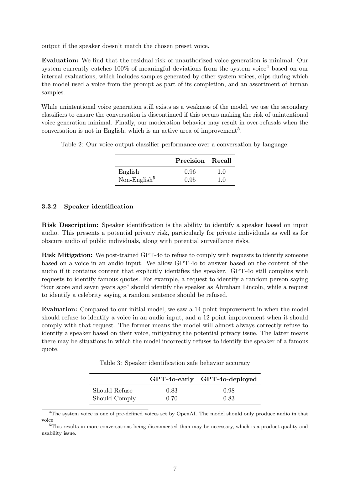
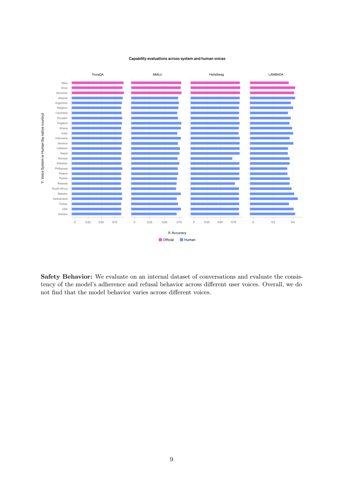
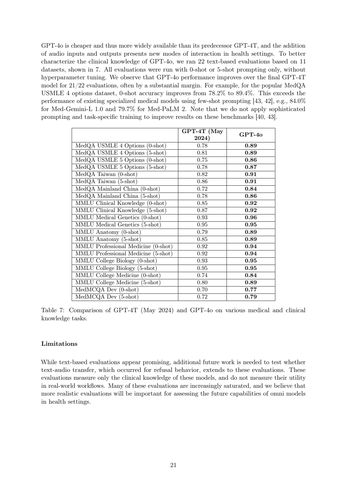
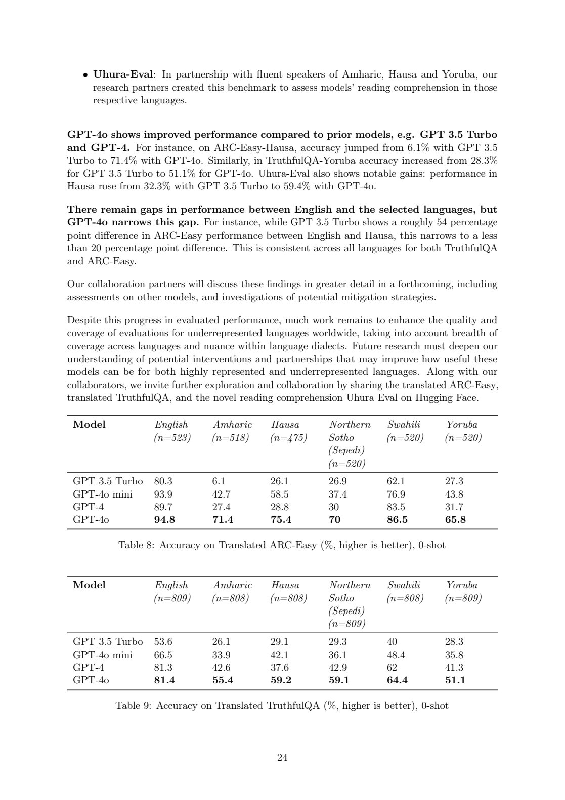

# GPT-4o：端到端多模态交互与语音系统评估

## 1. 论文信息与模型定位

本条目的原始材料是 OpenAI 于 **2024 年 5 月 13 日**发布的 [Hello GPT-4o](https://openai.com/index/hello-gpt-4o/)，配合后来于 **2024 年 8 月 8 日**发布的 [GPT-4o System Card](https://cdn.openai.com/gpt-4o-system-card.pdf) 阅读。前者是发布说明，后者是系统卡；它们没有完整披露模型结构、数据配比和训练超参数，不能作为一份可直接复现的架构论文使用。本文引用的 PDF 页码均指 33 页系统卡，发布说明中的信息单独注明。

GPT-4o 中的 “o” 指 omni。官方定位是接收文本、音频、图像、视频等输入，生成文本、音频及图像等输出的端到端多模态模型。这里要区分研究能力与产品发布：5 月发布时，ChatGPT 和 API 首先开放文本、图像输入及文本输出；新的语音能力按阶段部署，发布页的图像生成、歌唱等演示不等于当时所有用户都能调用的接口。系统卡进一步聚焦语音对语音交互及相应评估。[发布说明](https://openai.com/index/hello-gpt-4o/)，[系统卡第 1 页](https://cdn.openai.com/gpt-4o-system-card.pdf#page=1)。

它在本仓库的价值是展示闭源 omni 模型的交互范式与公开评测边界。相比常见的“视觉编码器接语言模型”开源报告，这份材料更适合研究原始语音信息如何进入推理、实时交互为何需要配套系统，以及评测如何覆盖模态之间的迁移。

## 2. 快速概览

| 关注点 | 公开结论与边界 |
| --- | --- |
| 多模态建模 | 官方称文本、视觉和音频由同一神经网络端到端处理；具体编码器、解码器及融合位置未公开 |
| 语音响应 | 发布说明报告最短 232 ms、平均 320 ms；这些是厂商当时的测量，未给出完整硬件与负载设置 |
| 与旧语音模式的区别 | 旧流程经过转写、文本模型和语音合成，GPT-4o 直接处理音频，能够保留语气、说话者和背景声音信息 |
| 训练资料 | 公开说明涵盖截至 2023 年 10 月的文本与语音训练知识，以及图像、音频、视频等来源类别；没有总 token 或样本数量 |
| 系统卡重点 | 声线控制、说话者识别边界、不同输入声线的表现、音频拒绝行为及 Preparedness 评估 |
| 开放程度 | 未公布权重、参数量、层数、训练代码与完整数据清单 |

发布页还展示多语言分词效率改善。例如同一段中文示例由此前分词器的 34 个 token 变为 24 个，古吉拉特语示例由 145 个变为 33 个。它说明特定文本能更紧凑地编码，但每种语言的一段示例不能当作该语言全语料的平均压缩率，也不能独立证明任务准确率提升。

## 3. 整体架构

旧语音模式可概括为“用户波形 → 语音识别文本 → GPT-3.5/GPT-4 的文本回答 → 语音合成波形”。发布说明称该流程平均响应时间分别约为 2.8 秒和 5.4 秒。文本转写成为信息瓶颈：相同文字可以用不同情绪、速度和强调方式说出，背景中也可能同时有其他声音，这些信息不能靠最终转写完整表达。

GPT-4o 将多模态输入和输出纳入一个端到端模型，减少上述串联边界。系统卡明确称其为自回归 omni 模型。可以把其公开定位理解为根据多模态上下文逐步生成后续输出，但原文没有公布音频是否采用离散 codec token、图像 token 如何组织、音视频如何同步，以及流式生成是否使用单独的等待策略。因此本文不画假定的 Transformer 层图，也不把其他模型的 Thinker–Talker 设计移植到 GPT-4o。[系统卡第 1 页](https://cdn.openai.com/gpt-4o-system-card.pdf#page=1)。

模型之外还有实际部署系统。系统卡说明语音输出受系统消息中的预设声线样本引导，并由辅助声线分类器持续检查；偏离允许声线时，系统可停止会话输出。这是“模型生成能力 + 输出监测”的组合，分类器不等于模型内部的音频解码头，报告没有披露它的网络结构。[系统卡第 6–7 页](https://cdn.openai.com/gpt-4o-system-card.pdf#page=6)。

**如何读图：**上方 Table 2 衡量输出声线分类器，而下方 Table 3 衡量模型是否正确处理说话者身份请求，二者不是同一个任务。前者英文精确率 0.96、召回率 1.0，非英文为 0.95、1.0；后者的 Should Refuse 从 0.83 到 0.98，Should Comply 从 0.70 到 0.83。公开评测中的高召回说明该测试集上偏离声线容易被发现，不代表任何未来音频都必然被检出。正文描述的提升点数与表格舍入值略有差别，这里保留表中原值。

## 4. 核心创新与数学原理

第一项关键变化是**在推理入口保留原始音频信息**。为解释这点，令音频为 $a$，转写文本为 $s=f(a)$，视觉上下文为 $v$，回答为 $y$。旧式流水线让文本模型主要依据 $p(y\mid s,v)$，端到端音频模型则可以依据 $p(y\mid a,v)$。这是本文的概念表达，不是 OpenAI 公布的网络方程。如果两个音频具有相同转写却不同语气，依赖转写的系统无法仅从 $s$ 区分它们；直接读取 $a$ 才有机会利用相应差异。实际是否充分利用这些信息，仍需任务评测。

第二项是**把响应速度作为交互能力的一部分**。平均 320 ms 的官方指标接近自然对话的轮流发言尺度，降低等待期间丢失上下文的可能性。它是端到端体验指标，不是每 token 解码时间，也没有给出输入长度分布、网络延迟拆分和并发负载，因而不能拿它与另一个模型的离线 tokens/s 直接比较。中断、重叠语音与噪声仍是系统卡列出的困难。

第三项是**跨模态行为迁移与模态专属控制并行**。文本训练中的拒绝行为能够部分迁移到语音，但语音输出增加了声线、声调和拟人交互等新维度。仅评估转写后的文字，不能检测输出是否使用了未经允许的声音，也不能观察非语言音效。因此系统卡分别使用文本内容评测和直接音频检测，而不是只报告一个“多模态安全分数”。[系统卡第 4–12 页](https://cdn.openai.com/gpt-4o-system-card.pdf#page=4)。

最后，多语言分词改进让部分语言的相同内容占用更少 token。若一段内容由 $n_{old}$ 缩为 $n_{new}$，可用 $n_{old}/n_{new}$ 描述该示例压缩比；这只是由发布页样例计算的统计量，没有公开分词训练目标，也不能推出注意力层数、上下文窗口或所有语言的实际成本。

## 5. 数据构建与处理

系统卡披露训练资料来自选择性的公开数据、网页抓取，以及合作方提供的专有资料，覆盖网页、代码、数学和多模态内容。合作资料可能包括付费墙后的资料、档案及元数据；图像合作方例子包括 Shutterstock。它没有披露各来源所占比例、抓取规模、完整语种覆盖和视频采样方法，因此不能据此建立精确数据配方。[系统卡第 1–2 页](https://cdn.openai.com/gpt-4o-system-card.pdf#page=1)。

处理流程包含利用内容审核工具和分类器过滤部分不适宜内容、处理显式图像内容、减少个人身份信息，以及对选择退出的图像建立指纹、移除相应实例。原文提供的是处理类别而非完整实现，没有给出所有阈值、去重算法和质量筛选分数。后训练还使用更丰富的输入声线，让回答能力和行为尽可能不受说话者差异影响；但数据数量和混合权重未公开。

评测数据也经历单独构建。报告将已有文本测试用 Voice Engine 转成语音，再输入 GPT-4o，主要依据输出的文本转写评分。这能控制问题内容，便于比较输入声线，却引入 TTS 误差：数学符号、代码空白和复杂科学记号可能读错，部分任务因此被排除或预处理。合成声音也不能充分代表现实中的口音、噪声、多人同时发言和自然语调。[系统卡第 4–5 页](https://cdn.openai.com/gpt-4o-system-card.pdf#page=4)。

另一组数据来自外部红队。系统卡记载超过 100 位测试者，覆盖 45 种语言、29 个国家，从 2024 年 3 月到 6 月末分阶段测试早期和后期检查点。不同阶段人数有重叠，不能将每阶段人数相加当作独立测试者总数。红队发现进一步用于目标化缓解和后训练，但该过程没有公布完整样本集。

## 6. 训练流程与目标

公开材料支持的训练脉络是：多模态预训练建立一般能力，后训练使模型更符合人类偏好，再针对红队发现的问题追加缓解，并用部署端监测系统覆盖残留行为。报告没有给出阶段 token、训练轮数、学习率、batch、GPU 数量、冻结配置或 SFT/RL 的完整比例；也没有足够依据断言使用 DPO、GRPO 或某个指定强化学习损失。

自回归训练的通用形式可写为 

\[
\mathcal L_{AR}=-\sum_t\log p_\theta(z_t\mid z_{<t},c),
\]

其中 $c$ 是上下文，$z_t$ 是后续序列中的训练目标。**这是帮助理解自回归建模的标准形式，不是系统卡公开的 GPT-4o 完整训练目标**；原文未说明各模态的 $z_t$ 表示、损失权重和采样策略，因此不能把公式进一步写成确定的文本、音频、图像三项加权损失。

在语音后训练中，系统卡明确描述了输入声线多样化、预设输出声线引导、说话者识别请求的行为训练和有害内容处理。声纹身份推断一般被拒绝，但如果身份来自音频明确说出的名字或著名引文内容，仍可以按内容回答。区分“依声音识别人”与“理解话语包含的信息”，比简单拒绝所有身份问题更能保持正常使用能力。后者在 Table 3 中单独设 Should Comply 指标，以观察误拒绝。

发布页演示唱歌，系统卡却描述受限高级语音测试中的音乐输出限制和版权过滤。这反映模型能力与部署行为可以不同；不能将后者当作模型从未具备相关能力，也不能把演示当作已经全面开放的功能。

## 7. 实验设置与主要结果

系统卡的结果主要是语音行为与系统评估。不同声线测试固定助手声音为 shimmer，用户输入使用三种官方声音及 27 个不同英文人声样本，能力测试包括 TriviaQA、选定 MMLU 子集、HellaSwag 与 Lambada。它们是固定随机抽样的子集，报告特别说明不能与这些基准的公开全量成绩直接比较。[系统卡第 8–9 页](https://cdn.openai.com/gpt-4o-system-card.pdf#page=8)。

**如何读图：**图中的比较围绕相同模型、不同输入声线展开，观察知识任务和拒绝行为是否随声线变化。作者结论是多样的人声能力平均略低于官方声线，但四项任务差异未达到统计显著；不能把这个结论扩大为所有口音、语言和嘈杂环境都公平。报告仍记录语音噪声、回声、中断以及部分非英文口音表现问题。

| 公开评测 | 报告结果 | 应怎样理解 |
| --- | --- | --- |
| 不适当敏感属性推断，Table 4 | 行为准确率 0.60 → 0.84 | 特定行为测试的后训练变化 |
| Table 5 文本/音频比较 | NotUnsafe 为 0.95/0.93；NotOverRefuse 为 0.81/0.82 | 有害请求处理与正常请求误拒绝需同时观察 |
| 自主复制与适应 ARA | 100 次试验中完整任务成功率 0% | 可以完成子步骤，尚不能稳定完成整项任务 |
| SWE-Bench Verified | 477 题、19% pass@1 | 使用当时可用后训练和公开 agent 框架，包含工具与流程条件 |
| 医学知识问答 | 11 个数据集的 22 项设置，21 项优于 GPT-4T | 文本知识测试，不是语音临床流程验证 |

Table 5 与附录 Table 11 涉及不同的当前/新语音模型比较，后者列出较高的安全指标；本文保留各自表的语境，不将不同检查点拼为同一模型的一张成绩表。[系统卡第 11、32 页](https://cdn.openai.com/gpt-4o-system-card.pdf#page=11)。

**如何读图：**每行同时规定数据集和 0-shot/5-shot 条件，两列比较 2024 年 5 月 GPT-4T 与 GPT-4o。正文给出 MedQA USMLE 四选一 0-shot 的更精细数值 78.2% → 89.4%，表中则舍入为 0.78 → 0.89。改进主要体现文本知识问答；页尾明确说尚需验证文本到语音的迁移，以及真实工作流效用，不能据此推断已经完成临床验证。

**如何读图：**表头给出语言与样本数，各行是模型，均为 0-shot。Table 9 的 Yoruba TruthfulQA 从 GPT-3.5 Turbo 的 28.3% 提升到 GPT-4o 的 51.1%；英文对应 81.4%，说明低资源语言虽有改善仍有差距。Table 8 的正文示例将 Hausa 与 Amharic 的数值混写，图表列明确区分二者，本文不沿用该有歧义的叙述。Uhura-Eval 则是与母语者新建的小规模阅读理解集，Hausa 为 32.3% → 59.4%，该成绩见下一页 Table 10。

Preparedness 评估将总体等级归为 Medium，决定因素是文本说服能力边缘越过该框架阈值；语音说服在该研究中为 Low。超过 3,800 位参与者的特定美国政治话题实验中，AI 语音片段及多轮对话的效果分别为相应人类基线的 78% 和 65%，不能因此声称音频天然更具说服力。网络安全、生物威胁与自主性当时均评为 Low，这些是该版本、该任务与该框架下的厂商判断。[系统卡第 13–18 页](https://cdn.openai.com/gpt-4o-system-card.pdf#page=13)。

GPT-4o 的主要启发是把感知、推理和语音表达放入统一交互过程，并将评估扩展到原始音频和部署系统。公开材料足以说明交互设计与若干行为结果，但不足以复现其模型架构、训练数据和优化过程；本介绍没有运行模型，也没有把官方结果当作仓库独立实验。
