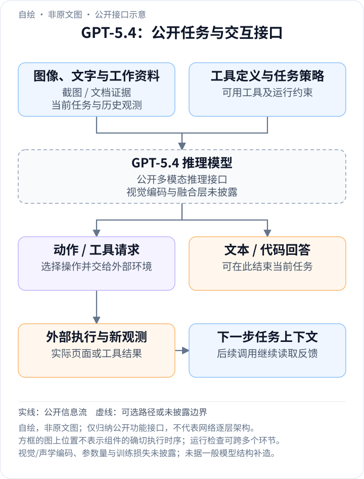
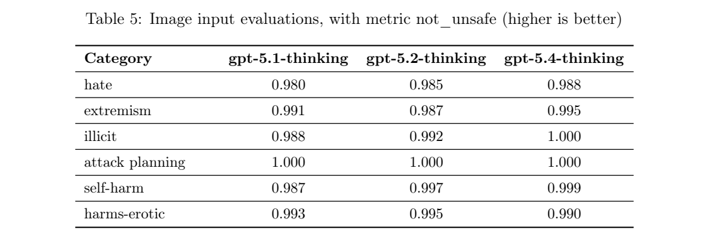
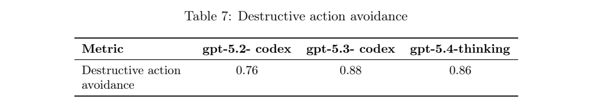
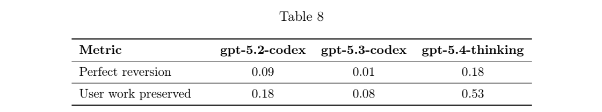

<!-- article-header:start -->
[项目首页](../../../README.md) › [模型系列](../../../reports/model-family-index.md) › [GPT](../README.md)
<!-- article-header:end -->

[项目首页](../../../README.md) › [模型系列](../../../reports/model-family-index.md) › [GPT](../README.md)

# GPT-5.4：高分辨率感知、计算机操作与按需工具检索

<!-- article-toc:start -->
<a id="article-toc"></a>

**本篇目录** · [论文定位](#paper-info) · [快速概览](#overview) · [整体架构](#architecture) · [核心原理](#principles) · [数据构建](#data) · [训练流程](#training) · [实验结果](#experiments)
<!-- article-toc:end -->

<a id="paper-info"></a>

## 1. 论文信息与模型定位

| 项目 | 内容 |
|---|---|
| 报告题名 | GPT-5.4 Thinking System Card |
| 发布机构 | OpenAI |
| 首次发布 | 2026-03-05；本文采用 2026-10-13 下载的系统卡及同日固定的官方发布博客 |
| 官方资料 | [系统卡 PDF](https://deploymentsafety.openai.com/gpt-5-4-thinking/gpt-5-4-thinking.pdf)；[发布博客](https://openai.com/index/introducing-gpt-5-4/) |
| 家族与定位 | GPT 系列的通用推理模型，把视觉理解、编程、知识工作与计算机操作结合起来 |
| 输入与输出 | 文本、图像及工具返回作为条件，输出文本、代码或工具调用；本文不将外部图像生成工具当成主模型的原生图像输出 |
| 规模与开放情况 | 参数量、网络层数、视觉编码器、连接器及权重未公开；系统卡和发布说明公开 |

系统卡关注训练与部署评测，发布博客补充高分辨率输入、工具搜索及主任务成绩。两者合起来可以解释公开的信息流，但不足以还原逐层网络。系统卡中的 GPT-5.4 Thinking 与博客不同产品设置的 GPT-5.4/Pro 也需要按各自实验口径区分。

<a id="overview"></a>

## 2. 快速概览

GPT-5.4 的多模态意义，在于让“看懂屏幕”进一步服务于“操作屏幕并检查结果”。它接收截图、文档图像与任务上下文，既能直接回答，也能生成由外部执行器落实的点击、输入或代码操作。新动作返回新的观测，模型再据此修正计划。这里的计算机执行环境属于系统组件，不是语言模型内部的一层。

官方同时扩大了高精度图像输入的预算，并通过 tool search 改变工具定义的加载方式：先提供轻量目录，待需要时再检索完整定义。前者保留小字、控件与密集图表细节，后者减少长工具列表对上下文的挤占。发布博客报告 MMMU-Pro 无工具得分 81.2%，OSWorld-Verified 成功率 75.0%；这些分别测视觉推理与完整代理任务，不能互相替代。

本版本还有针对长操作轨迹的训练：回退自己的修改时保留用户工作，以及遵守可配置的确认策略。它们影响代理在真实工作空间中的可用性，系统卡也提供相应评测，而没有公开其独立损失公式或训练样本规模。[依据：发布博客“Computer use and vision”“Tool search”；系统卡第 2、3.7–3.8 节](https://openai.com/index/introducing-gpt-5-4/)。

<a id="architecture"></a>

## 3. 整体架构

<!-- derived-architecture:start -->


*自绘公开接口示意（非原文图）。依据下述公开资料归纳；方框表示功能组件，不代表逐层实现。*

依据：[系统卡第2、3.5、3.7–3.8节；官方博客 Computer use and vision / Tool search](https://deploymentsafety.openai.com/gpt-5-4-thinking/gpt-5-4-thinking.pdf)；[Official release blog: public model capabilities and workflow interfaces](https://openai.com/index/introducing-gpt-5-4/)。
<!-- derived-architecture:end -->

一次交互可分为输入组织、多模态推理、动作生成、外部执行和反馈五步。用户图像与文字进入同一个任务上下文；工具返回、操作历史以及必要的完整工具定义随后加入。模型可以结束任务，也可以请求工具，再读取新结果。公开资料没有说明图像经过多少层编码、视觉序列长度或融合发生在哪一层，因此下表按功能接口描述。

| 模块 | 输入与输出 | 公开机制 |
|---|---|---|
| 图像输入接口 | 截图、文档图像 → 模型可读取的视觉条件 | original 与 high 两种细节预算；视觉编码及 token 化实现未公开 |
| 任务上下文 | 指令、图像、历史观测 → 当前任务条件 | 长上下文支撑多步规划与验证；发布时 API/Codex 可支持最高 1M 上下文，具体产品设置不同 |
| 推理主模型 | 当前上下文 → 回答、代码或动作请求 | 强化学习训练推理能力；内部网络和确切优化器未披露 |
| 按需工具搜索 | 轻量工具目录、检索请求 → 完整工具定义 | 需要工具时再加载其定义，减少全部定义预先进入提示的开销 |
| 计算机与代码执行环境 | 工具请求 → 页面变化、执行结果与新截图 | 模型原生支持操作决策，实际鼠标、键盘或代码执行由工具环境承担 |
| 反馈与约束 | 新观测、操作轨迹和确认策略 → 后续决策 | 模型根据结果继续工作，并接受系统/开发者层的操作策略 |

阅读示意图时，应把“模型产生动作”与“执行器改变环境”分开。并行调用多个工具也不等于模型同时生成多个独立答案：若三个工具一起运行后统一返回，只形成一次等待工具返回的轮次。发布博客用 tool yields 描述这种轮次，以便更接近实际延迟。

<a id="principles"></a>

## 4. 核心创新与数学原理

### 4.1 扩大视觉输入预算：保留定位所需的细节

密集文档与桌面截图常含有小字、图例及尺寸很小的操作控件。统一缩到低分辨率可能使这些局部信息不可辨认，即使后续语言推理足够强，也无法恢复已经丢失的像素证据。官方为 original 输入公布 10.24M 总像素、6000 像素最大边长的上限，high 则为 2.56M 总像素、2048 像素最大边长，两个限制共同约束可保留的尺寸。[依据：发布博客“Computer use and vision”](https://openai.com/index/introducing-gpt-5-4/)。

为理解这两个上限，若原图为 $`W\times H`$，保持长宽比缩放的可行尺寸需要满足：

```math
(sW)(sH)\le P_{\max},\qquad s\max(W,H)\le L_{\max}.
```

从这些约束可得到：

```math
s\le\min(\sqrt{P_{\max}/(WH)},L_{\max}/\max(W,H)).
```

这是解释像素预算的补充推导，**不是官方公布的预处理实现**；实际是否切块、怎样分配视觉 token、是否放大小图均未披露。更多像素能帮助读取细节，也可能增加处理成本，不能据此推出计算量按像素线性增长。

### 4.2 视觉操作闭环：动作必须经过环境反馈检验

静态视觉问答只需要读图后回答，计算机操作则必须面对动作引起的新状态。例如点击后菜单可能没有打开，页面也可能跳转到意外位置。GPT-5.4 的公开交互路径让模型继续读取截图或结构化返回，检查动作是否产生预期效果。

用任务轨迹作解释，可以把截至第 $`t`$ 步的观测和动作记为 $`h_t=(o_1,a_1,\ldots,o_t)`$；模型选择动作 $`a_t`$，执行环境产生 $`o_{t+1}`$，再将其加入历史。这是代理信息流的形式化记账，并非对其网络实现的断言。关键在于后续决策以真实反馈为条件，不能把“发出点击请求”直接算成“任务成功”。

发布博客分别报告仅截图的 Online-Mind2Web、截图加 DOM 的 WebArena-Verified，以及桌面 OSWorld-Verified。它们的观测接口与任务难度不同，成绩应在相同基准内部比较；从浏览器成功率无法推导任意桌面任务的可靠性。

### 4.3 Tool search：减少工具定义占据的上下文

大量工具的函数定义预先全部加入提示，会消耗与本次任务无关的输入 token。Tool search 先把轻量工具目录暴露给模型，待模型确定需要某种能力时，再检索并追加对应定义。

设全部定义长度为 $`\sum_{j=1}^{M}\ell_j`$，轻量目录为 $`L_{\mathrm{index}}`$，实际检索到的定义集合为 $`R`$。一次定义加载的开销可用 $`L_{\mathrm{index}}+\sum_{j\in R}\ell_j`$ 与前者比较。这个表达式只解释定义部分的 token 差异；完整任务还有检索调用、历史与输出成本，反复检索也可能抵消一部分节约。

官方在 MCP Atlas 的 250 个任务、36 个 MCP 服务器全部开启的条件下，对比直接暴露全部函数与通过 tool search 暴露服务器两种设置，报告后者总 token 用量下降 47%，准确率相同。因此证据支持的是该设置下的上下文效率改进，而不是任何工具生态都固定节省 47%。[依据：发布博客“Tool search”](https://openai.com/index/introducing-gpt-5-4/)。

### 4.4 保留用户工作：区分任务完成与正确回退

长任务中的回退操作可能同时碰到模型自己的修改和用户新加入的内容。系统卡说明训练中加入了长轨迹场景，要求模型恢复自己的修改并保护模拟的用户工作。它还把确认行为从单一内置规则，扩展为遵循系统和开发者提供的策略；这属于训练与部署行为的改进，不能简单画成一个确定存在的网络“安全头”。

Table 7 的一般破坏性操作避免率，与 Table 8 的完美回退、保留用户工作是不同指标。后者要求跟踪修改归属，比“完全不动文件”更接近合作场景。原文没有披露样本生成算法、各目标的权重或奖励分解，因此不能把普通策略梯度公式作为本版本的确切训练配方。[依据：系统卡第 3.7–3.8 节，PDF 第 10–11 页](https://deploymentsafety.openai.com/gpt-5-4-thinking/gpt-5-4-thinking.pdf#page=10)。

<a id="data"></a>

## 5. 数据构建与处理

| 用途 | 已公开的数据与处理 | 未公开项 |
|---|---|---|
| 基础训练 | 公开互联网、合作方可访问资料，以及用户、训练人员和研究人员提供或生成的信息；过滤数据质量与个人信息 | 图文/视频比例、token 总量、去重阈值、视觉分辨率分布 |
| 推理与行为训练 | 强化学习使模型先思考、尝试策略并纠正错误；长轨迹中训练回退自身修改、保护模拟用户工作 | 各阶段样本量、采样配比、奖励模型及算法细节 |
| 评测构建 | 困难生产提示、去标识化生产分布模拟、图像与文字组合、计算机操作轨迹 | 多数测试集的完整内容与逐任务结果 |

这里的生产提示和模拟轨迹中，有些仅用于评测，不能全部写成模型训练集。系统卡第 2 节给出通用数据来源，第 3.2 节则描述从近期 GPT-5.2 Thinking 流量构造部署模拟；后者目的是预测行为变化，不意味着用这些完整测试任务训练 GPT-5.4。

<a id="training"></a>

## 6. 训练流程与目标

| 公开环节 | 目的与机制 | 披露边界 |
|---|---|---|
| 数据准备与基础学习 | 从多来源资料学习通用能力，执行质量及个人信息过滤 | 基础预训练的网络、顺序、规模和损失未公开 |
| 推理强化学习 | 训练回答前思考、比较策略并识别错误 | 系统卡只公开方法方向，未披露 PPO/GRPO 等具体算法 |
| 代理行为训练 | 跟踪长操作轨迹、保护用户修改、遵循可配置确认策略 | 未公开为单独阶段还是混合训练，也未给出损失权重 |
| 部署评测与系统约束 | 检查图文安全、提示注入、操作行为及推理可监控性 | 评测与运行约束并不等于额外训练阶段 |

原文没有给出学习率、batch、步数、训练硬件、FLOPs 或训练成本。更高思考预算改变推理时的工作量，不能当作增加了训练参数；博客的 fast 模式也明确是相同模型的服务速度设置。

<a id="experiments"></a>

## 7. 实验设置与主要结果

官方发布博客的主要能力结果如下。除明确说明外，其评测采用 xhigh 思考设置；研究环境、工具和实际产品存在差异。

| 任务 | 指标与方向 | GPT-5.4 | GPT-5.2 | 条件与解读 |
|---|---|---|---|---|
| MMMU-Pro | 成功率 ↑ | 81.2% | 79.5% | 无工具、xhigh；提高 1.7 个百分点 |
| OmniDocBench | 平均归一化编辑距离 ↓ | 0.109 | 0.140 | 无思考预算；衡量文档解析误差 |
| OSWorld-Verified | 成功率 ↑ | 75.0% | 47.3% | 截图和键鼠动作的桌面代理测试 |
| WebArena-Verified | 成功率 ↑ | 67.3% | 65.4% | 同时允许 DOM 与截图 |

以上据[官方发布博客“Computer use and vision”](https://openai.com/index/introducing-gpt-5-4/)整理。第四节的 MCP Atlas 实验是同模型的工具配置比较，不与 GPT-5.2 的能力分数合并。



*原文 Table 5，系统卡 PDF 第 9 页图表区域；指标 not_unsafe，越高越好。*

**读表方式**：这是图像与文字组合输入下的安全评测，不是图像识别准确率。harms-erotic 从 0.995 降到 0.990，原文称其统计显著性低，不能把所有类别概括为全面提升。





*原文 Table 7–8，PDF 第 10 页分别裁切；保留表头与全部指标行。*

**结果解读**：一般避免破坏的得分 0.86 低于 GPT-5.3-Codex 的 0.88；但长轨迹中的用户工作保留率从 0.08 提高到 0.53，完美回退从 0.01 提高到 0.18。改进与任务条件有关，不能只展示优势指标。三张系统卡表格均来自同一固定版本；博客中的桌面成功率与安全卡指标属于不同实验，不应混成一个综合分数。

<!-- article-footer:start -->
---

[← 上一篇：Beyond Language Modeling](../../beyond-language-modeling/arxiv-2603.03276/README.md) · [按发表时间浏览](../../../reports/paper-reading-guide.md#year-2026) · [下一篇：Omni-Diffusion →](../../omni-diffusion/arxiv-2603.06577/README.md)

[返回本篇目录](#article-toc) · [返回模型系列](../README.md)
<!-- article-footer:end -->
