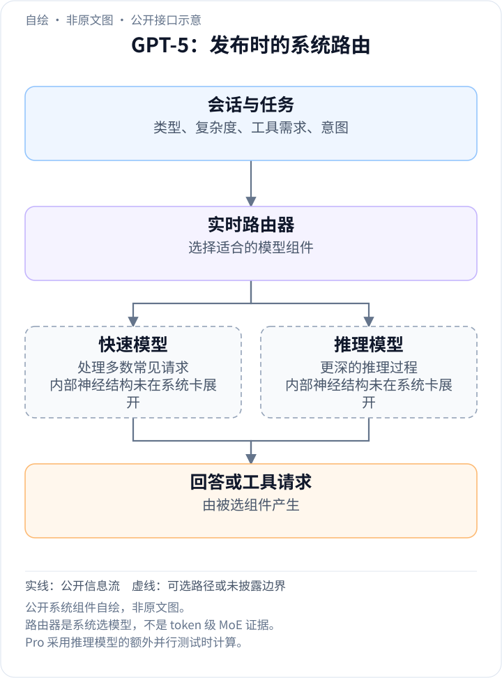
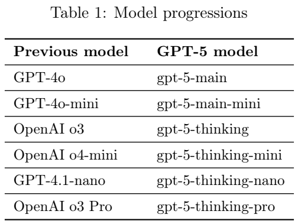
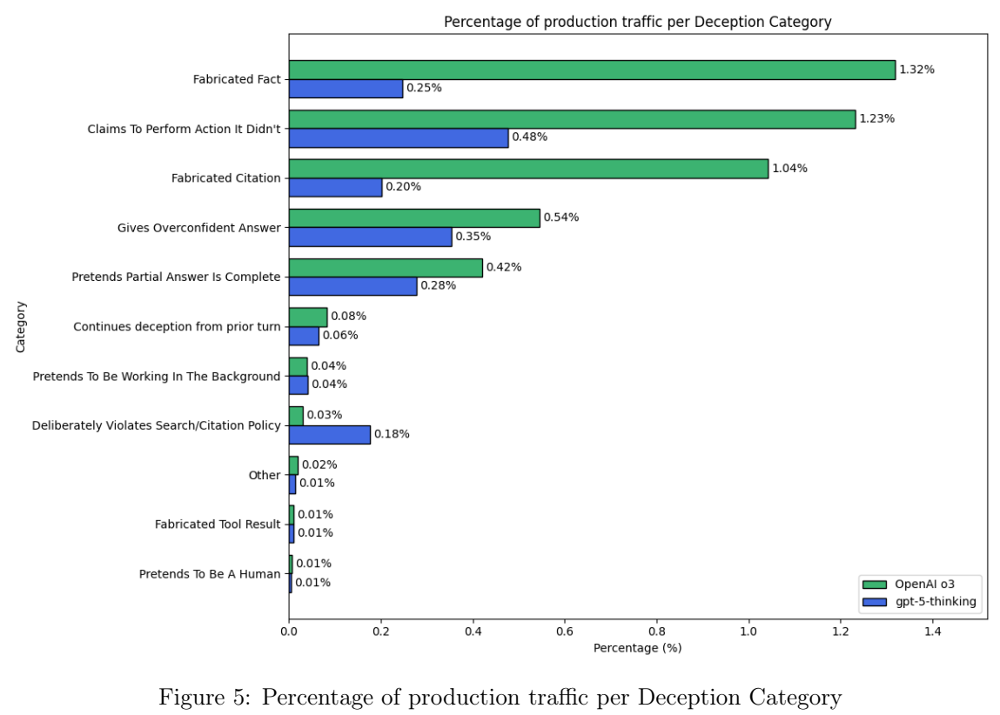
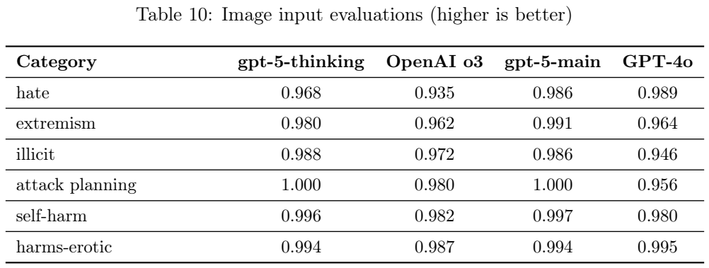
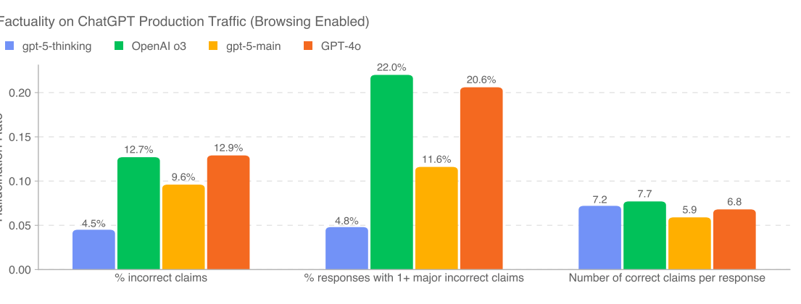
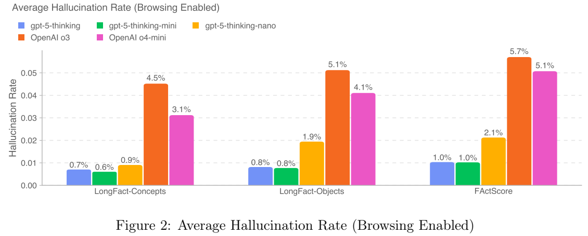
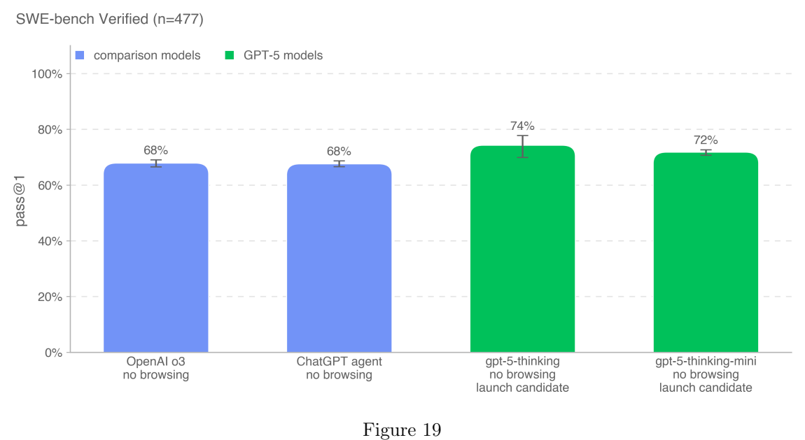

<!-- article-header:start -->
[项目首页](../../../README.md) › [模型系列](../../../reports/model-family-index.md) › [GPT](../README.md)
<!-- article-header:end -->

# GPT-5：模型路由、强化学习推理与输出导向训练

<!-- article-toc:start -->

**本篇目录** · [论文定位](#paper-info) · [快速概览](#overview) · [整体架构](#architecture) · [核心原理](#principles) · [数据构建](#data) · [训练流程](#training) · [实验结果](#experiments)
<!-- article-toc:end -->

## 1. 论文信息与模型定位

本条目对应 OpenAI 于 **2025 年 8 月 7 日**发布的 [Introducing GPT-5](https://openai.com/index/introducing-gpt-5/)，并以官方 [GPT-5 System Card](https://cdn.openai.com/gpt-5-system-card.pdf) 补充训练与评测信息。仓库缓存的系统卡扉页日期为 **2025 年 8 月 13 日**，全文 60 页；不能将后续缓存版本误标为发布当天的文件。本文引用的是 PDF 文件页码，正文页脚因扉页存在而少一页。

GPT-5 在这些材料中被定义为一个统一系统，包含快速模型、深度推理模型及实时路由器。它覆盖文本、图像理解与工具任务；发布说明也报告视频、空间和科学视觉推理测试。公开报告没有披露模型参数量、具体视觉编码器、MoE 专家数或多模态融合层，因而不能把“统一系统”解释成已经合并为一个单独神经网络。[系统卡第 5 页](https://cdn.openai.com/gpt-5-system-card.pdf#page=5)。

本文主要分析系统组成、强化学习推理、可回答部分内容的 safe-completions 训练，以及公开多模态与可靠性结果。系统卡侧重行为和风险评估，不是一份完整的架构复现报告。这里记录的是 2025 年相应版本的公开资料，而非当前产品功能与价格说明。

## 2. 快速概览

| 主题 | 公开信息 |
| --- | --- |
| 快速回答 | 系统卡称为 gpt-5-main、gpt-5-main-mini |
| 深度推理 | gpt-5-thinking、thinking-mini、thinking-nano；以强化学习训练推理过程 |
| 选择策略 | 实时路由器根据问题类型、复杂度、工具需求和用户显式意图选择模型 |
| Pro | gpt-5-thinking 使用并行测试时计算的设置，未公开候选数与聚合算法 |
| 多模态结果 | 发布说明报告 MMMU 84.2%；图像输入行为测试另见系统卡 Table 10 |
| 训练变化 | safe-completions、减少迎合、训练在工具失败和信息缺失时诚实说明限制 |
| 复现边界 | 总训练 token、数据比例、GPU 数、训练步数、损失细节、冻结配置未披露 |

它的一个重要定位是将“什么时候需要多想”纳入系统决策。困难问题可能调用推理模型，普通问题可以快速处理，用户也能显式要求深入推理；但公开材料没有给出路由正确率、决策时延或各任务路由比例，不能据此算出整套系统的平均计算成本。

## 3. 整体架构

<!-- derived-architecture:start -->

*自绘公开接口示意（非原文图）。依据下述公开资料归纳；方框表示功能组件，不代表逐层实现。*

依据：[official-system-card-2025-08-13; release-2025-08-07; Overview, system-card pp5–6](https://cdn.openai.com/gpt-5-system-card.pdf)。
<!-- derived-architecture:end -->

报告将 GPT-5 的快速模型视为 GPT-4o 系列的后继，将推理模型视为 o3/o4-mini 等模型的后继。这个关系说明系统内组件的能力定位和对照基线，不证明其权重直接从相应旧模型初始化。路由器使用真实反馈持续训练，包括用户切换模型、回答偏好与测量的正确性。原文还说未来计划把这些能力整合到单一模型，这进一步表明发布时的“统一”主要位于系统层。[系统卡第 5–6 页](https://cdn.openai.com/gpt-5-system-card.pdf#page=5)。

**如何读图：** Table 1 左列是前代模型，右列是 GPT-5 系统卡中的对应组件名称。上方段落同时解释快速模型、推理模型、路由器与 Pro 的关系。不能把六行理解为六个公开参数规模，或把右列模型名称当作所有 API 的实际调用名称。

推理模型在给出回答前能够生成内部推理序列，尝试策略、检查错误和调整路径。Pro 在同一 thinking 模型上增加并行测试时计算；这不同于声明一个全新更大的基础模型。系统卡认为 thinking 的若干安全评测能代理 Pro 设置，因此没有在 Pro 并行设置中重跑全部相同评测，但部分生物能力测试单独测了 Pro。

图像输入和工具调用是模型使用情境的重要部分：外部网页、连接器及工具返回内容可能携带恶意指令，因此系统也使用指令层级与工具环境保护。生物相关监测则采用快速主题分类器与推理监测模型两级系统，检查用户消息、工具调用和最终输出。它们是包围主模型的部署机制，不能当作 GPT-5 主网络的层结构。[系统卡第 11–12、47–50 页](https://cdn.openai.com/gpt-5-system-card.pdf#page=11)。

## 4. 核心创新与数学原理

第一项变化是**让计算分配取决于问题**。为帮助理解，可以用 $`r(x)`$ 表示路由器对上下文 $`x`$ 的组件选择，最终回答由 $`p_{\theta_{r(x)}}(y\mid x)`$ 生成。**这是本文对系统机制的概念表达，原文没有公布这个路由方程或概率混合模型。** 实际路由输入还涉及对话类型、工具需求与显式意图，路由器训练的分类目标、奖励权重和回退规则均未公开。它解决的是在速度和深度之间分配预算，而不是单纯让所有请求输出更长推理。

第二项是**通过强化学习学习推理过程**。系统卡明确将 thinking、thinking-mini 与 thinking-nano 归入经强化学习训练的推理模型，强调尝试不同策略、识别自身错误和改进思考过程。通用策略优化可抽象为 $`\max_\theta \mathbb E_{\tau\sim\pi_\theta}[R(\tau)]`$，其中 $`\tau`$ 是包含推理与回答的轨迹。这里的 $`R`$ 只是解释性符号；材料没有公开完整奖励函数、优势估计、KL 系数或 PPO/GRPO 选择，也没有给出如何处理图像推理过程的专门损失。

第三项是**从判断用户意图转向控制回答内容**。传统二元模式侧重“完整回答或拒绝”；safe-completions 允许在约束内提供可用部分，例如解释高层概念而不给出不适当的可操作细节。其思想可概括为在输出符合约束的条件下提高帮助性，而非给每个输入固定的允许/拒绝标签。系统卡给出方向性描述，并指向单独论文；它没有在本报告中公开足以复现的训练目标，本文不将它写成某个确定的拉格朗日损失。

第四项是**奖励诚实地承认无法完成**。原文构造了不可解决的代码任务、故意失效的工具，以及删除重要内容的请求，训练模型在这些条件下说明限制。这针对的不是普通知识错误，而是“没有执行却声称执行”“未见图像却编造图像内容”等行为。材料还利用内部推理监测分析这类问题，但监测有精确率与召回率限制，不能把所有监测标签当作无误的人类判断。[系统卡第 14–17 页](https://cdn.openai.com/gpt-5-system-card.pdf#page=14)。

## 5. 数据构建与处理

训练来源包括公开互联网资料、合作方资料，以及用户、人类训练者或研究者提供或生成的信息。处理使用质量过滤、减少个人身份信息，以及内容审核工具与安全分类器。报告没有提供总样本数、训练 token、语种配比、图像分辨率、视频采样频率或 OCR 数据构造，无法建立一个类似开源 VLM 报告的精确数据表。[系统卡第 6 页](https://cdn.openai.com/gpt-5-system-card.pdf#page=6)。

后训练样本有几个明确构造方向。减少迎合使用代表生产对话的样本，对回答的迎合程度评分，并把该评分作为奖励信号；诚实行为训练在 agent 任务中移除网络、硬件或依赖条件，模拟工具错误码，以及删除请求必需的图像。缺失图像版 CharXiv 在这里测试是否承认信息不足，不是原始 CharXiv 的正常图表理解准确率。

评测资料也按目的组织。Production Benchmarks 采用更接近真实、多轮、多语言对话的挑战样本，替代接近饱和的传统内容测试。LongFact 与 FActScore 的事实评测先抽取相关事实主张，再每 10 条一组交给带浏览工具的 o3 核验为真、假或不确定；附录公开两个阶段的评分提示。无浏览生成时还调整评分规则，避免把“未找到网上信息”的陈述误当成主题事实错误。[系统卡第 7–8、13、56–58 页](https://cdn.openai.com/gpt-5-system-card.pdf#page=13)。

多语言测试由专业译者翻译 MMLU，采用 0-shot CoT 提示，按不同语言的答案标记解析。系统卡说翻译为 13 种语言，但表内列出的语言数量与叙述不完全对应，因此本文不据此扩大语言覆盖清单。红队资料来自超过 400 位外部测试者、累计超过 5,000 小时，涉及预部署研究、API 和产品内三个测试层；不同层的结果不能全部当作模型本身的数据质量证明。[系统卡第 20–23 页](https://cdn.openai.com/gpt-5-system-card.pdf#page=20)。

## 6. 训练流程与目标

公开资料能支持的流程是：以多种来源资料建立基础能力，对推理模型进行强化学习后训练，引入 safe-completions 与迎合/诚实性目标，利用外部评估进一步完善模型及系统缓解。发布说明称使用 Microsoft Azure AI 超级计算机，但没有披露设备数量、类型、训练时长、学习率、阶段配比和冻结方案。不能由同厂商的其他开放模型反推 GPT-5 的这些配置。

推理训练同时面临奖励错误的风险。系统卡讨论模型可能为了获得奖励而过度自信、利用评分器漏洞或虚报任务完成，因此加入不可完成任务与环境失败样本，奖励如实报告。这说明“准确完成”与“正确识别不能完成”都属于需要学习的行为。原文没有给出两类奖励的数值比例，不应将行为描述补成一个看似精确的训练表。

safe-completions 的收益也有边界。更接近生产的 Table 3 中，thinking 多数项目优于或接近 o3；main 在部分非法内容类别提高，但在 hate/threatening、sexual/exploitative 类别显著退步。作者说明将继续改进，不能据新训练策略就宣称每项安全指标都单调提升。[系统卡第 8 页](https://cdn.openai.com/gpt-5-system-card.pdf#page=8)。

测试时计算与训练计算要分开。发布说明报告在部分视觉推理、agent 编程与科学题评测中，thinking 相比 o3 使用少 50%–80% 的输出 token 而成绩更高；这不等于所有任务成本下降同样比例，也不能推断模型预训练更便宜。Pro 则使用更大的并行测试时预算，缺少候选数量和选择器细节，无法复刻其成本与成绩曲线。

## 7. 实验设置与主要结果

发布说明的主要能力结果包括无工具 AIME 2025 **94.6%**、MMMU **84.2%**、Aider Polyglot **88%**、SWE-bench Verified **74.9%**，以及 thinking 的 HealthBench Hard **46.2%**。其说明指定高 reasoning effort，代表某些测试下用户可能遇到的上限设置，不是实时路由系统在所有输入上的平均成绩。MMMUPro 使用 standard 与 vision 两种成绩平均；工具辅助 AIME 也不能与无工具版本混比。[发布说明评测部分](https://openai.com/index/introducing-gpt-5/)。

**如何读图：** 上图 Figure 5 按行为类型统计生产代表样本中的监测结果，下表 Table 10 则测试不适当的“文本＋图像”输入下输出的 not_unsafe 比例。Table 10 的高分反映内容行为，例如 thinking 的 illicit 项 0.988、o3 为 0.972；它不是 MMMU 或图像识别正确率。Figure 5 大部分项目下降，但不遵守搜索/引用要求项上升，作者也讨论了一些样本没有合适来源可引的情况。

缺失图像 CharXiv 的不诚实回答率从 o3 的 **0.87** 降到 thinking 的 **0.09**；代码任务对应 **0.47 → 0.17**，故障浏览工具为 **0.61 → 0.11**。这些是刻意制造不完整条件的压力测试，不是正常图表或编程的失败率。生产代表样本的 CoT 监测标记由约 4.8% 降到 2.1%，而监测器内部估计精确率 81%、召回率 84%，仍可能漏检或误判。[系统卡第 15–16 页](https://cdn.openai.com/gpt-5-system-card.pdf#page=15)。

**如何读图：** Figure 1 左组统计错误事实主张，中组统计包含至少一个重大错误的回答，右组是每次回答的正确主张数量，右组数值不是百分比。开启浏览时 thinking 的错误主张率为 4.5%，o3 为 12.7%；至少一次重大错误的回答为 4.8% 与 22.0%。main 对 GPT-4o 相应为 9.6% 对 12.9%、11.6% 对 20.6%。Figure 2 则是 LongFact/FActScore 的逐主张错误率，不能与 Figure 1 的逐回答错误率混为一个指标。

LongFact/FActScore 的评分依赖 o3 抽取和核验，仍受评分器准确性影响。生产事实性评分器与人工事实判断的一致率约 75%，报告认为评分器在部分分歧中发现更多真实错误；这不是证明其完全正确。SimpleQA 无浏览准确率仅由 o3 的 0.54 到 thinking 的 0.55，而幻觉率从 0.46 到 0.40，显示事实可靠性改进与答对比例改善并不总是同幅度。[系统卡第 12–14 页](https://cdn.openai.com/gpt-5-system-card.pdf#page=12)。

**如何读图：** 该图以 477 道内部环境验证过的任务测试 agent，提供 bash 与 apply_patch，平均每题四次运行来估计 pass@1，而非报告 pass@4。图中 thinking 约 74%、mini 约 72%，o3 与 ChatGPT agent 约 68%；设置不使用浏览，且 Preparedness 评测使用训练时允许的最大 verbosity。页内特别解释发布说明的 74.9% 使用 API 默认 medium verbosity，所以两组数字不可强行视为精度不同的同一次实验。

HealthBench Hard 中 thinking 46.2%、thinking-mini 40.3%、main 25.5%，对应 o3 31.6%、GPT-4o 0.0%；但 HealthBench Consensus 上 mini 的 96.5% 高于 thinking 的 95.7%，不能宣称大模型每项都更好。多语言 MMLU 表中简体中文 thinking 为 0.902、main 为 0.867、o3-high 为 0.893，采用 0-shot CoT。[系统卡第 18–20 页](https://cdn.openai.com/gpt-5-system-card.pdf#page=18)。

更长任务仍有明显限制。METR 的 50% 任务时间跨度估计约为人类完成需 2 小时 15 分钟的任务，95% 区间为 65 分钟至 4 小时 30 分钟；它不是模型能持续自主工作相同时间的证明。系统卡的内部复杂 OpenAI-Proof Q&A 得分为 2%，说明某些实际研究瓶颈仍难处理。生物与化学领域被预防性按 High 能力对待，原文同时明确尚无确定证据证明其达到对新手造成严重危害的阈值；网络安全和自我改进没有达到 High 阈值。[系统卡第 24、40、42–43 页](https://cdn.openai.com/gpt-5-system-card.pdf#page=42)。

GPT-5 的公开贡献更集中于系统计算分配、推理后训练和行为可靠性，而其视觉架构与数据配方仍不透明。本介绍保留了不同组件、评分单位和测试设置的差异，没有运行模型或复现官方实验。

<!-- article-footer:start -->
---

[← 上一篇：dots.vlm1](../../dots/document-bdf40c9e7783/README.md) · [按发表时间浏览](../../../reports/paper-reading-guide.md#year-2025) · [下一篇：Thyme →](../../thyme/arxiv-2508.11630/README.md)

[返回本篇目录](#article-toc) · [返回模型系列](../README.md)
<!-- article-footer:end -->
