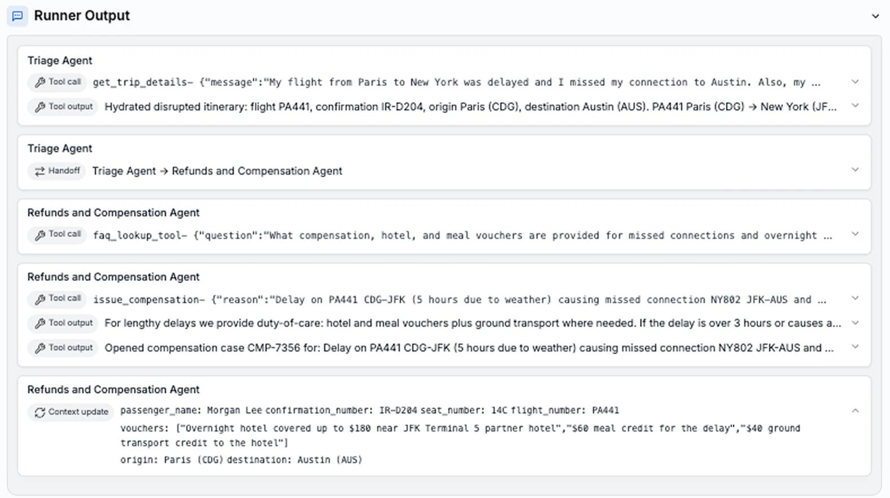
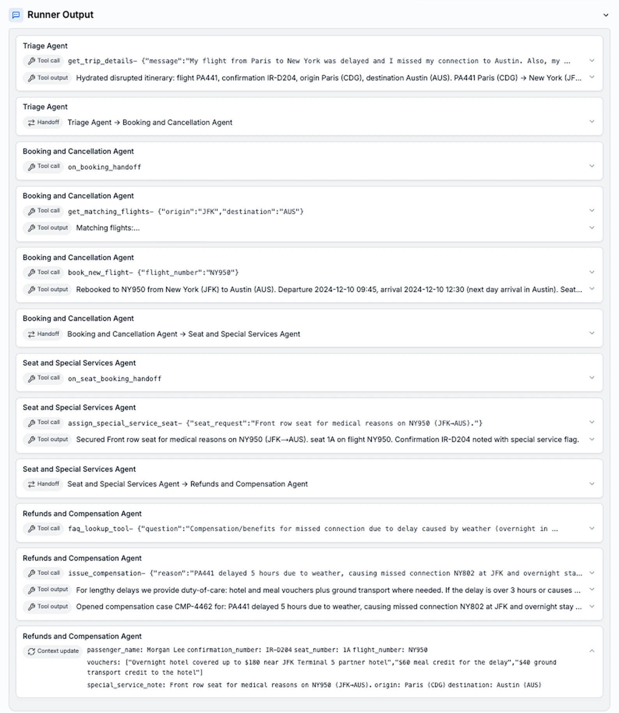
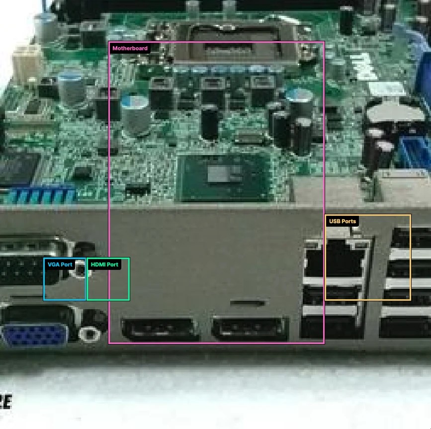
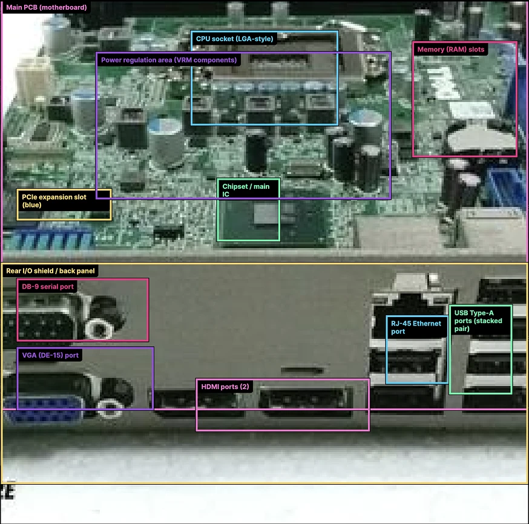

# GPT-5.2：视觉理解、长上下文与工具工作流的升级

## 1. 论文信息与模型定位

- **原始来源**：[Introducing GPT-5.2](https://openai.com/index/introducing-gpt-5-2/)，OpenAI，发布于 **2025-12-11**。本文依据 2026-10-08 保存的官方发布页正文和实验附录，属于发布材料介绍，不是架构公开论文。
- **版本定位**：Instant 面向快速日常任务；Thinking 面向需要更多推理的专业工作；Pro 面向愿意等待以换取更高质量的困难问题。不能把三者成绩合成一个“GPT-5.2 总分”。
- **多模态范围**：本文重点是图像、科学图表、软件截图和视频相关评测，以及视觉输入配合 Python 等工具。来源未公开参数规模、视觉编码器配置或精确训练 recipe。

发布页的可用性及价格反映发布时的信息。本介绍不将它们当作当前服务状态，也不把后续网页导航中的新模型新闻混入 GPT-5.2 技术内容。

## 2. 快速概览

GPT-5.2 的改进主要以任务结果而非网络结构披露：图表理解和界面定位更准确，长上下文中的信息整合更稳定，长程工具调用和专业产物质量有所提高。其评测包含专业文档与电子表格、软件修复、客户支持、多轮检索、数学和抽象推理。

多模态读者最需要注意 **工具条件**。Thinking 的 CharXiv 为无工具 **82.1**、带 Python **88.7**；MMMU Pro 为无工具 **79.5**、带 Python **80.4**；ScreenSpot-Pro 的 **86.3** 也是带 Python 配置。这些结果反映模型与工具共同完成任务，不能一律解释为一次图片前向推理能力。

长上下文同样有任务难度之分：正文所述接近 100 的结果是四个 needle 的 MRCRv2；附录八个 needle、128K–256K 区间的分数为 **77.0**。更强的信息整合能力不意味着任意长度、任意细节都能百分之百找回。

## 3. 整体架构

来源没有给出层数、隐藏维度、注意力形式、稠密/MoE 配置、视觉 tokenizer、图像 token 预算或视频时间编码。因此无法根据本发布页复原精确计算图，也不把其他 GPT 版本的结构移植进来。

可以确认的系统使用方式是：模型接收文本及视觉内容，在推理过程中可调用工具，将结果带回上下文，再继续产生答案或产物。不同的 reasoning effort 对应不同推理预算；Thinking 和 Pro 支持 `xhigh`，Instant 与二者的产品定位不同。

**读图**：相同旅行请求涉及误机、行李、过夜和特殊座位。前图主要进入补偿流程；后图先改签，再交给座位服务，最后处理补偿。图中的工具调用和 handoff 表明一个任务可以被拆成多步，并在上下文中保留中间状态。这是官方示例轨迹，不是神经网络架构图，也不是已经发生的真实航司交易。

发布页提到 Responses 的 `/compact` 可帮助运行超出单次上下文窗口长度的工具工作流。这是有效上下文管理机制的服务兼容说明，不证明模型拥有无限长的原生注意力窗口；压缩内容如何保留以及信息损失的详细实验并未在此披露。

## 4. 核心创新与数学原理

公开材料主要证明能力与系统工作流的改进，没有提出新的数学模块。其结果需要从三个层面理解：模型自身视觉和推理能力、可用工具、推理计算预算。工具可以辅助处理图片及计算；更大的预算可以支持更长的分析；二者都可能影响最后得分，来源没有提供完整三因素控制消融。

“错误率降低约一半”指特定图表和界面评测的错误变化，不是所有答案的总错误率。对固定准确率 $a$，错误率为 $1-a$，相对错误下降应按

$$
\frac{(1-a_{\mathrm{old}})-(1-a_{\mathrm{new}})}{1-a_{\mathrm{old}}}
$$

计算。以 CharXiv 无工具 **67.0→82.1** 为例，错误从 33.0 变为 17.9，相对减少约 45.8%；ScreenSpot-Pro 带 Python **64.2→86.3**，错误从 35.8 变为 13.7，约减少 61.7%。这是解释公开评测的算术，不是训练损失或作者提出的算法。

事实性评测也要区分响应与单条陈述。带搜索无错误回答比例为 **91.2→93.9**，对应错误回答比例 **8.8→6.1**，相对下降约 30.7%。不能写成“准确率增加 30 个百分点”。发布页说明错误由其他模型检测，评审本身也可能出错。

## 5. 数据构建与处理

官方发布页没有公开预训练语料总量、图文视频比例、合成视觉数据来源、训练图像分辨率、过滤规则或去重机制。因此本文不能给出可复现的数据构建配方。

有明确说明的是评测数据及组织。CharXiv 要求回答科学论文图表问题；ScreenSpot-Pro 使用专业软件的高分辨率界面截图；Video MMMU 考察视频相关多学科问题。工具启用与否写在结果旁边，不能根据任务名称判断统一输入协议。

MRCRv2 把多个相同用户请求及不同回复埋在长对话中，要求复现第 n 次请求的答案。版本二修正约 5% 的错误真值，指标为平均字符串匹配率。图中标为最大 256K 的点是 **128K–256K 长度区间的平均**，并非全都具有精确 256K 长度；该处 K 以 1,024 计。

GDPval 覆盖 44 个职业、九类主要经济行业，任务要求交付具体产物并由专家评审。知识工作得分受工具和产物格式影响，不能外推为职业中所有工作已经被自动化。SWE-Lancer 附录排除不能在基础设施运行的 **40/237** 个问题；这类样本处理也需要与成绩一起阅读。

## 6. 训练流程与目标

本来源未公布优化器、学习率、批大小、训练轮数、GPU 总量、冻结策略、视觉预训练阶段或强化学习奖励函数。它提到延续 GPT-5 的 safe completion 研究，并进一步改善敏感对话的行为，但没有给出可复现的训练步骤或数据配比。

评测一般使用 API 可用的最大推理预算：GPT-5.2 Thinking/Pro 为 `xhigh`，GPT-5.1 Thinking 为 `high`。专业任务中的 Thinking 使用 ChatGPT Pro 的最高 `heavy`，另有个别结果单独标注，如 ARC-AGI-2 的 Pro 为 `high`。不把评测推理参数误称为模型训练超参数。

发布页说明实验运行于研究环境，输出可能与生产 ChatGPT 略有差异。专业任务里 GPT-5.2 Thinking 还有 GPT-5 Thinking 未具备的新工具，所以与前代相比的总体提升不完全是隔离工具后的模型效果。本文仅复述公开设置，没有进行 API 调用或模型复现。

## 7. 实验设置与主要结果

**读图**：两张原图显示低质量主板照片上的模型预测框。GPT-5.2 标出了更多元件和区域，位置关系更丰富；官方正文也明确承认两者都有明显错误。框和标签是模型输出，不是人工标准答案；这一例子支持观察能力差异，不能代替带真值的定位基准。

| 视觉评测 | 工具条件 | GPT-5.2 Thinking | GPT-5.1 Thinking |
|---|---|---:|---:|
| CharXiv reasoning | 无工具 | 82.1 | 67.0 |
| CharXiv reasoning | Python | 88.7 | 80.3 |
| MMMU Pro | 无工具 | 79.5 | 未列出 |
| MMMU Pro | Python | 80.4 | 79.0 |
| Video MMMU | 无工具 | 85.9 | 82.9 |
| ScreenSpot-Pro | Python | 86.3 | 64.2 |

这些都是原发布页附录的百分比分数。CharXiv 在两种协议下均改善，但同一模型带工具和无工具的差值不构成完整工具因果消融，因为来源没有展开全部控制条件。ScreenSpot-Pro 无 Python 的分数，正文只说明显更低，没有提供数字。

| 其他任务 | GPT-5.2 Thinking | 对照 | 解读限定 |
|---|---:|---:|---|
| GDPval 胜或平 | 70.9 | GPT-5：38.8 | 对照是 GPT-5，非表头容易暗示的 GPT-5.1 |
| GDPval 明确获胜 | 49.8 | GPT-5：35.5 | 胜或平不等于明确胜出 |
| SWE-Bench Pro public | 55.6 | GPT-5.1 Thinking：50.8 | 软件修复，与四语言设置对应 |
| SWE-bench Verified | 80.0 | GPT-5.1 Thinking：76.3 | 不与 Pro 数据集混称 |
| Tau2-bench Telecom | 98.7 | GPT-5.1 Thinking：95.6 | 模拟用户、多轮工具任务 |
| GPQA Diamond | 92.4 | GPT-5.1 Thinking：88.1 | 无工具 |
| FrontierMath Tier 1–3 | 40.3 | GPT-5.1 Thinking：31.0 | 带 Python |
| ARC-AGI-2 Verified | 52.9 | GPT-5.1 Thinking：17.6 | Pro 为 54.2，且单独标为 high |

Tau2 的 Telecom 设置额外提供了一条通用系统指导；Airline 子集因真值评分质量而被排除，所以不能把它解释为包含所有领域的统一成功率。Pro 的 GDPval 胜或平为 **74.1**，GPQA 为 **93.2**，这些属于 Pro 配置，未混入 Thinking 列。

长上下文八 needle 结果在 64K–128K 为 **85.6**，128K–256K 为 **77.0**，前代分别为 36.0、29.6；提升明显，但仍有长程错误。金融建模内部评测 **59.1→68.4** 是增加 9.3 个百分点，非相对增加 9.3%。

本材料提供了较充分的任务级结果，却没有足以拆分架构、数据、后训练、工具和推理预算的组件证据。最可靠的结论是特定配置下视觉理解、长上下文和工具工作流能力提高；对未知视觉场景、生产服务输出及完整自主代理任务仍应保留各自的评测范围。
