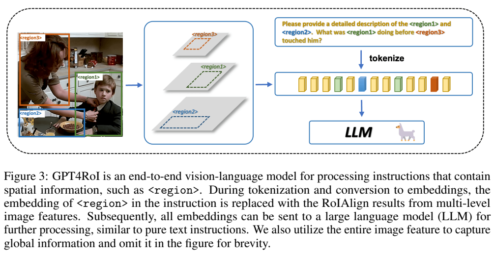
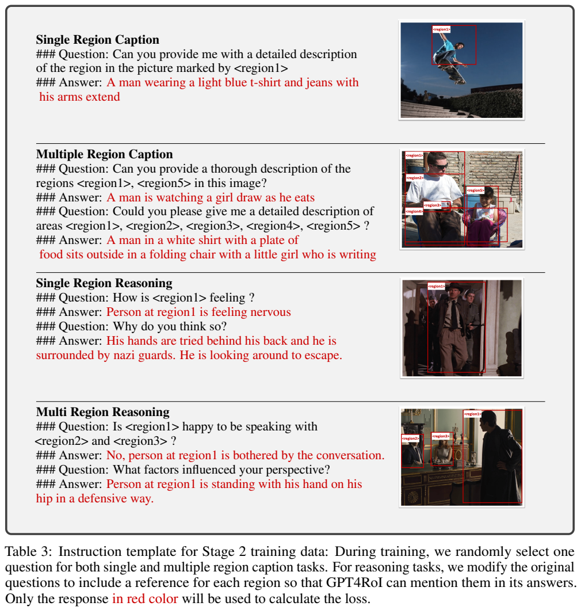
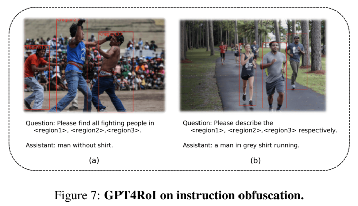
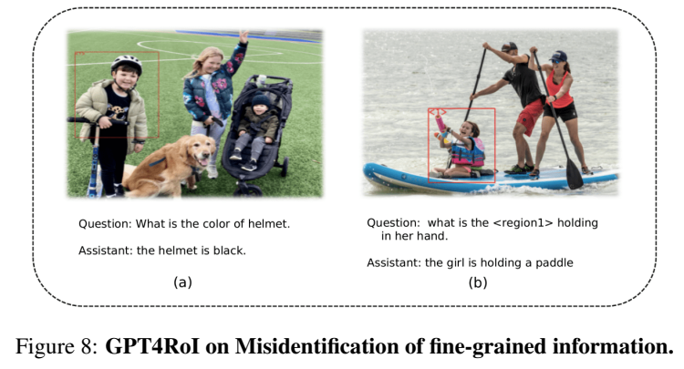

<!-- article-header:start -->
[项目首页](../../../README.md) › [模型系列](../../../reports/model-family-index.md) › [GPT4RoI](../README.md)
<!-- article-header:end -->

# GPT4RoI：用框选区域的视觉特征执行空间指令

<!-- article-toc:start -->
<a id="article-toc"></a>

**本篇目录** · [论文定位](#paper-info) · [快速概览](#overview) · [整体架构](#architecture) · [核心原理](#principles) · [数据构建](#data) · [训练流程](#training) · [实验结果](#experiments)
<!-- article-toc:end -->

<a id="paper-info"></a>

## 1. 论文信息与模型定位

| 项目 | 信息 |
|---|---|
| 原文 | *GPT4RoI: Instruction Tuning Large Language Model on Region-of-Interest* |
| 作者与机构 | Shilong Zhang、Peize Sun、Shoufa Chen 等；香港大学与上海人工智能实验室，前三位共同一作 |
| 本文依据 | [arXiv:2307.03601v1](https://arxiv.org/pdf/2307.03601v1)，2023-07-07，含补充材料 |
| 官方项目 | [GPT4RoI 仓库](https://github.com/jshilong/GPT4RoI) |
| 基础 | CLIP ViT-H/14，Vicuna-7B，加载 LLaVA 第一阶段的预训练权重 |
| 定位 | 根据用户指定框，对单个或多个区域描述、比较和推理，输出文本 |

名称中的GPT4不是使用GPT4作为语言主干。GPT4RoI使用开源Vicuna-7B，核心是region-text空间指令微调。它可以接受明确的区域引用，减少“左边那个人”一类语言指代的歧义，但论文的主要证据是定性演示，没有系统定量benchmark成绩。

<a id="overview"></a>

## 2. 快速概览

普通图文模型通常把整图特征和问题拼接，若用户想问一个小区域，就需要靠文字表达位置。GPT4RoI把框当作空间输入，在`<region>`位置放入从该框提取的特征；区域引用可以和自然语言任意交错，允许多框比较、关系询问与追问。

| 要点 | 实现 |
|---|---|
| 全局信息 | CLIP倒数第二层特征，经单线性projector给LLM |
| 局部信息 | CLIP四层特征构成金字塔，坐标信息+scale shuffle+RoIAlign |
| 区域引用 | 特征替换特殊占位符，普通字符串region编号保留用于输出引用 |
| 训练 | 先只学区域提取器，再冻结视觉骨干、训练区域模块/projector/LLM |
| 数据 | 短类别/属性对齐后，学习较长caption、VCR推理与LLaVA对话 |
| 边界 | 支持语言和框输入；未展示像素mask输出或点/涂鸦输入能力 |

<a id="architecture"></a>

## 3. 整体架构

模型有视觉编码器、整图projector、区域特征提取器与LLM。CLIP骨干四个抽取层是倒数第2、5、8、11层，在各层加入feature coordinates，再以轻量scale shuffle增强跨层信息。所有四层都参与RoIAlign，输出14×14区域特征，融合成空间指令的表示。14×14是中间RoI特征网格，不应直接写成每框固定占用196个LLM token；正文说融合成single embedding，并未详列最终所有张量变换。



*原文Figure3，PDF第5页，图表区域裁切。彩色框对应不同区域，彩色embedding插入语言序列。caption特意说明整图特征也参与输入，只是为了简洁没有画在图中。*

每个问题都加包含`<image>`的前缀，转换embedding时用整图特征替换该位置；框对应的`<region>`则由局部视觉特征替换。局部属性依靠RoI，场景和对象关系还可从整图获得背景。用户可以手动框选，外部检测器也能提供框；模型本体不以预测新框为主要输出任务。

第3.2节的文字例子把原`region3`转换成`region2`，但没有说明重编号规则。可确认机制是“保留普通文本区域名并替换视觉占位符”，不能从这一例子推出会自动交换区域身份。正确使用需要保持用户编号、框与插入特征一一对应。

| 模块 | 输入与输出 | 公开机制 |
|---|---|---|
| CLIP ViT-H/14 与整图 projector | 图像 → 全局 LM 视觉序列 | 倒数第二层作为全图特征，单线性投影对齐 Vicuna-7B |
| 多层金字塔与 scale shuffle | 倒数 2/5/8/11 层 → 含坐标的多层特征 | 每层加入 feature coordinates，再轻量跨尺度处理 |
| RoIAlign 与融合 | 用户框及四层特征 → 区域 embedding | 四层均采样为 14×14，再融合为区域表示；并非直接插入 196 个 LM token |
| 空间占位替换 | image/region 标记 → 全图和对应 RoI 表征 | 保留普通 region 名称供文字引用，视觉占位在 embedding 阶段替换 |
| Vicuna-7B | 全图、多个区域与问题 → 区域描述/推理 | 第一阶段只训练区域提取器，第二阶段冻结视觉编码器、更新接口及 LM |


<a id="principles"></a>

## 4. 核心创新与数学原理

### 4.1 多深度局部特征作为可引用的语义输入

框坐标决定在哪里采样，RoI 特征决定该位置是什么。四层金字塔让区域表示同时获得不同深度信息，坐标加入和 scale shuffle 保持其空间与尺度联系；最后融合为语言可用 embedding。该过程读取已有框，不承担定位新框的主要任务，因此与“输出框坐标”的 grounding 模型方向不同。[原文 §3.1，PDF 第 4–5 页](https://arxiv.org/pdf/2307.03601v1#page=5)

**空间指令不是坐标的纯文本编码。** 给定框$`b`$及四级特征$`F_\ell`$，可用下式解释第3节的模块关系：

```math
r_b=\mathrm{Fuse}\big(\mathrm{RoIAlign}(\mathrm{Shuffle}(F_\ell,C_\ell),b;14,14)\big)_{\ell=1}^4.
```

$`C_\ell`$表示坐标信息。此式是本文说明记号，原文没有编号数学公式，也没有给Fuse/Shuffle的所有具体算子与参数。它表达的是保留不同深度视觉信息、对齐到用户的连续坐标区域、再融合进语言空间。

RoIAlign 采用连续位置插值；标准双线性采样可写为：

```math
F(x,y)=\sum_{i,j}F(i,j)\max(0,1-\vert x-i\vert )\max(0,1-\vert y-j\vert )
```

实际只有邻近四个格点有非零贡献。这是标准定义解释，不是作者提出的新公式。相比离散取整框，它能减少坐标量化误差；但不能恢复视觉骨干输入时已经丢失的小字、小物体细节。

### 4.2 占位替换保留多区域比较与全局上下文

普通区域名称留在词序列中，视觉占位替换为对应区域特征，使回答仍能用 region 名称指代对象。每个问题还加入整图前缀，避免只看局部后失去场景关系。多框比较因此可在一次语言上下文内完成；编号与框的对齐若出错，语言格式正确也无法挽救语义引用。[原文 §3.2、Figure 3，PDF 第 5 页](https://arxiv.org/pdf/2307.03601v1#page=5)

插入到LLM后，区域embedding与文本共同参加自回归上下文。对多框问题，语言模型能同时访问不同局部及全局信息，而不用先为每个框单独生成caption后再让文本模型比较。因此它是一种训练过的语义融合，而非把现成检测结果简单粘成提示词。

### 4.3 从短区域属性到复杂关系的分阶段适配

第一阶段以类别、颜色、位置等短表达，只训练新增区域提取器，固定既有图像接口和语言能力；第二阶段再更新区域提取器、整图 projector 和 LM，用关系、动作及常识监督学习组合。回答掩码让问题与视觉输入提供条件而不被当作目标复述，两个阶段均属于监督学习。[原文 §4、§4.1–4.2，PDF 第 5–7 页](https://arxiv.org/pdf/2307.03601v1#page=7)

语言损失只监督回答和停止字符串`###`。按第4节描述整理为：

```math
\mathcal L=-\sum_t m_t\log p_\theta(y_t\mid y_{\lt t},I,\{r_b\}),\qquad m_t=\mathbf1[t\text{ 位于回答或停止串}].
```

这是标准next-token损失的解释式。问题和视觉占位符是条件，未作为全部待预测文本算损失。第二阶段仍为监督微调，原文没有强化学习、DPO或显式区域对比损失，不能由“推理能力”反推其使用RL。

<a id="data"></a>

## 5. 数据构建与处理

第一阶段用COCO检测、RefCOCO、RefCOCO+，把框对应的类别或短属性表达转为对话。文本通常在5词以内；检测任务先说明期望回答类别，再串多个`region→category`，指代数据要求回答属性和相对位置。这样先让新增区域表示进入已有语言空间，避免简单类别训练直接改写整个LLM。

第二阶段，VisualGenome和RefCOCOg用于单区域caption，Flickr30K Entities转为多区域caption，生成的描述要覆盖被多个框强调的视觉元素。单框和多框caption各准备20种问法，训练时随机抽一种。数量指**问题模板**，不等于有20个独立人类标注版本。



*原文Table3，PDF第7页。上部为单/多区域描述，下部为单/多区域推理及追问；红色部分是监督目标。这里是训练样例，不能当成模型在未见样本上的准确率证据。*

VCR含290K选择题、110K电影场景。论文保留正确答案与解释，把解释改成第二轮“为什么”问答；每段对话先列出区域引用，答案中的视觉占位符改成“类别 at region编号”的普通文本。附录给30种解释追问模板。它的语义推理来自既有VCR标注转写，不是对所有电影事件做新的人类因果验证。

LLaVA150K指令数据用EVA-02 LVIS检测器每图取最多100框，在问题中附上“此region可能含某类别”的声明，再进行对话训练。检测器提供的类名与框是自动增强，可能带噪声；最多100是这条数据处理的上限，不是实验已证明模型对100个区域都稳定推理。原文未给最终各数据集采样比例、去重和训练区域对总量，因此不凭原数据集规模估计模型实际训练样本数。

<a id="training"></a>

## 6. 训练流程与目标

| 阶段 | 初始化与更新范围 | 已披露配置 |
|---|---|---|
| 区域预训练 |加载LLaVA第一阶段；仅region extractor训练，视觉骨干、整图projector、LLM冻结|LR4e-5，cosine，batch16，2epochs，WD0|
| 空间指令微调 |继续前阶段；只冻结视觉encoder，更新region extractor、image projector及Vicuna|LR2e-5，2epochs，PyTorchFSDP|

附录A.1说使用8张每张80GB的GPU，但未列具体型号。输入图像224×224，视觉骨干冻结仍可为区域模块提供预计算特征和梯度条件；“end-to-end fine-tuning”在此不意味着视觉encoder也解冻。

warmup同时写“3000 iterations”和“ratio .003”，两项如何取舍未解释；因此本文不擅自选一个当唯一正确设置。batch16出现在第一阶段句子中，第二阶段只明确学习率与epoch，不能声称其所有配置必然相同。optimizer类型、精确混合精度、最长语言序列和训练时长未在所读v1详列。FSDP用于7B模型及可训练模块的显存分片，不是MoE机制。

<a id="experiments"></a>

## 7. 实验设置与主要结果

第5节标题是Demonstrations，展示单区域与多区域图文问答。例子包括描述拿伞男孩的动作、比较跑步人物、辨认应呼叫的服务人员，以及解释区域之间的行为关系。它们说明新接口能生成相关回答，但原文**没有CIDEr、VQA准确率、VCR test准确率、对照消融或速度统计**。不能引用后续GLaMM报告中的GPT4RoI 145.2等分数冒充本篇自行报告的结果。





*原文Figure7、Figure8，PDF第11页。上面“找全部打斗者”“分别描述多区域”的回答没有按要求完整处理；下面头盔颜色和女孩手持物识别错。图中不仅有成功示例，也明确呈现失败。*

附录A.5指出两类关键问题。第一，训练指令主要由规则生成且caption占比较高，当用户换句式，模型可能把筛选/比较任务误解成描述；含“respectively”的分别回答要求不在训练模板覆盖内，示例只给了一个人。第二，局部细节容易被区域最显著的特征主导：头盔颜色错、女孩手中的物体被误说成桨，说明框选并不保证细粒度辨识正确。

第6节进一步承认224分辨率限制小区域理解，提高分辨率又增加全局ViT计算成本；区域-text数据比整图-text少，复杂多框指令覆盖不足。点、涂鸦、以图搜图式交互列为未来方向。因此可核实结论是“建立区域特征与语言的可训练接口，并提供早期能力/失败演示”，而不是已用大规模受控评测证明优于所有同类系统。本文逐图核对原文，未运行模型。

<!-- article-footer:start -->
---

[← 上一篇：Lynx](../../lynx/arxiv-2307.02469/README.md) · [按发表时间浏览](../../../reports/paper-reading-guide.md#year-2023) · [下一篇：SVIT →](../../svit/arxiv-2307.04087/README.md)

[返回本篇目录](#article-toc) · [返回模型系列](../README.md)
<!-- article-footer:end -->
